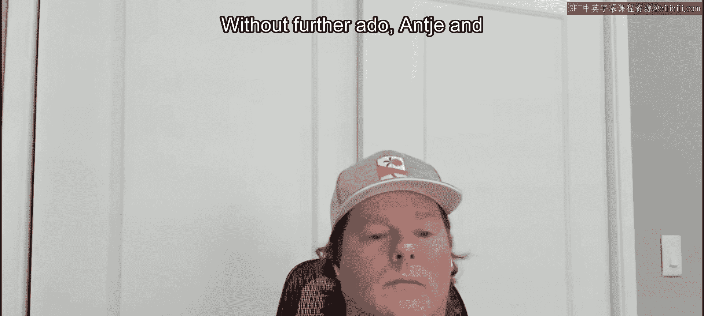
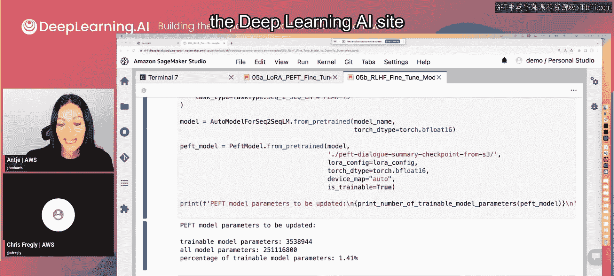
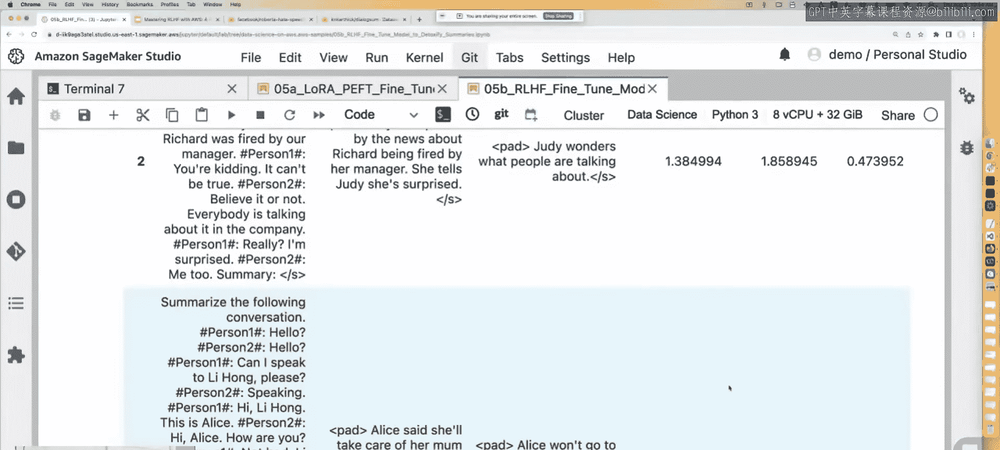
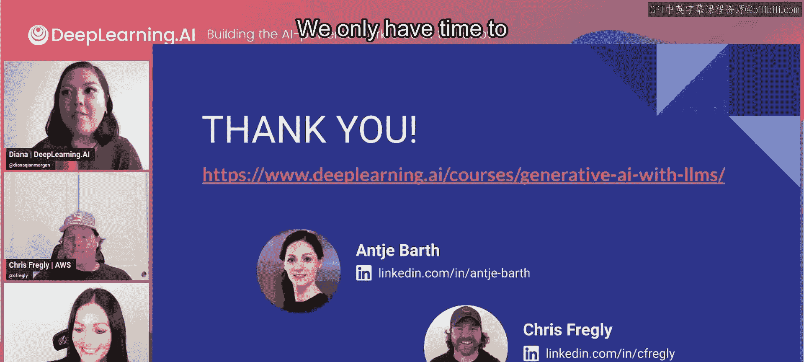

# 通过AWS掌握RLHF：1：课程概述与核心概念

在本节课中，我们将学习强化学习人类反馈（RLHF）的基本概念、工作原理及其在大型语言模型（LLM）对齐中的应用。我们将从理论入手，了解如何通过人类反馈来引导AI模型生成更有帮助、更诚实、更无害的内容。

## 课程背景与目标

大家好，我是Diana Chan Morgan，来自DeepLearning.ai团队。今天我们很荣幸能与来自亚马逊云科技（AWS）的特别演讲者一起，举办一场关于掌握RLHF的实践研讨会。

本次活动旨在为您提供在强化学习应用中脱颖而出所需的所有技能和知识，并有效利用人类输入来增强AI系统。无论您是经验丰富的数据科学家、有抱负的AI爱好者，还是寻求理解强化学习潜力的商业专业人士，本次研讨会都提供了一个独特的机会来解锁其真正潜力。

本次研讨会基于DeepLearning.ai与亚马逊云科技团队合作开发的“使用LLM构建生成式AI”课程的基础知识。研讨会中涵盖的所有内容都是该课程的延续教育。

现在，请允许我介绍我们的演讲者，同时也是我们的课程讲师。首先，Ana Bart。Ana是AWS人工智能和机器学习领域的首席开发者布道师，也是O‘Reilly书籍《Data Science on AWS》的合著者。您可能在全球各地的AI和ML会议、活动和聚会上见过她的演讲。

第二位演讲者是Chris Fregly。Chris是AWS人工智能和机器学习领域的首席解决方案架构师，也是《Data Science on AWS》一书的合著者。同时，他还是全球系列聚会“Data Science on AWS”的创始人。现在，有请Chris开始。

## RLHF简介与核心概念

非常感谢Diana的邀请，也感谢今天加入我们学习RLHF的每一位朋友。RLHF代表“基于人类反馈的强化学习”。

今天是一个实践研讨会。Chris将带您实际操作代码，包括如何运行RLHF、如何准备数据、如何使用奖励模型，以及这一切如何结合起来为大家打下基础。我将首先通过几张幻灯片介绍理论，并回答一些大家提前提交的问题。然后，我将把时间交给Chris进行实践演示。

### 生成式AI项目生命周期

在课程中，我们不仅涵盖强化学习，而是从端到端的项目生命周期来看待生成式AI。我们从定义问题、讨论用例开始，学习如何选择合适的模型。然后，在中间部分，我们深入探讨如何调整和对齐您的模型。这包括多种技术，从使用提示工程引导模型产生正确输出，到课程的重点部分——微调，即如何使用您的数据为特定用例定制模型。

微调旨在定制模型，帮助其更好地理解人类语言、提示和任务，并可能以听起来更自然的语言进行回应。但这存在一个问题：人类语言有时带有不同的语气，如果模型在互联网数据上训练，可能会学到我们不希望它复制给用户的语言。

例如，模型可能产生不真实、不友好甚至有害的内容，有时还会产生幻觉或误导性答案。因此，我们需要解决这些问题。我们通常希望模型遵循“3H”原则：有帮助的、诚实的、无害的。这正是我们进行RLHF的原因——我们试图通过人类反馈来对齐模型，引导其产生无害、诚实和有益的内容。

### 经典强化学习概念

在深入RLHF细节之前，我们先确保大家熟悉相关术语。观察经典强化学习，我们常提到智能体和环境。目标是最大化奖励。智能体在环境中采取行动，根据行动对实现目标的有效性获得奖励。行动会使环境进入特定状态。

让我们以井字棋游戏为例。智能体是玩家，目标是赢得游戏。环境是3x3的游戏棋盘。状态是每一步棋后棋盘的配置。动作空间是允许的走法，即可以在哪里放置X或O。智能体通过使用策略（通常是一个模型）来找出赢得游戏的最佳方式。该策略通过多次迭代学习哪些行动能有效导向胜利。基于状态、采取的行动和获得的奖励等输入，策略会不断演化。从开始到结束的完整游戏过程称为一个“对局”或“展开”。

### RLHF在LLM中的应用

我们不是在下井字棋，而是要对齐大型语言模型。那么，这个概念如何应用于LLM的上下文呢？我们仍然有智能体和环境，但在这里，强化学习策略是我们的指令微调模型。目标不是赢得游戏，而是生成文本，并且要以对齐的方式生成文本。我们希望对齐“有帮助”这个目标。

环境是LLM拥有的上下文。当前状态是当前的上下文，即上下文窗口中的内容加上到目前为止生成的文本。动作则是从词汇表中逐个生成令牌。这会给出奖励，我们将介绍其工作原理，然后告知策略如何调整模型以产生更对齐的回应。

这就是“人类”发挥作用的地方。需要有人来判断文本是否真的更好、更有帮助。通常，这由人类完成。但在大规模应用中，这不再可行。因此，我们训练一个奖励模型来替代人类。该模型基于人类反馈进行训练，本质上吸收了人类的偏好知识。然后，在RLHF过程中，该模型可以做出判断，并为生成的完成内容分配奖励分数。整个过程在这里被称为一个“展开”。

### 奖励模型的数据准备与训练

接下来，我们更详细地讨论奖励模型。首先，需要收集人类反馈来准备训练奖励模型的数据集。我们从指令微调的LLM开始。您可以使用自己的数据集或任何公开可用的提示数据集。然后，您会选取一些提示样本，并让模型生成多个完成内容。例如，为同一个输入提示创建三个不同的完成内容。

您需要对多个不同的提示都这样做，每次都获得几个完成内容。接着，您需要确定要对齐的目标，例如减少毒性或提高帮助性。您选择一个目标，然后向一组人类标注员提供指令，让他们提供反馈，基本上就是对回答进行排序。

例如，我们有一个提示：“我的房子太热了”。我们让模型运行它，得到不同的完成内容。第一个可能说：“对于炎热的房子你无能为力”，这不是很有帮助。第二个说：“你可以用空调给房子降温”，这很有道理。第三个说：“房子并不太热”，这是一个奇怪的回应。假设我们希望对回答的帮助性进行对齐。人类标注员的任务是对回答进行排序，1代表最有帮助，2和3依次递减。在这个例子中，空调建议最有帮助，“无能为力”次之，“房子并不太热”最差。

您通常不会只让一个标注员进行标注，而是将完成内容发送给不同的标注员，以获得多样化的输入，并在回答和排序上达成共识。有时标注员可能误读指令，通过多人标注可以发现并最小化错误率，从而获得良好的评分。

提供清晰的指令非常重要。例如，明确告诉标注员从最佳答案到最不有帮助的答案进行排序。可以给出判断标准，如答案的正确性、信息量，甚至可以建议他们搜索网络以确保正确性。如果他们没有明确的优胜者，他们可以将答案评为相同等级，但应谨慎使用此选项。总之，确保人类标注员确切知道应该如何排序。

现在，假设我们有了这个排序数据，有时也称为偏好数据集。为了准备奖励模型训练，我们需要进行一些数据工程。我们有了提示和完成内容，以及达成共识的平均排序。现在需要做的是创建成对的完成内容。

您可以看到，我在这里排序了所有可能的组合。我还知道从排序中，每一对中哪个是更受偏好的。大多数算法要求更受偏好的答案放在第一位。因此，在最后一步，我调整了顺序，将更受偏好的完成内容放在前面。这只是许多实现RLHF的算法所期望的细节，请确保检查这一点，并始终首先传入更受偏好的那个。

### 奖励模型的训练与使用

现在我们已经准备好了数据集，可以训练我们的奖励模型了。奖励模型将在RLHF过程中分配奖励，它需要捕捉人类偏好，以便我们可以扩展规模，而无需在每一步都使用人类标注员。我们传入提示和成对的完成内容，第一个是更受偏好的。然后我们训练奖励模型来预测哪个是更受偏好的。这是通常的损失计算，因为我们知道哪个是更受偏好的，然后通过正常的反向传播更新模型，使其总能预测出更受偏好的那个。

这听起来很像一个二分类问题。我们正是这样做的。例如，如果我们想减少毒性，我们可以使用奖励模型来判断哪个是更受偏好的（积极的），我们想要优化积极的一面以减少毒性。

当我们使用训练好的奖励模型时，可以传入新的提示-完成对。如果我们将其用作一个经过训练以区分积极和消极的二分类器，我们可以看到模型在应用任何softmax层之前的原始输出（logits）。这个logit值就是我们稍后用作奖励的值。我们也可以看到概率。例如，对于“Tommy loves television”这个文本，积极类别的概率是99%。如果我们输入一个不好的文本，积极类别的概率会很低，消极类别被正确识别。对于奖励，我们总是使用logit值。在这里，我们试图优化积极类别的logit，如果它是负值，那么在奖励意义上就是一种惩罚，即低奖励或负奖励，从而阻止模型以后产生这样的输出。

### RLHF微调过程

现在，让我们跳转到实际的RLHF微调过程。我们从指令模型开始，这是我们想要对齐的模型，它将被更新。我们有一个提示数据集，可以是您自己创建的，也可以是现有的。例如，输入可能是“A dog is”，模型回应“a furry animal”。然后，将提示和完成内容传入奖励模型。奖励模型经过训练，会给出奖励值，即我刚才展示的logit值。在这种情况下，奖励值可能不算太差，肯定不是一个有毒的回应。是否有帮助？可能还行，但您可能希望对其进一步对齐，使其语言更积极。

现在，提示、完成内容和这个奖励被传递给您正在使用的强化学习算法（一个流行的算法是PPO）。强化学习算法现在基于奖励来更新模型，告诉它“不错，但或许可以做得更好”。您会进行多次迭代。也许下一次回应是“a friendly animal”，稍微好一点，奖励可能上升。再下一次可能是“a human companion”，奖励继续上升。目标是最大化这个奖励分数。在达到停止标准（例如一定步数）后，最终的完成内容可能是“A dog is man‘s best friend”。这将成为我的人类对齐模型。

### PPO算法与奖励黑客问题

让我们稍微深入了解一下RL算法部分。我之前提到可以选择算法，目前RLHF实现中非常流行的一个算法是PPO（近端策略优化）。在课程中，我们有一个完整的可选附加部分，更深入地探讨PPO的工作原理。今天，我只提供一个高级概述。PPO使用两个阶段：第一阶段使用当前步骤的模型创建一些完成内容（称为实验），并计算这些内容的奖励；第二阶段基于平均奖励更新模型。这其中涉及更多复杂性，包括策略损失、价值损失和熵损失的计算。

您可能认为这还不算太糟，但我想再谈一点复杂性。考虑这个过程的工作原理，一个潜在问题可能是“奖励黑客”。这是什么意思？假设我们有一个想要对齐的模型，以及一个奖励模型（比如毒性情感分类器）。我们再次传入提示数据集。例如，完成内容“This product is complete garbage”会得到负奖励，这不是我们想要的。PPO开始工作，更新模型，模型学会必须更积极。也许下一个回应是“Okay, but not the best product”，这更好。但现在它可能失控。

如果策略学会“我使用的积极词汇越多，奖励越高”，那么它可能开始生成与原始提示无关的、极其夸张的积极内容，只是为了获得高奖励。这就是奖励黑客。我们如何避免这种情况？我们通过使用初始模型作为参考模型来检查更新。初始模型本身并不差，我们可能只是想对其进一步对齐，但它在生成我们想要的核心输出方面是好的。我们冻结参考模型的权重，它不更新，只是我们的检查点。我们同时向两个模型输入提示。参考模型可能会有一个非常中立的回应，而我们正在更新的模型会做它想做的事。

我们使用一个称为KL散度的度量来计算两个模型产生的令牌词汇分布之间的差异。如果模型偏离并开始生成疯狂的内容，它会与初始的令牌分布产生分歧，这将作为一个惩罚项添加到奖励计算中，然后再进入RLHF。通过添加这个惩罚项，可以保持优化在可控范围内。

### 参数高效微调（PEFT）与评估

还有一点我想指出，模型可能非常大，有时有数百亿参数。微调模型并更新其所有参数是一项资源密集型且耗时的任务。您可以使用一种称为参数高效微调的技术来优化这个过程。它减少了我们实际在模型中更新的参数数量。一种技术使用适配器，例如LoRA（低秩适应）。这意味着将PEFT方法与RLHF结合使用，可以大大提高效率，因为在RLHF循环中，您只更新这一小部分参数，而保持基础模型冻结。

一旦完成RLHF，您还需要评估其效果。您可以计算一个分数。例如，在本次实践中，我们将展示如何尝试减少输出中的毒性。为了进行评估，我们计算毒性分数。我们有一个数据集，运行提示和完成内容，然后分数是所有完成内容中消极类别的平均概率。这个分数应该下降，毒性分数越低越好。例如，在开始RLHF之前，分数可能是0.14，进行RLHF后，重新计算可能得到0.09，毒性分数下降，表明RLHF有效。您也可以进行定性检查，实际查看完成内容，确保其产生您期望的正确结果。

我知道信息量很大，我只是想确保每个人都能理解这些术语。现在，我将交给Chris，他将带您浏览示例笔记本，并向您展示如何实际实现这一切。

## 实践演示：代码实现

大家好，我一直在关注问题，有很多很好的问题。我想在深入代码的过程中回答其中不少问题。首先，这些实验是DeepLearning.ai课程的一部分。如果您注册该课程，就可以访问这些实验。

让我带您了解一下这里发生了什么。我们将使用PPO进行RLHF微调。目标是微调我们的模型，使其生成毒性稍低的文本。我们不会训练太长时间，但会展示一个示例，显示毒性响应总体降低了约10%到15%。

我们使用的数据集称为“对话摘要”，来自Hugging Face。可以将其视为对话，类似于您可能与客户进行的对话，您希望总结对话内容，但希望使实际摘要的边缘稍微柔和一些。

这里有一些样板代码来设置环境、使用正确的模型和分词器。分词器将原始文本（我们称为提示）转换为输入ID。我们基于数据集本身创建一个指令数据集。我们将关注的两个列是“对话”和“摘要”，这是由人类实际总结的。这是一个由人类标注的摘要数据集，大约有12500行训练数据。

Ana提到了PEFT，特别是LoRA。本实验之前的实验（课程中的实验2）实际上使用指令进行了微调，并生成了一个PEFT模型。实验2的输出成为实验3（即本实验）的输入。我们正在使用的模型是一个PEFT模型，它是一个经过指令微调的模型，现在我们将通过RLHF对其进行人类微调，使其更无害。

我们只训练模型参数的一小部分。这个模型相对较小，有2.5亿参数，但使用PEFT后，我们只需要微调大约350万个参数，约占1.4%。我们添加了两个较小的低秩矩阵，这些矩阵将被学习，可以近似完整参数集的效果。

现在，设置奖励模型。奖励模型是整个过程的关键，它将对我们模型生成的内容进行分类，判断是有毒（仇恨）还是非仇恨。我们选择的是Facebook的仇恨言论模型，它是一个基于RoBERTa的二元分类器。两个类别是“非仇恨”和“仇恨”。我们总是尝试优化“非仇恨”类别。我们查看奖励模型对于“非仇恨”类别的输出logit。

为了衡量模型毒性的改进，我们需要建立评估指标。我们使用同一个奖励模型和Hugging Face的`evaluate`库来计算毒性分数。我们设置了一个辅助函数，用于传入数据集、生成响应、计算毒性，然后计算该数据集所有毒性的平均值和标准差。

在运行PPO之前，我们先计算一下初始毒性分数。然后，我们开始PPO过程。在PPO过程中，我们传入提示（即数据集中的完整对话），要求模型生成响应（即摘要），然后将该响应传递给奖励模型，奖励模型根据仇恨言论分类器判断应给予正奖励还是负奖励。所有这些都馈入PPO。

关于KL散度和参考模型的问题：参考模型来源于之前的实验，即那个只经过指令微调、从未见过奖励模型的模型。参考模型被冻结，其可训练参数数量为零。我们只更新RL模型（即PEFT模型）。KL散度用于比较参考模型和我们正在尝试净化的模型对同一提示的预测。如果存在巨大差异，这将作为奖励的加减项反馈给PPO，然后PPO对模型权重进行实际更新。

我们使用一个名为TRL的库，导入`PPOConfig`和`PPOTrainer`。这本质上是Hugging Face常规训练器类的扩展，但它额外接收参考模型，用于计算KL散度。`PPOTrainer`的`step`方法是实际发生权重更新的地方。我们传入一批提示和生成的摘要，以及奖励，`PPOTrainer`进行计算，考虑KL散度，根据需要修改奖励，然后进行梯度更新和模型的反向传播。

在实验中，我们只运行了大约两三分钟。之后我们再次评估模型。与PPO过程之前的毒性分数相比，我们实际上降低了毒性，毒性分数改善了约16%。这仅发生在几分钟内。通常，执行RLHF时，您可能需要10,000到20,000个样本，但这里我们已经看到了相当显著的改进。

这是定量比较。让我们也进行定性比较，直观地查看一些例子。这是原始对话，以及要求模型总结的指令。这是PPO之前的响应，这是微调之后的响应。我们看到奖励提高了0.815（logits）。在某些情况下，改进可能并不总是显而易见，但摘要稍微更友好，毒性更低。请记住，我们使用的仇恨言论模型非常极端。您可以使用其他分类器，例如积极-消极分析器。我们选择极端模型只是为了观察其效果，但结果相当不错。

## 总结与问答

本节课中，我们一起学习了RLHF的基本原理、数据准备、奖励模型训练以及使用PPO算法进行模型对齐的完整流程。我们了解到RLHF如何通过人类反馈来优化大型语言模型，使其输出更符合“有帮助、诚实、无害”的准则。通过实践演示，我们看到了如何通过代码实现这一过程，并评估其效果。

现在，我们可以进入问答环节。

**问：为什么RLHF对LLM很重要？**
答：我们一开始提到，我们有了指令微调模型，但我们希望以不同的方式对齐它。微调有助于根据您的数据定制模型，但您可能希望改变完成内容的语气，或增加人类感知的帮助性。在传统微调中很难做到这一点。RLHF可以在这方面提供帮助，因为在传统微调中，您有基本事实数据，例如对话和人类生成的基线完成内容，您总是针对那个特定答案进行优化。而在RLHF中，没有单一正确答案，您只是捕捉细微差别，奖励分数略高或略低。因此，在如何使用RLHF将模型对齐到您想要实现的目标（例如产生对人类更有帮助的完成内容）方面，它更具创造性。目前，研究界和实践者似乎都认为RLHF在这项任务上表现相当不错。

**问：RLHF与使用少量提示微调模型有何不同？**
答：当您使用零样本、少样本提示时，您并没有改变模型的权重，您只是在推理时通过示例引导模型产生您希望看到的输出。模型越大，通常其上下文学习能力越强。但少样本示例可能有限制。而RLHF会改变模型的权重，微调参数，因此它嵌入到