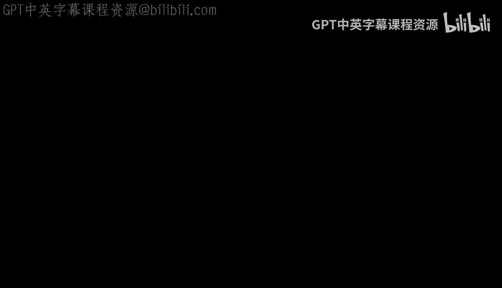

# 吴恩达《Pytorch深度学习（4模块全）｜PyTorch for Deep Learning》中英字幕 p01 1.conversation-between-laurence-moroney-and-andrew-ng.zh_en -BV1S7yhB7EUQ_p1-

Welcome to PyTch fundamentalamentals， the first course and the PyTch for Deep Learning Professional Ctific。

😊，Pytorch has become one of the most widely used frameworks in AI and is a tool that researchers rely on engineers build with and students and professionals everywhere want to learn。

 In fact， a large part of the recent generative AI revolution is powered by hightorch。

 But the path to learning it isn't always clear that tutorials everywhere it can be hard to know was relevant and what's high quality when you're just starting out that's how put together this clear structured path for learning Pytorch you started the fundamentals and build up to more advanced architectures step by step。

 and I'm excited to introduce Lawrence Mori whose courses and books have helped most of people get started with AI and deep learning。

 Lawrence we working with Pytorch extensively for many years and seen how it's changing the way we build models。

 So Lawrence， what got you said about teaching Pytorch。

 I think one of the things that when I first really started looking at Pytorrch is that remember way back you and I we did some Tensorflow specializations in Tensorflow。

😊，And one of the most beloved ones was we did something called the Kaas functional API。

 And what the Koss functional API did was it changed everything for me in that you weren't designing your models to be linear。

 you could start thinking about more exotic models with like like Siese networks and skip level and stuff like that。

 and when I started then looking into Pytorch Pytorch just did that natively how you design your network and how you design your forward pass in code。

 it just made it simple and it was like the default experience rather than an addon experience and that got me really。

 really excited about like wow， I can start really building much more advanced models much more simply。

 That's what I love about this first course is that we're gonna start building right away。

 We're going just look at our first Pytorrch model we' write the code will run it。

 well watch it learn from data But by the end， we'll actually have an image classifier that can label like objects in an image One things that Kes did well back then and now Pytorch is let you put together building blocks that could more easily。

Be put together to four more complex architectures。

 I just really excited about that how we can just help learners on that journey to go from zero all the way up to the most advanced architectures by that blockbased approach that you mentioned。

 I know a lot of us pro launch models unless you get a done。 But beyond a certain point。

 a lot of my teams do very advanced things with cutting models be fine to cutting genetic AI models to tu very high performance on visual AI models。

 So I think in today's world with a lot of work going on inI this is simply important skill set。

 I also want to help you to understand that even if you're just getting started on your journey by starting with code by starting with understanding the fundamentals and using a powerful framework like pietorch。

 It's really setting you up for success in this world。

 One other thing that I find delightful about pieytorch is。

The ease of use actually makes it more fun because when you're playing around download the open source Pytage package。

 the relative ease with which you could get the transformformers library from Huging phase and fine tune them。

 It actually makes it more fun。 So in addition to， you know finding jobs。

 which is absolutely important， I find that the speed also just makes this work more enjoyable。

 absolutelysute agree。 And I think that ease of use， not just for building。

 but also like when things go wrong to be able to find and fix problems and debug them， you know。

 allows you to be more successful quickly。 So with this professional certificate started the first course on the fundamentals。

 but eventually going up to the professional certificate。

 I think it'll make learners much more job ready。 I hope you enjoy learning piey toage。

 Let's go into the next video and get started。😊。

