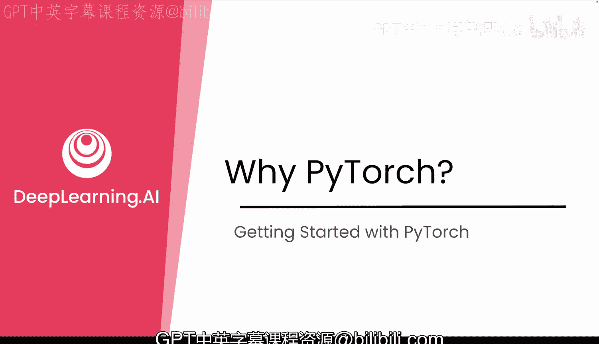
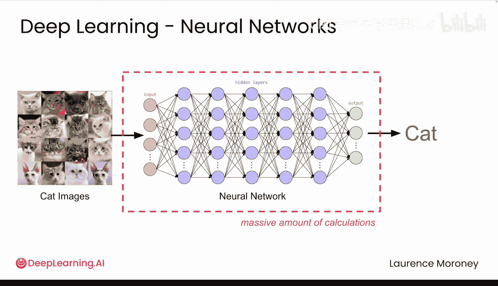
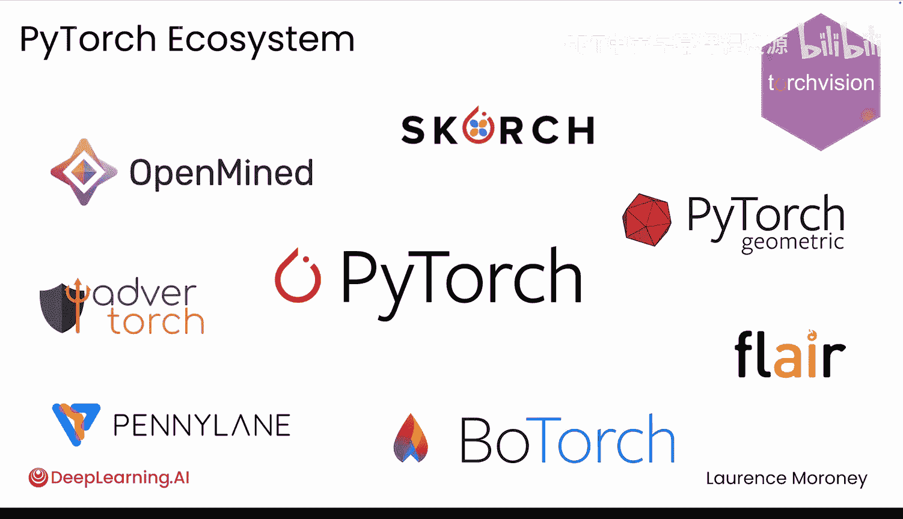
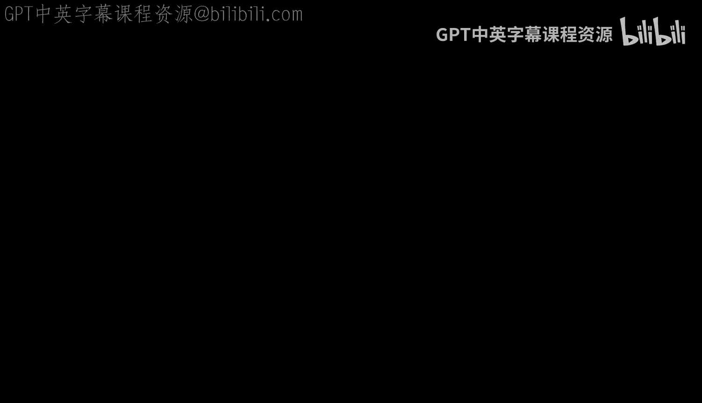

# 吴恩达《Pytorch深度学习（4模块全）｜PyTorch for Deep Learning》中英字幕 p02 2.why-pytorch.zh_en -BV1S7yhB7EUQ_p2-

Welcome to module 1 of Pytorch fundamentals。 Over the next few videos。

 you're going to build your first models with Pytorch。 Now， I'm guessing you're here for a reason。

 Maybe it's because Pytorch powers cutting edge AI research。

 or maybe your employers are asking for it， or perhaps you've heard it's the easiest way to build deep learning models。

 All great reasons。 But let me show you what really makes Pytorch special using an example。 Now。

 let's say I want to add two numbers and see the results。 in Pytorch， here's the entire code。 Now。

 if you haven't seen tensors before， don't worry about it。

 they're just Pytorrch's way of storing numbers。 And I'll explain more about them soon。 For now。

 just notice how simple this is。 That's it。 It just looks and acts like a regular Python。

 And when you print the results， you'll see the actual value right here。 Now。

 you might be thinking so what， that just looks like normal code。 exactly。 that's the point。 Today。

 deep learning can feel like writing regular Python。 but it wasn't always like this。

 You see machine learning works very differently from traditional programming to make that。😊。

Concrete imagine you're building a recommendation system。

 Now this is code that suggests products to customers in traditional programming， you'd write rules。

 if the customer buys a camera， let's recommend some lenses。

 but what if it was a gift and what if your friend already had five lenses you might need thousands and thousands and thousands of rules for every single exception and you'd probably still miss something Now this is where traditional programming can hit a wall in traditional programming。

 you would write these rules to transform inputs to outputs but in machine learning。

 you give the system examples of inputs and outputs and it will learn the rules for you deep learning takes this further using neural networks give them customer histories and they'll learn what people tend to buy show them cat photos and they'll learn what makes a cat a cat but here's the catch and here's why early tools were so complicated to learn from thousands or perhaps even millions of examples。

 neural networks have to do a massive amount of math every single example that you show it every cat photo every purchase。

requiresquires so many calculations across the entire network。

 and this can happen over and over and over， building up to millions of calculations as the network slowly learns the patterns。

 The early frameworks were so focused on handling all of that computational power that even the simplest things could become absurdly complex。

 Let's go back to wanting to add two numbers， brace yourself。😊。

Do you want to see the result？ You couldn't just print it。 You get something cryptic like this。

 But why did deep learning tools work this way。 Well， the early frameworks made a deliberate choice。

 They use something called a static computational graph。 It's a bit like a factory assembly line。

 You had to define every step ahead of time in order。

 And then you compile it and start running data through it。 You made a mistake。

 You want to experiment。 You forgot one operation， and you need to insert it after step 2。 Well。

 you can't。 The assembly line is already built and running。 You have to stop everything。

 tear it down， redesign it and rebuild it from scratch。 And that's not all。

 You could not test individual parts。 You had to build the entire assembly line before you could run any of it。

 You couldn't use normal Python if statements or loops。 Instead。

 you had to use special operators that were complex and unintuitive。

 And your assembly line could only handle inputs of onefi size。 Now。

 imagine if Python functions only worked with lists。 for example， with exactly three items。

 You couldn't even。😊，Use normal Python debugging when something went wrong。

 the error messages pointed to internal system code and not will you actually made the mistake。

 people could be spending their time fighting their tools rather than doing the actual work so Pytorch emerge from this frustration with one core principle Deep learning should feel like normal python Pytorch introduced a new way to handle computation you just write clean pythonic code and Pytorch takes care of the rest you can use your normal loops if statements you can change anything anytime it all just works and when something breaks the error will point to your code you can stop your program inspect the variables and fix problems just like anything else as pythonic but Pytorch became more than just a tool Today it' back by a massive community researchers sharing code that you can reuse solutions to common problems and constant improvements there's an answer to almost any question that you might have and this mix Python simplicity powerful tools and a thriving community is。

Petorrch has become the go to choice for everyone from students to researchers at the cutting edge of AI。

 and now you're ready to join them， whether you're exploring new ideas。

 growing your career or just getting more comfortable with the framework。

 you're in the right place so let's get started。😊。

