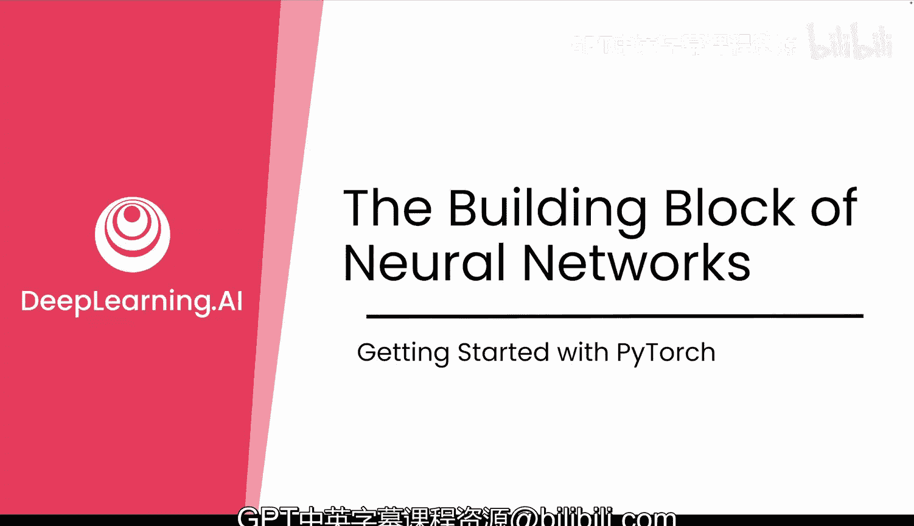
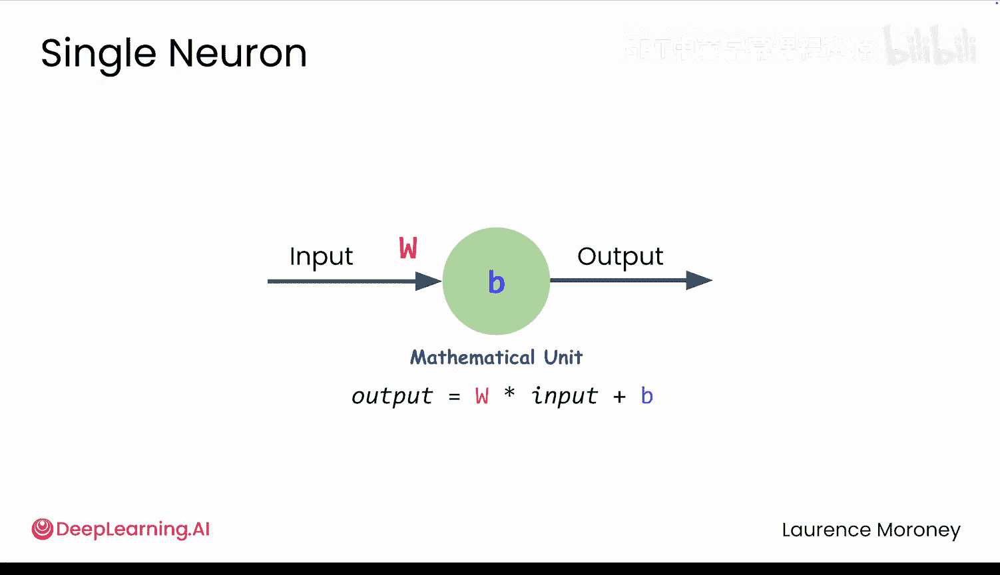
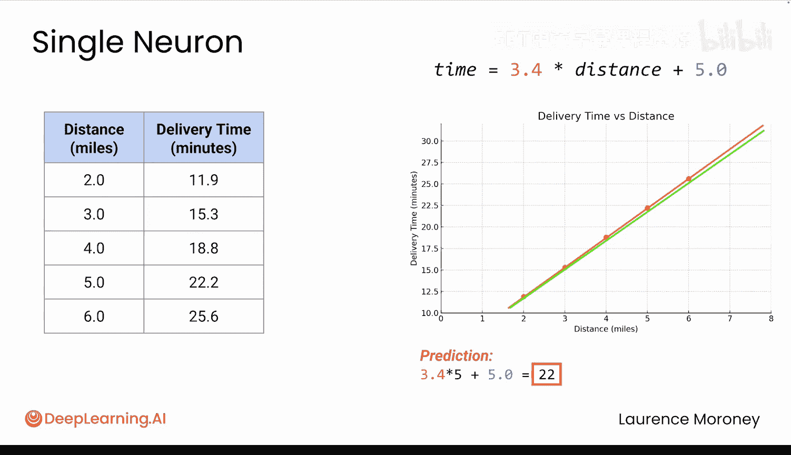
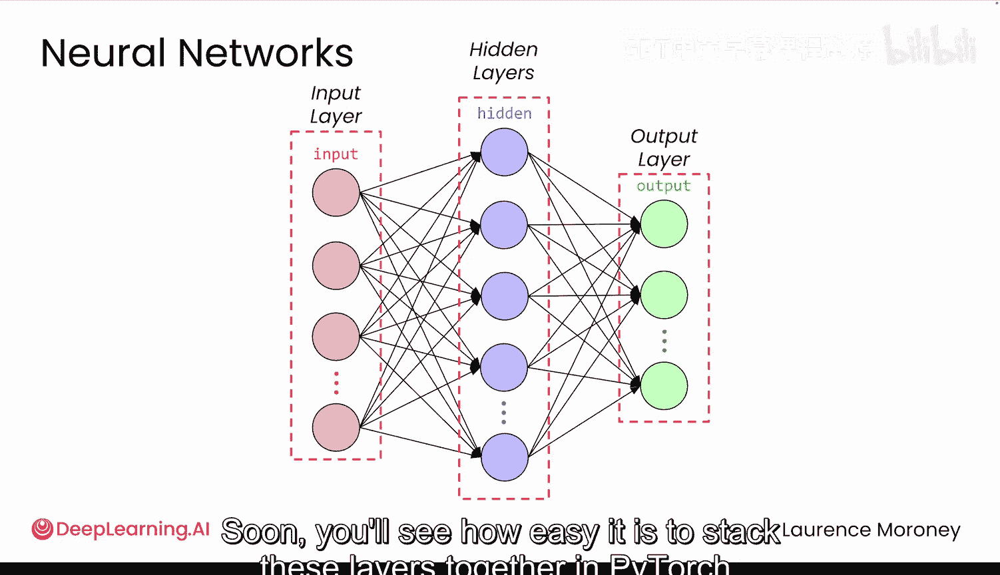

# 吴恩达《Pytorch深度学习（4模块全）｜PyTorch for Deep Learning》中英字幕 p03 3.the-building-blocks-of-neural-networks.zh_en -BV1S7yhB7EUQ_p3-

You've seen how pieytorrch emerged from researchers frustration with complicated tools and why it's become one of the leading frameworks for building neural networks。

 But now it's time to understand what you're actually building。 Let's ground this with a problem。

 One that you're going to revisit later when you train a model to solve it。

 say you work for a local delivery company that promises to get orders to customers within 30 minutes。

 and you may make those deliveryies by bike。 Last month， you were late three times。

 your manager wasn't very happy。 One more late delivery and your job could be at risk。 Now。

 a new order comes in the customer wants something delivered7 miles away。

 Do you take the job can you get there and under 30 minutes。

 If you're already comfortable with the way neurons model linear equations and learn by reducing error。

 you can feel free to skip this video。 but if you're new to this material and you'd like a quick refresher。

 stick around So neural networks are great at solving problems like this。

 if they have the data and you're going to tackle this one using the simplest kind of neural network possible。

 just one neuron And since complex networks are really just。😊。

Many neurons doing the same basic operation， understanding how one neuron works gives you the foundation for all of them。

 And while this is inspired by biology， neurons in this context are just mathematical units。

 They are tools with adjustable parameters that shift to match the patterns in your data。

 It's more intuitive than it sounds。 Let me show you， heres some historical delivery data。

 Can you see an underlying pattern。5 miles took 22。2 minutes。6 miles took 25。6。 Now。

 imagine a customer wants something that's delivered 7 miles away。 Let's plot the data。

 and let's see what's actually happening。 notice how the points follow a straight line。

 A good predictive model for this data would be。 Well， a line。

 if you know the equation for that line， you can then predict new values。

 And here is the key insight。 A single neuron is just a linear equation with two parameters。

 The weight and the bias。 and the math will look like this。

 That's just the equation for straight line。 So all the neuron needs to do is to find the right values for。

😊。

And B to create the best fitting line through all of your data。

 And that search for those best values。 That's the learning in machine learning。

 So the question then becomes， how does a neuron figure out which line is best。

 So let's just start with a rough guess。 we'll start by guessing weight is one and bias is 10。

 So then if I try to predict the delivery time for5 miles I'll get 1 times 5 plus 10 is 15 minutes。

 But in the real data we could see that5 miles took 22。2 minutes。 So I'm off by more than 7 minutes。

 Look like I need a steeper slope， So let's try weight equals 3。4 and bias equals 53。

4 times 5 plus5 is 22 minutes。 And now we're almost a spot on we're just 0。2 minutes off。

 It's a much better fit。 Just like I looked at the error a moment ago And I thought the weight needs to go up and the bias needs to go up and I need to change by slope。

 the neural network makes those same kind of decisions。 But using math instead of intuition。

 It starts with random values for the weight in a bias。😊。

And in pytorrch， these are called your modelss parameters。

 Then it will look at how far off each prediction is from the actual data。

 The further off the points are the bigger the total error。

 the network will then use calculus to figure out which direction to adjust the weight and the bias It's essentially asking if I increase the weight just a little Does the error go up or does it go down。

 and then once it's figured all that out， it will take a small step in the right direction measureasure that error adjust slightly and continually repeat Now it could do this hundreds or maybe even thousands of times。

 but eventually it will find values close to the best possible ones。 And in pytorrch。

 you'll see all of this happen with just a few lines of code then you might be wondering what happens when you start connecting thousands or even millions of these neurons together Does the math get impossibly complex here's a surprising thing It stays linear Each neuron is still doing that same basic calculation Let me show you how a neuron handles multiple inputs。

 Our delivery problem neuron had only。One input distance。

 But what if you wanted to consider multiple factors， say distance time of day and weather。

 a neuron with three inputs will just extend the same pattern。

 It's all still just the linear equation。 It's just more terms being added together。

 Each input gets its own unique weight。 They all add up plus the single bias value。

 And that's really all a neural network is neurons connect to neurons。

 A layer is simply a group of neurons that all take the same inputs when you connect one layer outputs to the next layer inputs。

 you've now built a network。 The first layer can take in your raw data like the distance。

 the time of day and the weather。 The last layer gives your prediction like the delivery time。

 All those layers in between， we call them hidden layers because you never directly set or see their values。

 So， you'll see how easy it is to stack these layers together in pytorrch。 But for now。

 let's just continue with just one neuron。 In the next video。

 you'll see this complete pipeline and how you'll go from raw data to a deployed model。

 It's the systematic process that。

Every Pytorrch project follows after that， you'll build your first neural network and you'll train it on this exact delivery problem。

 just a few lines of Pytorrch code will bring all of these concepts to life， so let's keep going。😊。

