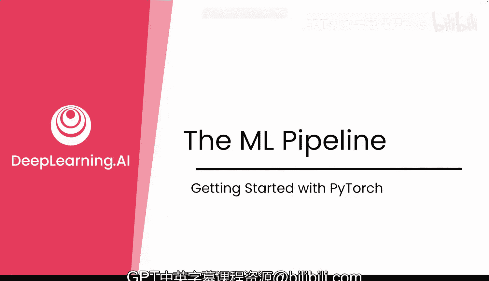
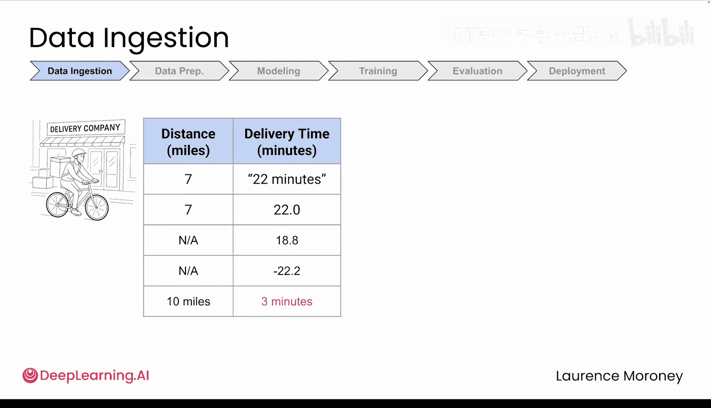
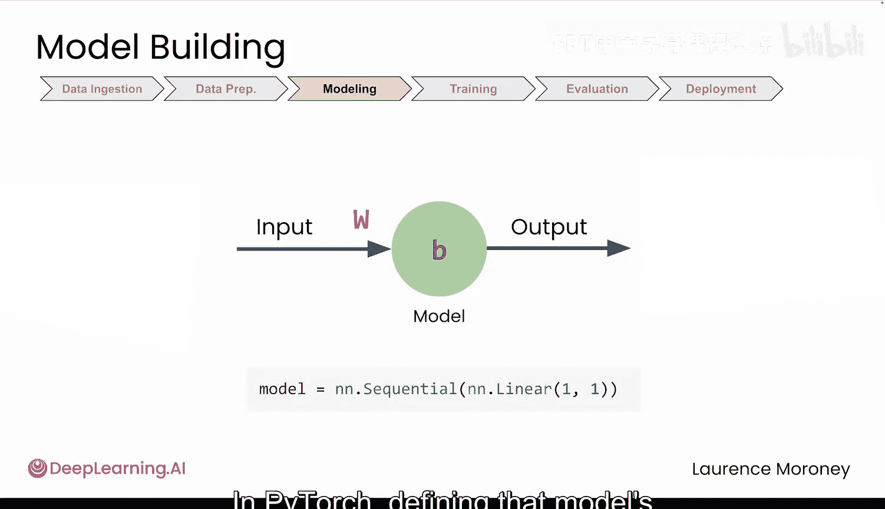
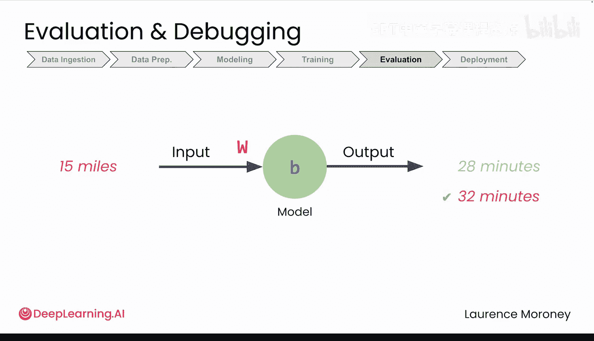
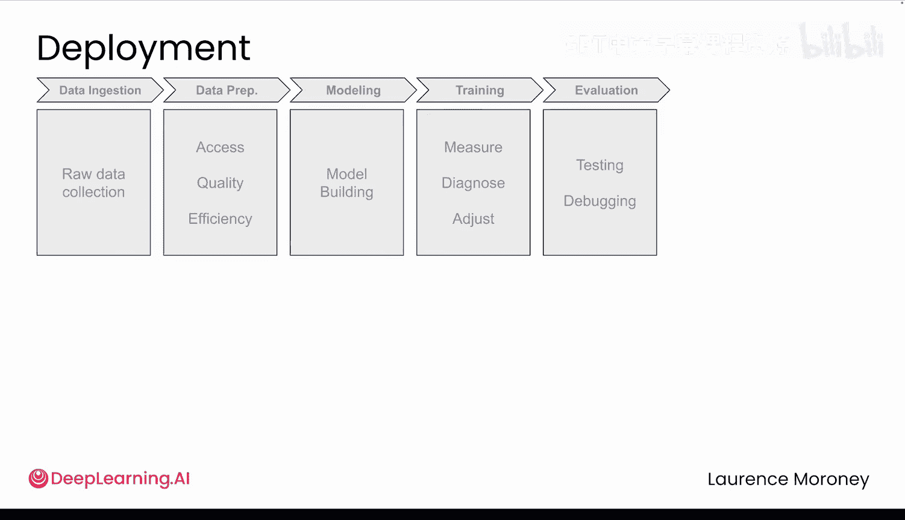

# 吴恩达《Pytorch深度学习（4模块全）｜PyTorch for Deep Learning》中英字幕 p04 4.the-ml-pipeline.zh_en -BV1S7yhB7EUQ_p4-

In the last video， you saw how neural networks learn starting with our delivery time problem。

 where a single neuron found simple linear patterns in historical data。 So in your first pytorch lab。

 you're going to train that model for yourself。 You'll also train on a whole new set of delivery data。

 and then you'll use your model to make predictions for new customer locations that it has never seen before。

 This process using a trained model to make predictions on unseen data is called inference。

 But before we jump into the code。 We also need to have a systematic approach。

 So let me show you the framework that we're going to use throughout this entire professional certificate。

 whether you're training this delivery predictor or whether you're building image classifiers later on。

 Were always going to reference the same underlying structure。 Here are the six stages。

 St1 data ingestion。 It all starts with data before you can train any model。

 you need to gather your raw information and organize it So Pytorch can work with each data point efficiently for the delivery predictor。

😊。

That data will come from the company's delivery records， but here's where things get tricky。

 maybe earlier records listed delivery times as free text entries like 22 minutes while newer ones use numeric values like 22。

0 and there's always issues with things like missing values negative delivery times or records that suggested that you are biking in 200 miles an hour this kind of messy data is the norm and not the exception in your first lab we're gonna to keep things simple you'll start with clean delivery data that's ready to use but understanding these steps now helps you appreciate what goes into realworl projects and you'll take on more of these challenge yourself as we move forward in the later courses of the certificate that brings us to stage2 data preparation getting that data was just the beginning whether you're working with delivery recordsCustom images or email text the next challenge is the same you have to clean transform and organize that data into a form that your model can actually learn from for the delivery data that might mean things like。

ing the errors we spoke about earlier like removing impossible delivery times of duplicate entries。

 It could also mean handling missing values when timests went recorded or engineering new features by converting addresses like12。

3 oak Street into distances like 8。2 miles This stage often takes the most time and the most code in a real project and that's normal Most models don't fail because the math was wrong。

 they fail because the data was messy St 3 model building Now that your data is cleaned and is ready。

 it's time to design the model that's going to learn from it。

 Now whether you're predicting delivery times or classifying images or maybe analyzing text this step is about choosing the right architecture for your problem architecture means structure。

 how many neurons are you going to use how are they connected what types of layers does the model need for your delivery predictor the architecture is as simple as it gets1 neuron that learns the relationship between distance and delivery time in Pytorrch defining that model's architecture takes。

Just a single line of code。 The beautiful thing about Pytorch is that even this simple model will follow the same patterns as much more complex ones that you're going to be tackling later in this course and having a good model design is just the blueprint。

 next you actually have to teach it to make those good predictions and that stage4 training here's where your model starts learning you'll feed in examples like the delivery was 8。

2 miles and took 22 minutes or this one was 12 and half miles and took 31 minutes and the model will gradually start to figure out the pattern in the training stage。

 you'll learn how to configure the key pieces that make this process work how do you measure prediction errors how do you guide the model to approve and how do you control how fast it learns with training settings then you'll run the training loop where Pytorch does the heavy lifting and your model learns from the data but even when training finishes successfully you're not done yet now comes the real test Can your model make a good prediction on new unseen data and that brings us to stage5。

and debugging to know if you have a really good model。

 you need to see how well it performs on new data and this is examples that it wasn't trained on to find out you're going to use a test set and this is a portion of the delivery data that you held back during training So maybe your model predicts 28 minutes for a 15 mile delivery but in reality it took 32 minutes how often is your model close how often is it way off as you move through the course you'll learn how to detect deeper issues and debug models when things go wrong。

 But for now the key question is simple。 Does your model work well enough for you to trust it。

 St6 is deployment and this is the final stage that's getting your model out into the real world for people to use。

 but let's do ourselves a little favor and we'll leave this one out of the pipeline for now we'll pop back in when the time comes now that you've seen the full picture you're ready to dive right in and in the next video you'll see how even our simple delivery model follows these exact stages in Pytor code then in the lab you're going run it yourself and find out whether you should make that delivery。

