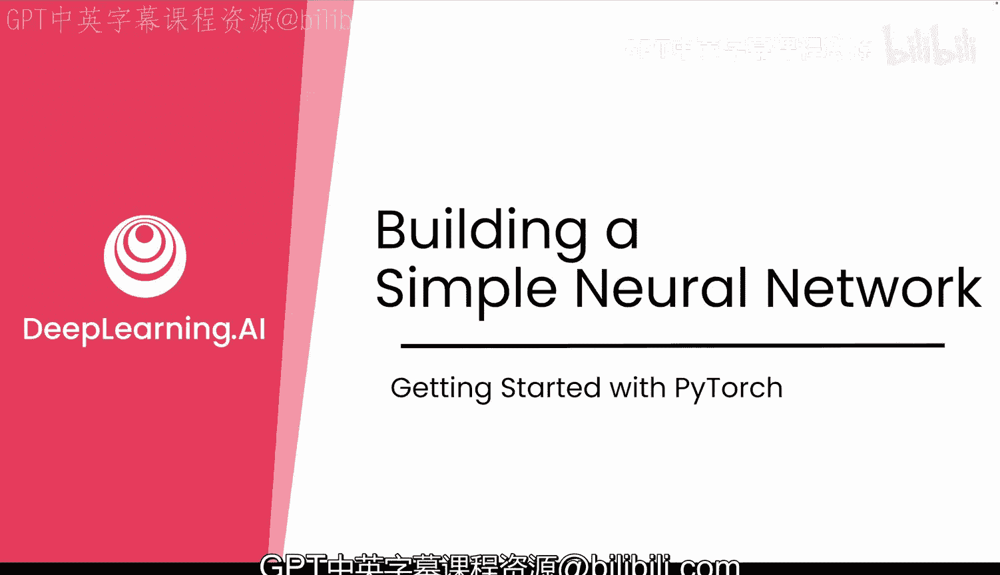
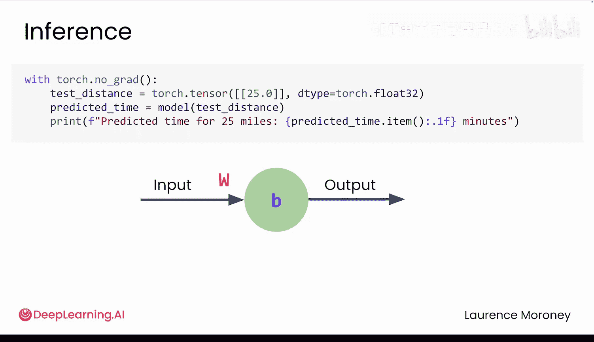
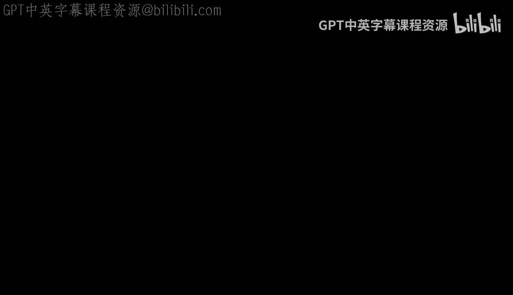

# 吴恩达《Pytorch深度学习（4模块全）｜PyTorch for Deep Learning》中英字幕 p05 5.building-a-simple-neural-network.zh_en -BV1S7yhB7EUQ_p5-

You've seen the machine learning pipeline and you can understand how neural networks learn。

 Now let's take a look at how it all maps to actual pytorch code。 Let's start with the imports。

 These will give you pytorch's core functionality torch components for building neural networks and N and tools for training these networks optim。

 but now let's talk about your data in real projects data ingestion and data preparation are separate steps First you gather messy data and then you clean and formatted。

 But for this example， I've combined those stages and provided data that's already clean and ready for you to use You're creating them from Python lists。

 but they're more than just lists。 Tensors are optimized for the math that neural networks need to do Now you'll learn much more about them later。

 but for right now， just think of them as containers that store and organized data in a way that models understand Now we take a look at how each number is wrapped in its own set of brackets。

 These outer brackets represent a subset of your entire dataset。

A collection of individual data points。 This collection is called a batch。

 Each inner set of brackets is one sample in the batch。 Since you have four delivery records。

 you'll see four samples each wrapped in its own brackets。

 And since each delivery only has one feature distance each sample will just contain one value。

 But remember earlier when I talked about data with multiple inputs like distance time of day or weather。

 and that's where these brackets can become really important each sample might hold several values。

 one for each input feature。 So even if there's just one or maybe hundreds of features。

 these brackets will tell pytorch where one sample ends and the next one begins。 Lastly。

 notice this part where it says D type equals torch dot float 32。

 This tells pytorch what kind of numbers to store。 and in this case。

 it's 32id floating point numbers perfect for the decimal values in our delivery times。

 Now let's create your neural net。😊，Remember those rigid assembly lines from early deep learning frameworks sequential is pytorrch's streamlined version。

 It's a container that passes data through layers in order。

 but makes it easy for you to swap components without all of that messy rewiring here you're only using one layer and this is your single neuron It's technically a linear layer。

 This first one means it takes one input that's going to be our distance。

 This second one means that it produces only one output and that will be our predicted delivery time。

 It applies a linear transformation to the input。 and that's all a linear layer actually does。

 Pytorrch makes all of this easy layers like this are built into the framework and you can create them with just a single line of code。

 This neuron will learn the best weight and the best bias to map our distances to our delivery times just like finding the best fitting line through all of our data points Now your model needs two tools to actually learn The first is the loss function and we're using one called mean squared error loss This will measure how。

Wrong or how right your predictions are。 But if you predict 45 minutes when it actually took 60 that's a bigger error than say predicting 58 minutes the optimizer SGD。

 which stands for stochastic gradient descent is the algorithm that figures out which direction to adjust your weight and bias to reduce that error model parameters is how you access those values in pytorch which in this case is just the weight and bias from your single neuron Lr is the learning rate smaller values mean you adjust your weight and bias parameters by smaller amounts larger values being bigger adjustments both extremes can have their own challenges if you're curious about the math behind loss functions or optimization you'll get a much deeper introduction in module2 you'll also find more in the course resources or you can explore the deep learning specialization for a full deep dive okay this is the training loop where the actual learning happens remember when I manually adjusted the weight and bias to get closer to the right line this code is doing the same thing。

Automatically hundreds of times。 In fact， it will do it for 500 times。

 Each full pass through the training data is called an epoch。 In each epoch。

 the model will one make predictions。2 measure how far off those predictions are。 and three。

 adjust its internal parameters to improve on those predictions。 And here's what each line is doing。

 First， let's look at optimizer dot 0 grad。 You'll hear much more about this method later in the course。

 But for now， just know that it clears out all of the calculated values from the previous training round Without it。

 Pytorrch will accumulate adjustments across rounds， which would mess up all of your learning。

 This line outputs equals model inputs。 tells the model to use the distance as inputs。

 loss equals loss function outputs times compares the predictions to the real times and calculates just how wrong they are。

 Los dot backward figures out how to adjust the weight and bias to reduce that error。

 Just like remember when I said， I need a steeper slope for predicting。😊。

Delivery times it's now done with the calculus behind the scenes。

 The technical term for this process is called backproagation。

 Optimr do step will make all of those adjustments。 Now that the model is trained。

 let's try making a prediction The line with torch do nograd tells pitorrch that you're not training anymore just doing inference training takes extra work under the hood But for inference we can skip all of that and run much more efficiently。

 And if the model learned what it was supposed to it should give you a good answer。

 but you're gonna to have to try it out in the lab to see for yourself and speaking of building that's exactly what's next。

 It's time to get hands on and see if your delivery job is still safe。😊。

