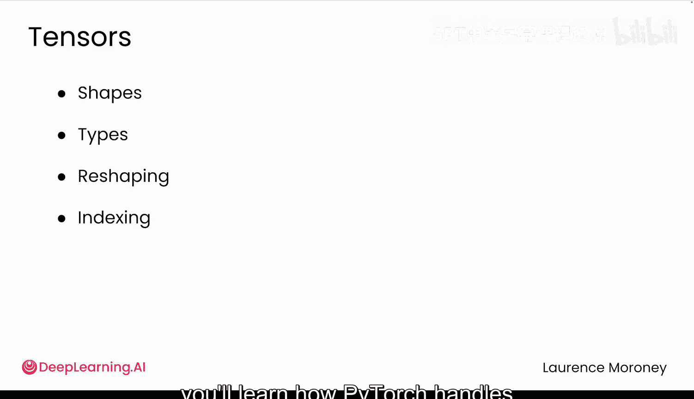
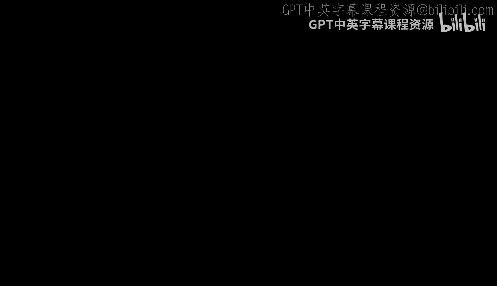

# 吴恩达《Pytorch深度学习（4模块全）｜PyTorch for Deep Learning》中英字幕 p07 7.tensors.zh_en -BV1S7yhB7EUQ_p7-

In the last lab， you trained a model to predict delivery times。 And along the way。

 you've been using tensors。 maybe without thinking too much about them。

 And that's fine until it isn't。 Many pytorrch errors come from tensor issues。

 So let's build up your tensor skills now， before those errors might derail your projects。

 In this video， you'll learn how to read and understand tensor shapes。

 handle data types and pytorrch。 createate tensors in different ways。

 reshape and slice them to fit your models and then pull out what you need。

 So let's start with the most important tool in your tensor toolkit。 checking shapes。

 When you print distances dot shape。 You'll get something like torch dot size，6 comm1。

 And that will tell you exactly how your data is organized。

 There are six samples that's your batch size。 and there's one feature per sample。

 that's the distance of each delivery shape and mismatches are one of the most common pietorrch errors right alongside device and D type issues。

 So let's take a look at a shape that does work and we'll be using the same single neuron model that you trained earlier now。

😊。

Pass in the distances。 And it just works。 Well， why？

 Because each sample has one feature just as the model expects。 But what about that6。

 Why doesn't the batch size cause a problem？ Well， that's because the model expects the first dimension to be the batch size。

 and that's the number of samples it will take at once。

 Think of it a little bit like a stack of papers。 the model reads each page the same way。

 whether a six pages or 600 in the stack。 The first dimension is how many。

 and the rest describe what each sample looks like。

 So now try passing in multiple features like distance hour and weather。 It fails。

 the model was only built for one input feature。 So when you hit a shape mismatch。

 Pytort will tell you what's wrong， but not how of fix it。

 Once you see both shapes usually the fix will be obvious。 Now you understand shapes。

 let's talk about data types。 When you create a tensor， Pytort can use defaults。

 You want to enter integers， you'll get64， include a decimal point。 then you'll get float 32。

 and if you。want to be explicit， you can use the D type argument。 It guarantees float 32。

 even if you forget the decimal point。Alternatively。

 you can use dot floatat to convert any tensor to float 32。 what happens if a mixed types。

 it used to be the case that pytorrch would throw an error when you try to mix D types that's no longer true。

 Now pytorrch will automatically handle mixed types through type promotion。 For an example。

 if you add an int tensor and a float tensor， pytorrch will automatically clavings。

 but for neural networks， float 32 is the sweet spot。

 It's fast accurate and standard on modern hardware。 Now that you understand types。

 let's look at a different way to create tensors。 The simplest way use python lists。

 And if you're coming from nuy， Pytorrch tensors behave almost exactly the same way。

 you can convert a nuy array like this。 Just remember this shares memory。

 if you change one and the other changes too。 If you need quick test data。

 try these built in patterns for zeros。Or random once you have tensors。

 you'll often need to reshape them to match what your model expects。 Remember。

 pytorrch models expect input with a batch dimension like 61 that we saw earlier。

 that first number6 tells the model how many samples it's getting one of the most common shape errors of course is for getting that batch dimension。

 Let's say you want to predict the delivery time for single order for example，25 miles。

 This is a scalar， but your model expects a shape of batch size features which at a minimum is one1 you can also use unsqueeze to add dimensions。

 So now it's ready for the model So always check the shape before you use unsze。

 and if you go in the other way， try just using squeeze S removes all dimensions of size1 and is great for cleaning up after batching and always print tensor do shape when you're debugging these tools are your first defense against shape errors。

 Now sometimes you need specific values from your tensors like checking predictions or grabbing a few samples。

 indexing and slicing can be used for this and they work。

Just like Python lists this gives the first prediction and this gives the first three。

 but even a single index value is still a tensor。 So if you want the actual python value。

 use dot item to convert it into a float but be careful dot item only works on tensors with exactly one element Call it on a bigger tensor you'll get an error so far we've looked at one feature per sample with multiple features you can index across both dimensions like so you've now seen shapes。

 types reshaping and indexing it's a lot but don't worry you don't need to memorize everything these patterns will become second nature with practice and even the pros check the docs in the next video you'll learn how pytorrch handles elementwise operations and broadcasting these are powerful tools for building models and transforming data in the upcoming lab you'll debug real tensor errors using the tools you've just learned I'll see there。

