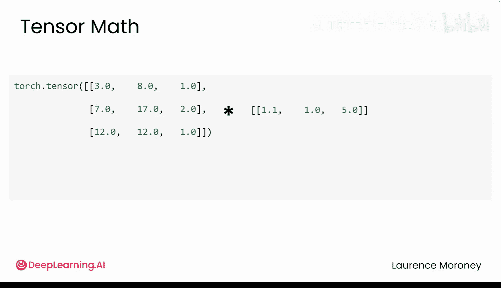

# 吴恩达《Pytorch深度学习（4模块全）｜PyTorch for Deep Learning》中英字幕 p08 8.tensor-math-and-broadcasting.zh_en -BV1S7yhB7EUQ_p8-

In the last video， you learned how to create， reshape and debug tensors。 Now。

 let's see how Pytorch actually computes with them。

 Let's start with a computation from your single neuron model， weight times distance plus bias。

 And here's what that looks like when you have multiple distances to process。

 Pytorrchs tensor math works element wise。 So each element is operated on independently。

 your computation applies the same weights to each distance and then adds the same bias to each result。

 The math looks just like regular python。 But pytorrch runs these operations efficiently on all elements at once。

 This works for scals， which are single values， as well as tensors that have the same shape。

 But what if you have more complex data。 Imagine three deliveries where each has three features。

 distance hour and weather。 And now you want to apply adjustment factors。 maybe 1。1 x for distance。

 No change for time and a 5x penalty for bad weather。 creating that tensor with repeated 1。11。0。😊。

0 rows works because the tensors have the same shape， but it's redundant。

 Wouldn't it be nice if you could just specify those adjustment values once。

 And that's where broadcasting comes in。 You know that tensors with the same shape will work element by element。

 but remember how a scalar could update every value in our distance tensor When you add a scalar to a tensor pytorch automatically expands that single value to match every element and that's how weight and bias could apply to all of your distances at once。

 This automatic expansion is broadcasting in action。

 But what about if we have something like5 a tensor with a shape of 1，1。

 do you think it will work with our13 shape tensor Well， the first tensor has shape 1。

31 row 3 values The second has shape 1，11 row 1 value normally pytorrch requires exact dimension matches for operations。

  different shapes would cause an error。 but here's the magic when one dimension is one。

And the other is larger， Pytorrch will automatically expand the smaller dimension by repeating values。

 So our size 1，1 tensor becomes 555， matching the 1，3 shape。 And now they can be added together。

 Let's look at a more complex example that shows broadcasting's real power。

 What happens when you combine a 13 tensor with a 31 tensor。

 Take a moment to think about how this will work。😊，Well， here's what happens。

 Pytorch looks at each dimension。 The first dimension  one versus3， The one expands to3。

 the second dimension 3 versus one。 Well guess what？ The one expands to3。 So both become 33。

 So how would you actually use this。 Well， remember those delivery adjustments instead of repeating 1。

11。05。03 times。 you can just write this。 No loops， no manual repetition。

 Pytorch handles at all through broadcasting。 And this pattern appears everywhere。

 adjusting multiple features across batches， combining different dimensions of data。

 applying transformations efficiently。 so many places， Once you know to look for it。

 you're going to see broadcasting opportunities everywhere in deep learning。

 Now you've covered essential tensor operations over the last two videos。

 The provided lab has additional examples that you can explore。 because like any tool。

 Tensors will become intuitive through practice。 But most importantly，😊。

The end of module 1 congratulations we've started by exploring what makes Pytorch special and now you've learned the fundamentals you've worked through the machine learning pipeline。

 you've trained your first neural network you've mastered Tensor operations you've built the foundation up next is the Tensor lab where you'll practiced these concepts followed by a graded assignment to test your skills then in module2 you've going to tackle classification problems and dive deeper into how neural networks really learn you've mastered Pytorch fundamentals it's time to put them to work。

