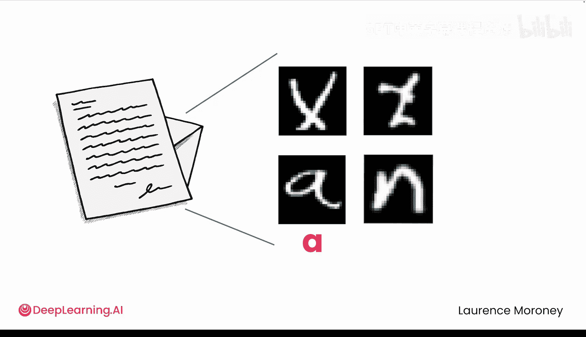
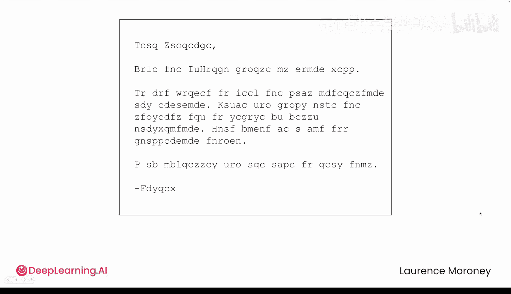
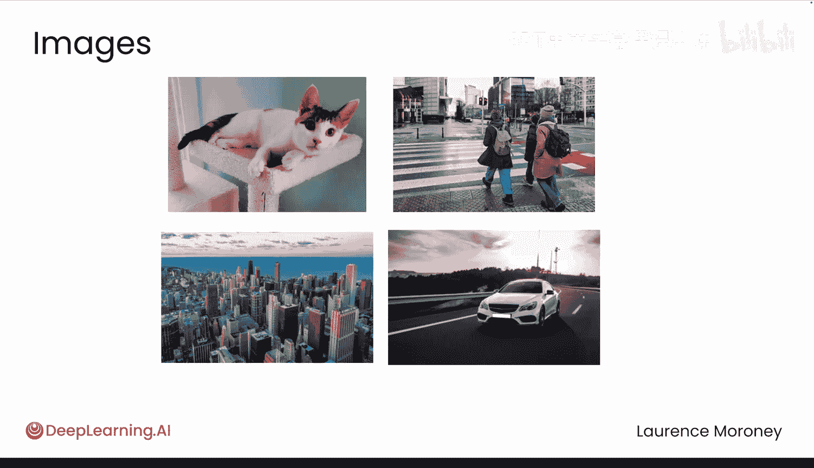
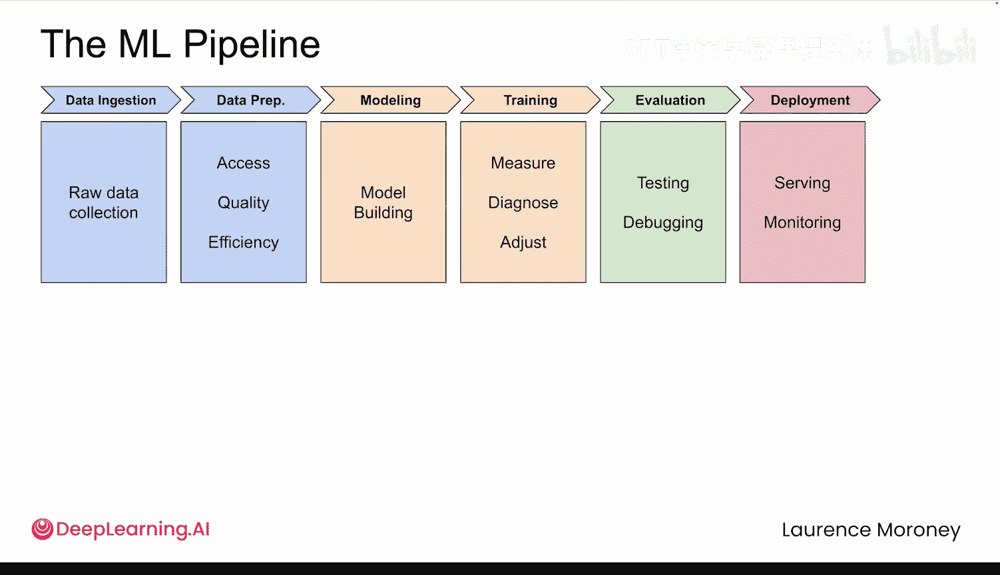
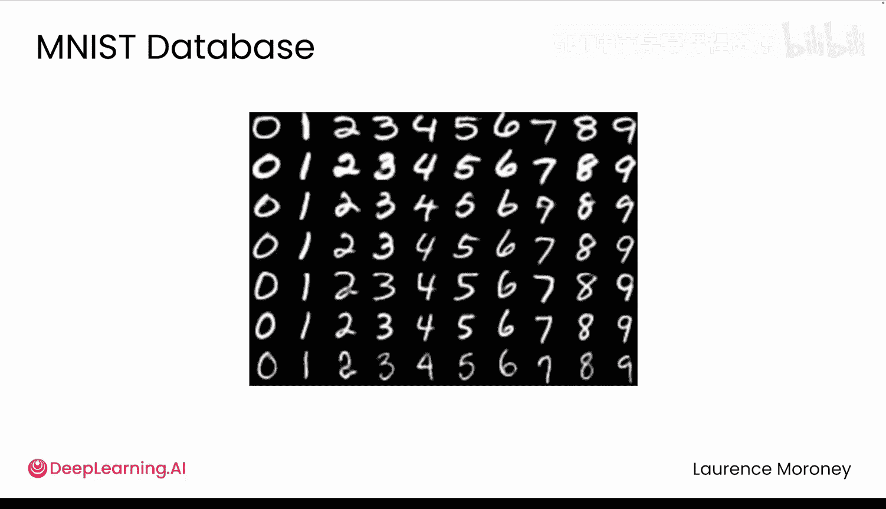
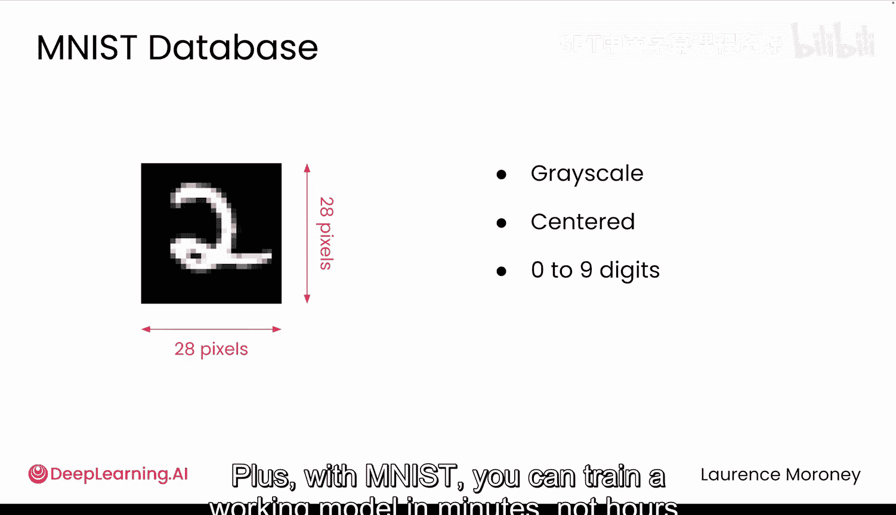
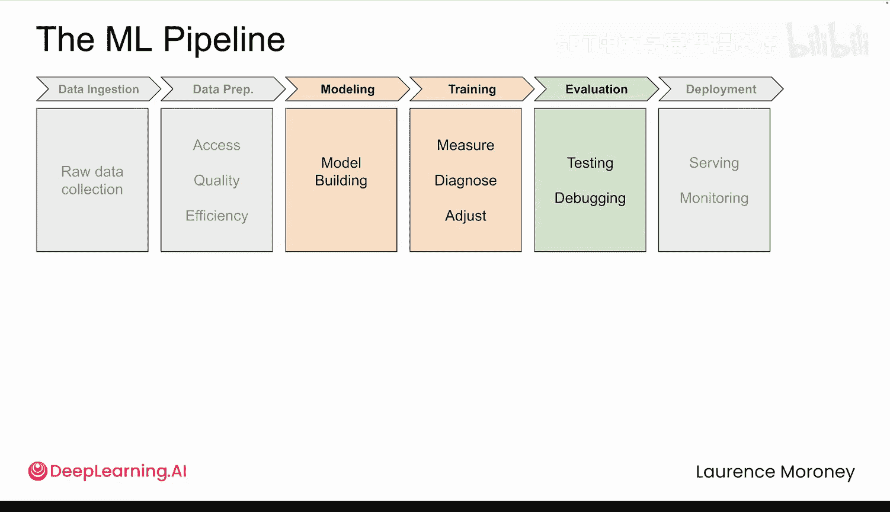

# 吴恩达《Pytorch深度学习（4模块全）｜PyTorch for Deep Learning》中英字幕 p09 1.decoding-a-secret-message.zh_en -BV1S7yhB7EUQ_p9-

Welcome back in module 1， you built your first models with Pytorch and you got comfortable with the fundamentals。

 And if you're new to this， that's a solid foundation。 And if you're more experienced。

 you probably picked up some interesting pytorrch specific patterns along the way。

 But now let's tackle something more interesting。 But first， I need your help with a problem。😊。

My friend Andrew sent me this letter， and his handwriting is just as bad as mine。

 I can't read a single word。 It's， well， it's unique。 So had an idea。

 What if I could train a neural network。To read this for me， I took the letter。

 and I segmented it into individual images like this。

 And then I tried to build a model to classify each character。

 You know that this squiggle is an a and that one's an n and so on。

 Once I could classify each letter， I should be able to reconstruct the whole message。

 But when I ran my model， this is what I got。 Not quite right。

 So I'm going to need your help translating this letter。

 but you're going to need some new tools because you're going to be working with images。

 And this means a lot more data than you saw in module 1。 Each image here contains hundreds。

 maybe even thousands of pixel values。 In fact， for the rest of this course。

 we're going to focus on images。 and will give you the time to really master the machine learning pipeline before we move on to more advanced topics。

 and you'll explore loss functions and optimizes in a lot more detail。

 and you'll pick up some pytor specific techniques like how to manage devices such as GPus。

 By the end of this module， you'll have built a multilayer neural network。

 that can hopefully decode Andrew's letter。 But before you。😊。

cle this handwriting。 you're going to start by practicing on something a little bit more simple。

 These are handwritten digits。 And you can see there's a lot of variation in different handwriting styles。

 numbersumbers might be written neatly， messily slanted and a whole lot more And while you can probably decipher these numbers easily。

 How would you get a neural network to do the same。

 As you might recognize these examples come from a data set called Mnist。 And yes。

 you might be rolling your eyes a little bit。 M does get used a lot。 I get it。 but hear me out。

 there's a good reason for starting here。 especially when you're just beginning your pytorch journey。

 MN is a really good starting point because it's simple。

 and it's structured in a way that makes it easy to train a neural network。

 All of the images are 28 by 28 pixels and their grayscale neatly centered and labeled with one of 10 digits from 0 to 9 plus with Mn。

 you can train a working model in minutes not ours。

 and this will help you learn the core ideas before you move on to more complex challenges。

 So in the next two videos， you're going to take。😊。

Fresh look at the ML pipeline and learn the pytorch way of doing things with images。

 The first video focuses on data。 Realworld data sets are large and messy and you'll need better tools to load and manage them effectively。

 Then after that in the next video， you're going to move beyond sequential and build models with more flexibility while also taking a closer look at how training actually works。

 These videos are going to lay the groundwork for building your first image classifier using MNist as a stepping stone towards building something called a convolutional neural network。

 So let's dive in and see what's new。😊。

