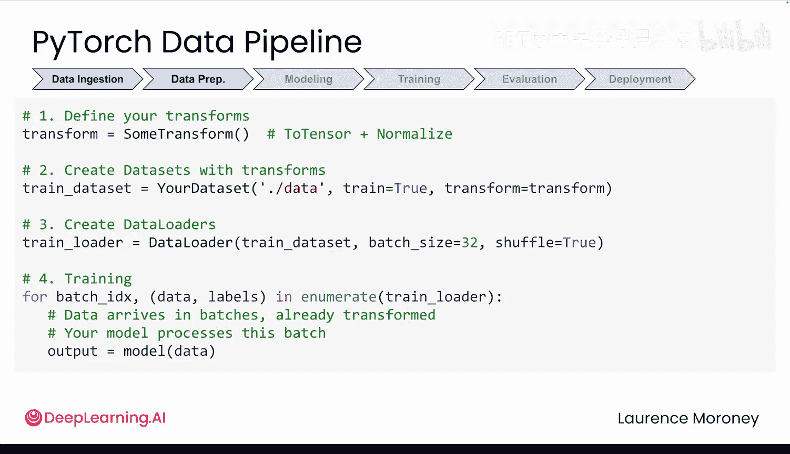

# 吴恩达《Pytorch深度学习（4模块全）｜PyTorch for Deep Learning》中英字幕 p10 2.overview-of-the-ml-pipeline-with-pytorch---part-1-data.zh_en -BV1S7yhB7EUQ_p10-

Let's revisit the machine learning pipeline and see how Pytorch handles data。

 You already know about these steps from module 1。 But now if you're going to decode Andrew's letter。

 you're also going to need to understand Pytorch's data handling tools。

 before you get into the complexities of image data， let's start with something more familiar。

 that delivery data that we looked at in module 1。 The same tools that can handle millions of delivery records can also handle millions of images。

 Once you see the pattern with simple data， images are going to make a lot more sense。

 So let's imagine your delivery company from module 1 has grown。 instead of 10 deliveries。

 you now have 100000 records to analyze and a lot。 Now。

 imagine you wanted to try and load all 100000 records at once。 you might use code like this。

 as you load this data， every piece needs to live in your computers ran with 100000 records you might be okay。

 But what if you had millions of records。 Or if you added weather data， traffic patterns。

 driver info and all of that kind of stuff。 at that scale。😊。

Your computer can run out of memory and crash in no time。

 and that's why you need to load your data piece by piece。

 The practical solution is to work with your data in batches。 and these are smaller。

 manageable chunks of the full data but batching is just one part of the picture before your data is ready for training you need to process it format it and serve it In a way that your model understands and that's where three of pytorrch's core data utilities come in and these are transforms data set and data loader。

 they each handle a key part of the process and they're designed to work well together。

 let's take a look at how transforms work to apply transforms to data。

 you usually write something like this Transforms are operations that run on each data point as it's loaded preparing your data for the model Compose just means to do the following things in order。

 then you have the two most common transforms to tensor and normalize neural networks are surprisingly picky they train much better when all inputs are small numbers ideally centered around zero and's。

Exactly what these two transforms do to Tensor， convert your data into Pytorch tensors and scales them to fold between the values of0 and1。

 normalize adjusts these values even further， centering them around zero and then scaling using standard deviation。

 For now， just know that these will help your model train much more effectively and you'll learn more about them and other transform techniques in the next module。

 Next up， you're going to wrap your data in a dataset set object。

 which fetches each sample from disk when it's asked to it doesn't preload everything in one shot。

 And that's one of the secrets to handling massive data sets。

 It handles things like where your data lives on disk how to load train equals true。

 Well that lets you choose between training and test sets of data。 And if this is new for you。

 you'll see a lot more about that when I discuss evaluation and download equals true。

 downloads the data if it's not already there。 and you can retrieve a sample from your data simply by indexing it。

 In module 3， you'll learn how to use the data。Class to build custom datas。 But for now。

 we'll stick to the prebuilt ones that are available in Pytorch。 Once you've defined your data。

 you're going to use a data loader to serve the data in batches。

 It's part of the pipeline that makes training on large data sets possible by requesting one batch at a time from your dataset batch size tells the loader how many samples to serve at a time。

 You can also shuffle the data which helps the model learn even more effectively during training。

 Now， let's see the complete data pipeline in action。And you're ready to train。

 This pattern efficiently handles data sets that would otherwise overwhelm your computer's memory。

 And whether you're working with thousands of delivery records or millions of images。

 the principle stays the same。 Lo only what you need when you need it。

 But getting data into your model is just the beginning。 In the next video。

 you'll tackle the rest of the M L pipeline。 and then you'll look at how loss functions and optimizers update your model。

 I'll see you there。😊。

