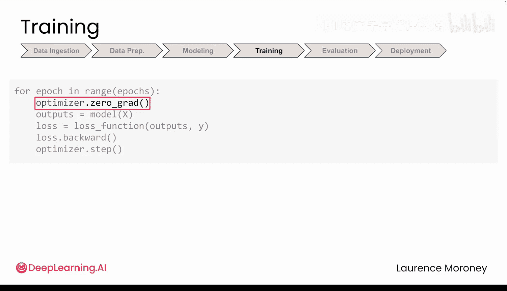
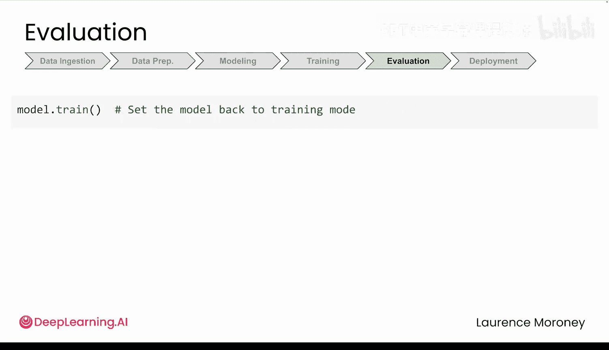

# 吴恩达《Pytorch深度学习（4模块全）｜PyTorch for Deep Learning》中英字幕 p11 3.overview-of-the-ml-pipeline-with-pytorch---part-2-models.zh_en -BV1S7yhB7EUQ_p11-

In the last video， you saw how Pytorch helps you manage your data with tools like data transforms and data loader。

 you can load， prepare and serve data efficiently， no matter the size of your data。 Now。

 let's move on to the rest of the machine learning pipeline， model building。

 training and evaluation In module1， you saw sequential in action。 And， of course， this word great。

 but there's another pattern that you'll see a lot in Pytorch creating your model using Nn do module。

 This code does exactly the same thing as the sequential version， just with more control。

 So let's take a closer look at the structure。 Every pytorch module class has two parts In it defines your layers and forward describes how data flows through them And in it。

 you're just defining what layers exist。 It's a little bit like gathering your tools。

 The actual order comes in forward。 and that's where you describe the path that data is going to take through your model。

 And this is similar to how sequential orders the flow but written。😊。

Different style you're gonna to see this pattern everywhere in Pytorch code。 But wait。

 you've defined this forward method。 How do you actually run it？ You might think model dot forward。

 but what if I told you that sequential is a subclass of module and it too has a forward method。

 and how did you run that model you never actually called forward directly it's the same for your custom model Well when you call the model method and pass the data。

 Pytorch does more than just run your forward method。

 it also makes some internal checks tracks the necessary math and sets things up for updating the model later。

 and that's why you' will always call model passing at the input and not saying model dot forward passing at the input Pytorch will handle that forward call for you and it's all wrapped up in the essential bookkeeping。

 So what about this line super in it I it really necessary。

 you might think it's just Python boilerp and maybe nothing bad happens if you skip it but when you try to create your model。

 Pytorch needs to set up a system to track。All of its learnable parameters。

 and these are the weights and biases that you're going to update during training。

 So when you call super in it， it actually creates that tracking system for you。 without it。

 pytororch has nowhere to register your layers。 So now let's take a look at training。

 you've seen this training loop already in module 1 This standard sequence is the core of most pytorch training loops。

 zero grad clears out all the old calculations。 backwards figures out the improvements and step update your model。

 But here's the thing if you don't follow this standard order， your training might fail silently。

 pytorch won't throw an error your model won't learn properly。 for example。

 what would happen if you swapped backwards and step your code runs fine。

 but the model updates itself based on the previous batches calculations。 and not the current ones。

 or if you put zero grad after backward。 Well， then you just threw away all of that work that backward did。

 What if you put zero grad outside the loop。 Well， those calculations just pile up。

 Each batch will add to the previous one。😊。

And your model starts making huge adjustments when it should just make tiny ones。

 the next two videos will take a deeper dive into these topics。 For now。

 just remember that this pattern is important。 You almost always want the same order every time you've been training your model but how do you know it's actually learning That's what evaluation is for testing your model on new data that it hasn't previously seen and wasn't trained on two critical things here。

 model eval be careful。 this is not a method that evaluates your model as some people mistakenly think it just sets the model into evaluation mode。

 you need this because it's both more efficient computationally and some layers in your model will behave in different ways during training and evaluation Torch do nograd。

 This will disable that extra tracking that pytorch does during training if you don't turn it off Pytorrch will keep storing lots of details even when they're not needed and this waste memory and might even。

Crash your program during validation。 Now， the most important part of evaluation is to see how well your model has performed on new data that it hasn't seen before。

 Testing on the training set would be like giving a student the same test twice。

 The student might just memorize the answers， but you want to see if they can apply what they've already learned since you're exploring image classification in this module。

 you can easily measure performance using accuracy。 The accuracy calculation is straight。

 Count how many times the model gets the classification right and divide that by the total attempts。

 If your model predicts 9500 digits correctly out of 10000。 that's 95% accuracy。

 And don't forget to switch back to training mode if you are returning the model to training。

 You've now revisited the full pipeline。 data loading， model building， training and evaluation。

 but you've only scratch the surface of training。 And in the next two videos were're going to take a closer look at what's happening with loss functions and optimizers。

😊。

