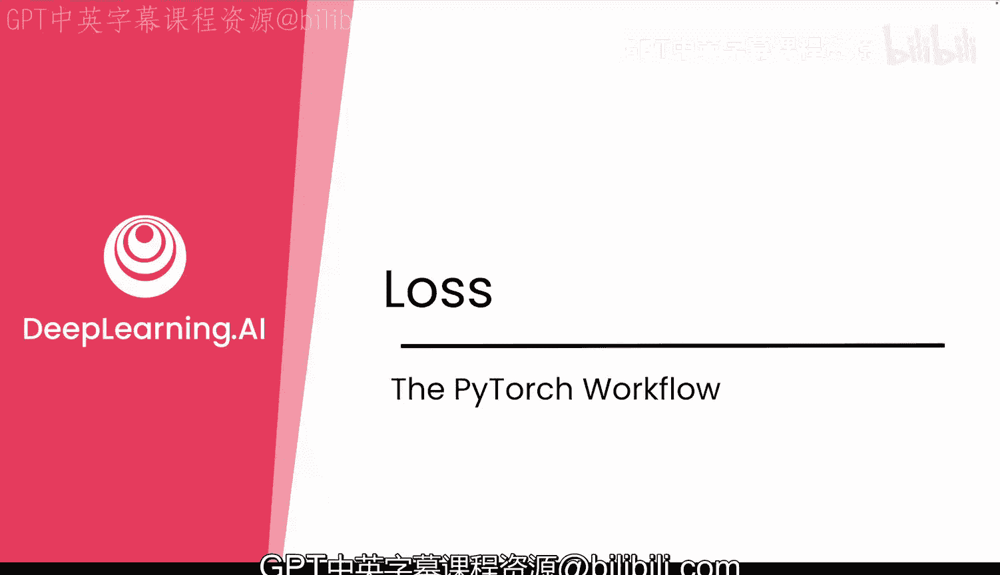
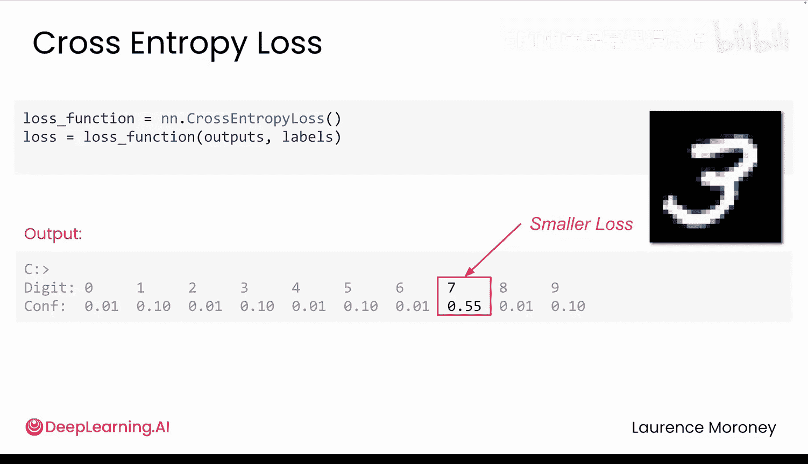
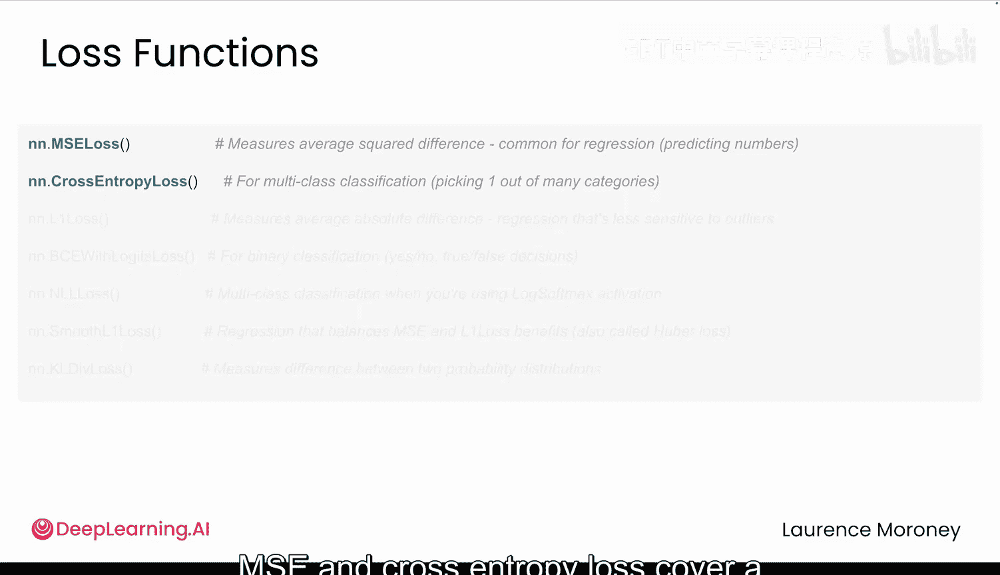

# 吴恩达《Pytorch深度学习（4模块全）｜PyTorch for Deep Learning》中英字幕 p12 4.loss.zh_en -BV1S7yhB7EUQ_p12-

As you move through this professional certificate， you'll see these three lines come up again and again。

 And again， during training。 They're simple to write， but a lot happens behind the scenes。

 Pytorch will take care of the complex math for you。 But in this video。

 you'll take a quick look under the hood to understand what each line really does and why the order matters。

 These three lines will work together in this sequence。 measure diagnose update。 First。

 you'll measure how wrong your predictions are。 And that's your loss。

 This one number that sums up all of your mistakes。 And then backward diagnoses the problem。

 It examines how each weight in your model contributed to the error。

 Which weights made things worse and by how much Finally， optimizer dot step updates the weights。

 It uses those diagnostic scores to adjust each parameter。

 The weights with the bigger problems will get bigger corrections。 in this video。

 you're going to focus on the first step and that's measuring loss。

 You've already seen one kind of loss function called。😊。

Mean squared error， which works really well for tasks like we had when we were predicting delivery time。

 You'll also meet a new loss function cross entropy loss。

 and this is used for classification problems。 I'll break down how these loss functions work and how to choose the correct one for your task。

 Every loss function does the same basic job。 It compares your model's predictions to the true answers and then gives you a number。

 the higher the number， the more wrongg you are back in the delivery company example。

 you use the model to predict delivery time based on distance。 Now。

 let's say your model makes two predictions。 The first prediction the model predicted six minutes。

 but the actual time was4 for the second prediction say it predicted three minutes。

 but the actual time was5 to figure out how far off you were you subtract the target from the prediction and that gives you the error。

 It's like measuring the distance between your guess and reality So how rung was your model overall。

 loss here is the average error across all of those predictions。

 Think of it like a report card for your model。Ler the score the closer your predictions are to reality on average。

 but if you average out the raw errors in this case it was plus2 and-2 and you divide that by two because there's two of them you get zero it looks like perfect performance even though both predictions are actually wrong and this is why you use mean squared error and you square the differences it rid of the minus signs So now both mistakes count and they don't cancel each other out and that's where that name comes from mean squared error and there's one more benefit。

 squarearing makes bigger mistakes matter more being off by 10 minutes is much worse than being off by one So MSE loss mean squared error loss helps in these two ways number one it makes sure that all mistakes count and number two it punishes bigger errors more than it punishes smaller ones mean squared error is perfect when you're predicting continuous values things like distances temperatures or prices but in this module you're tackling classification What digit is this and here you're going to need。

Different loss function we'll use one called cross entropy loss with cross entropy loss。

 Your model isn't just picking an answer。 It outputs a confidence score for all possible answers or classes。

 Take mnist。 Your model must choose between digits 0 through 9。 So for each image。

 it outputs 10 numbers a probability for each digit。 This means I'm 70% sure it's a 3。

 maybe 8% sure it's a2， but it could be a 0。 and all of those score should add up to 100%。 Now。

 here's the key idea。 cross entropy loss punishes overconfident wrong answers。

 If your model says it's 95% sure that this is a 7， but it's actually a3。

 That's a big mistake and the loss will be very high。 but if it's only 55% sure it's a 7。

 it's still wrong， but not as confident So the loss will be smaller。

 You want your model to be confident about the right answers and unsure about the wrong ones。

 cross entropy loss。

Shape that behavior。 Now， here's one important warning。 Do not mix up your loss functions。

 using MSE loss for classification might work， but poorly。

 training will be slow and potentially unstable。 Are you using cross entropy loss for regression。

 it'll probably break because it expects probability distributions and not continuous values。

 And also don't compare their raw numbers。 My MSC is 0。08， but cross entropy gives 2。3。

 which is better。 Well， that's just like comparing two completely different things。 same idea。

 different scale， just make sure that the number goes down during training。

 the goal is to minimize loss。 So when would you use which loss function。 Well。

 if you're predicting a number such as temperature price or distance， use MSE。

 and if you're predicting a category like a digit animal or word， use cross entropy loss。

 There are lots of other loss functions out there， Of course。

 and each are suited to specific situations。 If you're curious。

 check out the resources below to explore them further。 But for now， the。

New is that MSE and cross entropy laws cover a lot of territory and deep learning tasks。

 so that's the measure part of our sequence In the next video。

 you're going to explore how Pytorrch diagnoses the problems and makes those updates。

 I'll see you there。😊。

