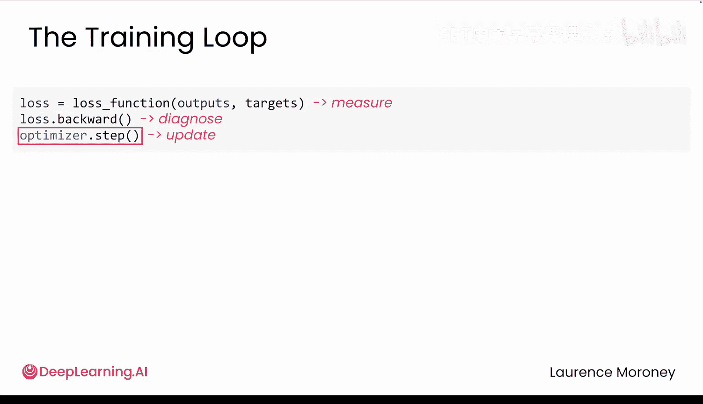
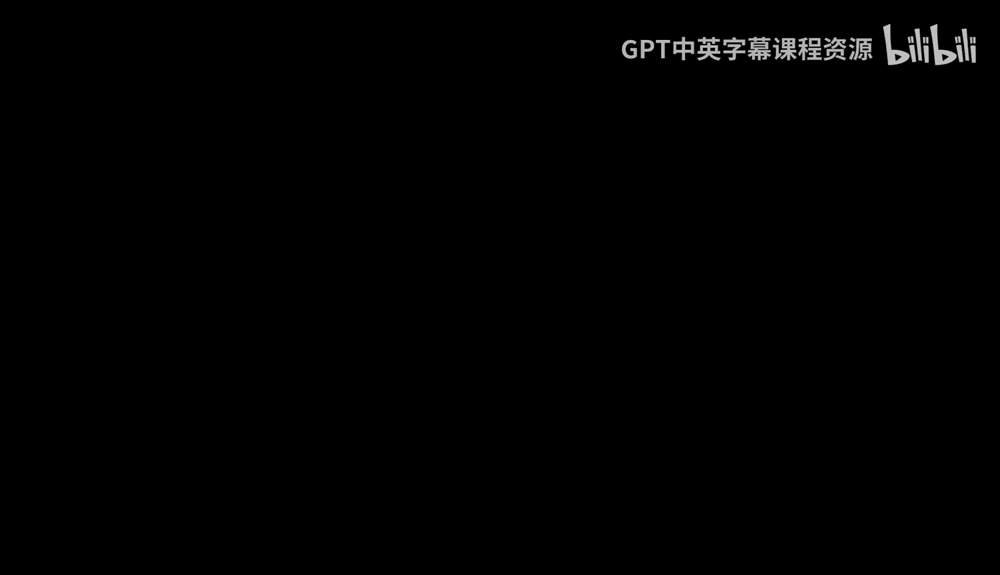

# 吴恩达《Pytorch深度学习（4模块全）｜PyTorch for Deep Learning》中英字幕 p13 5.optimizers-and-gradients.zh_en -BV1S7yhB7EUQ_p13-

In the last video， you saw how loss functions measure how right or how wrong your predictions are。

 And this is the first critical step in every training loop。 Now， let's take a look at the next two。

 In this video， you'll discover how backward， figures out which weights caused any problems and how optimizers can use that information to improve your model。

 By the end， hopefully you won't just know how to use these tools。

 you'll also understand why they work。 So let's take a look。

 after measuring how wrong your predictions are with the loss function。

 The next step is to figure out what caused that loss。 and that's what backward does。

 Think back to how neural networks work。 Each neuron takes inputs。

 Multiplies each by a weight adds them up with a bias and then passes that through an activation function。

 Even in a small neural network， you're dealing potentially with thousands of weights and biases。

 So if we look at a simple example， this network has 784 inputs。128 hidden neurons and 10。😊。

Output classes， and it has over 100000 weights between inputs and the hidden layers。

 There are 128 biases for the hidden layer， and there are 1280 weights between the hidden layer and the output and of course。

 there are those 10 biases for the final output layer。

 and that's a total of 101770 trainable parameters。 So backward acts a little bit like a detective。

 It looks at every single weight and bias and asks how much did you contribute to the loss。

 These diagnostic scores are called gradients。 They tell you not just who contributed to the error。

 but how much and in what direction。 Po values mean that increasing this weight will make the loss worse。

 Neg means that increasing this weight would have helped large values have a big influence。

 Small values barely mattered。 but here's a common misconception。

 People often think that backward updates these weights。

 It doesn't backward only calculates gradients if figure。

Out how much each weight contributed to the overall loss。 The actual updates will happen later。

 when you call optimizer dot step。 you can find course resources if you want to load more。

 but this course is focused on pytorch and not calculus and the beauty of Pytorch is that it handles all of that complexity for you。

 But what's really happening here。 your goal is to try to minimize loss。

 Think of it as like standing on a hillside， trying to reach the bottom of a valley。

 The gradient tells you the slope at your position， which way is uphill or which way is downhill。

 So to get to the bottom， you go in the downhill direction。 and that's going towards lower loss。

 And that's why we call it gradient descent。 The simplest approach is what we've been using stochastic gradient descent。

 SgD strategy is straightforward。 If your weight has a negative gradient， then let's increase it。

 If your weight has a positive gradient， then we can just decrease by going in the opposite direction。

 Theres a big gradient will make a big change has a small gradient。😊，Make a small change。

 but it doesn't just subtract the gradient directly。 It scales it first using the learning rate。

 So if your gradient， for example， is 0。5 and the learning rate is 0。01。

 the learning rate will scale down any updates。 And here's why this matters。 In this case。

 a tiny learning rate has tiny steps。 it will take forever to reach the bottom。

 a good learning rate has steady progress all the way to the bottom。

 a huge learning rate has these giant leaps that can bounce back and forth。 overshooting the minima。

 So SgD can work great， but there are smarter optimizers that can adapt to each weight individually and one of those is at。

 It's kind of like having an assistant that knows which weights need big adjustments and which ones need fine tuning。

 Adamom has become a popular first choice optimizer because it' reliable flexible and often faster than the alternatives。

 but a word of caution。 don't copy the learning rate from SGd when using atom because your loss might。

Explode。 It's tuned completely differently。 There are other optimizers in Pytorch， like Rm Pro。

 Adagrad and a whole lot more。 And if you're curious， check out the resources。 But for most projects。

 Sgd and Adam have you covered Now that you understand gradients as diagnostic scores for each parameter。

 zero grad begins to make a lot more sense。 Every time you call backward pytorch adds new gradients to whatever is already there。

 So if you don't call zero grad， you're not just diagnosing parameters for this batch。

 you're actually accumulating the diagnoses from every batch。

 and the gradients will keep accumulating incorrectly onto their training breaks。

 So that's why you call optimizer do0 grad at the start of every training loop。 Now。

 you might wonder， well， why does pytorrch accumulate the gradients in the first place。

 It turns out that this behavior is really useful for advanced use cases like gradient accumulation or certain custom training schedules。

 but for most projects， including everything you'll。😊。

In this course you're going to want to clear those gradients every time you can now understand the complete training loop loss functions measure how wrong or how right the model is backward diagnosis how each parameter contributes to the errors optimizers then use those diagnostic scores to update the weights now before you start building your first classifier I one final Pytor specific topic to discuss and that's device management and that means making a code run on GPUus for FAA training nowll see you there。

