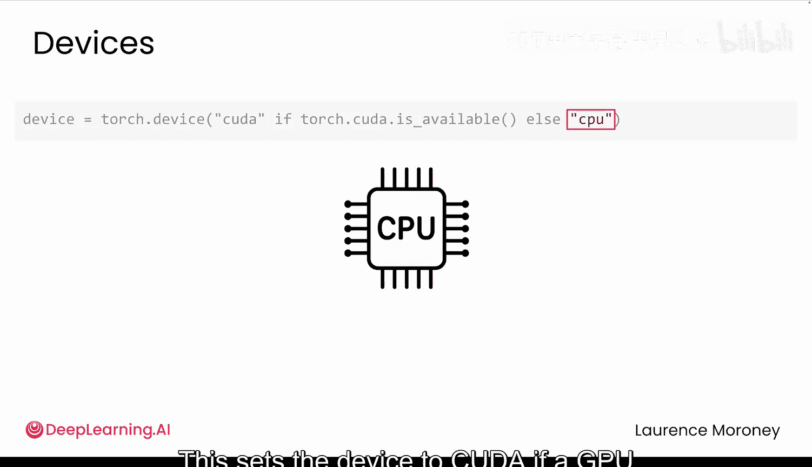
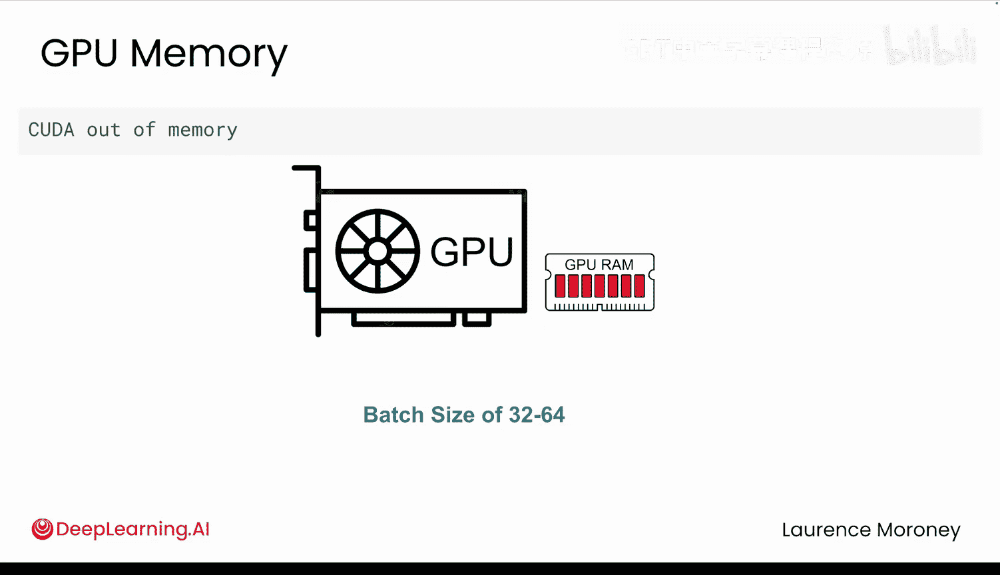

# 吴恩达《Pytorch深度学习（4模块全）｜PyTorch for Deep Learning》中英字幕 p14 6.device-management.zh_en -BV1S7yhB7EUQ_p14-

Welcome back。 as you start working more with tensors and models in pytorch。

 there's something important that you need to understand early on。

 Every tensor and every model lives on a device。 Now that could be your CPU or a GP or other accelerator if one is available。

 And here's the key。 Pytorch will not move things around you automatically。

 And if your tensors and models aren't all on the same device。 your code may not run。

 It could crash with an error like this。 In this video。

 you'll learn how to control where your data and computations live and how to avoid one of the most common errors。

 people run into when they get started with Pytorch。 every computer has a CPU。

 And that's the default device Pytorrch uses unless you tell it otherwise CPUs are built for general purpose work and run operations sequentially。

 but some systems also have an accelerator like a GP， a graphics processing unit。

 which can run tensor operations much faster， especially during training。 In fact。

 training on an accelerator like a GP。😊。

Can be 10 to 15 times faster than on the CPU alone。 So if your system has one of these。

 you'll almost always want to use it。 but you do need to ensure that your model and data are both on the same device and you'll do this manually So let's start re checking whether your system has an accelerator Pytorch gives you a simple way to do it using the following code if this returns true pytorch can use a GP to accelerate your computations。

 a common pattern for choosing a device looks like this。 this sets the device to kuda。

 if a GPU is available and CPU otherwise it is a safe default and one you'll often see in pytorch code。

 the kuda keyword refers to Nvidia GPus that have a toolkit called kuda。

 Now while there are other options likemp for Apple Silic Kuda is the most commonly used one and it's what the labs in this course will be using also once you've defined your device the next step is to move your model and your data onto it first you can move your model。

Cate like this。 This puts the models's parameters onto the selected device。

 Then within your training loop， move each batch of data like this。Now。

 if you're not sure where something lives， you can always check for tensors。

 it's pretty straightforward for models， it's a bit different。

 Models themselves aren't on the devices， but their parameters are。

 so you can check one parameter to see where they all are。 if you're getting device errors。

 you should also double check that your targets and the output of your model are also on the same device too。

 Now there's one common mistake to watch out for when you use dot 2。

 It doesn't change the tensor in place， it actually creates a new one。

 So if you want to actually move the tensor you need to reassign it。 Any time you use dot 2。

 make sure you're assigning the results to a variable that you will actually use Now。

 here's what a complete training loop looks like with proper device management。 The key steps are。

 choose your device up front。 move the model once and then move the data in every batch。

 This pattern is the foundation of every training script that you'll write in Pytorch。

 Even when everything's on the right device。😊，iceThere's one more thing to watch out for the GPU memory because it is limited。

 If your model and batch size take up more memory than the GPU has available。

 you'll see an error like this。 And that's why batch size matters。 Small batches make training slow。

 Lar batches too large and you might exceed your GPU's memory and cause a crash。 for many systems。

 a batch size between 32 and 64 is a good starting point。

 but it does depend on your hardware and on your model architecture。 If you see a memory error。

 first try lowering your batch size。 It is the most common fix。 Get device management right early。

 and you'll avoid one of the most frustrating classes of errors in pytorch。

 And when something does go wrong， you'll know exactly what to check。

 You've now seen how to manage devices And with everything you've learned so far。

 you're ready to put it altogether in the next video。

 you'll see how to train your first image classifier and pytorrch。

 bringing that full pipeline to life。 I'll see you there。😊。

