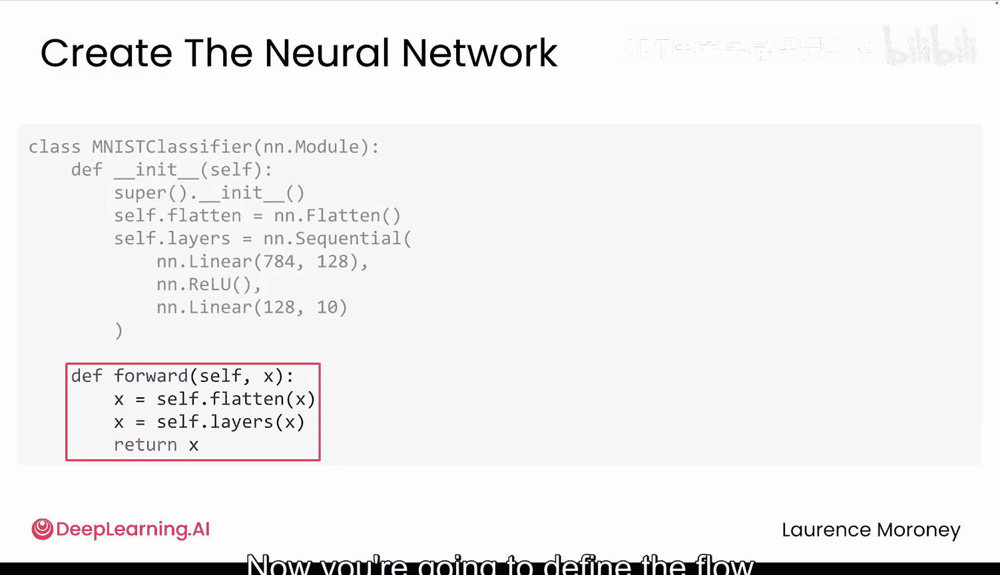
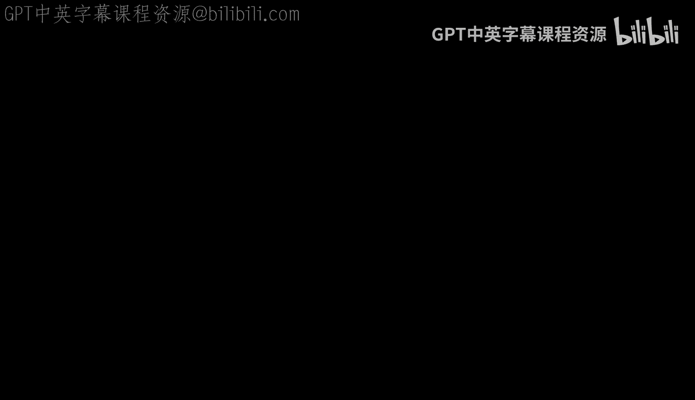

# 吴恩达《Pytorch深度学习（4模块全）｜PyTorch for Deep Learning》中英字幕 p15 7.image-classification---part-1-preparing-the-data-and-building-the-model.zh_en -BV1S7yhB7EUQ_p15-

Hi and welcome back。 So far， you've seen how to load data， manage devices。

 measure loss and update weights。 Now， let's bring it all together and build your first image classifier with Pytorrch。

 You're working with Mnist， those handwritten digits that you saw earlier。

 This data set has 60000 training images and 10000 test images。

 Each of these are 28 by 28 pixels in grayscale。 It's the perfect warm up before tackling Andrew's letter in the assignment。

 So let's jump into the code and build a model。 We'll start with the data pipeline。 First。

 you need to import torch vision。 and this is ptorrchs Comp vision library。

 It comes built in with popular data sets like Mnist， as well as tools for image processing。

 Remember， Transs。 Well， here you're applying them to Mnist to tensor converts the images to tensors and then scales the pixels from 0 to 255。

 down to a range of 0 to 1。 normalized then shifts and scales those values。

 So they're centered around 0。 Now， what are these numbers，0。1307 and 0。😊。

3081 Well they are the mean and standard deviation of the entire training set by normalizing every image with the same values。

 you make the data more consistent and that helps the model learn faster。

 We'll see more on that in the next module Now let's load in the data sets for the training data root equals dot data says just simply where to store the files on your computer。

 Tra equals true tells it that you want the 60000 training images。

 Down equals true means that if MNist isn't already there。

 go ahead and download it and Trans applies those preprocessing steps that you just to every image automatically。

 The test data is almost identical just use training equals falses to get the 10000 test images instead of the training ones to use the same transforms the same storage location and all of that Torch visionion will handle all of the downloading and organizing for you Now onto data loaders for training。

 you're setting the batch size to be 64 That means。64 images in each batch。

 which shuffle equals true for every epoch。 the model will see the images in a different random order。

 The test loader uses batch size equals 1000。 These are much larger batches because we don't need to calculate gradients。

 We're only testing， but notice something interesting。 The training data is shuffled。

 but the test data isn't。 Take a moment to think about why that might be。Well。

 datas often come organized by class。 If you don't shuffle。

 your model might see 6000s in a row before seeing any ones。

 It could learn unintended patterns like early batches are zeros。 batches are9s。

 Instead of actually learning what makes zero look like a0。

 shuffling will mix everything up so that each batch has variety in it。

 The model learns the actual features of each digit and not just their position in the data。

 but for testing， well， the model's done learning， you're just checking if it can recognize digits correctly。

 or it doesn't matter then。 So now it's time to create a neural network。

 You're going to go beyond sequential and will build a custom architecture。 Let's walk through this。

 You're creating a class that inherits from N dot module。

 This gives you all of pi Tor's neural network functionality in it's in it。

 you're going to define your layers。 First comes flatten。 This is new。😊，Here's why you need it。

 EndN images arrive as tensors with a specific shape。 When pytorch loads a single mist image。

 it gives you a 12828 dimension tensor， and that's the channels the height and the width。

 The one channel means that it's grayscale is' just a single brightness value from 0 to 255 for each pixel28 by 28 pixels are the size and those are the other two channels。

 but when you're training on batches， pytorrch will actually add another dimension So which batch size equals 64。

 your data arrives as 64 comma1 comma 28 comma 28， So that's 64 images。

 each one channel and each is 28 by 28 pixels。 Here's the issue。

 Linear layers expect flat vectors and that's one long row of numbers per image not two dimensional grids。

 And that's what flatten does。 It takes each of your 28 by 28 images and reshapes them into 784 values in a row。

 Y 784 because 20。😊，By 28 equals 784。 So now your batch instead of being dimension 64。

12828 just simply becomes 64 by 784 without flatten。

 you get a shape mismatch error when your image data hits the linear layer。

 So now you can stack your layers with sequential linearar 784128 takes those 784 pixel values and transforms them to 128 hidden features re is our activation function that keeps how positive values and zeros out the negatives。

 then linear 12810 takes 128 features and turns them into 10 outputs。

10 outputs being one for each digit class with 10 digits from 0 through9。

 Now you're going to define the flow of the data in that forward method， take the input， flatten it。

 pass it through your layers， return the output。 So now you have everything ready。

 a data pipeline that loads and preprosses MS images and a neural network that can process those images。

 But right now this model doesn't know0 from a9 in the next。

V you're going to see how to bring this model to life with training you'll see how to set up the optimizer。

 define the training loop and watch as your model learns to recognize digits with increasing accuracy let's keep going。

😊。

