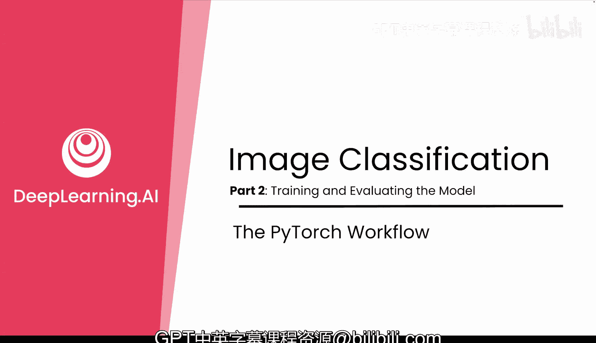
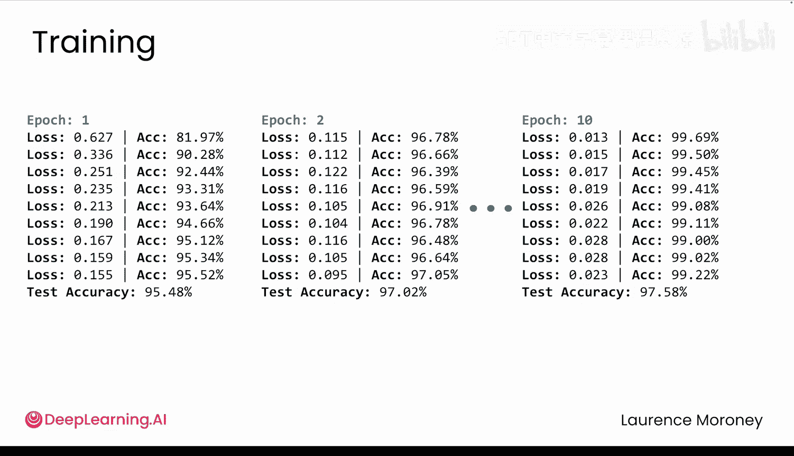

# 吴恩达《Pytorch深度学习（4模块全）｜PyTorch for Deep Learning》中英字幕 p16 8.image-classification---part-2-training-and-evaluating-the-model.zh_en -BV1S7yhB7EUQ_p16-

Welcome back In the last video。 you saw how to build the two key components。

 a data pipeline that loads NN images and a neural network architecture that can process them。

 But if you ran the model right now， you'll just be guessing in this video。

 you're going to walk through the code that actually trains that model step by step。

 Let's start by setting up everything that you need for training。 First， device selection。

 If couda is available， you'll use the GP。 Otherwise Pytorrch is going to fall back to the CPU。

 Then let's create the model and move it to the device using dot2 device。 remember。

 both your model and your data need to be on the same device。 Otherwise。

 you'll get an error during training。 You're going to be using cross entropy loss as your loss function。

 And as you saw earlier， it's designed for classification tasks。

 with a model will pick one class out of many。 and that's perfect for choosing a digit from 0 through 9 and you're using the atom optimizer with a learning rate of 0。

001。 You've already seeing how Adam adapts its learning rate as a trains by making。😊。

Larger adjustments early when gradients are noisy and then smaller corrections later as your training stabilizes。

 so now let's create a function to train our model for one epoch。 The function takes in five inputs。

 your model the data loader the loss function， the optimizer and the device that everything should run on you'll start with model do train and this puts the model into training mode you'll set up three tracking variables。

 running loss accumulates the loss values correct counts predictions that match the true labels and total counts all of the samples you've seen so far。

 Next we're going to loop over all of the batches and in each batch we're going to move the data and the target to the right device clear any leftover gradients with optimizer zero grad will then run a forward pass by calling the model and passing at the data to get output will compute the loss by calling the loss function will backproagate with loss do backwards and then we'll update the weights with optimizerstep and then you track your。

ProgressLos item gives us the label value and output do max tells us which digit class got the highest score and lets you compare that to that label value。

 every hundred batches， you're gonna to print out the current loss and accuracy with 60000 training images and batch size 64。

 That's about 938 batches per epoch。 So you're going to see around 9 updates。

 notice what's happening here。 look at the loss number， it's dropping from 。64 to about 。17。

 while your accuracy climbs from about 81% to about 95% and that's just in a single pass through the training set and look how little code it took to make all of that happen。

 But training is only half of the story。 you need to test your model on new unseen data。

 there are two key differences from training。 First， model eval will switch you into evaluation mode。

 Second， you're going to wrap everything in a width torch no grad during evaluation you're not training so you don't need。

This will save memory and speed everything up。 The evaluation itself is pretty straightforward。

 You're gonna run each batch through the model。 You're going find which class got the highest score with output on Max。

 You're going to count how many predictions match the true labels and then you can return the accuracy percentage。

 No optimizer， No loss tracking， No weight updates just how many did you get right。

 Now you have your training function and your evaluation function。 that's put them all。

 You'll train the model for 10 epochs。 that's  tenfold passes through the entire training data set。

 but it's not just repetition with each pass。 the model refines its understanding of what makes it two different from a7。

 after each training epoch。 you're going to evaluate on the test set to see how well it performs on unseen data。

 This tells you if the model is actually learning generalizable patterns or if it's just memorizing the training data。

 And here's what you'll see by epoch 10， you'll notice something really satisfying。

 the loss is tiny and the accuracy is high when you。😊。

stops improving is often a sign that your model is done learning for now。

 so you may not even need all 10 epochs and that's it you're ready to train your first image classifier in Pytorrch head over to the lab and give it a try。

😊。

