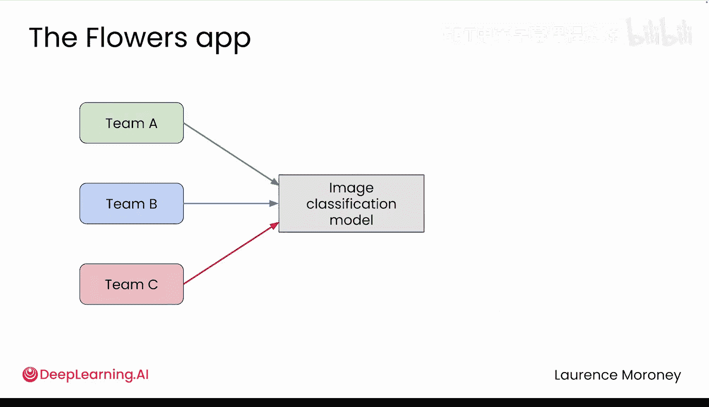
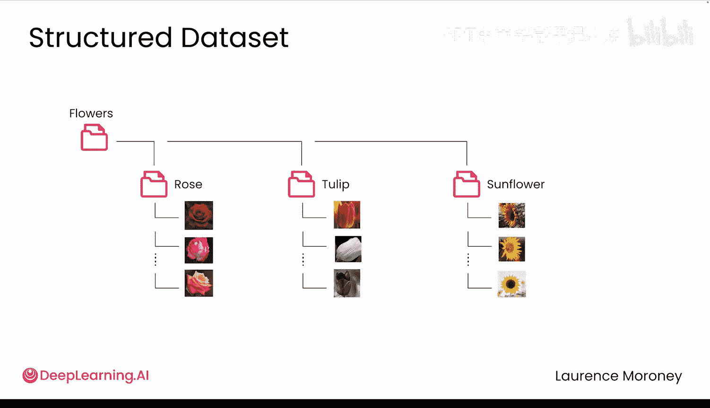
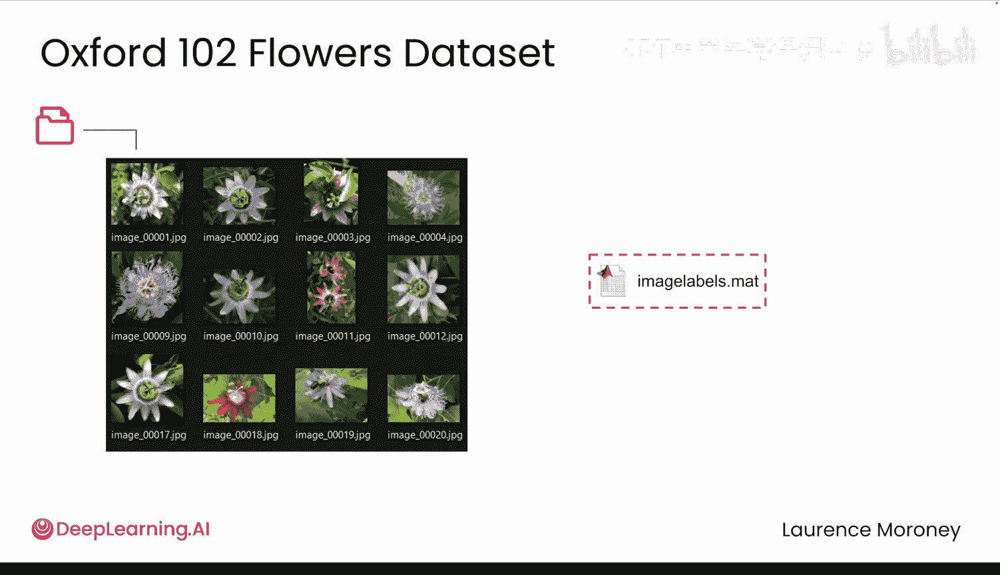
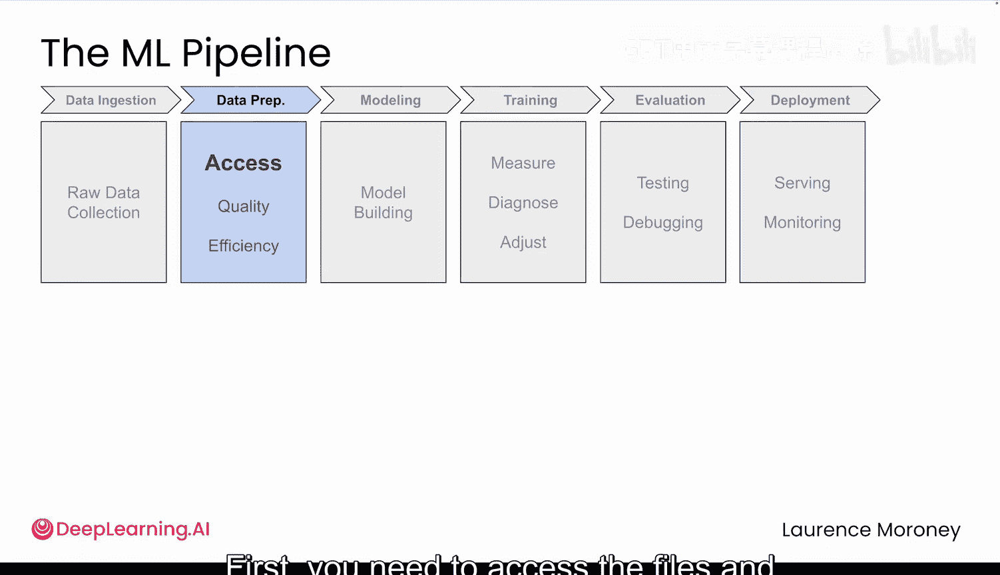
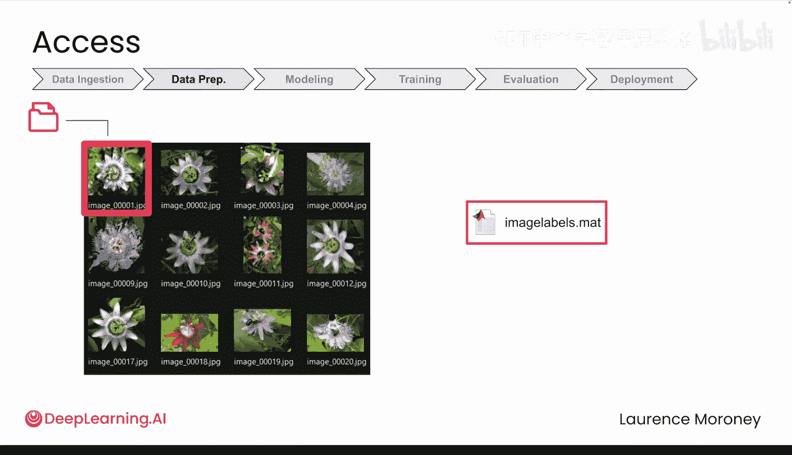
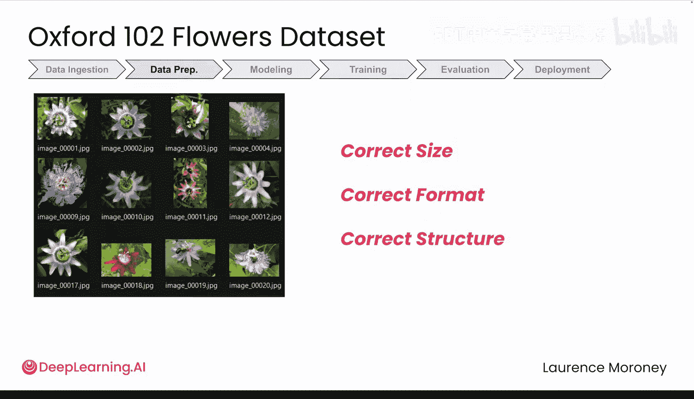
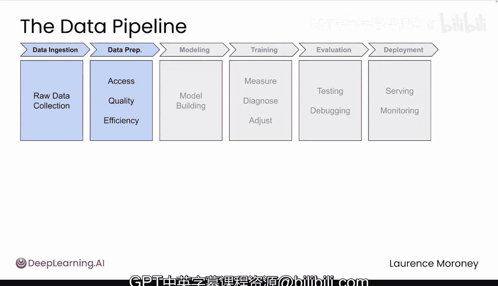

# 吴恩达《Pytorch深度学习（4模块全）｜PyTorch for Deep Learning》中英字幕 p17 1.introduction-to-data-pipelines.zh_en -BV1S7yhB7EUQ_p17-

Welcome to module 3 In the last two modules， you've gone from Pytorarch fundamentals to building your first image classifier。

 You can load data， build neural networks， train them and get real predictions。

 That foundation is exactly what everything else builds on。 But now things get more interesting。

 So far， you've worked with clean， well organizedized data sets like Mnist。

 but we're going to be diving deeper into the data side of the pipeline now， because in practice。

 data sets are often much messier and more challenging。

 and that's exactly the kind of problem you're about to take on。

 A botanical garden wants to build a flowerid app for its visitors。 and you've re brought in to help。

 Three different teams have already tried。 They all used exactly the same neural network architecture。

 identical layers， the same parameters。 but they've got wildly different results。😊。

Why because the real challenge isn't just the model。 It's also the data。

 It doesn't matter how sophisticated your model is。

 if you can't properly access and prepare your data。

 you're doomed from the start bad data handling means bad results and that's exactly what sank those teams Now you're taking on the project and I want to make sure that you don't make the same mistakes because even the best model in the world can't save you from a broken data pipeline So let's see what you're going to be working with the botanical garden provided the Oxford 102 flowers data set for training and here's what you get when you download and unzip it a folder full of images and when you open the folder they're generically named Jpeg files like image 0001 and when you open a file you can see the images inside it are flowers in many data sets。

 images are neatly sorted into folders named after their categories。 but that's not the case here。

 Instead labels are stored separately in a dot mat file， which is a compressed binary form。

From Matlab and you'll need to figure out how to extract your labels from this potentially unfamiliar file type so that's a first glimpse at your data and remember the only difference between those failed attempts was how each team handled this data it made all the difference between a successful app and a frustrating failure so what does handling the data actually mean well when you're working with any data set there's a natural progression and potential problems at every step first you need to access the files and match the images to their labels with Oxford flowers that's already tricky the images have generic names and the labels are tucked away in dotmat files that's not the most beginner friendlyly approach next you need to get the images into the right format correct size data type and structure so your model can actually learn from them and then finally you need to load everything efficiently in batches not one image at a time or your training could grind to a really slow halt problems can crop up at any of these steps。

And they're not always obvious so in this module we'll group these issues into three categories。

 access problems， quality problems and efficiency problems and when things went wrong for those earlier teams。

 it could have been any one of those in this module will going to work through each of these problem areas systematically using that Oxford Flowers data your main tools will be Ptorrches data set and data loader classes you've seen them before but now we're going to dive deeper into what they can really do for you by the end of this module you'll have the data pipeline skills to build the botanical garden app and tackle any project that comes your way。

