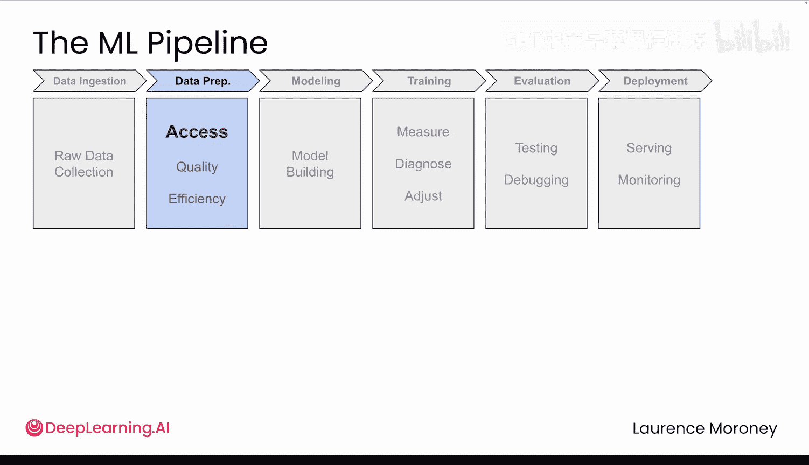
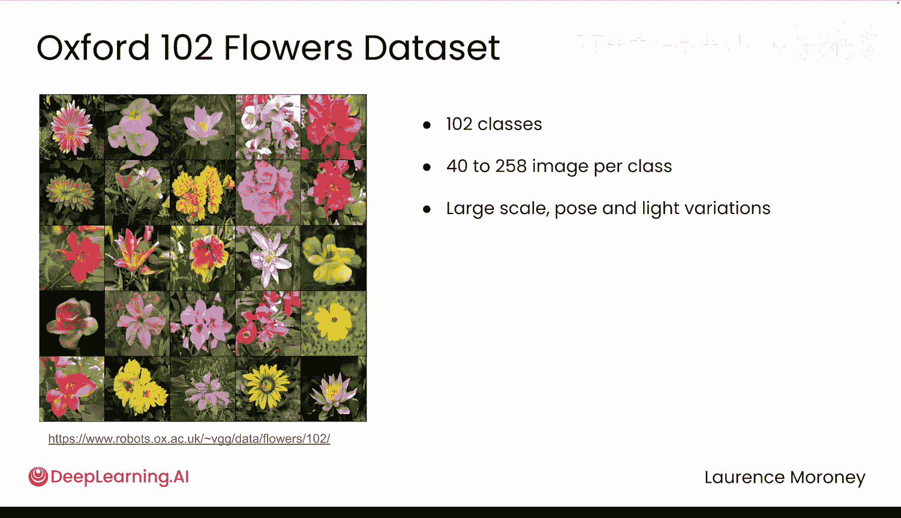
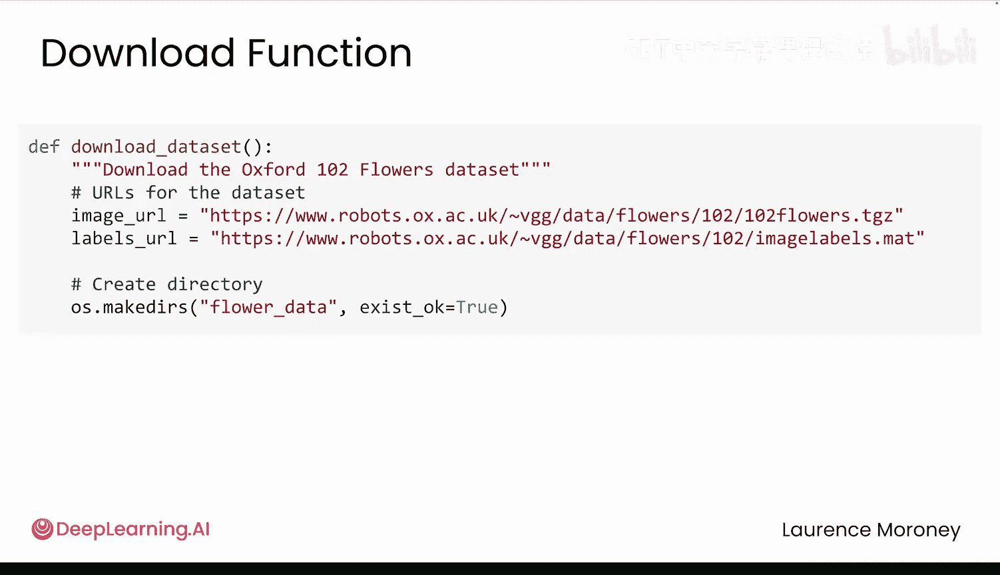
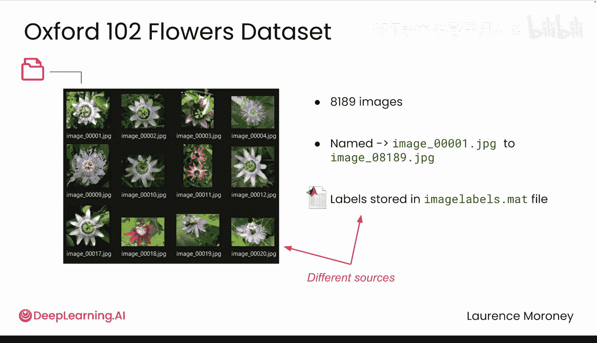
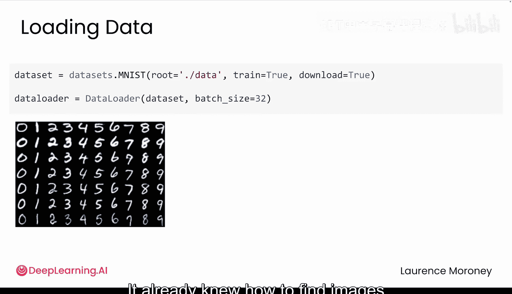
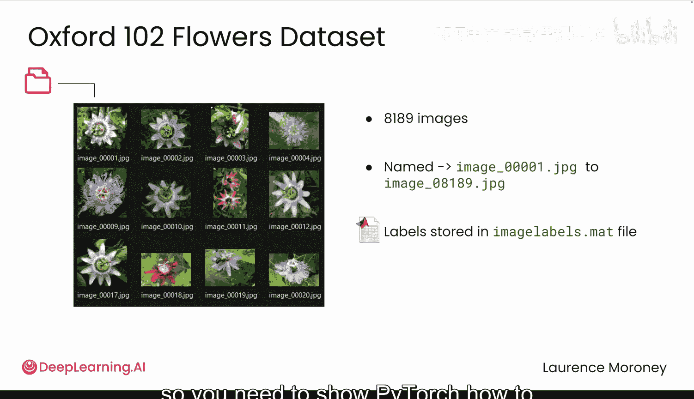
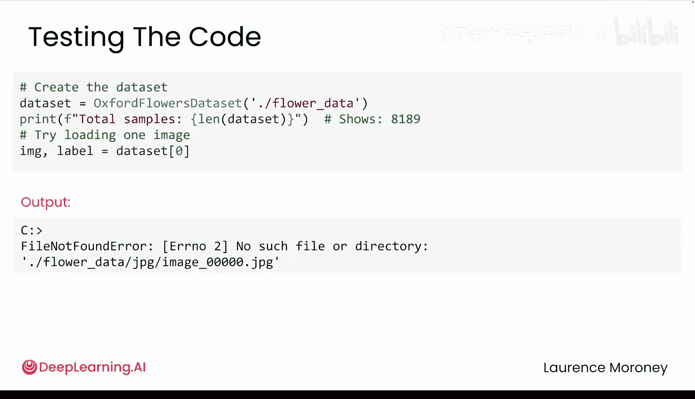
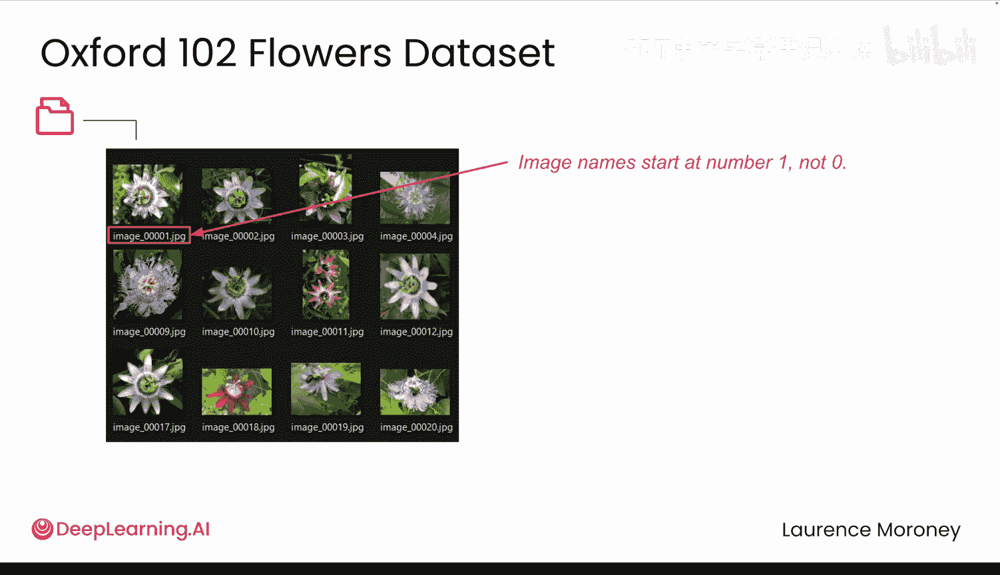
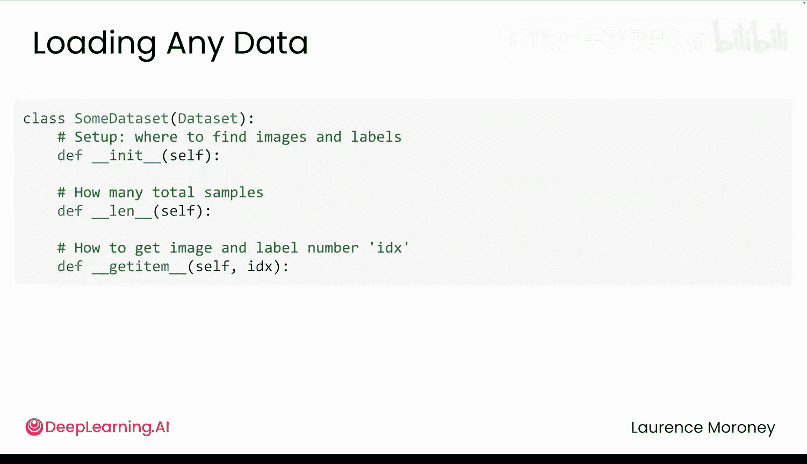
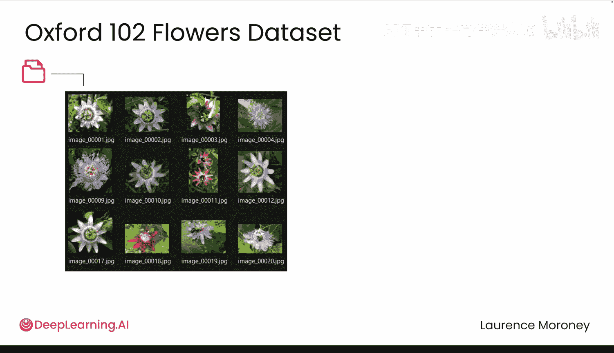

# 吴恩达《Pytorch深度学习（4模块全）｜PyTorch for Deep Learning》中英字幕 p18 2.data-access.zh_en -BV1S7yhB7EUQ_p18-

In the last video， we saw how the Botanical gardens earlier attempts at this flower identification app failed because of poor data handling。

 So now it's time to tackle the first major issue data access。 If you can't reliably loadier data。

 Well， nothing else matters。 I'll show you what goes wrong with messy datas like Oxford F。

 and how to fix it using Pytorrchs data class。 So let's start by downloading the data set and seeing what we're working with。

 I've provided the download function for you。 You'll explore the details in the lab。 But in short。

 it fetches both the image files and the labels。 So now let's take a look at what we download it。

 We've got over 8000 images or with generic names like image 0，0，0，1 do Jpeg。

 There's no organization by flower type just a flat list of numbered files。

 The labels are stored separately in this dot map file， a binary format used by Matlab。

 It maps each image to a flower category。 So we've got images in one place。

 and labels in another place and another format。😊。

Enrely， we need a way to connect them cleanly and systematically in previous modules。

 you load a data with pre-built data like MNist。 It already knew how to find images and match them to the right labels。

 Oxford F isn't pre-package like that so you need to show pytororch how to work with it by building a data class a pytorch data class a custom one needs to answer three questions。

 The first in it how do I set it up and where's the data， then there's Le how many samples are there。

 and then there's get item When asked for a sample like image 42 what should I return。

 These three methods are all pytorrch needs to work with any data format So let's implement them with Oxford F I'll start with it and this is the setup method Here's where we'll tell our custom data where to find everything and load any info that we need later the data does need some setup we're gonna handle the file paths we're gonna read the Matlab file using sci Pi and we'll even fix the label indexing and that's what makes it。

Realistic， you can explore the details in the lab。 but here's the key takeaway。

 We now have access to all of the image pads and their corresponding labels。

 So what's in that labels array。 Well， let's take a look。 We have 8189 labels and as one per image。

 Each of these is a number from one to 102 representing a flower type it does look like the first 10 images are all labeled as type 1。

 So the data set does seem to be organized by category。 but wait the label start1。

 let's double check that。 Yeah， that's a problem。 We have 102 flower types。

 but pytorch expects zero index labels。 So instead of one through 102。

 We need to change this to 0 through 101。 It's the kind of detail that could quietly break your training So we fix it by subtracting one from every label。

Also， notice what we're not doing in it。 We're not loading any images。

 We're just setting up the info that we'll need to find them later。 This is called lazy loading。

 and it's critical loading all 8189 images at once would use up gigs of memory Instead will just store the pads and the labels。

 the actual image loading will happen later in get item。 Next up is L。

 This one simple you return the total number of samples in the data Since you have one label per image the length of the labels array tells pytorch exactly how many samples to expect。

 It uses this to properly iterate through your data during training。 Now。

 for the most important method。 get item。 Here's the idea。

 Pytorch gives you an index and your job is to return the data for that index。

 That's it for this data set， that might mean something like Pytorch says give me sample number 42 and you return the 4 second flower image and its label and that's the flower type that it represents here。

 the colon 0，5D pad。😊，The index with zeros to match the file names。

 Remember things like image 00042 do jpeg。 We use PL or pillow Python's imaging library via image gott open to load the image。

 then we grab the corresponding label from the labels array。

 So when pytorch asks for index 42 it gets image 42 and its label that's the contract you define what each sample looks like。

 and pytorch will handle how when and how often to call this method。

 Now let's make sure our data set actually works。 Oh， we got an error。 Well， let's check the folder。

 It looks like the image are named image 0，0，0，1，0002，0003 etc。

 and that numbering starts at1 and not 0。 So when we ask for index 0 we're trying to load image 00000 do jpeg but that file doesn't exist。

 So let's fix that in our getite method and now let's try again。

Great， this is exactly why you always test your dataset set early。

 A simple off by one error like this could have broken everything later。 If things are working now。

 your data is successfully connecting images to labels。 But a quick note。

 This pattern will work for any type of data。 The structure is always the same。 Light set up。

 lazy loading。 You've now built a custom data set that can systematically access over 8000 images and labels without crashing memory。

 But accessing that data is just the first step。 in the next video， you'll tackle quality problems。

 Like what to do when your images come in all different shapes and sizes and formats。

 I'll show you how to build a transformation pipeline that will then prepare your data for training。

 and I'll see you there。😊。

