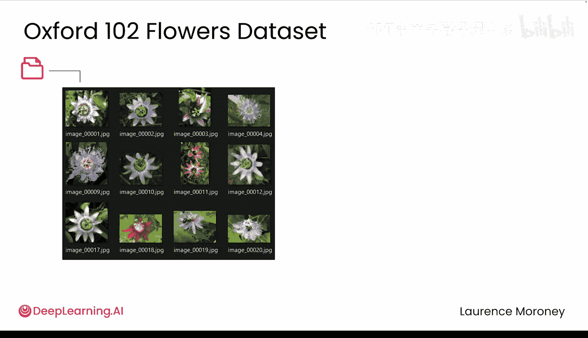
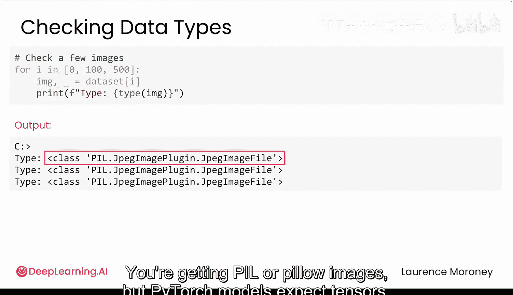
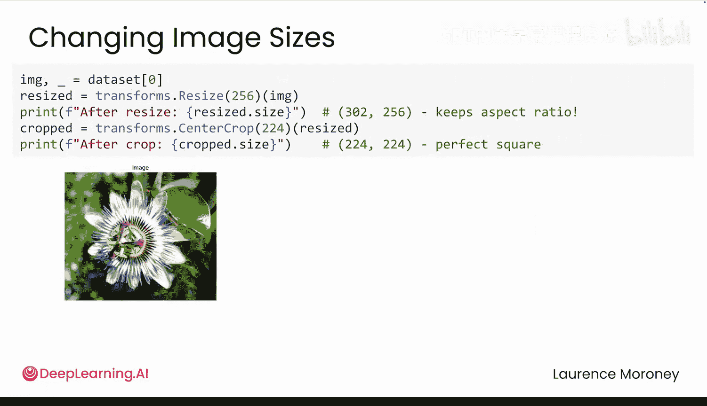
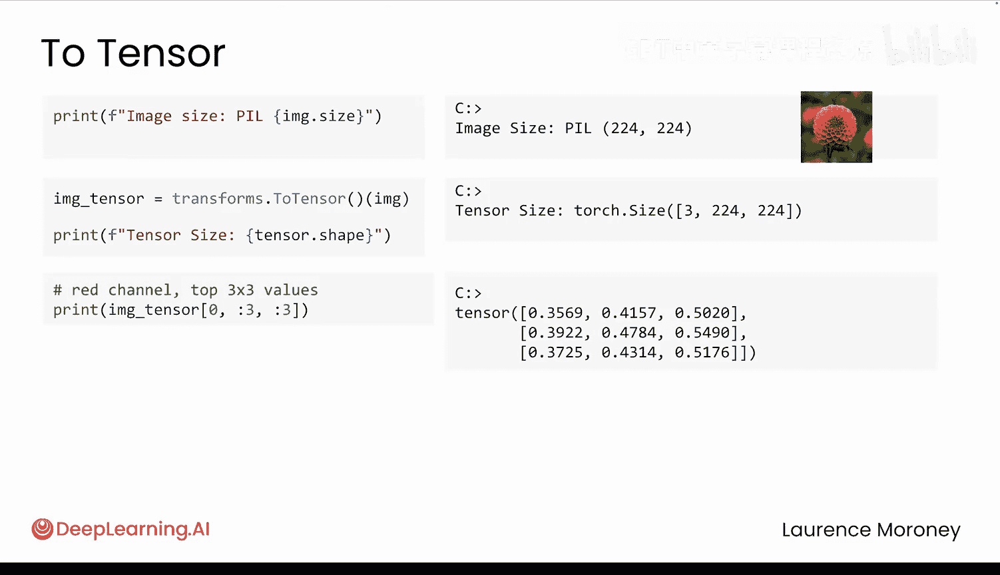
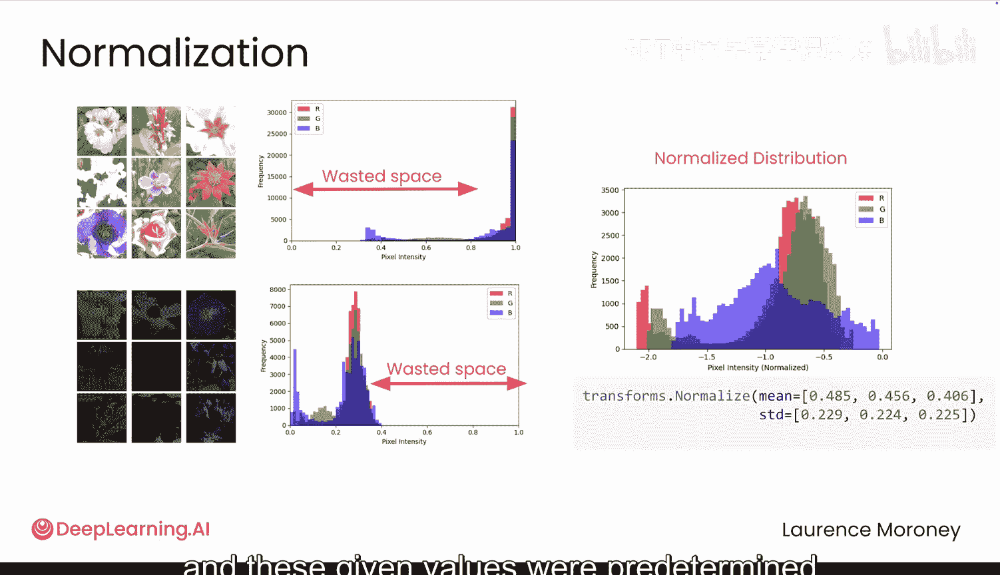
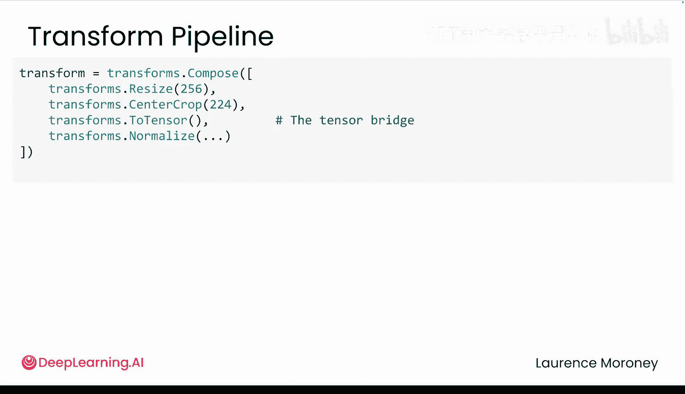

# 吴恩达《Pytorch深度学习（4模块全）｜PyTorch for Deep Learning》中英字幕 p19 3.transform-pipelines.zh_en -BV1S7yhB7EUQ_p19-

In the last video you built a dataset set class that systematically loads all of the images and labels from the Oxford Flowers dataset。

 but accessing the data is just the first step in this video you'll tackle quality problems。

 The issues that keep raw images from working with pytorrch models you'll learn how to use the pytorrchches transformation pipeline to handle resizing format conversion and normalization。

 by the end you'll understand how transforms work。 why their order matters and how to debug when things go wrong whether these concepts are new or familiar you'll see exactly how Pytorrch handles them So let's see what happens when we try to use our data as is Imagine your flower data is ready and you create a data loader just like in the last module and then you get this error This likely means your images have different heights and widths Pytorrch can't stack them into a batch unless the same size remember image batches need to follow this format batch size。

 the channels， the height and the width if the dimensions don't match Pytorrch throws an error but。

Might not be the only issue in this data。 So let's start digging in to see what you're working with。

 These images are all different sizes they' are likely taken with different cameras over the years。

 So variation， of course， would make sense。 but there's another issue The data type。

 you're getting P or pillow images but ptorrch models expect tensors So you've got two different problems one is different sizes and the other is the wrong format。

 Now this is exactly what ptorrch's transform system is for handling preprocessing in a clean consistent way。

 Let's start with the size mismatch。 Piytorrch will provide transforms that you can chain together to fix this like resize。

 which sets the height and width to 224。 wait what if your image is a rectangle。

 what you think will happen It's going to distort the image stretching and squishing it to fit a better approach is to use resize with just a single value and that will scale the shorter edge while keeping the aspect ratio then you can use center crop to extract a square from the middle。

 Also watch out for the name。

If you call your transform transforms with an S。 you'll overwrite the pytorrch module and get some confusing errors。

 So here's a quick debugging tip when building transformation pipelines test each step individually so you can see exactly what's happening。

 Ining each step like this is the key when debugging transforms。

 you can see exactly how your data changes and then catch issues early on Next up。

 you'll need to convert those pillow images into tensors。 you've seen two tensor before。

 but do you remember everything that it does， let's inspect what two tensor actually does more closely First。

 here's the size of our pill image 224 by 224 pixels Now when you call two tensor on this image First。

 obviously it's going to turn that image into a tensor but with some interesting properties so you can see that if you print out the shape。

 It has rearrange the dimensions by adding a channels's layer for the three color channels red。

 green and blue and now pixel values will normally range from 0 to 255。😊。

And to tensor will scale these values， dividing all of them by 2，5。

5 so that the values will all fall between 0 and 1。

 And as you can see from these sample values from our tensor here， they do all fall between 0 and1。

 same pixel data but a different scale。 The scaling will help networks learn。 for one。

 it's helpful if all features are on the same scale。 Think about it。

 increasing your age by 10 years is huge， but adding 10 millm to your height is not。

 but a model will just see 10 in both cases by scaling everything into a 0 to1 range。

 a 10% change is always a 10% change， no matter the units。 plus。

 neural networks will do a lot of multiplication， and big numbers like 255 can easily explode。

 So scaling can also help keep the math stable。 Now， let's add one more transform。 normalization。

 we've seen normalization before。 but let's take a closer look。

 While our intensity values now fall between 0 and1。 If your images are mostly bright flowers。

 the values will。😊。

St're close to one。 If they've mostly dark backgrounds， they'll cluster close to zero。

 and this leaves a lot of unused space， squeezing important detail into a narrow range。

 And this makes it harder for the model to spot subtle differences。

 normalization using mean and standard deviation spreads those values out more evenly and these given values were predetermined to work very well in this case。

 So now your intensity values have the right shape， scale and distribution。

 making it easier for the network to learn what matters。 Now。

 when you're building a transform pipeline， it helps to know what kind of data each transform expects。

 before you run to tensor， you're working with a regular image in this example。

 to Tensor will act like a bridge。 Once you cross it， you're in tensor land。

 and some transforms only make sense on one side or the other。

 It used to be that image transforms like resize or center crop only worked on images。

 So if you try to use them after converting to a tensor。😊。

It hit an error these days， thankfully， torch visionion is more flexible。

 Many image transformations now work on either side of our bridge， but that's not always the case。

 For example， normalize will only work on tensors and it will error if you try to run on an image。

 So just be careful about which side of the twotensor bridge you're on so that you can use each transform the right way and avoid subtle bugs in your pipeline。

 So now let's update our data with the full transform pipeline。 And now for the moment of truth。

 can we finally create that batch that crashed earlier。 perfect。

 we now have four images in our batch。 Each of three color channels and all exactly 224 by 224。

 The values are properly normalized and your Oxford F data is hopefully now ready for training。

 Now here's a quick tip。 when you're building transform pipelines。

 you can pull a single image from your data and this will apply the transform and you can check this image to see if everything looks right。

 If something looks wrong， you can retrieve a raw image from a data and then debug the issue by applying your。

😊，ForsOne at a time。 and I can tell you this approach has saved me countless hours of debugging。

 You've now solved the quality problems that were blocking your data set from working with Pytorrch models。

 You can resize images consistently convert them to the right format and then normalize their values for optimal training。

 your data is now properly formatted。 but you're not done yet。

 and in the next video will build that complete data pipeline， splitting your data。

 batching it efficiently and avoiding some common performance pitfalls。

 These steps are critical for getting your model to train smoothly and for scaling up when things get much bigger。

 I'll see you there。

