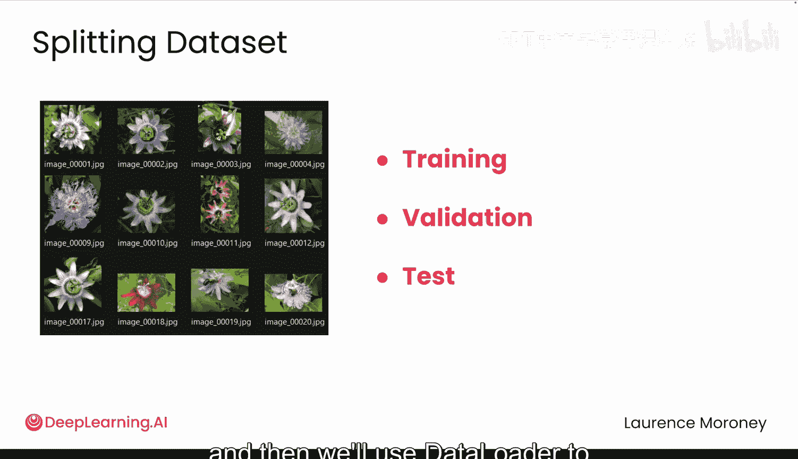
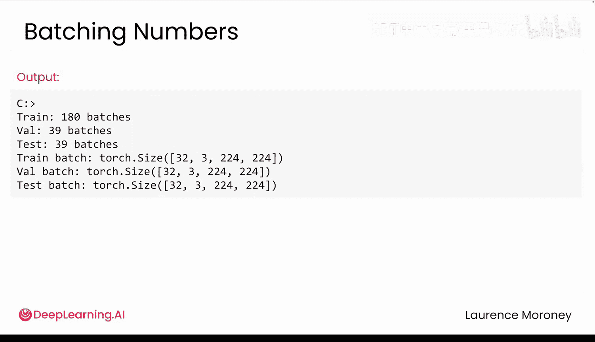

# 吴恩达《Pytorch深度学习（4模块全）｜PyTorch for Deep Learning》中英字幕 p20 4.dataloader.zh_en -BV1S7yhB7EUQ_p20-

In the last video you cleaned up your data with transforms， resizing images。

 converting them to tensors and normalizing the values。 Now it's time to tackle two more essentials。

 First， we're going split your data into training validation and test sets and then will use data loader to batch and serve that data efficiently but more importantly you'll see why these steps matter So let's get started if more data is a good thing why don't we just train our model on the full set of flower images here's the catch How would you know if your model works on new photos and that's why you would split your data。

 typicallyy you split data sets into three parts。 One for training one for validation and one for testing Each serves a different purpose The training set is what your model learns from It sees these images over and over again during training The validation set helps you check performance during training while you're still tuning things and the test set is your final check used only once after trainings complete。

Oxford flowers， you might split that 8189 images roughly like this，5700 for training。

1200 for validation and the rest for testing。 Let's see how you do that in pytorch。

 for the training set take 70% of the total length of the data and then 15% for validation Now you can compute test size as the remainder and then you'll ensure that the splits add up to the full data set and avoid rounding errors you'll see output like this The key is random split。

 It randomly assigns images to each set。 so you don't end up with all daisies in one and all roses in the other。

 This gives every split a good mix of the hundred02 flower types and just to be clear your original data set is not modified。

 you're not slicing it up youre just creating three separate views of the same data So now you have three separate data sets for training validation and testing in these courses will be using a mix of these depending on the main purpose of the lecture。

Learn more about how these splits work and why they're important。

 Check out the provided resources or explore the data engineering specialization。 Next。

 you'll use data loader to efficiently load batches from each set。

 and this is especially important during training for performance。

 remember that whole batch size equals 32。 That means you'll get 32 samples at a time instead of just one and here's the interesting part。

 looping through a data loader will give you one batch per iteration。

 I've added a break to stop after the first batch so you can inspect it notice that each batch gives you two things a batch of images and a batch of labels。

 for example， this means you have 32 images each with three color channels each size 224 by 224 The label tensor here gives you one label for each image in that batch。

 That break was a great way to inspect the first batch。 but you can also use this pattern。

 and this is handy for quick debugging without starting a loop。 Now we need to add one crucial。

meter to our data loaders and that's shuffle。 Why would you shuffle the training data Well there's two key reasons First。

 if your data is ordered daisies first then roses and then sunflowers。

 your model might learn to associate position with flower type instead of learning the actual features and that's not helpful for real worldor predictions。

 Second if the model sees only daisies for many batches and then only roses it can actually forget what it learned about daisies shuffling will mix flower types in each batch and will help the model retain everything that it's learning。

 So why then would we set shuffle equals false for validation and test。

 Well that's simple your model is not learning from these sets。

 It's just being evaluated so shuffling isn't needed and those problems we saw earlier wouldn't apply。

 One more important clarification。 shuffle only affects how data loader serves up the batches your original data remains unchanged。

 So now let's clear up a common source of confusion around batches and epochs。Here's the math。

 You can't have 0。125 of a batch， so you get 179 full batches of 32 images and one partial batch with four images。

 that's the remainder that was left over for total of 180 batches。

 One epoch means you're going through all 180 batches once seeing every image in your data set exactly one time。

 So let's verify this you can see in this code that you're printing the length of the last three batches。

 and here's the output。 you see that last batch with only four images。

 Well that's normal it's just the leftover images that did not make up a full batch。

 and this can confuse people sometimes when they expect every batch to be exactly the same size。

 So when you train for 10 epochs。 you're going through all 180 batches 10 times your model sees each image 10 times in total。

 but in a different random order。 each epoch thanks to that shuffle equals true。

 Now let's wrap up this video by looking at two common mistakes that can cause major problems as your data loader tries to access。

Samples and here's one that I see all the time。 You can see that I'm loading the entire Cv file from disk into memory Every time get item is called。

 If your data set has 5732 entries， that means that the full CSv all of those entries is reloaded every time you retrieve a single sample so that 5732 times per epoch。

 So if you train for 10 epos that's over 57000 full loads of the same file。

 which is a massive and unnecessary slowdown the fix is simple load once in it。

 and here's another common pitfall， if you get couda out of memory errors。

 the first thing to do is to try reducing your batch size start with 32 or even 16 and then work your way up to fit available memory。

 So now let's put everything that we've learned into practice。

 The output shows everything is working correctly proper shapes correct splits and efficient loading。

 you now have a complete data pipeline for the botanical garden app from those messy map files all the way to efficient。

😊。

ing and in the next video， we'll take a quick look at ways that you can bugproof that pipeline I'll see you there。

😊。