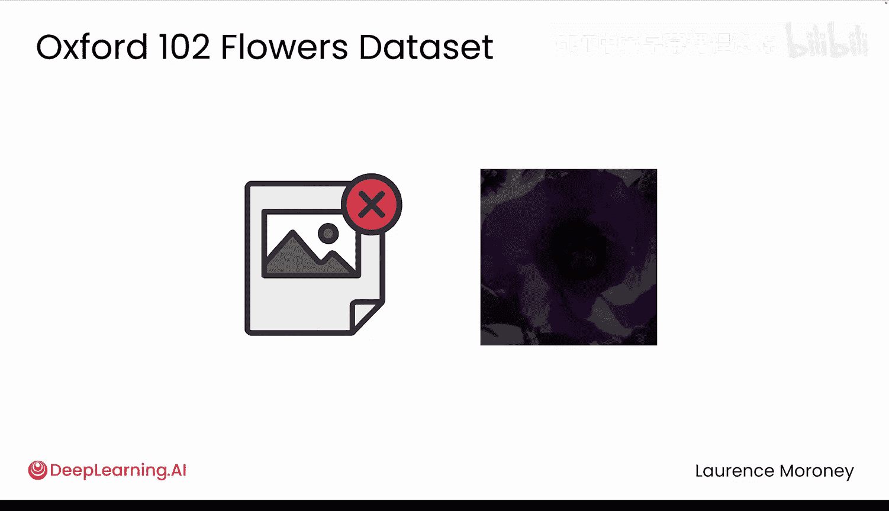
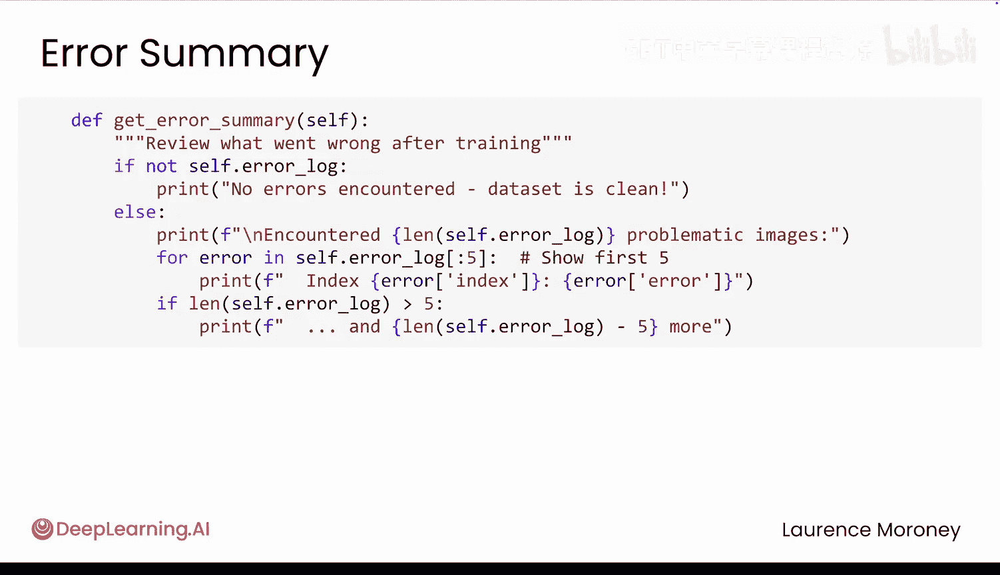
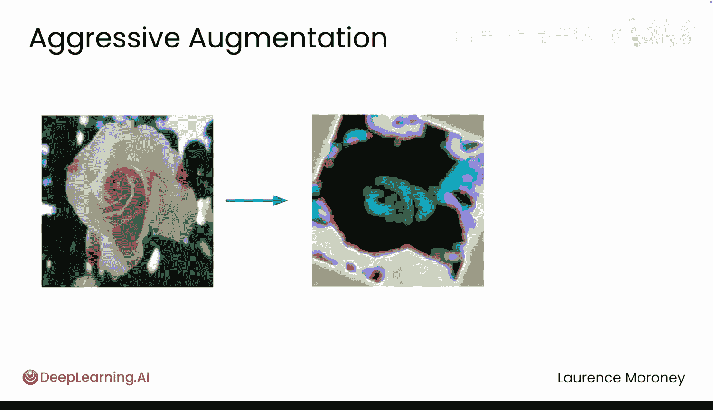
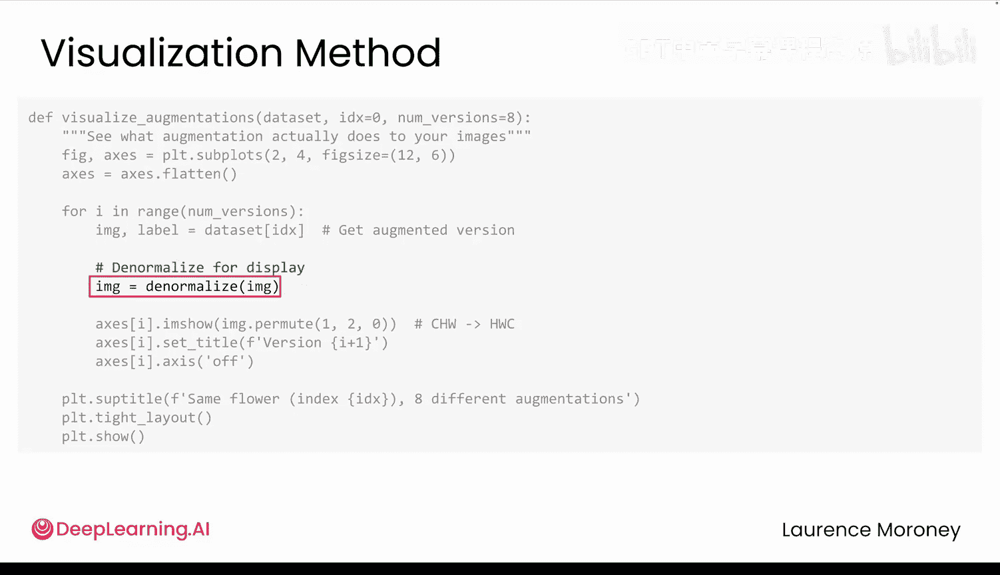
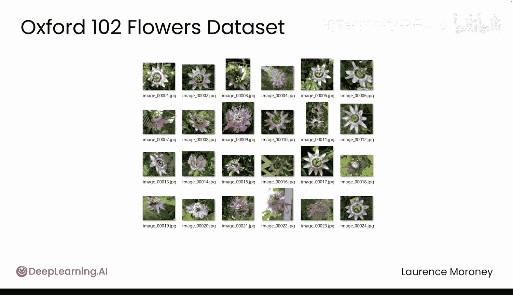

# 吴恩达《Pytorch深度学习（4模块全）｜PyTorch for Deep Learning》中英字幕 p21 5.bugproof-pipelines.zh_en -BV1S7yhB7EUQ_p21-

Welcome back。 You've built a working Oxford Flowers pipeline。 But how robust is it。

 What if your data contains corrupted images or what if your model has to recognize flowers in different or poor lighting and how can you be sure that your pipeline even works before you start training for hours in this video。

 you'll learn the techniques to make your pipeline more reliable and your model more robust。

 You'll add data augmentation to handle real world variations run a single batch test to catch errors early and add error handling so that one bad image doesn't crash your entire training run。

 Let's start with data augmentation So far， your model has only seen the original Oxford F images and they're all taken in similar conditions to help it recognize flowers in more varied situations。

 you can use data augmentation to generate new versions of those images。 But why does that help Well。

 if your model only sees perfect centered roses in bright sunlight。

 It might fail when someone shows it in。😊。

Image that's offcentered and in the shade by showing the same flower from different angles in different lighting and with subtle changes。

 you're teaching the model to focus on the essential features like the shape and the color rather than superficial details or the placement of the flower in the image itself。

 one way to do this is by saving flipped， rotated or brightness adjusted copies as new files but Pytorch has a smarter solution on the fly augmentation instead of storing extra files Pytorrch applies random transformations every time in image is loaded So for example。

 in epoch 1 flower 42 might be flipped horizontally and then in epoch 2 it might be rotated slightly and darkened This gives your model endless variation of training data without taking up extra storage to make this work will define separate transforms for training and validation。

😊。

This transform applied during training includes random changes。 As you can see in this code。 here。

 you might add a horizontal flip or rotation， or perhaps a color j。

 which randomly will mess with the lighting and color of an image。

 you can also learn more about all of the other augmentations in the course resources。 Now。

 you can see here in validation， I removed those augmentations。

 But why would you skip augmentation for validation。 Well。

 that's because you want to evaluate your model on consistent data。

 If validation images change randomly， too， you couldn't tell whether performance changes were real due to real model improvements。

 or just because of the different inputs。 So now that you've added augmentation to make your model more robust。

 let's make your pipeline more robust， too。 here's a frustrating scenario。

 your training has been running smoothly and then two hours in crash 1 corrupted image brings everything down or maybe an image is technically valid。

 but so small that it breaks your transforms。 These issues are more common than you might think。😊。

Especially with real world dataset sets， the Oxford Flowers dataset is relatively clean。

 But what if a file was only partially downloaded and corrupted or maybe somebody accidentally saved a broken image。

 Let's build a data set that handles these problems gracefully。 the first step is simple。

 instead of crashing， we track errors。 then comes the important part。

 making get item resilient to bad data， It starts out as usual。

 but now we can add a few safety checks。 Ver confirms that the file is not corrupted。

 a size check skips tiny images that might break your transforms。

 Con or GB fixes grayscale images that might have snuck it。 but here's the key。

 What happens when something still goes wrong。 Well， instead of crashing。

 we can log exactly what went wrong， we can print a warning。

 and then we can gracefully skip to the next image。

 That recursive call to get item will keep your pipeline moving。 Even when files are broken。 Finally。

 we'll add a method to review the issues after training。 So now when training。😊。

you can expect which images had problems and then decide whether you want to fix them or leave them out with error handling in place。

 your pipeline will not crash on bad data and you will have a clear record of what went wrong。

 but there's another subtle issue that can hurt your model's performance and that's overly aggressive augmentation I've seen pipelines where the augmentations were so extreme that the flowers turned into unrecognizable blobs of color and if your model can't tell what it's looking at well it can't learn the features and then can't learn to classify so how do you know if your augmentation is reasonable one simple thing is just look at it we can build a quick visualization tool so every time you called data IDX the random augmentation will create a new variation we can use that to show eight different versions of the same flower but there's a catch the images are normalized so we need to undo that before we display them this code reverses normal so you can actually see the colors instead of the distorted values。

You can test your augmentation and here's what to look for。

 If the flower is clearly recognizable in each version， then you're in good shape。

 if they all look identical， then your augmentation probably isn't working if they look like abstract art it's probably too aggressive and if the images are all black or have wild colors it could be a normalization issue So you've handled errors gracefully and verified the augmentations look reasonable but here's a key question how do you know your pipeline is actually working during training you might have images that are never accessed because of a shuffling bug or maybe some images might be loaded far more often than others without monitoring you would never know So let's add some lightweight tracking to shine a light on what's happening under the hood this will extend your datas to track which images get loaded。

 how often each one is accessed how long each load takes and then will add a simple method to review all of these stats and call it just after each training epoch and this kind of monitoring can reveal shuffling bugs。

Where some images are never accessed performance issues such as slow load times， data imbalance。

 where certain images are accessed too often。 it's good for you to catch these problems early。

 and it's better to do it now than discover after days of training。 and that's it。

 You've transformed your Oxford F pipeline from a basic loader into a production ready system。

 If you want to see all of these pieces in action。 check out the lab for this module where you'll build and explore the complete pipeline。

 putting your data through real worldor tests before training even begins。

 You've prepared the data Now it's time to go build something amazing with it。

 Congratulations on mastering Pytorrchches data pipeline and we'll see you in the next module。😊。

