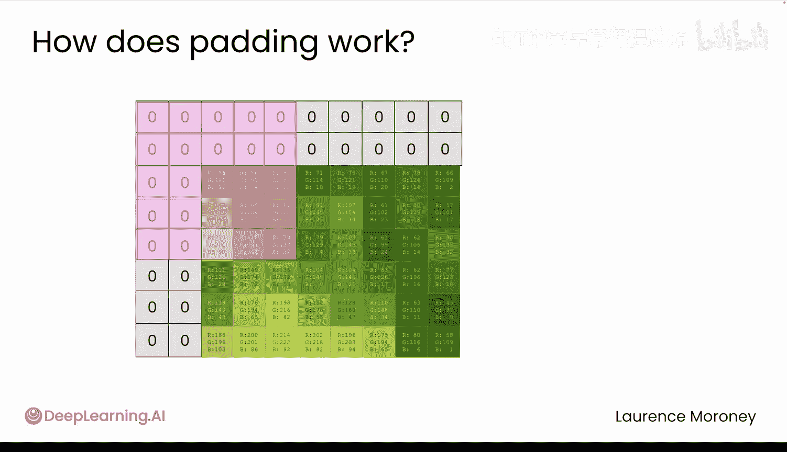

# 吴恩达《Pytorch深度学习（4模块全）｜PyTorch for Deep Learning》中英字幕 p22 1.cnns---part-1-filters,-patterns,-and-feature-maps.zh_en -BV1S7yhB7EUQ_p22-

Welcome back。 You've done a great job handling the data for your botanical garden app。

 but I got some news for you。 The butterfly house next door once in。

 and they want us to expand the app so that visitors can also classify insects and small animals So you're going to need something bigger。

 You're going to need something that can recognize more advanced things and can detect edges。

 textures and patterns and you're going to need something called a convolutional neural network。

 Youve built your classifiers using linear layers。 But here's the problem。

 Linear layers treat every pixel as independent。 When your model looks at a flower or a butterfly image。

 it sees thousands of separate numbers with no understanding that neighboring pixels can form features like wings and 1 A or eye spots and that's where convolutional neural networks come in over the next two videos。

 you're going to explore how convolutional layers help neural networks see by scanning for patterns in images using filters。

 CNNs are the backbone of computer vision。😊，inspiredspired by biology in the 1960s。

 neuroscientists found that certain neurons and the visual cortex respond only when they see particular patterns CNNs mimic this by using filters to sort out features in images and learn from those so let's see how this works with one of our nature photos here's a close up from our data in grayscale。

 If I zoom in， you can see the individual pixels Now let's add the grayscale values you've centered on this pixel with a value of 61 Now think of the surrounding pixels in this3 by3 grid as its neighbors Now imagine a filter a separate three by3 grid of numbers which you'll slide over this image at each position you'll multiply the filter values with the pixel values underneath then you're going add all of these together and take the average the resulting average then replaces the center pixel value essentially changing its color Then when you slide the filter over the image and calculate new。

For each pixel based on its neighbors， that process is called a convolution Well why on earth would you do this Well。

 by assigning different weights in the filter， you actually highlight different kinds of patterns Now let's take a look at what that means。

 Take this image for example， Can you guess what this filter might do。

 You can think of it like these values in the center as starting from a baseline of zero or black。

 But if you look to the left and right， adjacent pixel values that are similar will actually cancel each other out But if there's a sharp contrast say the left side is really dark and the right side is really bright that creates a strong output for this filter that's exactly what you'd expect for a vertical edge in an image the filter picks up on this contrast and highlights where the vertical edges appear。

 Now what you think this filter might do。Well， it's very similar to the previous one。

 but this one detects horizontal edges。 And here is what it produces。 Now。

 why does this matter for a classification task。 Well， when you identify a butterfly。

 you don't analyze every pixel。 You notice wing shapes， veinin patterns。

 those distinctive orange and black sections。 Your brain uses these features to recognize that's a monarch。

 for our model， it's the same idea。 filters help highlight the patterns that distinguish the difference between a monarch and a swallow tail or between a butterfly and a beetle。

 Now， heres the interesting part。 You could design those filters by hand。

 But how would you know which filters work best for butterflies versus flowers versus beetles。

 Or what if the model could learn which filters work best and tune them to find specific patterns that identify each class。

 That's the key power of convolutional neural networks。

 They will figure out which visual features matter most for the。😊，Spific task that you have in mind。

 Pretty cool right So now let's dive in and see how you can create convolutional layers in pytorch using N do module Earl you built networks using layers like N do linear a convolutional layer works in exactly the same way It's just another type of layer that you add to your model architecture in pytorrch you define one using N do co2D Now that name just means it's a twodimenional convolution like you would use in a two dimensionmenal image So let's walk through each of these settings step by step in channels is the number of color channels in your input image for our nature photos that's typically three channels red green and blue out channels determines how many filters your convolutional layer will use Each filter learns to detect a different feature maybe one will find wing edges another spots eye patterns and another detects fuzzy textures usually you'll have multiple filters to capture all of the different features in your images kernel。

Size sets the size of each filter and a three by three filter is common because it examines each pixel along with its immediate neighbors。

 and this is perfect for detecting local patterns like wing scales or flower paedal textures。

 Str controls how far your filter moves with each step as it scans the image。

 A strideide of one means it carefully checks every pixel increasing the stride makes the filter skip pixels It's faster but you potentially missing fine details like antenna segments。

 padding is really interesting。 and it's related to the kernel size。 Think about this for a second。

 How would you center a pixel on the edge of an image。 Well。

 imagine you zoom into this corner of an image so that the boundary is now outside the image and now take a filter and slide it into the corner。

 But what happens if you want to center the filter on the pixel in the corner。

 your filter now has neighboring values that fall outside the image。

 A padding value of one simply adds those value。😊，In and they're typically set to zero by default This is related to kernel size because what if I had a kernel size of5 now you're going to see you need a padding size of two in order to center on a corner pixel so that covers how filters work and how convolutional layers use them to find useful patterns and images now that could be the delicate veins of a butterfly wing or the spiral pattern of flower pals in the next video you'll explore the architecture of a complete convolutional neural network and you'll understand how convolutional layers pooling and fully connected layers all work together and then we'll implement that in Pytorch。

😊。

