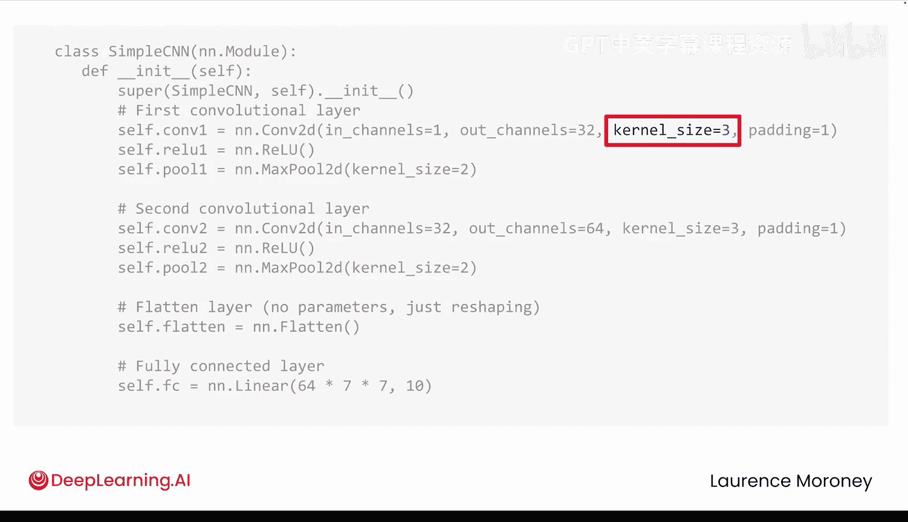
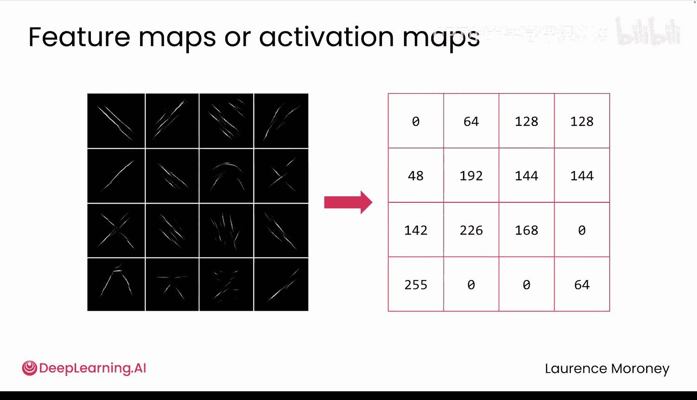
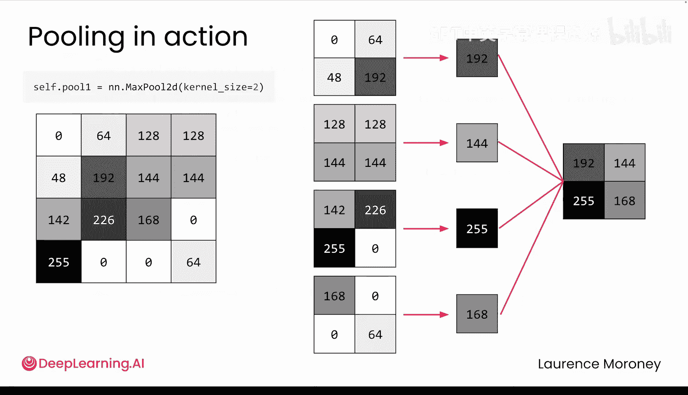
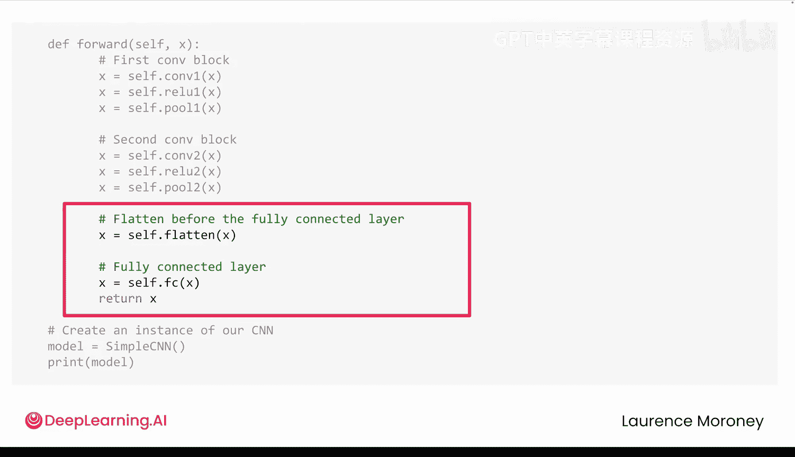

# 吴恩达《Pytorch深度学习（4模块全）｜PyTorch for Deep Learning》中英字幕 p23 2.cnns---part-2-the-full-architecture.zh_en -BV1S7yhB7EUQ_p23-

In the last video， you explored how convolutional layers work and how CNNNs can learn useful filters to extract features and patterns from images。

 Now， we're going to put those pieces together into a full convolutional neural network architecture。

 And as you can see， it extends N dot module， just like you've done before。 in the init function。

 you'll define the structure of your network。 It starts with two convolutional layers and ends with a fully connected layer to classify your images。

 fully connected just means that every neuron in the input is connected to every neuron and the output。

 and it's just another name for linear layer In this first convolutional layer。

 you're going to start with an image that has one channel。 So it's a grayscale image。

 Each pixel has a single brightness value。 The model will then try to learn 32 different filters。

 Each filter is one of these three by three grids of numbers。 So there's 9 weights per filter。

 These filters slide over the image and respond to different patterns with a padding of one。😊。

While the output of this layer may look like 32 new images。

 they're really just a arrays of numerical values showing how strongly each filter reacted to different parts of the image。

 These are commonly known as feature maps or activation maps。

 and they map where each feature appears in the input。 Then comes the re activation。 And as you know。

 it sets any negative numbers in the resulting feature map to 0。 And again。

 this helps the model learn more complex patterns。 Then it's fed into something called max pool 2 D。

 What is that。 Well， let's take a look。 pooling is a common technique in convolutional neural networks。

 that's used to reduce the size of feature maps。 It's effectively a way to throw away pixels after a filter has been applied compresspressing the data while keeping the most important parts。

 in a way that shouldn't affect the results。 Let's see this in action。

 sayy you had a kernel size of2 for the max pool。 So on the left。

 you have the feature map output from。😊。

FilterSince you're pooling kernel sizes2， you select a two by two area of values。

 you'll then only keep the largest value in this group。 In this case， it's 192 and discard the rest。

 And that's why it's called max pooling。 If you repeat this process across every two by2 group of values in the feature map。

 you'll end up with a smaller output keeping only the maximum value from each two by two area。

 The logic here is that your filters have already extracted the important features from the original image。

 So now by applying pooling you're compressing each filtered image keeping just the most significant information。

 As a result， less data needs to pass through the network。

 and the next layer sees images that were only a quarter of the original size。

 and this is important because after your first convolutional layer。

 you now have 32 different feature maps flowing into the second layer for large images。

 this quickly becomes a lot of data pooling。

Rduces this volume of information making your neural network much more efficient without losing valuable details and more robust to small changes after your convolutional and pooling layers have highlighted and compressed the key features in the image it's now time to classify the result using a fully connected layer this fully connected layer combines all of the features into a final prediction in this example you can see that the linear layer has 64 times 7 times 7 inputs the 64 should be relatively photos where resized to 28 by 28 pixels for this example and you figure it all out Well remember how the max pooling layer works by taking images from2 by2 chunks so a 28 by 28 image is going to be split in half on each axis and you'll have 14 by 14 images the second max pooling layer is going to do the same thing and hal that 14 by 14 to get you to 7 by7 so then those7 by7 feature maps will get fed into the final。

linear layer so in other words each max pooling layer halves the size of its input then you have the forward method to define the flow of data。

 which is pretty straightforward No pun intended you pass data through each of the convolutional layers and then recall that the linear layer expects a single row of values so you need to flatten your tensor into a single vector and pass it through that final layer to produce a prediction and that's your full CNN pipeline from raw pixels to learned features to classification so far you've now seen how a CNN processes an image starting with those learned filters that generate feature maps and then pooling to reduce the size and improve robustness and then finally classification through the fully connected layers so you can now understand the core theory and in the next video I'll walk you through the code step by step to build a convolutional neural network using pytorch。

