# 吴恩达《Pytorch深度学习（4模块全）｜PyTorch for Deep Learning》中英字幕 p24 3.train-a-cnn-for-image-classification.zh_en -BV1S7yhB7EUQ_p24-

Welcome back。 Now that you've seen how convolutional layers work。

 Let's build a full CNN for the expanded nature classifier app。 In this video。

 you'll explore a convolutional neural network and train it on a small but diverse data set of 32 by 32 color images。

 F， Ins and small animals。 I won't walk through all of the data loading and prep that's handled for you in the lab code。

 So let's jump straight into defining the network。 Here's the full architecture。

 It's similar to the one from earlier。 except now the images are in color。

 and there are three convolutional blocks instead of two。

 focus on the input and output channels of each block。

 The first convolutional layer takes three input channels， one for each of red green and blue。

 and it produces 32 output channels。 and this will mean that it will learn 32 different filters。

 You can think of this as the model seeing three versions of the image。

 red only green only and blue only。 Each of the 32 filters picks up different patterns from that input。

 The second layer takes those 32 channels。😊。

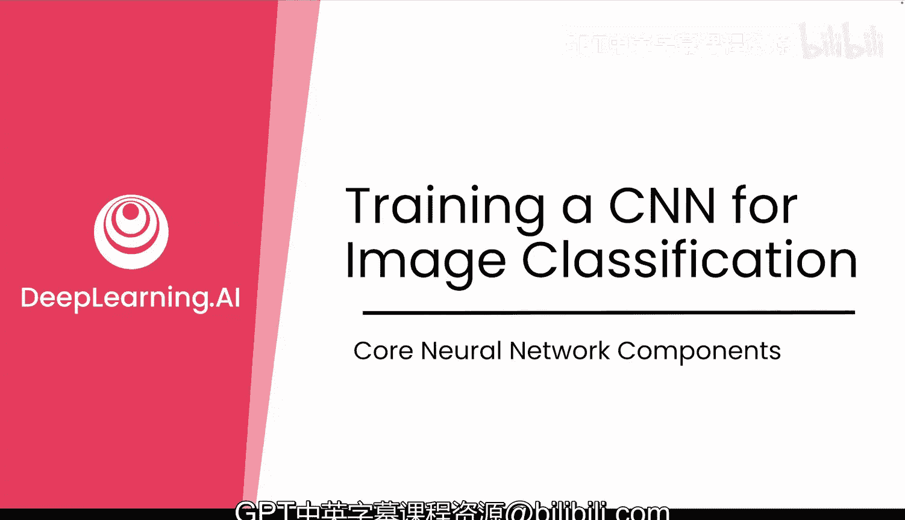

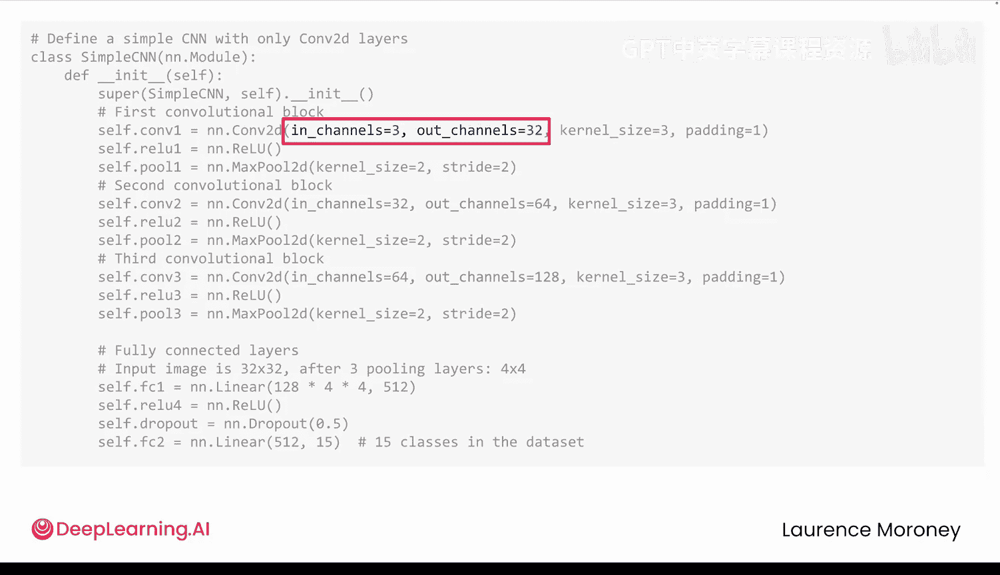

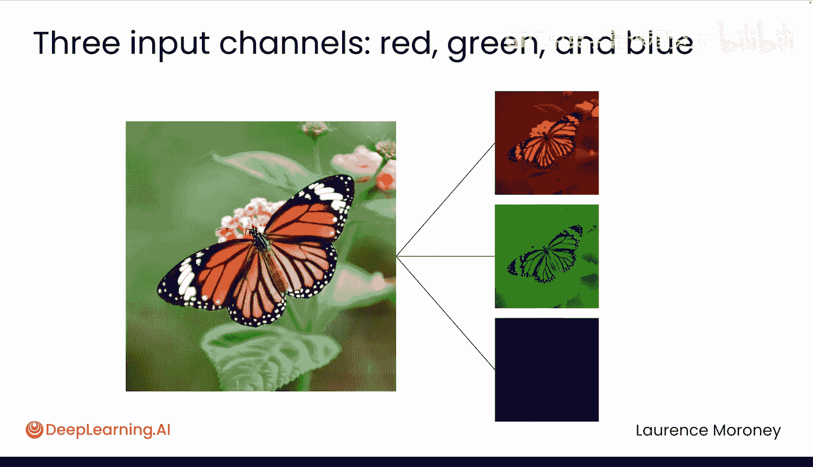

And produces 64。 the third layer goes from 64 to 128。

 So the model is learning more filters as it goes deeper。

 Each convolutional block is followed by a max pooling layer that cuts the height and width of the image in half。

 So by the time the image passes through all three blocks。

 It spatial dimensions have shrunk from 32 by 32 to just4 by4。 After that。

 the feature maps are flattened in the forward method and passed into a fully connected layer with 512 neurons。

 This layer uses relu just like before， and helps the model combine features into more abstract representations。

 Then comes something new。 a dropout layer。 During training。

 this layer randomly deactivates about 50% of the neurons。 Now， this might sound counterintuitive。

 Why would we want to turn off parts of our network。 Well， let's look at an example。

 imagine a model trained to classifiedify dogs versus wolves。

 This husky image was misclassified as a wolf。 Can you guess why， well。

 it's not because the husky looks like a wolf。

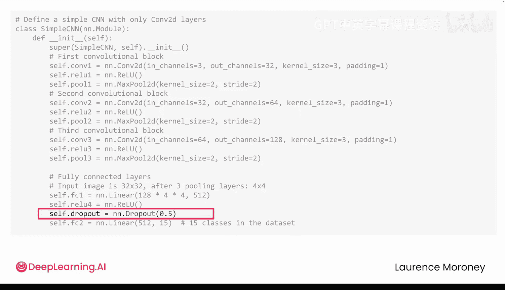

It's because the model was fixating on the snow in the background in the training set。

 some wolf images had snowy backgrounds， and that was enough for the model to start learning that snow means wolf。

 What's happening here is called coadaapation。 Some neurons become specialized snow detectors and others start relying on them。

 the model then gets lazy it leans on shortcuts instead of learning robust features like body shape or facial structure。

 Dropout breaks those shortcuts by randomly turning off neurons during training dropropout makes it risky to rely too much on any one pattern。

 if the snow detector neuron gets dropped out。 The model then has to find other cues。

 the ones that actually matter。 In practice dropropout rates typically range from 0。2 to 0。

5 and you' place drop out after activation functions but before the final classification layer Now to be precise if most wolf images in your data have snow and dog images don't that's a data problem。

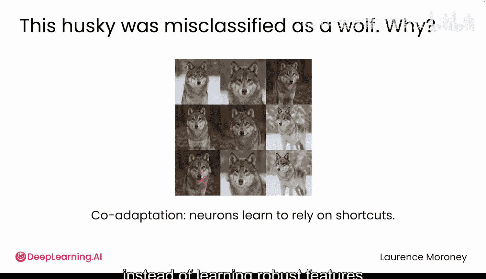

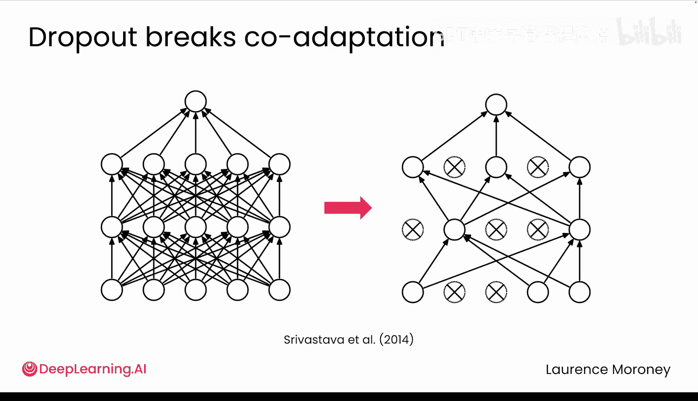

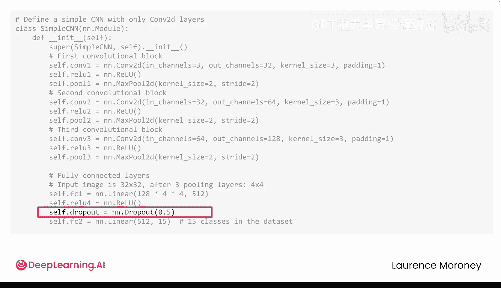

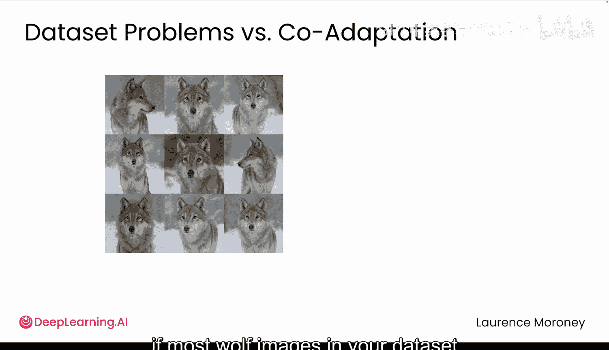

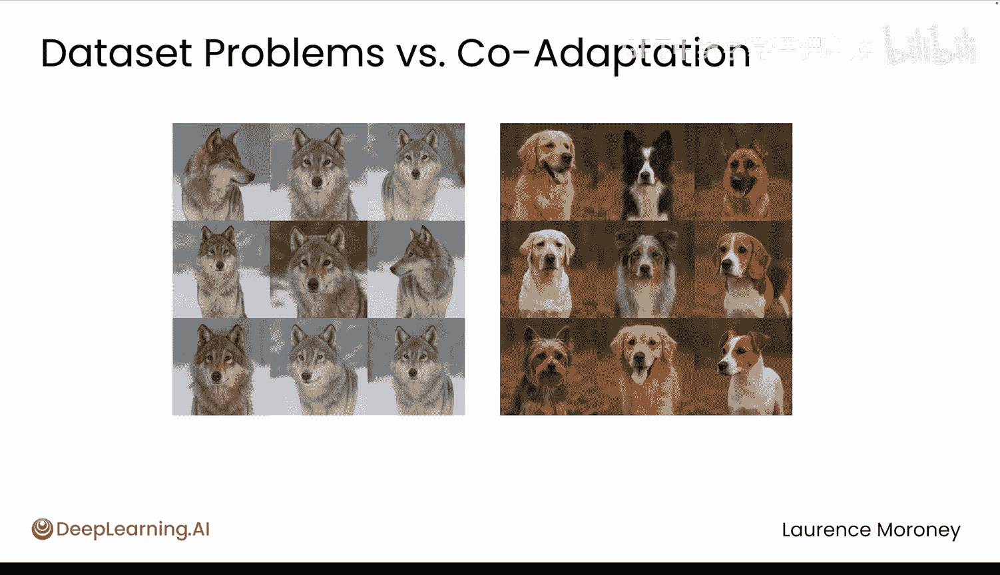

isn't overfitting。 It's just learning the only pattern it sees。 but in typical real world data。

 the patterns are not so clearcut。 Dropout helps by encouraging the model to learn features that generalize not just the ones that happen to correlate。

 And finally， there's a second fully connected layer that outputs 15 values one for each class in your dataset。

 once you've defined the model， you'll also set up an optimizer and a loss function。 In this case。

 we're using the crossenttropy loss and the atom optimizer in the graded assignment。

 you'll also see weight decay applied to the atom optimizer。 like dropout。

 it's a regularization technique that helps with generalization but it works differently。

 instead of turning neurons off。 weight decay discourages the network from using very large weight。

 Why would it do this。 Well， it's because large weights can be a sign that the model is memorizing specific patterns in the training data rather than learning features that generalize。

 weight decay as a small penalty for large weights。

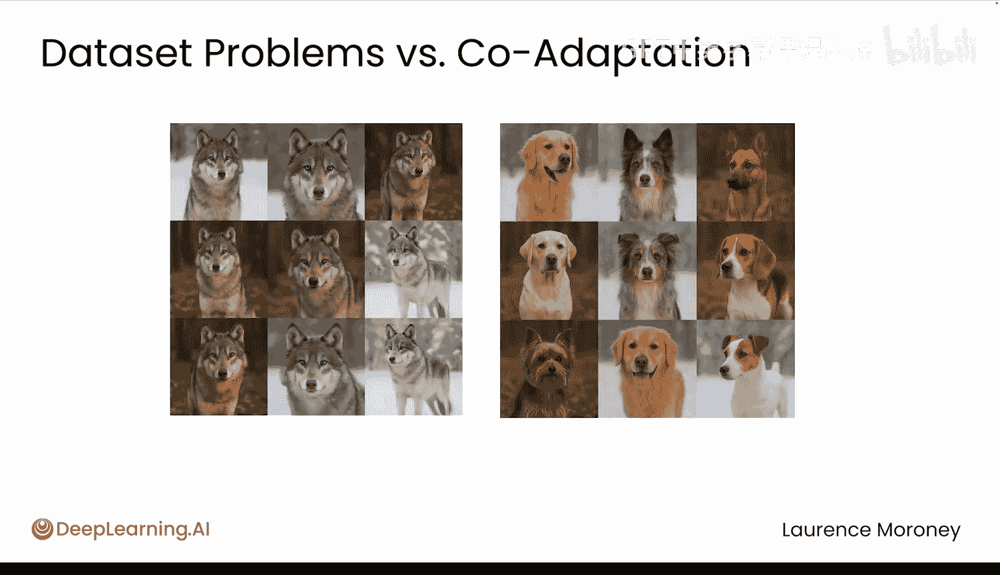

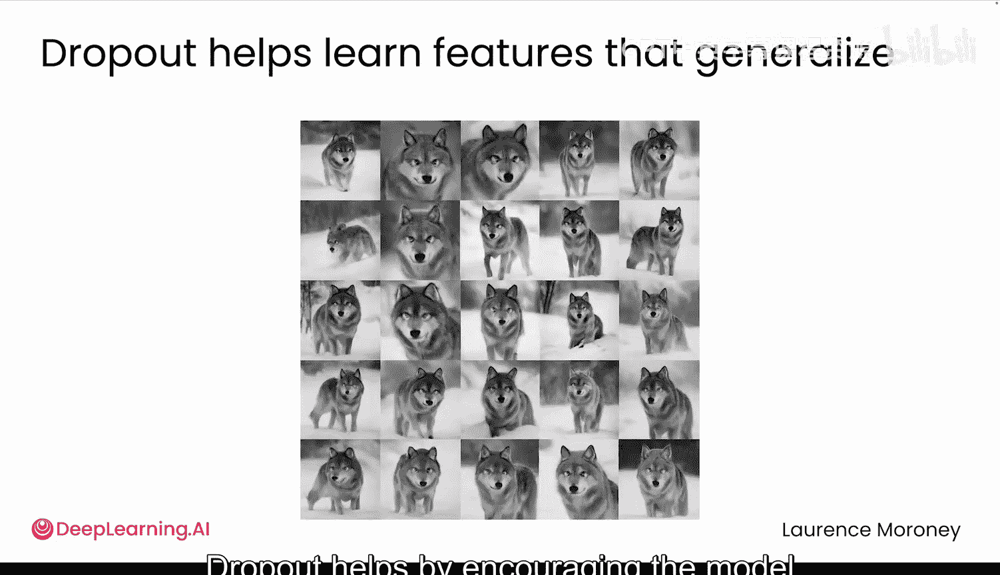

Nouddging the model towards simpler and more robust solutions Now when you head to the lab。

 you'll get to see how the shape of your data changes as it flows through the CNN。

 The first number you'll see in each shape is the batch size。

 So if you're training with one image at a time， that number will be one Each image starts with three channels。

 red， green and blue and each channel is 32 by 32 values。

As the image passes through each convolution and pooling layer。

 the spatial size shrinks while the number of channels grows by the final layer。

 the model outputs 15 values， one for each class， representing the predicted class probabilities。

 When I train this model for just 10 epochs。 the results actually look pretty good。

 you can see it in the graphs here on the left， the training loss steadily decreases on the right。

 the accuracy on new unseen data improves over time。 And when you check out some sample predictions。

 the model surprisingly accurate。 Even with these small low resolution images。

 They may look a little pixelated here， but that's just because we enlarge them from their original 32 by 32 size。

 So now to your turn， head to the notebook and explore how it all works in detail。😊。

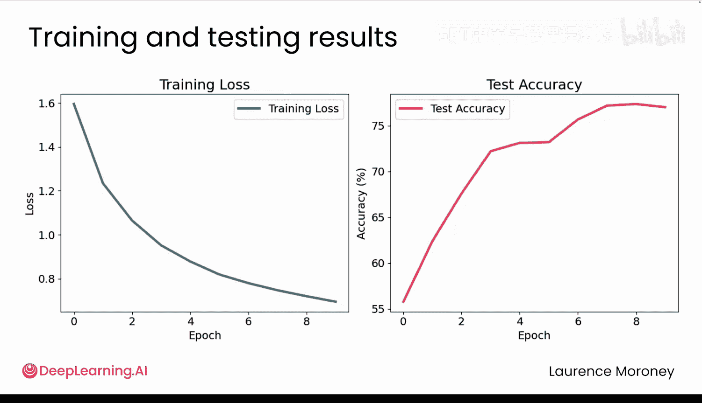

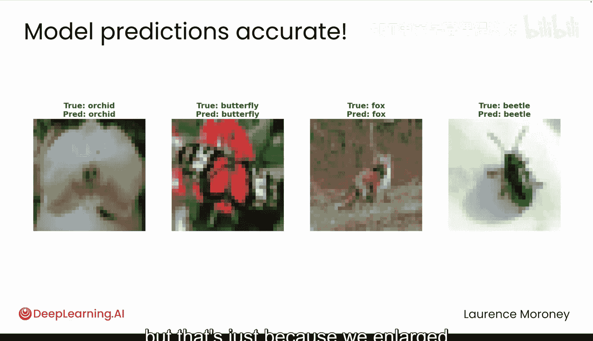