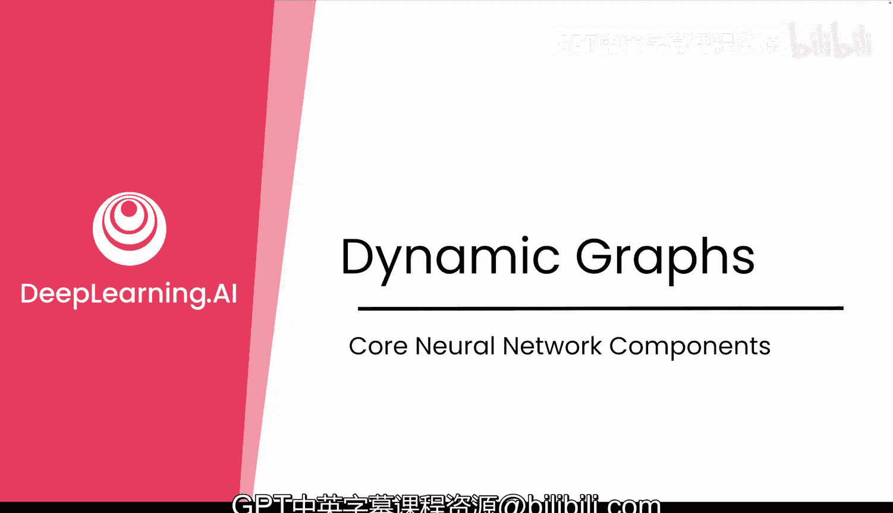
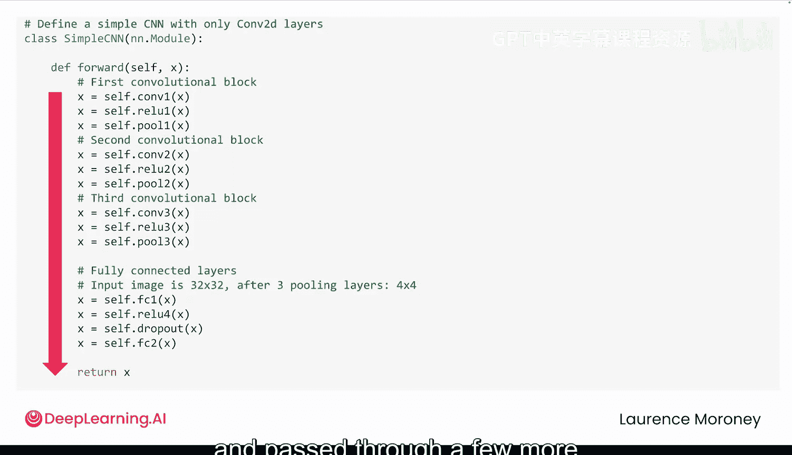
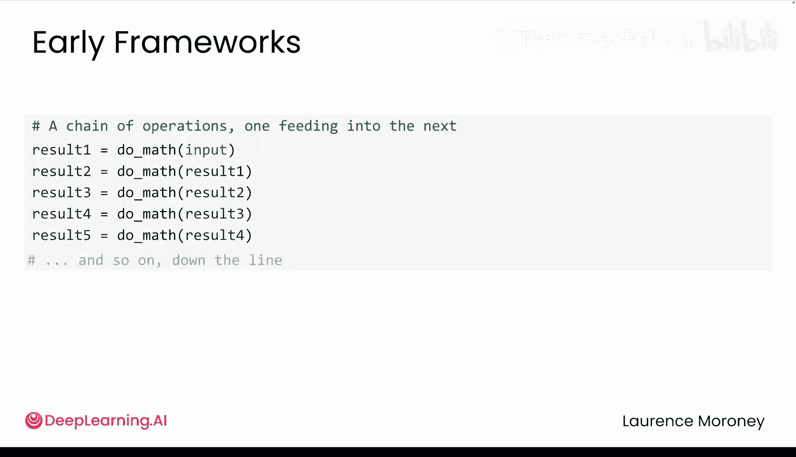
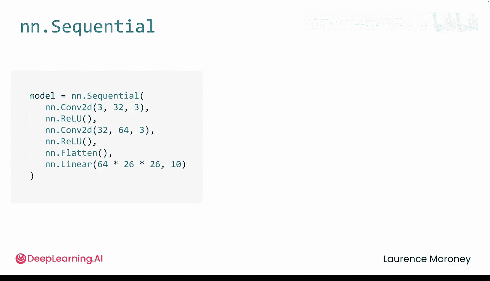
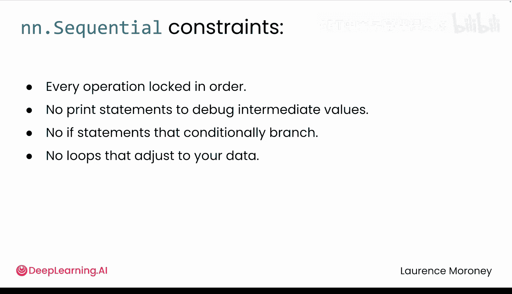
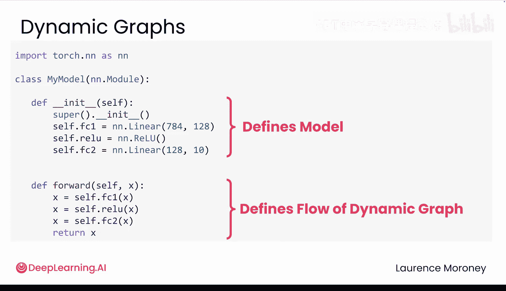
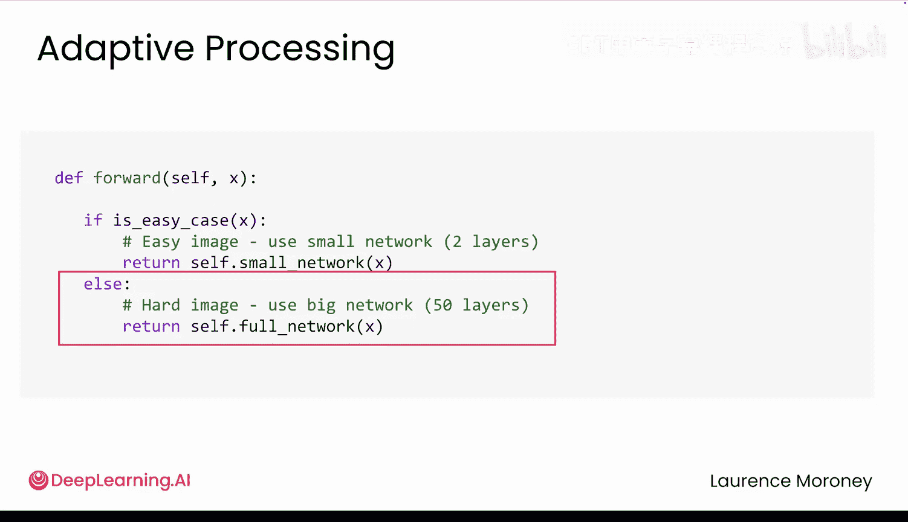

# 吴恩达《Pytorch深度学习（4模块全）｜PyTorch for Deep Learning》中英字幕 p25 4.dynamic-graphs.zh_en -BV1S7yhB7EUQ_p25-

Welcome back。 You've just trained your first convolutional neural network for the botanical garden app。

 but let's take a closer look。 The structure is completely linear。 data flows straight through。

 There' three blocks of convolution。 Reello and pooling layers。

 and then it's flattened and pass through a few more layers before outputting a prediction。 Now。

 that's a solid start。 But so far， it's just a stack of layers。

 It looks repetitive and it doesn't really show off what makes pytorrch special In Pytorch。

 you're not locked into that ridge and model structure。

 and it accomplishes this using something called a dynamic computation graph that gets built as your model runs step by step。

 As you heard way back in module 1， older frameworks worked differently。

 You had to define your computation graphs ahead of time before any data could pass through。

 What does that actually mean。 What is a computation graph。

 What makes pytorrch's dynamic approach so powerful。 Well， let's take a closer a look。

 Let's start with a model defined using sequential。

 The model runs your data through each layer in order just like you'd expect。

 Each layer transforms the input and。😊。

sses it on。 It's simple， readable and effective for straightforward architectures。

 But here's the catch。 sequential locks you into a fixed structure。 It doesn't support loops。

 conditionals or other kinds of branching logic。 In fact。

 this kind of code isn't so different from how you build models in older frameworks using static graphs。

 to see why let's take a closer look at what a computation graph really is。

 When you write this sequential block， you're defining a specific mathematical equation。

 con2 D might specify thousands of multiplications and additions。 Re zeros out any negative values。

 And when chain together， you get one giant equation。 Now， imagine spelling out that very equation。

 every single calculation， one step at a time。 multiply this by that at the results of this zero out negatives multiply again。

 add the bias on and on and on countless times。 That step by step breakdown。

 That's a computation graph。 Every operation you apply is recorded as part of that graph why。

During training， all deep learning frameworks need to walk backwards through the graph using the chain rule from calculus That's how it figures out how to adjust each and every parameter and older frameworks handled this differently than pytorrch does now you had to define that entire graph upfront every operation。

 every connection before anything could run once defined the structure was locked and when you use sequential in pytorch。

 you're working with similar constraints。 Everything runs in a fixed order。

 you can't print intermediate values to debug there's no conditionals， there's no loops。

 Everything input follows the same path with no exceptions and that's why sequential feels a little bit like static graph programming。

 you're back to defining that fixed equation with no flexibility Now you might wonder why would anybody want to work that way Well it turns out there are real benefits when a framework knows the full computation graph in advance it can optimize it for speed and memory efficiency but the tradeoff you give up flexibility because you're describing a fixed equation there's no room to tweak things as you。

Or explore unexpected ideas。 And that's exactly what Pytorch set out to change。

 Let's look at an example。 Imagine you're building a CNN for your botanical garden app。

 but now you want it to handle flowers differently from butterflies in Pytorch。

 you can write that logic directly inside the forward method。 in older frameworks with static graphs。

 that kind of control was really， really difficult。 Yes， they allowed you to have conditionals。

 but only by building every possible path ahead of time。 Pytorch takes a different approach。

 that if statement doesn't just control the logic。 It shapes the graph itself。

 Each time forward runs， Pytorrch records exactly what happens。

 Every multiplication addition layer and branch。 The result is a custom computation graph built on the fly based on the actual path that your data takes。

 That graph is used for back propagation。 so the parameters get updated and then the graph is discarded。

 Next time forward runs， Pytorch starts from scratch。  building a brand new graph。😊。

tailored for that run， even if it follows a completely different path。

 and that's the core difference。 Sta frameworks make you think like a compiler。

 But Pytorch lets you think like a Python programmer。 write logic， branch， adapt on the fly。

 This flexibility comes from using Nn module instead of NN sequential。

 whether in it defines our model and forward allows us to define the flow of your dynamic graph。 Now。

 these dynamic graphs do come with a small performance tradeoff。

 but for researchers and developers that flexibility means faster iteration。

 easier debugging and more expressive models。 and it's not just a nice idea。

 it solves real problems that you will actually run into。 For example。

 static graphs often require all inputs to be the same shape。

 But what if you're working with sentences where some have three words and some really long ones have 50 in Pytorch it just works if you need to debug something in the middle of a computation in static frameworks that meant switching to a special debug mode interrupting the flow wasn't allowed in Pytorch。

 it's just Python。 if you need to。😊。

Investig an issue。 Just add a print。 you can even build models that adapt to the input like running a simpler model for simple cases and a complex model for trickier cases。

 your model becomes smart about its own computation and these are not edge cases and this is how modern AI works in Pytorrch it's all possible by just writing Python code。

 This kind of flexibility is perfect for experimentation but as your models grow。

 you'll need better ways to structure your code and that's what we'll explore next and I'll see you in the next video。

