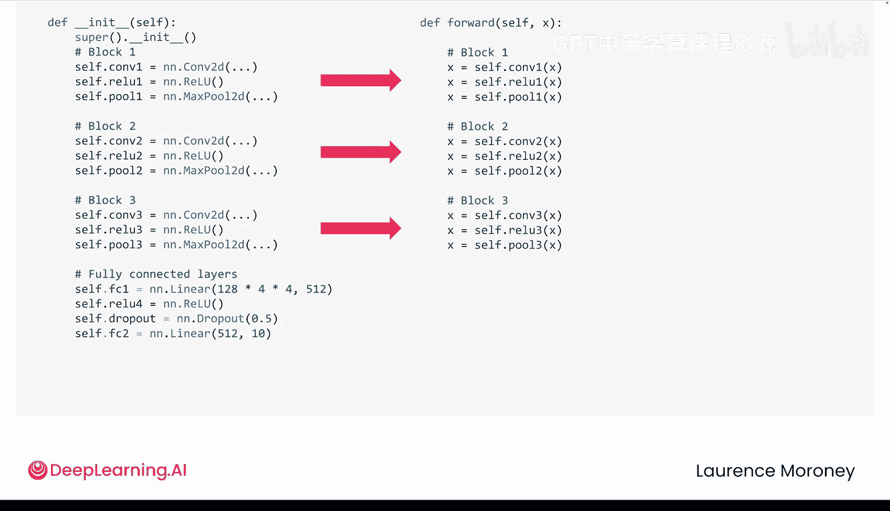
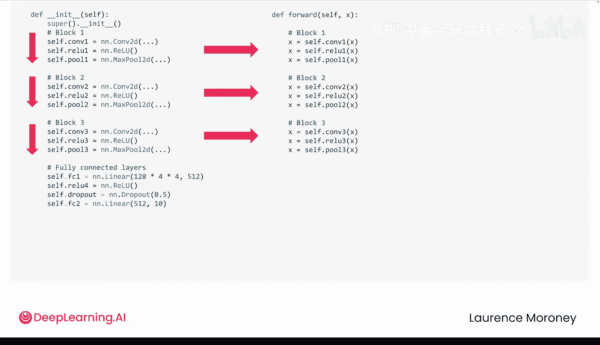
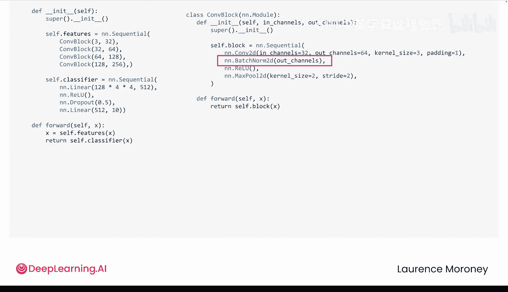
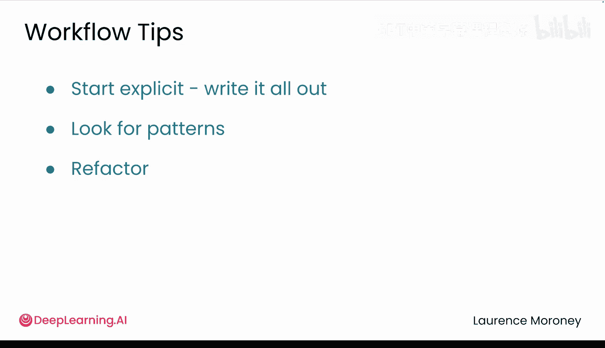

# 吴恩达《Pytorch深度学习（4模块全）｜PyTorch for Deep Learning》中英字幕 p26 5.modular-architectures.zh_en -BV1S7yhB7EUQ_p26-

Welcome back。 Last time you learned about Pytorrch's dynamic computation graphs and how they give you incredible flexibility。

 But that didn't solve the repetitive path of your CNN。 You could have written that in any framework。

 Well， there's a time for simplicity and a time for flexibility。

 So let's explore when to embrace ptorrch's dynamic nature。

 when to keep things simple with sequential and most importantly。

 how to combine both approaches to write professional maintainable code。

 Let's look at your init method。 You have9 separate layers following a pattern。

 And here in the forward method。 You're manually calling each of those nine operations in the exact same order that you define them。

 People often wonder if you really need all of this redundancy between the in it and the forward methods。

 Why should you even bother with two methods。 Well。

 there's a good reason as it separates concerns as was suggested by the previous video。

 The init method is there to define your model's architecture。

 The layers and their learnable parameters that will persist across training。

 These will be the actual。😊。

Values that your model is learning。 while the forward method， in a sense。

 is defining the dynamic flow of your computation graph。

 and it's this separation that enables pytorrchs flexibility。

 but is this model using that flexibility。 Well， no it isn't。

 Every image is just following the same path three times in a row and you're writing everything twice for no real benefit。

 So let's fix this redundancy because you could imagine the botanical garden client is calling and says the app is working great。

 but we're seeing some tricky butterfly species that all look similar。 Can you make the model deeper。

 maybe add another convolutional block。 Sure So you need to add a fourth block。 but remember。

 you have to add it in two places。 first is in in itops you've already used Relu 4 for the fully connected layer。

 So now you're playing a naming game。 you call this Re 5。 well that's confusing。

 Why would block 4 use Relu 5 and then you have to remember to add it to the forward。

 This is how bugs creep in。 it's not uncommon to add layers to in it and forget to call them in forward。

 These issues might not。😊。

CaErrors， but your model is also not doing what you would expect。 The fix in this case。

 Pytorrches N N sequential to group layers that run in order。 Now， in the full word。 That's it。

 you want to add that fourth block， your client just ask for Well now you can just update in it。

 No forward method changes needed， No naming conflicts， no forgotten layers。

 You define the sequence once and sequential handles the execution。 look at that forward method。

 two lines for the sequential blocks instead of 15。

 So you might be wondering if sequential is so convenient。 Why not just use it for everything。 Well。

 remember from the last video， sequential forces a fixed linear path。 No conditional branches。

 no loops， no dynamic behavior。 It's essentially a static pipeline。

 But if your model needed to say return two different outputs。 It wouldn't be possible The good news。

 you don't have to choose one or the other。 And you can see that in the code that we looked at earlier。

 But notice it's still repeating the con re pool pattern three times in that sequential。😊。

You can do even better with modular design Since you're repeating that same pattern。

 you can group those layers into a single block。 It keeps things cleaner and easier to reuse。

 This is now a reusable building block。 just like any built-in pytorrch layer Now look how clean your CNN becomes adding that fourth block Well just add a new conv block to features want to change all blocks to use batch normalization。

 update conf block once and all three blocks will get the change。

 This is modularity  building complex models from simpler reusable parts you can even nest modules inside modules to create clean scalable architectures。

 So here's a quick workflow tip。 start explicit then refactor and when building something new write everything out even if it's repetitive it makes debugging easier and helps you see exactly what's happening Once it works。

 look for patterns other repeated sequences。 well you sequential other reusable blocks create custom modules like conf block。

 Think of it as a rough draft that you polish as you go。

you're not writing redundant code because you don't know better you're doing it to understand and debug effectively you've now gone from defining every layer by hand to building clean modular models just like the pros and speaking of understanding your models in the next video you'll explore how to inspect them you'll learn how to peek inside those sequential blocks visualize your architecture and see exactly what your model is doing I'll see you there。

