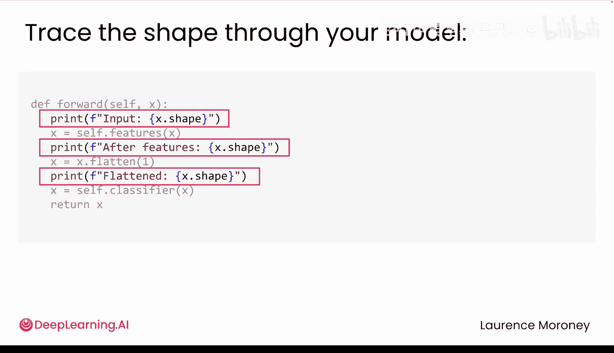
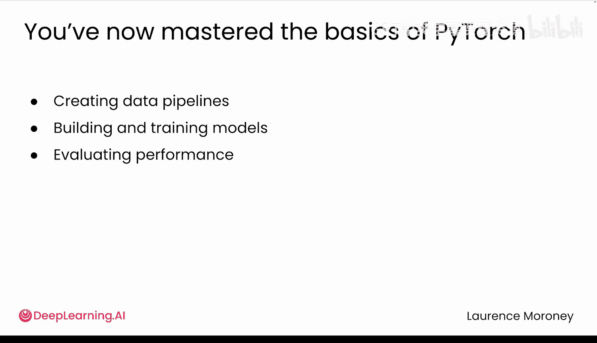
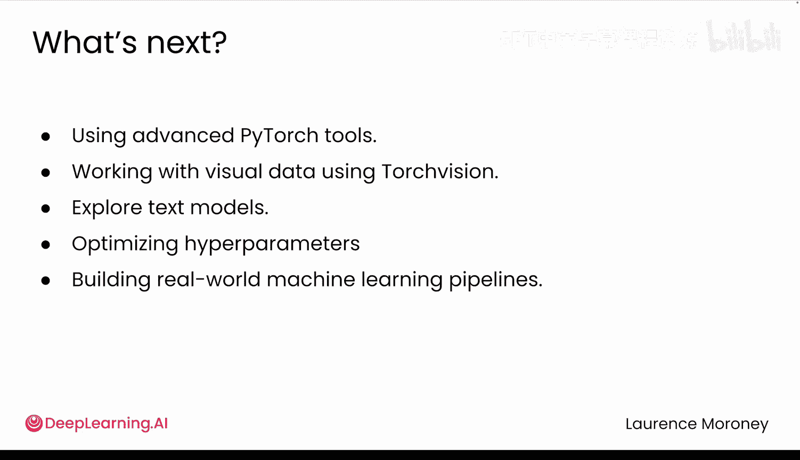

# 吴恩达《Pytorch深度学习（4模块全）｜PyTorch for Deep Learning》中英字幕 p27 6.model-inspecting-and-debugging.zh_en -BV1S7yhB7EUQ_p27-

Welcome back。 You've learned how to train a convolutional neural network。

 layer by layer with a solid data pipeline and tools to boost performance。

 Now it's time for one last skill， inspecting what's inside your model In this video you'll explore tools to examine your model structure count its parameters and understand how layers are wired together。

 You'll also see how this helps you solve real issues like those pesky shape mismatch errors。

 Let's start with a simple question。 How do you see what's inside your model。

 your first instinct might be to print it。 and you'll get something like this。

 Each line shows you the name that you gave the layer like conv1 or Fc2。

 the type of layer such as con2D Maxpool 2D or dropout and key settings like input output sizes or kernel size。

 This mirrors exactly what you defined in it。 It's like pytorrch is showing you your blueprint。

 perfect for spotting those structural mistakes， But notice what's missing。

 How many parameters does each layer have， What shapes are the tensors。

 What's actually inside those sequential。😊。

BlocksIn this video， you'll learn how to dig deeper。 you'll see exactly what's inside your model。

 understand how big it is and pick up debugging tricks that can save you hours。

 We'll also look at how inspection helps when something breaks like a shape mismatch or a device error。

 So let's start with that first question， how many parameters does your model have to count parameters you might try。

 but instead of a list， you'll get something like this。

 That's a generator Can you think of a reason why ptorrch might use generators here。

 because it's efficient。 It doesn't load everything into memory that just gives you one parameters at a time when they're needed to actually see the parameters。

 you'll need to iterate and you'll get shapes like this。

 Each shape represents a set of parameters Usually weights and biases from your layers。

 But if you want the total number of parameters， here's the standard approach。

 The dot nu L method gives you the number of elements in each tensor add them all up and you've got your total parameter count Over a million parameters。

😊，Well， great but where exactly are they to find out you need to look at each layer individually and that's where dot named parameters comes in。

 This shows you exactly where each set of weights and biases live layer by layer to understand these shapes Let's take a look at Fc1 do weight as an example it connects 2048 inputs to 512 outputs so you get a weight matrix would a shape 512 by 2048 Each row holds the weights for one output neuron one weight for every input Now that might feel backwards if you're expecting it in the order of input output but the shape reflects the purpose Each output combines information from all inputs So pytorch organizes the weights around the outputs and the bias well that's the 512 those's one value per output neuron but what if your model includes nested blocks like sequential or custom modules how do you peak inside the Well pytorch gives you two handy methods children。

😊，And modules， let's start with children。 This shows only the tople components like a convolutional or your fully connected layers。

 If a block contains other layers like sequential or a custom module。

 you won't see what's inside to go deeper， try modules。 What's the difference。

 Think of your model like a folder structure。 children shows only the top level folders。

 modules shows everything inside， including layers nested inside sequential or other custom blocks。

 This is especially helpful when you're working with modular architectures and you'll want to inspect every layer。

 Now， you've got the full picture of your model。 But what happens when something goes wrong。 Well。

 let's take a look at a common pytorrch error。 This one it usually means the input to a linear layer did not match what the layer expected。

 in real projects， the first thing most people check is the shape of the layer itself。

 If the error happens at F1。 you can print its weight shape like this。

 and that gives you the fastest answer。 But if you're not sure which layer is causing the issue or you want to inspect。

😊，Multiple layers at once。 You can just use named parameters。 So F1 expects 1024 inputs。

 but your model passing in 2048。 Why the mismatch to trace the shape through your model。

 try printing it inside the forward pass。 Now you can see the shape that your features block is producing and where the flattening is working as expected by combining model inspection what F1 expects would shape tracing what it actually gets。

 you can quickly pinpoint where things went off track。

 That's how inspection and debugging work together。 And with that。

 you've reached the end of this video and the end of course1 from a single neuron predicting delivery times to a convolutional neural network you've come a long way。

 you've built a solid foundation in pytorrch， creating data pipelines。

 building and training models evaluating performance and inspecting what's happening under the hood。

 This was the course that brought it all together。 The one that gets everyone speaking the same pytorrch language。

 And now you're ready to move forward。

In the next course， you'll start building with more advanced tools from the Pytorch ecosystem。

 you'll work with visual data using torch vision， you'll explore text models。

 optimize hyperparameters and build training pipelines that are faster。

 more flexible and hopefully closer to real world machine learning。

 and this is where those strong foundations turn into serious capability cow way to see you there。

