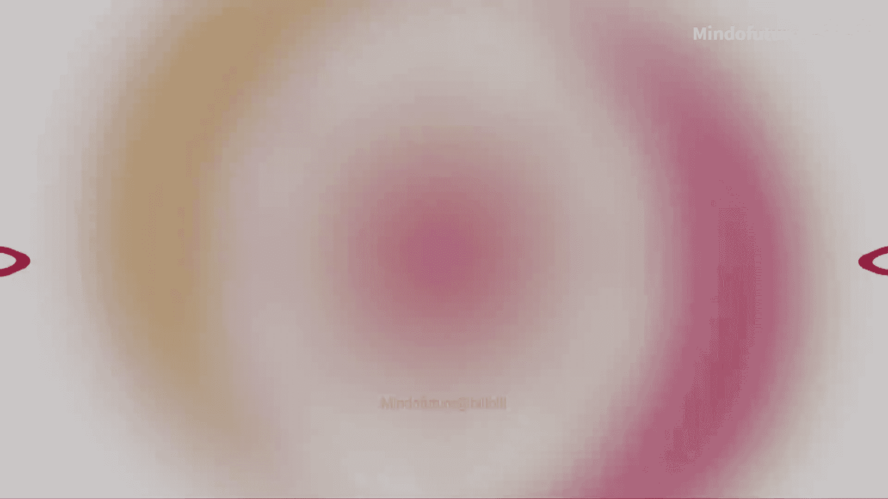
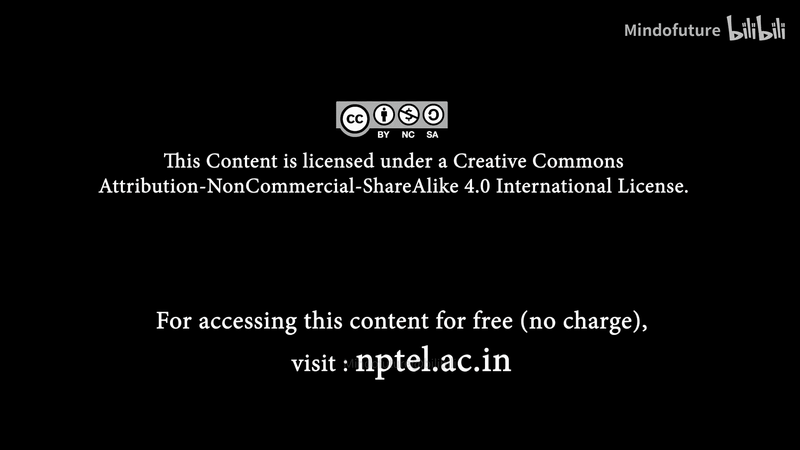
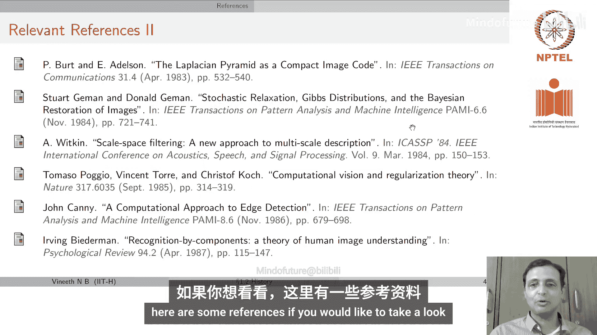

# 002：历史回顾 🧠

在本节课中，我们将回顾计算机视觉领域在过去几十年中的发展历程。这有助于我们理解该领域的起源，以及它是如何演变成今天这个样子的。

## 概述

上一讲我们介绍了课程概况，现在我们将正式开始课程内容。本节课将简要回顾计算机视觉的历史，主要分为四个部分：早期的探索（50-70年代）、低层图像理解的发展（80年代）、高层视觉理解的兴起（90-00年代），以及近十年深度学习的简要历史。

## 早期探索：1950s - 1970s 🕰️

计算机视觉最早的历史可以追溯到20世纪50年代。1959年，David Hubel和Torsten Wiesel发表了关于猫视觉皮层感受野的研究。他们通过实验发现，哺乳动物的视觉皮层中存在简单和复杂的神经元，视觉处理始于定向边缘等简单结构。他们的工作为理解生物视觉系统奠定了基础，并在1981年获得了诺贝尔奖。

同年，Russell Kirsch及其同事首次将图像表示为一组0和1的数字网格。这标志着图像数字化表示的开端，其第一张数字照片至今仍被保存在美国波特兰艺术博物馆。

1963年，Lawrence Roberts在其博士论文中探讨了如何从二维线描图中提取三维立体信息，这触及了计算机视觉的核心目标之一。随后在1966年，MIT的Marvin Minsky和Seymour Papert启动了一个雄心勃勃的暑期项目，旨在开发一个能自动分割前景背景并提取物体的系统。虽然项目未能如期成功，但它揭示了视觉问题的复杂性。

进入70年代，Huffman和Clowes研究了如何标记图像中的线条（凸、凹、遮挡等）。1973年，Fischler和Elschlager提出了“图式结构”方法，将物体定义为部件及其连接的组合，并定义了匹配优劣的度量标准。这一时期还见证了光学字符识别（OCR）作为首个计算机视觉产品的诞生，以及MIT开设了世界上第一门计算机视觉课程。

## 低层视觉理解：1980s 🔍

上一节我们回顾了领域的开端，本节我们来看看80年代在低层图像理解方面的努力。

1981年，Horn和Schunck提出了**光流法**，用于估计运动物体在两帧图像间的速度和方向。其核心是优化一个全局能量函数：
`E = ∫∫ (I_x u + I_y v + I_t)² + λ (u_x² + u_y² + v_x² + v_y²) dx dy`

1986年，John Canny提出了**Canny边缘检测器**，这是一个多阶段的优化算子，因其原理清晰、实现简单而广受欢迎。

1987年，Biederman提出了“通过组件识别”理论，这是一种自底向上的物体识别方法，认为物体是由“几何离子”（如圆柱体、圆锥体等基本三维形状）组合而成。

1988年，Kass等人提出了**Snakes（主动轮廓模型）**，用于从噪声图像中勾勒物体轮廓，广泛应用于跟踪、分割等领域。

此外，80年代还涌现了许多重要概念和技术，例如：
*   **图像金字塔与尺度空间**：用于多尺度图像处理。
*   **小波变换**：信号处理领域的里程碑。
*   **从X恢复形状**：如从阴影、纹理、轮廓等恢复三维形状。
*   **变分优化方法**与**马尔可夫随机场**：为许多视觉问题提供了数学框架。

值得一提的是，1989年，LeCun等人首次将**反向传播算法**应用于卷积神经网络，并成功用于手写数字识别，这为后来的深度学习革命埋下了种子。

## 高层视觉理解：1990s - 2000s 🧩

在掌握了低层特征提取之后，研究社区在90年代和21世纪初开始转向更高层次的视觉理解。

1991年，Turk和Pentland提出了**特征脸**方法，利用特征分解进行人脸识别，在受限场景下取得了成功。

以下是90年代末至21世纪初的一些关键进展：
*   **1997年**：Shi和Malik提出了基于**归一化割**的图像分割方法。
*   **1998年**：出现了**粒子滤波**和**均值漂移**等跟踪与聚类算法。
*   **1999年**：Lowe提出了**尺度不变特征变换**，这是一种重要的图像关键点检测与描述方法。
*   **2001年**：Viola和Jones提出了高效的**人脸检测**框架。
*   **2005年**：Felzenszwalb等人重新审视并改进了1973年的“图式结构”方法，提出了统计版本的**可变形部件模型**，在物体检测上表现出色。
*   **2005-2007年**：**PASCAL VOC**数据集启动，推动了目标检测、分类等任务的标准化评测。场景识别、全景图拼接、地点识别等技术也得到发展。

## 深度学习时代：2010s 至今 🚀

进入21世纪10年代，深度学习开始主导计算机视觉的发展，推动研究走向更高层次的抽象。

以下是深度学习时代的一些里程碑事件：
*   **2010年**：**ImageNet**大规模视觉识别挑战赛启动，为算法提供了统一的评测平台。
*   **2012年**：**AlexNet**首次使用深度卷积神经网络赢得ImageNet挑战，准确率大幅提升，成为深度学习复兴的标志。
*   **2013年**：**ZFNet**赢得比赛，**R-CNN**开创了基于区域的物体检测方法。人们也开始探索CNN的工作原理。
*   **2014年**：**GoogLeNet**和**VGGNet**等经典网络出现。CNN开始用于人体姿态估计等新任务。**生成对抗网络**和**变分自编码器**等深度生成模型被提出。
*   **2015年**：**残差网络**出现，CNN在ImageNet上的性能首次达到人类水平。**全卷积网络**和**U-Net**推动了语义分割任务的发展。**MS COCO**数据集和首个**视觉问答**数据集发布。
*   **2016年**：**YOLO**和**SSD**等单阶段物体检测器出现，提升了检测速度。**Cityscapes**和**Visual Genome**等更复杂的数据集发布。
*   **2017年至今**：研究向更高层次语义理解迈进，如**场景图生成**（理解物体间关系）、**视觉常识推理**（为答案提供依据）和**全景分割**（统一实例与语义分割）等。

## 应用发展 📈

从应用角度看，计算机视觉的发展路径同样清晰：
*   **1970s**：光学字符识别成为最早的产品。
*   **1980s**：工业**机器视觉**兴起，用于产品质量检测；“智能相机”开始嵌入视觉算法。
*   **1990s**：应用扩展到**生物识别**（人脸、指纹等）、**医学影像**、**视频监控**等领域。
*   **2000s**：上述应用持续深化，**自动驾驶导航**开始研究，**谷歌 goggles**、社交媒体的图像/视频应用出现。
*   **2010s 至今**：计算机视觉应用已无处不在，渗透到各行各业。

## 总结与推荐阅读 📚

本节课我们一起回顾了计算机视觉从早期生物视觉研究、低层特征提取、高层模型构建到深度学习统治的完整发展历程。我们看到，这个领域始终致力于从二维图像中理解我们身处的三维世界，并且抽象层次越来越高。

如果你想深入了解这段历史，推荐阅读Szeliski的《Computer Vision: Algorithms and Applications》第一章，并查阅本讲幻灯片中每页引用的原始资料链接。

我们将在下一讲继续新的主题。