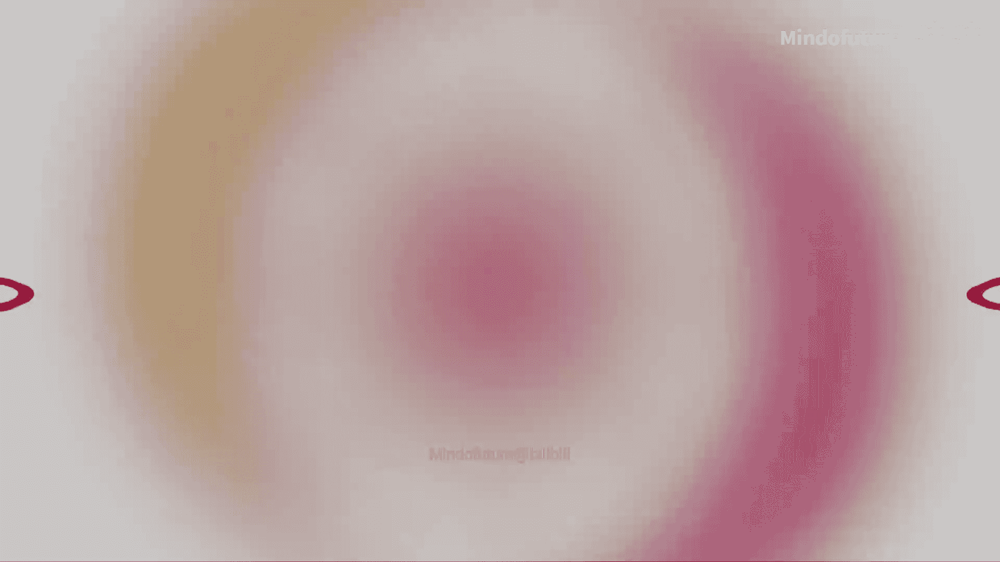
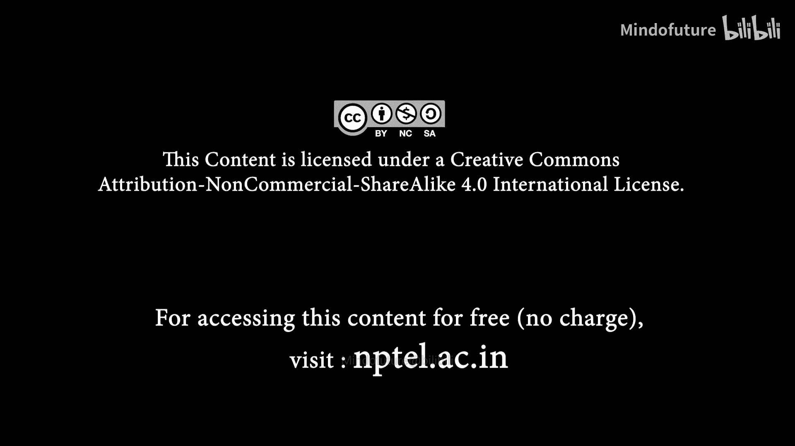
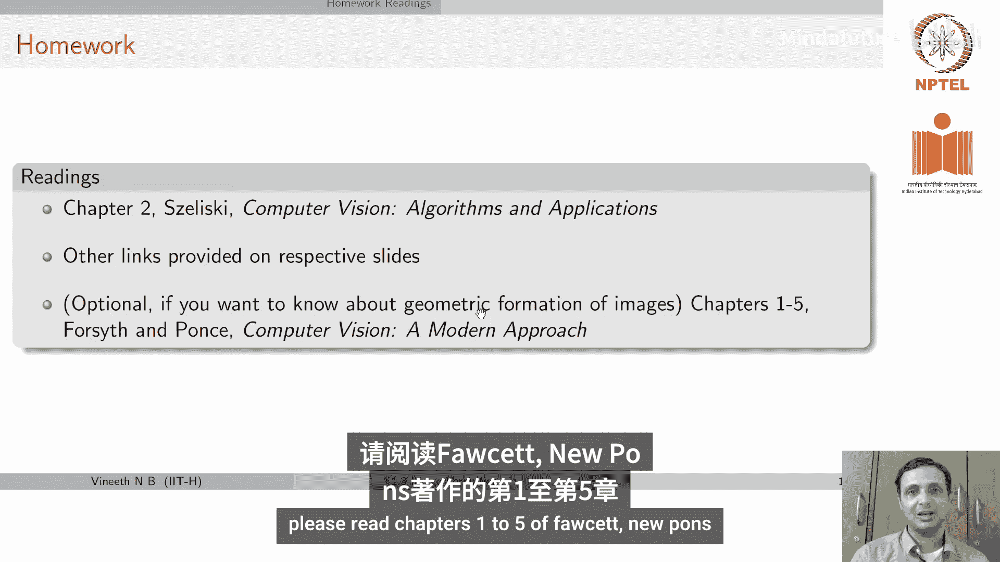

# 003：图像形成 📸

在本节课中，我们将学习图像是如何形成的。我们将探讨从光线照射到物体表面，到最终被相机传感器捕获并存储为数字图像的整个过程。理解图像形成是计算机视觉的基础，它涉及几何、光学、色彩和传感器技术等多个方面。

## 从历史到图像形成

上一节我们回顾了计算机视觉的历史。本节中，我们将聚焦于图像形成的基本原理。

在深入之前，你是否思考了上节课的趣味问题？劳伦斯·罗伯茨除了对计算机视觉的贡献，更广为人知的身份是互联网的奠基人之一。事实上，他是美国国防部高级研究计划局（ARPA）ARPnet项目的负责人，该项目是当今互联网的前身。

## 图像形成概述

图像的形成始于光源照射到物体表面。光线被反射，其中一部分到达图像平面，再通过光学镜头聚焦到传感器平面上，最终被捕获。

影响图像形成的因素包括：
*   光源的强度和方向。
*   物体表面的几何形状和材质（如纹理）。
*   其他可能将光线反射到该表面的邻近物体。
*   传感器的捕获特性。
*   图像的表示方式和色彩空间。

## 光线与表面的相互作用

要研究图像形成，可以从多个角度入手。我们将从光度学的角度，探讨光线与表面的相互作用。

当光线照射到表面时，可能发生三种基本的反应（实际上还有更多）：
1.  **吸收**：部分光线被表面吸收。这取决于一个称为**反照率（ρ）**的因子。反照率低的表面吸收更多光线。吸收因子可表示为 **1 - ρ**。
2.  **漫反射**：光线向多个方向散射。这种现象与观察角度无关。砖块、布料、粗糙木材等纹理材质是典型的漫反射表面。在此场景下，**朗伯余弦定律**指出，反射光的强度与观察方向夹角的余弦值成正比。
3.  **镜面反射**：反射光的方向取决于观察方向。镜子是典型的例子，其反射角等于入射角。

现实世界中，大多数表面同时具有镜面反射和漫反射分量。此外，还有其他可能的现象，如透明度（光线穿透）、折射（如棱镜）、次表面散射（光线在表面多层间散射）以及荧光/磷光（出射光波长与入射光不同）。

一个重要的概念是**双向反射分布函数（BRDF）**。它是一个描述局部反射的模型，用于量化当光线从某一特定方向入射时，表面从另一观察方向看去的明亮程度。

## 色彩感知与拜耳滤镜

从色彩角度看，可见光只是广阔电磁波谱中的一小部分。到达传感器的彩色光通常涉及两个因素：光源的颜色和物体表面的颜色。

相机色彩传感的一个重要发展是**拜耳滤镜（Bayer Filter）**。它指的是相机传感器上彩色滤镜的排列方式。并非每个感光元件都能捕获红（R）、绿（G）、蓝（B）三原色光。

拜耳提出了一种网格排列法：50%的传感器感应绿色，25%感应红色，25%感应蓝色，这灵感来源于人类的视觉感受器。因此，在实际相机中，感光元件阵列被安排成棋盘格样式。

为了获得全彩图像，需要使用**去马赛克（Demosaicing）算法**。该算法利用周围像素的信息，来推算每个像素位置上缺失的颜色分量。

## 相机成像管线

相机的图像传感管线通常遵循以下流程：
1.  **光学部分**：光线通过镜头、光圈和快门。
2.  **传感器**：光线到达CCD或CMOS传感器。
3.  **增益**：信号被放大（模拟增益）。
4.  **模数转换**：模拟信号被转换为数字原始图像。
5.  **图像处理**：进行去马赛克、锐化、白平衡等处理。
6.  **压缩与存储**：图像被压缩成特定格式（如JPEG）进行存储。

## 传感器类型：CCD vs. CMOS

以下是CCD与CMOS传感器的主要区别：
*   **CCD（电荷耦合器件）**：在每个感光元件处产生电荷，然后将这些电荷逐像素转移，在输出节点转换为电压，最后通过模数转换器（ADC）转换为数字值。
*   **CMOS（互补金属氧化物半导体）**：在每个感光元件内部就将电荷转换为电压，并使用晶体管进行放大，通过传统导线传输数字信号，因此无需额外的ADC。

如今，CMOS技术已非常成熟，我们使用的大多数相机（包括智能手机）都是CMOS设备。

## 相机参数与概念

了解图像形成还需理解以下相机参数和概念：
*   **快门速度/曝光时间**：控制传感器接收光量的时间。
*   **采样间距**：成像芯片上感光单元之间的间隔。
*   **填充因子**：有效感光面积与理论感光面积之比。
*   **芯片尺寸**：传感器芯片的总面积。
*   **模拟增益**：通过自动增益控制逻辑放大传感信号（通常对应相机的ISO设置）。
*   **传感器噪声**：传感过程中来自各环节的噪声。
*   **分辨率（位深）**：表示每个像素所用的比特数（如8位对应0-255）。
*   **后处理**：压缩存储前使用的数字图像增强方法。

## 采样与混叠

图像形成中的一个关键概念是**采样与混叠**。**香农采样定理**指出，如果图像数据的最高频率为 **F_max**，那么采样频率至少应为 **2 * F_max**（即奈奎斯特频率）。如果图像中包含高于奈奎斯特频率的成分，就会发生**混叠**现象。这在图像放大或缩小时可能导致问题。

## 色彩空间

虽然RGB是最常见的色彩空间，但实践中还使用其他多种色彩空间：
*   **CMYK**：用于印刷行业的减色模型，包含青色、品红色、黄色和黑色。
*   **其他**：如XYZ、YUV、Lab、YCbCr、HSV等。国际照明委员会（CIE）为色彩空间制定了标准。

## 图像压缩

图像形成的最后阶段是**压缩**，以便存储。通常，信号会先转换为**YCbCr**色彩空间，其中Y代表亮度，Cb和Cr代表色度。由于人类视觉系统对亮度更敏感，因此压缩时会对亮度分量采用更高的保真度。

最常用的图像压缩技术是基于**离散余弦变换（DCT）**，它被JPEG等标准广泛采用。视频压缩则在此基础上，结合了**块运动补偿**等技术。

压缩质量通常用**峰值信噪比（PSNR）** 来衡量，其公式为：
`PSNR = 10 * log10(MAX_I^2 / MSE)`
其中，`MAX_I` 是图像的最大可能像素值（如255），`MSE` 是原始图像与压缩图像之间的均方误差。

## 总结

本节课中，我们一起学习了图像形成的完整流程。我们从光线与表面的相互作用开始，探讨了色彩感知、相机传感器（CCD与CMOS）的工作原理、关键的成像参数、采样定理、不同的色彩空间，最后了解了图像压缩的基本原理和评估方法。理解这些基础知识，对于后续深入学习计算机视觉算法至关重要。