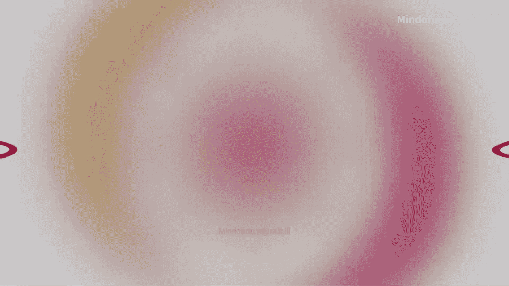
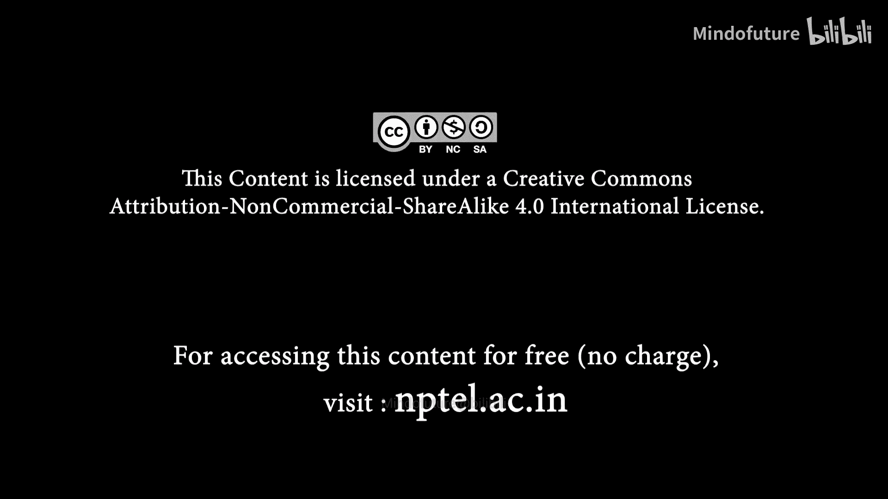
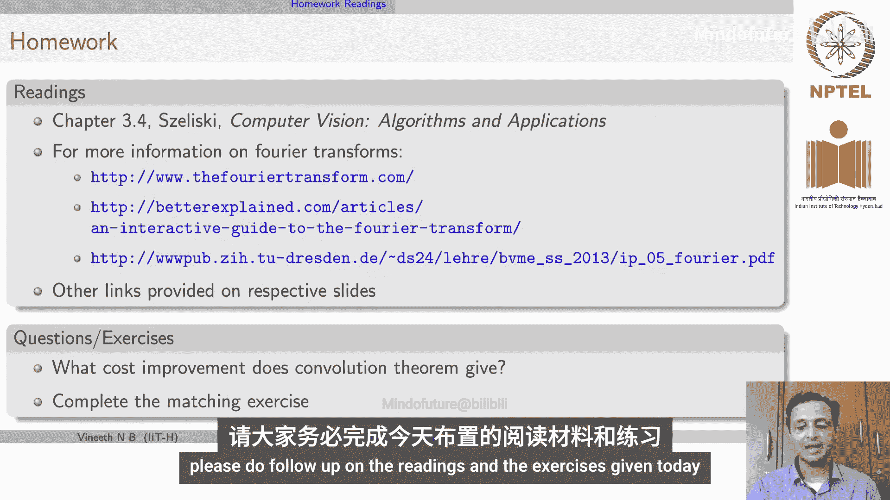

# 006：频域图像 📊

在本节课中，我们将学习一种全新的图像表示方式——频域。我们将探讨如何将图像视为由多种频率组成的二维信号，并了解这种视角如何帮助我们更高效地进行图像处理操作，特别是卷积。

## 从空间域到频域 🔄

上一讲我们讨论了图像滤波和卷积。本节中，我们来看看如何从频率的角度分析图像。

在深入之前，我们先回顾上节课留下的两个问题。

### 问题一：相关性与卷积

卷积因其数学特性在图像处理中非常有用。然而，相关性在某些任务中仍有其价值，例如模板匹配。

以下是模板匹配的应用场景：
*   **任务描述**：给定一个小模板，需要在一个更大的图像中找到该模板。
*   **示例**：在一张图像中寻找特定的标志或物体。
*   **要点**：场景中的物体与模板可能在尺度、方向或外观上不完全匹配，但只要足够相似，相关性仍能发挥作用。

### 问题二：非线性滤波器

并非所有滤波器都必须是线性的。让我们通过一个实际用例来理解非线性滤波器。

图像中可能存在多种噪声，例如：
*   **椒盐噪声**：图像中出现随机的黑白像素点。
*   **脉冲噪声**：仅出现随机的白色像素点。
*   **高斯噪声**：每个像素值都添加了高斯分布的随机值。

考虑椒盐噪声的情况。如果使用高斯滤波器（线性滤波器）进行平滑处理，无论滤波器尺寸如何，噪声只是被模糊了，并未真正移除。

解决方案是使用非线性滤波器——**中值滤波器**。

中值滤波器的操作步骤如下：
1.  取一个滑动窗口（如3x3）。
2.  将窗口内所有像素值排序。
3.  取排序后列表的**中值**作为中心像素的新值。

**为什么中值滤波有效？**
在数值序列中，中值能自动**剔除异常值**（如噪声点99）。而均值滤波器则会受到异常值影响，导致滤波后该点值依然很高。由于中值无法表示为输入值的线性组合，因此它是非线性滤波器。

另一个著名的非线性滤波器例子是**双边滤波**。它能实现**边缘保持平滑**的效果，例如在人像处理中平滑皮肤区域而保持五官轮廓清晰。

双边滤波器的核心思想是：**如果一个邻域像素在强度值上与中心像素相差太大，则降低该像素的权重**。

其权重 `W(i,j,k,l)` 由两部分构成：
*   **空间邻近度权重**：类似于高斯滤波器，距离中心越远的像素权重越低。
*   **强度相似度权重**：像素 `(k,l)` 的强度值与中心像素 `(i,j)` 的强度值越接近，权重越高。

公式表示为（已简化）：
`W(i,j,k,l) = exp(-((i-k)²+(j-l)²)/2σ_d²) * exp(-(I(i,j)-I(k,l))²/2σ_r²)`

因此，滤波器系数会根据图像不同位置的局部强度动态变化，从而实现平滑同质区域同时保留边缘的效果。

## 图像的频率表示 📈

现在进入本讲的核心主题：频域图像。

首先思考：当我们降低图像分辨率时，究竟丢失了什么？我们丢失的主要是**高频信息**，即图像中的锐利边缘和细节。

### 傅里叶级数简介

傅里叶变换的基础是傅里叶级数。傅里叶（18-19世纪）提出，任何一维函数都可以表示为不同频率的正弦和余弦函数的加权和。

对于一维时变信号，其构建块是正弦波：`A * sin(ωt + φ)`，其中 `A` 是振幅，`ω` 是频率，`φ` 是相位。

**示例**：一个复杂波形可以分解为多个不同频率和振幅的正弦波叠加。例如，方波可以近似为基频及其奇次谐波（3f, 5f, 7f...）的叠加，谐波振幅随频率升高而递减。

### 扩展到二维图像

对于图像这样的二维信号，傅里叶变换将其表示为不同空间频率的二维正弦波的叠加。

在频域图像（傅里叶谱）中：
*   **中心点（原点）**：代表**直流分量**，即图像的平均亮度。
*   **其他亮点**：每个点对应一个特定的空间频率。点到原点的距离代表频率高低，方向代表该频率在图像中的方向（水平、垂直或斜向），亮度代表该频率成分的振幅（强度）。

**重要特性**：傅里叶谱通常关于原点对称。我们在图像一侧看到的频率，在其对称位置会有一个对应的“镜像”频率。这是由于数学表示的性质决定的。

### 傅里叶变换的数学形式

傅里叶变换的结果通常用复数表示，包含**幅度**和**相位**两部分：
*   **幅度谱**：`|F| = sqrt(实部² + 虚部²)`，表示各频率成分的强度。
*   **相位谱**：`φ = arctan(虚部 / 实部)`，表示各频率成分的起始位置。

对于离散的图像信号（我们实际处理的），我们使用**离散傅里叶变换**。其重要性质是：**空间域中的离散非周期信号，对应频域中的连续周期谱**。

## 卷积定理与计算优势 ⚡

我们学习频域表示的一个重要原因是**卷积定理**。

**卷积定理**指出：**两个函数卷积的傅里叶变换，等于它们各自傅里叶变换的乘积**。
用公式表示：`F{g * h} = F{g} · F{h}`

这意味着，在空间域中复杂的卷积操作，可以在频域中转换为简单的**逐点乘法**操作。

**这如何带来计算优势？**
*   直接计算大小为 `MxN` 的图像与 `KxK` 滤波器的卷积，计算复杂度约为 **O(M * N * K²)**。
*   计算图像的离散傅里叶变换，如果使用定义直接计算，复杂度为 **O((M*N)²)**，这反而更高。
*   然而，存在**快速傅里叶变换**算法，能将计算复杂度降低到 **O(M * N * log(M * N))**。
*   因此，对于**大图像和大滤波器**，先在频域进行乘法（`O(M*N)`），再利用FFT进行正反变换（`O(M*N*log(M*N))`），其总成本可能低于直接的空间卷积。

**应用示例**：边缘检测。
1.  在空间域：图像与边缘滤波器卷积，得到边缘图。
2.  在频域：计算图像和滤波器的傅里叶变换，将二者相乘，再进行逆傅里叶变换，得到相同的结果。

## 低通与高通滤波器 🎛️

从频率的角度，滤波器可以分类为：
*   **低通滤波器**：允许低频通过，阻挡高频。效果是平滑图像，模糊细节。
    *   **例子**：高斯滤波器。
*   **高通滤波器**：允许高频通过，阻挡低频。效果是突出边缘和细节。
    *   **例子**：边缘检测滤波器（如Sobel）。

降低图像分辨率本质上就是应用了一个强烈的低通滤波器，去除了高频信息。

## 幅度与相位的重要性 🎭

傅里叶变换的幅度和相位哪个包含更多信息？一个有趣的实验是**交换**两幅图像的幅度谱和相位谱，然后进行逆傅里叶变换。

实验表明：
*   **相位谱**：主要决定了图像的**结构和轮廓**信息。使用一幅图的相位和另一幅图的幅度重建的图像，看起来更像提供相位的那幅图。
*   **幅度谱**：主要决定了图像的**纹理和频率内容**。

这催生了**混合图像**技术：将一幅图像的低频部分（平滑后的幅度）与另一幅图像的高频部分（相位或边缘）结合，可以创造出从不同距离观看时呈现不同内容的图像。

## 总结 📝

本节课我们一起学习了：
1.  **频域表示**：将图像视为不同空间频率的叠加，并通过傅里叶变换在频域进行分析。
2.  **卷积定理**：理解了在频域通过乘法实现卷积的原理及其潜在的计算优势。
3.  **滤波器分类**：从频率通过性的角度认识了低通和高通滤波器。
4.  **幅度与相位**：了解了傅里叶变换中幅度和相位分量的不同视觉含义。

频域分析为我们提供了理解图像和处理图像的强大工具，是许多高级图像处理技术和计算机视觉算法的基础。