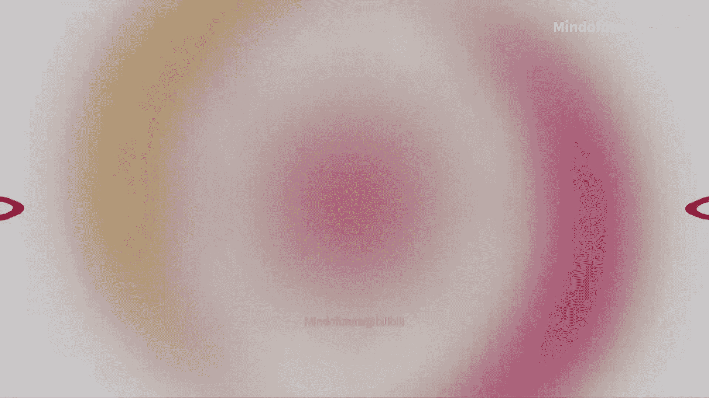
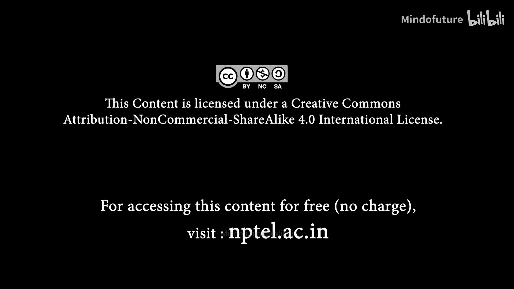
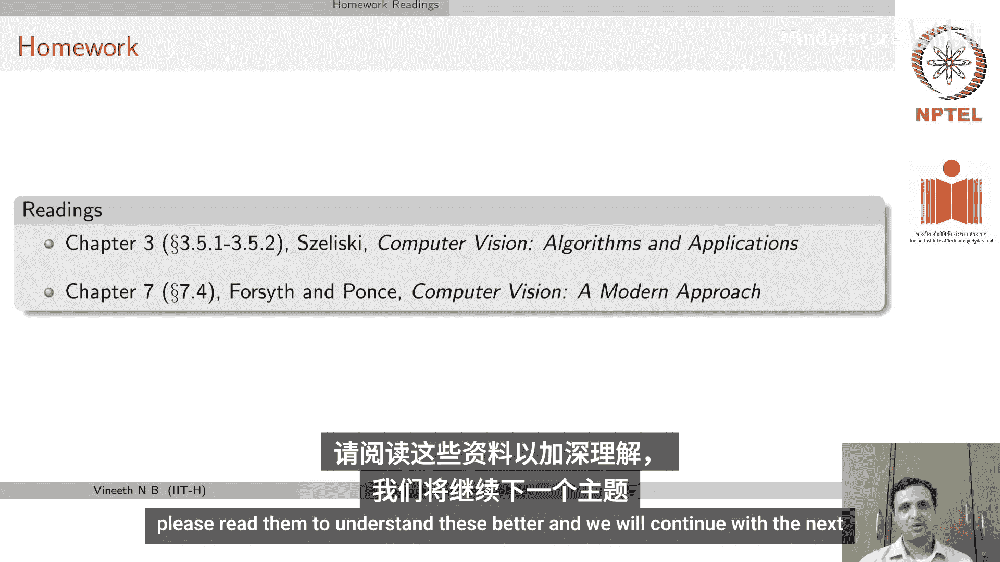

# 007：图像采样与插值

## 概述
在本节课中，我们将学习图像处理中的两个重要基础主题：**采样**与**插值**。我们将探讨如何通过下采样降低图像分辨率，以及如何通过上采样提高图像分辨率，并理解其中的关键概念，如奈奎斯特采样定理和抗混叠技术。

---

## 回顾上节课问题

上一节我们介绍了傅里叶变换在卷积计算中的应用。本节开始前，我们先快速回顾上节课留下的问题。

### 傅里叶域卷积的成本优势
问题：通过傅里叶域（利用卷积定理）实现卷积，能获得多大的成本提升？

卷积定理允许我们在空间域定义卷积，在频域进行乘法运算，然后进行逆傅里叶变换。具体步骤是：分别计算图像 **G** 和滤波器 **H** 的傅里叶变换，将它们相乘，再进行逆傅里叶变换。

让我们通过一个简单的基本案例来解释成本提升。如果图像卷积的复杂度是 **O(n²k²)**，其中 **n×n** 是图像尺寸，**k²** 是核尺寸。

通过在傅里叶域执行卷积，你仍然需要 **O(n²)** 的复杂度来对图像进行一次遍历。此外，进行快速傅里叶变换（FFT），图像需要 **O(n² log n²)** 的复杂度。回想我们讨论快速傅里叶变换时提到，如果你有 **n** 个样本，成本将是 **O(n log n)**。在我们的案例中，一幅图像有 **n²** 个像素，因此计算其完整快速傅里叶变换的成本将是 **O(n² log n²)**。

类似地，对于尺寸为 **K×K** 的核，成本是 **O(k² log k²)**。因此，总的计算复杂度将是 **O(n² log n² + k² log k²)**。其他任何计算都将是加法项，而这个最大的组成部分将超过其他项。显然，这比原始图像卷积操作的成本更低，尤其是当 **K** 变大时。这意味着如果你的滤波器或掩码尺寸变大，使用快速傅里叶变换来实现卷积将带来成本效益。

你今天使用的许多深度学习库已经通过傅里叶变换实现了卷积。你可能不知道，你可能只是在使用一个库，但许多深度学习库的后端已经使用快速傅里叶变换来实现其卷积代码，这使其速度更快。

### 空间域与频域图像匹配
另一个练习是将空间域图像与傅里叶域图像进行匹配。

以下是匹配结果：
*   图像1 对应 D。
*   图像3 对应 A。
*   图像4 对应 C。主要原因是观察图像4，可以看到一组非常强的垂直边缘，而图像C在频域中有很多水平边缘。回顾上节课的傅里叶图像示例，我们看到空间域中的垂直线导致频域中的水平线，反之亦然。因此，如果空间域中有水平线，你将在频域中得到垂直线。
*   图像2 对应 E。原因是观察图像2，那里有一条相当强的垂直线。这来自于水面地平线的水平线，甚至涟漪中的水平线。所以，涟漪中有很多水平线，这转换成了傅里叶匹配中的这条垂直线。
*   图像5 对应 B。你可以看到花朵中有很多茎秆，给出了频率的水平方面，同时不同花朵之间也有很多水平边缘，给出了一些垂直频率。

### 低分辨率图像的意义
我们再次回顾上节课提出的一个问题：低分辨率图像对我们有什么意义？

如果从人类感知的角度来理解，目前已知人类视觉系统中的早期处理是寻找不同方向和尺度频率的滤波器。我们稍后会更仔细地回顾这一点，但有时人们也将它们与所谓的**Gabor滤波器**联系起来。

其次，人类视觉系统中的感知线索主要基于中高频。再次记住，高频意味着边缘，因为当你沿着行或列从一个像素移动到下一个像素时，强度值会发生突然变化。如果它沿着行更长，你会称之为垂直频率；如果沿着列更长，你会称之为水平边缘。

因此，感知线索通常依赖于中高频。但是，当你看到低分辨率图像时，它相当于对图像进行下采样。如果你从很远的地方看一幅图像，你实际上是在对图像进行下采样，这意味着你可能会丢失一些高频信息，但你确实获得了大量的低频信息，这足以让你感知物体是什么，但可能无法提供更精细的细节。

---

## 图像下采样

那么，如何将下采样作为一项操作呢？最简单的方法是：给定这样一幅图像，你只需丢弃每隔一行和一列，只考虑每隔一个像素（行方向和列方向）。这直接给你一个尺寸减半的图像。然后你可以重复此过程以获得越来越低的分辨率。

但是，如果你放大这些下采样图像，它们看起来是这样的。我们只是简单地放大这些图像。

如果你放大并观察这些图像，半采样图像会得到类似这样的结果，四分之一采样图像在2倍放大下得到类似这样的结果，八分之一采样图像在4倍放大下看起来像这样。

你可能会问，是的，这是预期的。如果你下采样，为什么还要担心它在近距离看起来如何？这是一个有效的问题，但在这里提出是有原因的。最后一张图像看起来相当粗糙，有太多伪影。我们能否至少让它看起来平滑？我们理解通过下采样你失去了一些信息，但我们至少希望它在放大时看起来平滑。你认为如何实现这一点？

让我们稍等片刻答案，但也看看这种效果的另一个例子。

你知道在这种图像中发生了什么吗？这是海洋图像。我们以某种方式进行了下采样，你得到了这样的效果。这种效果也被称为**混叠**。

混叠通常发生在你的采样率不足以捕捉图像中的细节量时。我们将看几个例子，然后重新审视我们看到的绘画，以及如何确保它不粗糙。

---

## 奈奎斯特采样定理与混叠

无论如何，如果你的采样率不够高，你将无法获得细节。例如，你在这里顶部看到一个正弦波。如果你只在这些点进行下采样，记住你没有看到正弦波的下降趋势。所以，如果你只采样这些黑点，你可能会认为这是实际的正弦波。记住，这里我们刚刚绘制的红波的频率与原始波非常不同。

为什么如此不同？只是因为我们没有足够地采样原始信号。这就是为什么我们最终得到这种与原始正弦波非常不同的形状。

因此，为了正确采样，理想情况下你需要知道原始信号的结构。这就是一个重要概念——**奈奎斯特率**——出现的地方。我们在上一讲中也简要提到了这一点。

所需的最低采样率，以重建原始信号或以实际形式捕获原始信号，称为奈奎斯特率。

那么奈奎斯特率意味着什么？奈奎斯特率可以追溯到信息论和信号处理的基础，其中香农的采样定理非常著名。该定理提出，奈奎斯特频率的最小采样率由 **Fs** 给出，它必须至少是 **2 * Fmax**。这里的 **Fmax** 是信号中的最高频率。

对于图像，我们会说它是图像中的最高频率。我们现在说，你的采样率或奈奎斯特频率应至少是图像或信号中最高频率的两倍。

为什么会这样？我们稍后会看到，但我们可以解释在图像设置、视频设置甚至图形设置中不这样做的后果。让我们看几个例子。

在图像设置中，如果你不以适当的频率（即两倍 Fmax）采样原始信号，你的衬衫看起来会很奇怪，这就是所谓的混叠。

在视频中，这是你可能经常观察到的情况。有时当你走在路上，看到一辆自行车（尤其是自行车或汽车车轮），虽然汽车向前移动，但当你只看车轮时，车轮可能看起来在向后转。如果你还没有这样做，如果你还没有问自己为什么会发生这种情况，这就是原因。

原因是，如果你现在将车轮的运动视为这里的顶行，那么顶行是实际运动。正如你在顶行看到的，你可以看到这里的箭头沿顺时针方向移动，所以你可以假设这类似于一个沿顺时针方向移动的自行车轮。但我们选择只在所有位置中的三个位置进行采样。顶行是车轮的实际运动，但这些框是实际采样的位置。它们是采样的位置，所以如果你只看采样的位置，你会看到箭头首先在这里，然后在这里，然后在这里，依此类推。实际上，第二个和第三个可以告诉你为什么会产生这种效果。所以你会看到，如果你只做第二个和第三个，你实际上会认为你的车轮在逆时针移动，因为这是你仅有的两个样本，箭头在逆时针方向移动，但最初你的车轮是顺时针移动的。

这仅仅意味着你没有以车轮旋转的频率或以两倍其最大旋转频率进行采样。

这是图形学的另一个例子，原因再次相同。你可以看到，在这种特定情况下，混叠在这些频率非常高的区域很明显。再次记住，当我们说图像中的频率时，我们指的是像素在黑白之间变化的速度。当我们说黑白时，它可以是深灰色到浅灰色，但从黑白变化在接近图像地平线时变得非常高，这就是频率非常高的地方，这意味着你的采样率必须是该频率的两倍才能忠实于原始图像。这是我们经常在图形中看到的效果。

---

## 理解两倍最高频率采样

一个更具体的方式来理解为什么需要以两倍最高频率采样。我们不会在这里推导香农采样定理，因为这不是本课程的重点，但让我们尝试直观地理解为什么需要以两倍最高频率采样。让我们以棋盘为例。

你这里有一个棋盘，我们现在论证顶行是良好采样实践的示例，底行是不良采样实践的示例。

所以在这里看，左下角这个。你可以看到样本是这些圆圈，当你看到样本时，你可以清楚地看到我们只在黑色方块上采样。所以如果你只有那四个样本，你可以假设整个棋盘都是黑色的，中间没有白色方块，因为你从未在白色方块上采样。显然，你在这里没有以适当的频率采样。这里的频率是黑白变化的速度，在多少像素内变化。显然，你没有以两倍最高频率采样，这将给你带来不良信息。

这是一个稍好但仍然不完整的采样。再次，在这里你可以看到这些空心圆圈，你可以看到你稍微改进了采样，但再次，你看到一个黑色，然后一个白色，然后第一行上的第三个样本又是白色。这意味着，你的感知或任何进一步的处理将想象这是黑色，后面跟着一系列白色，那不是棋盘，而是第一个黑色小方块之后整个白色块。这再次是欠采样。

这是一个我们实际上以两倍频率采样的示例。你可能会问为什么是两倍？在这种情况下，记住实际频率是信号完全经历其变化的时候。所以在这种情况下，一个信号从这里到这里完成，我们在那两个框内采样两次。这意味着我们以两倍最高频率采样。当你这样采样时，你在每个黑色方块和每个白色方块中都得到了一个样本，你现在知道这是一个棋盘。显然，如果你采样超过这个次数，对你来说甚至更好。

希望这能给你一个直观的理解，为什么你需要以至少两倍图像内容最高频率的速率采样任何信号、任何图像。

---

## 高斯预滤波：抗混叠技术

一种良好的抗混叠技术是**高斯预滤波**。我们稍后会讨论高斯预滤波的含义，但这是我们之前看到的图像，我们说这幅图像粗糙，这是我们想要尝试实现的效果。我们确实理解，如果你下采样，你会失去一些信息，但我们至少希望让它看起来平滑。

那么如何进行高斯预滤波呢？你首先要获取一幅图像，然后对其应用高斯模糊。你知道高斯模糊是什么，它是高斯平滑。你可以使用一个3×3的高斯核。如果你不记得高斯核是什么，记住它看起来像这样，至少一个3×3的高斯核看起来像这样，你还有一个1/16进行归一化，那就是你的3×3高斯核。类似地，你也可以构建5×5的核，依此类推。所以你首先在输入图像上应用该核，这给你一个图像的模糊版本。

现在你进行下采样。然后在下一次下采样之前，再次模糊。然后下采样，模糊，然后下采样，模糊，依此类推。

你认为这为什么有效？这有一个原因。让我问你这个问题：高斯滤波器是低通滤波器还是高通滤波器？高斯滤波器是**低通滤波器**。这意味着它去除高频，只通过相对较低的低频。这意味着，通过应用高斯模糊，你已经去除了高频，这意味着采样率现在实际上可以降低。再次记住，香农采样定理指出，你必须以至少两倍图像中最高频率的速率采样。如果我降低图像中的最高频率，我可以以较低的速率采样。

这就是我们采用的技巧，以便能够下采样，同时在输出图像中仍然具有平滑的效果。所以你进行高斯模糊，现在你的整体频率范围变小了，现在你可以承受下采样而不会在图像中产生混叠的粗糙效果，这就是我们所说的高斯预滤波。

---

## 图像上采样与插值

所以，下采样是故事的一方面，故事的另一方面是如何进行上采样？有时你需要从低分辨率图像转到高分辨率图像。

最简单的方法是进行非常标准的**插值**操作。任意两个值之间的插值，你谈论的是实轴。任意两个值之间的插值，简单来说就是位于连接这两点的直线上的值。至少线性插值是在连接这两点的直线上。

因此，如果我们想对图像进行上采样，我们可以做的最简单的插值形式是所谓的**最近邻插值**，我们只需将每一行和每一列重复10次。所以每个像素，你沿着列重复10次，沿着行重复10次。所以它几乎就像一个完整的10×10块具有完全相同的值。然后你取下一个像素，为10列重复它，为10行重复它，这意味着下一个10×10块具有相同的值，依此类推。

好消息，你的分辨率提高了；坏消息，你将在图像中产生这样的伪影，因为这正是你所做的。因为你取了几个像素，只是将它们扩展成块。

我们怎么能比这做得更好？显然，我们不想像这样上采样图像，并在上采样图像中产生块状效应。

---

## 通过卷积进行插值

因此，我们可以在输出中保持一定平滑度的同时进行插值或上采样的方法是：让我们尝试回忆数字图像是如何再次形成的。回想一下，图像是原始连续函数或原始连续信号的离散采样版本。

所以你有一个原始信号 **f**。你在某些位置对其进行量化，这给了你图像或信号 **F** 在 **X, Y** 位置的值，就像在我们的案例中，它将是一幅图像。所以，正如我们已经说过的，这不过是一个连续函数的离散点采样。所以当我们进行插值时，我们只是在问一个问题：我们能否以某种方式从离散样本重建那个原始连续函数？这就是我们试图回答的问题，因为如果我们能做到这一点，我们就可以插值并达到我们想要前进的任何分辨率。

不幸的是，在实践中，我们不知道小 **f**，即你的连续函数。我们不知道那个连续函数，我们不知道你的图像是从哪个真实世界场景以采样方式捕获的。

然而，我们可以尝试以一种有原则的方式来近似这一点，我们将通过卷积方法来实现。

因此，我们想要做的第一步是：将你的离散采样版本 **F** 转换为一个连续函数。因为我们不知道原始连续函数，我们将定义一个伪连续函数，它简单地声明：在你知道值的地方，你只需将图像的值放在那里；在其他任何地方，你只说它是零。这将是连续函数的一个自动版本，至少目前来说，这是一个连续定义的函数。

因此，我们现在尝试重建你的 **F_hat**，这是你想要获取 **F** 的分辨率。通过将这个伪连续图像与某个滤波器进行卷积，所以我们想问：如果我们有这个连续函数 **f_sub_F**，我们能否以某种方式获得某个核 **h**，从而构造出原始（不是原始，但至少是上采样）信号？你认为它应该是什么？

这幅图像可能会给你一些理解，也许一个帐篷形状的信号可以帮助你理解一维信号。但这仍然没有回答卷积如何能将我们从一种分辨率带到更高的分辨率，因为我们看到的方式是，卷积可以保持相同的分辨率（如果你包括填充），如果你不填充，你可能会在边界上丢失一些像素。但现在我们想要达到更高的分辨率，然后我们使用卷积。

---

## 插值核与上采样公式

现在，为了能够使用卷积执行插值并将图像上采样到更高的分辨率，我们将使用一个插值核来实现，其定义如下。你在这里看到什么？再次记住，你的原始卷积定义类似这样：**G(i, j) = Σ Σ F(k, l) * h(i-k, j-l)**。

而这是我们将用于插值的新定义：**G(i, j) = Σ Σ F(k, l) * h(i - R*k, j - R*l)**。如果你仔细观察，这两个表达式之间的主要区别是这里乘以 **k** 和 **l** 的量 **R**。

**R** 是我们称之为上采样率。所以如果你想将图像尺寸加倍，你的 **R** 是2；如果你想将图像尺寸变为四倍，记住我们正在进行上采样，所以如果你想将图像尺寸变为四倍，**R** 将是4，依此类推。

让我们尝试理解这实际上是如何工作的。为了简单起见，让我们看看这个方程的一维变体。假设 **G(i) = Σ F(k) * h(i - R*k)**。这是同一方程的一维变体。再次记住，对于这些目的，图像是一个二维信号，所以我们为图像写的许多表达式，如果你去掉一个维度，你可以将其应用为一维信号的卷积。

所以这就是我们在一维中实际拥有的，所以在一维中解释更容易。让我们考虑尝试理解实际发生了什么。让我们考虑一个X轴。

假设有一些信号 **F(k-1)**，这里有另一个信号 **F(k)**，这里有另一个信号 **F(k+1)**，依此类推。这与你最早幻灯片上看到的非常相似。我只是画了这样的线来表示我拥有的 **F** 的各种值，那是我的输入图像，我想提高其分辨率。

所以现在因为我想提高分辨率，我在这里问的问题是：如果我在这里取某个 **i**，在这些值之间，**G(i)** 会是什么？**G** 是输出，**F** 是输入。这就是我想问的。

所以在 **G** 轴上，这里的棘手部分是 **G** 中的坐标索引与 **F** 中的索引不同，因为 **F** 只有一定数量的索引，而 **G** 的索引数量是 **F** 的两倍。所以这将是 **G** 索引中的 **R*(k-1)**，这将是 **R*k**，这将是 **R*(k+1)**。

现在，如果我们尝试理解这里的 **G(i)** 在做什么，它是 **F(k) * h(i - R*k)** 的和，因为你取了许多 **k** 值。当然，**k** 的范围可以从 **k-1** 到 **k+1**，如果你取一个3×3窗口或更高，取决于核的长度。所以在这种情况下，我们的意思是 **h(i - R*k)**。

所以如果你再次取一个这样的例子，记住这里的 **h** 是插值核之一，在这种情况下，它被称为帐篷核，因为它看起来像一个帐篷。这个核的作用是，当你从放置核的中心像素进一步向外移动时，那些像素的影响线性下降（不是指数下降，而是线性下降）。这就是你的帐篷核。所以如果你添加一个这样的核，你只是说这个 **F**... 所以如果你把核放在这里，那么你说 **G(i)** 将是 **F(k) * h(i - R*k)**，**i - R*k** 是这里相对于 **h**（绿色曲线）的值。所以你将用 **h(i - R*k)** 乘以 **F(k)**，用 **h(i - R*(k+1))** 乘以 **F(k+1)**，这将是这个量，依此类推。

因此，通过这个操作，你能够进行插值，显然，这些值中有一个求和，这将给出 **G(i)** 的值。这就是这些插值核的工作原理。

---

## 不同插值方法的比较

所以，线性插值器对应于我们看到的帐篷核。你也可以有更复杂的核，例如双三次样条，那些是最复杂的核。但这里有一些应用这种插值的定性结果。

我们看到的第一个是执行最近邻插值的效果，其中有块状效应。然后如果你做双线性插值（即我们谈到的线性插值，但沿着两个轴），你会得到类似这样的结果。如果你进行双三次插值，你会得到类似这样的结果，依此类推。所以这些插值的主要区别在于你使用的核：一种情况是最近邻，第二种情况是双线性，第三种情况是双三次。

我们不会定义每一个核，但你可以查看本讲座末尾的参考资料，以了解实践中定义的各种核。

---

## 下采样（抽取）的卷积实现

就像我们定义插值一样，你也可以定义它的互补操作，即**抽取**。抽取意味着下采样。所以，虽然我们到目前为止将下采样视为简单地省略每隔一个像素，或者如果你进行高斯预滤波，你也确保获得更平滑的输出，你也可以使用类似卷积的操作来实现下采样，这将非常相似，唯一不同的是，你将使用 **k/R** 和 **l/R** 而不是 **R*k** 和 **R*l**，因为你现在想要下采样而不是插值。

---

## 总结

本节课中，我们一起学习了图像处理中的核心操作：**采样**与**插值**。

我们首先回顾了傅里叶变换在卷积计算中的成本优势。然后，我们深入探讨了**下采样**的基本方法及其可能导致的**混叠**问题。通过**奈奎斯特采样定理**，我们理解了为避免混叠，采样频率必须至少是信号最高频率的两倍。为了在降低分辨率时获得平滑效果，我们引入了**高斯预滤波**这一抗混叠技术。

接着，我们转向了**上采样**。从简单的最近邻插值及其块状伪影出发，我们探讨了如何通过**卷积**和**插值核**（如线性/帐篷核、双线性核、双三次核）来更平滑地提高图像分辨率。最后，我们提到下采样也可以通过类似的卷积操作（抽取）来实现。

通过理解这些基本原理，你为后续学习更复杂的图像处理和多尺度分析（如图像金字塔）奠定了重要基础。