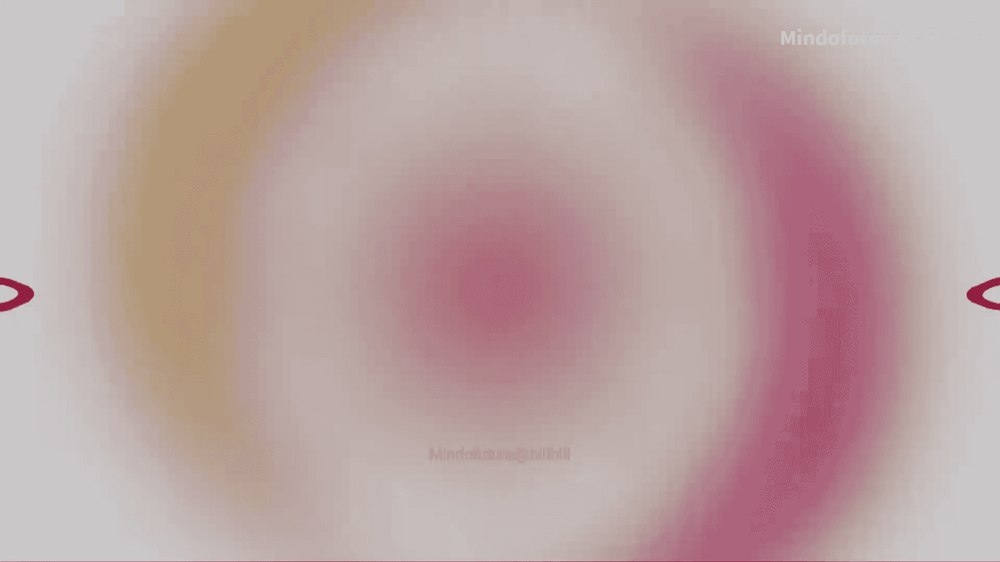
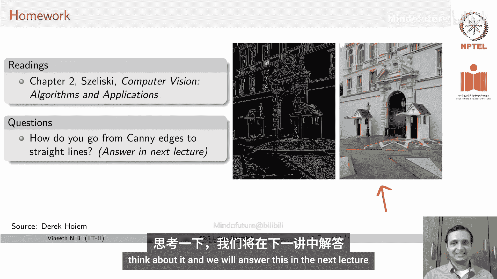

# 008：边缘检测 🧠

在本节课中，我们将学习如何从图像中检测边缘。边缘是图像中强度发生剧烈变化的区域，它们是图像的一种紧凑表示，对于人类视觉感知和机器视觉任务都至关重要。我们将从理解边缘的形成开始，逐步学习如何使用导数、梯度以及卷积操作来检测边缘，并最终介绍经典的Canny边缘检测算法及其改进方法。

## 边缘的重要性与形成原因

上一节我们介绍了图像处理的基础知识，本节中我们来看看如何从图像中理解和提取更高层次的特征。我们将从边缘检测开始。

检测图像边缘的想法，是将图像从一个二维矩阵映射到一组线条或曲线上。从某种意义上说，这些曲线或线条就是我们所说的边缘，它们是图像更紧凑的表示形式。

为什么这种表示很重要？如果你看到这三张图片，我问你图片中有什么物体？你很容易就能说出：第一张图片是一个人，中间一张看起来像一匹马，最后一张看起来像一架飞机。这有点令人惊讶，因为如果你把这样的图像输入给机器学习算法或神经网络，模型要像你我一样做出这些分类并不容易。因此，对于人类视觉系统来说，边缘对于完成图像理解和整个感知过程至关重要。

事实上，即使这些图像中的边缘在一定程度上被移除，我们也能根据剩余的边缘填充并说出这些图像中存在什么物体。这就是边缘在图像中的重要性。

所以，让我们提出问题：我们已经介绍了一些图像概念，我们了解了卷积，在一定程度上理解了图像的频率表示、采样和插值。那么，利用我们目前所学的知识，如何去寻找图像中的边缘呢？关键思想是寻找**强梯度**，然后进行某种后处理以获得美观、稳定的边缘。

那么，为什么我们会看到梯度？让我们在下一张幻灯片中尝试理解这一点。首先，在我们从数学上尝试理解如何检测图像边缘之前，让我们先尝试理解边缘最初是如何形成的。原因可能有很多。

给定一张图像，例如你现在在屏幕上看到的这张，边缘本质上是图像中某种形式的不连续性。这种不连续性可能源于**表面法线**的变化。例如，你在这个特定的柱子上看到它是圆柱形的，当你围绕圆柱体移动时，表面法线方向在变化，在某个点之后，表面法线方向出现不连续性，这在人眼看来就是一条边缘。

另一种情况是简单的**颜色或外观不连续性**。正如你在这里看到的，表面颜色或外观存在一些不连续性。也许这是一张黑白图像，你可以想象下面有一个红色块，下面有一个蓝色块，仅仅是颜色差异就会导致不连续性。

也可能存在**基于深度的不连续性**。如果你观察后面的这座塔，你可以看到有一个部分从建筑物中凸出来，显然建筑物在那个部分后面，所以图像中这两个物体之间的深度差距也会导致不连续性，从而形成边缘。

最后，你还有**光照不连续性**，这是由于光线变化（例如阴影）引起的。例如，你在这里看到有一个小的物体，一部分阴影落在那个区域，你从那个特定位置看到一条边缘。

这些并不是导致边缘的唯一不连续性，但这些是可能导致边缘的不连续性的例子。

如果你更局部地观察这些区域，你会发现在没有边缘的地方，图像看起来相当平滑。但在有边缘的地方，图像像素在特定方向上存在某种过渡。边缘在图像中可以有不同的方向，在这个特定情况下，你可以看到在一个特定方向上强度发生了变化。如果你取图像的另一个区域，你可以看到在那个区域有许多不同方向的各种边缘。因此，我们理想情况下希望能够检测图像中的所有这些边缘。

## 边缘检测的数学基础：梯度

为什么边缘很重要？我们在几页幻灯片前讨论过，我们说这对于人类视觉系统如何感知周围环境非常重要。但即使不是人类视觉系统，如果你想运行一个机器智能系统，边缘也很重要。我们在几页幻灯片前讨论过，边缘对人类视觉系统很重要。但不仅仅是人类视觉系统，边缘对于基于机器的智能系统也很重要，你可以使用边缘将像素分组为对象或部分。例如，边缘告诉你某个特定区域内的所有区域属于一个共同的对象，它还可以帮助我们跨图像跟踪重要特征，它可以是3D形状的线索，或者也可以帮助你进行交互式图像编辑。这是什么意思？假设我想拍摄这座建筑（这是海得拉巴印度科学院校园的一座建筑），假设我想拍摄这座建筑，并想在背景中添加雪或山脉，那么我理想情况下需要边缘信息来将建筑与背景分离，然后能够相应地更改背景。因此，边缘对于这类应用很重要。

我们谈到图像可以用多种方式表示，图像可以看作矩阵，图像也可以看作函数。所以，当你把图像看作函数时，边缘看起来像非常陡峭的悬崖。这是什么意思？如果你有一张像左边这样的图像？显然，我们现在的任务是找出这些陡峭的悬崖存在于图像的哪些位置？这就引出了导数和梯度，因为如果你需要找到陡峭的悬崖，那意味着在像素的非常小的单位变化中（从一个像素到下一个像素或两个像素的距离），强度发生了巨大变化。所以在某种意义上，我们说边缘是图像强度函数快速变化的地方，或者可以有效地使用导数或梯度来测量。

让我们看一个例子。如果这是你的图像，你有一个白色块，后面是一个黑色块，然后又是一个白色块。如果你取这个图像的一行来理解，即使在那行中，你也有相同的模式：一组白色像素，然后是一组黑色像素，然后是一组白色像素。你的强度函数看起来像这样。再次记住，白色强度高，黑色强度低。所以你的图像在图像强度空间中实际上看起来像这样，即左侧用红色指示的那行像素。

如果你对这些强度函数中的所有值求导，导数看起来就像第三列这样。有一个初始点，导数（梯度）为负，因为值在下降；然后有一个稍后的点，梯度大小相等但方向相反，因为强度在那个特定点增加了。

这里只是相同设置的另一个例子，但这里我们还向你展示了在这个特定设置中二阶导数看起来如何。记住，只要一阶梯度持续上升，二阶导数就会上升直到某个点，然后下降，然后在梯度的后半部分又回来。二阶导数的图看起来像这样。我们将在接下来的几张幻灯片中看到更多二阶导数的例子。

现在，我们的挑战是如何获得这些导数。我们理解边缘很重要，并且边缘可以使用导数获得。但现在我们的问题是，如何使用卷积来实现这一点？为此，让我们看看导数的第一性原理定义。

如果你在图像像素中有X和Y方向，让我们将图像的强度函数视为 `f(x, y)`。那么 `∂f(x, y)/∂x`，根据第一性原理定义，写作 `lim (ε→0) [f(x+ε, y) - f(x, y)] / ε`。

记住，我们试图测量关于x的导数。现在，对于离散数据，连续数据的定义不适用，`x+ε` 可能未定义，`f(x+ε)` 可能未定义。所以你定义 `∂f(x, y)/∂x` 为 `[f(x+1, y) - f(x, y)] / 1`。这将是你的离散导数定义。

现在，看看这些定义，你认为相关的掩码、核或滤波器会是什么？为了确保我们得到这个特定的梯度。你能猜出滤波器是什么吗？一个简单的答案就是你在右边看到的。它正是这个定义。它简单地说，如果你在一个特定的像素 `(x, y)`，你可以看到 `f(x+1, y) - f(x, y)`。通过将这个滤波器的这个值放在那个特定像素上，这就是你在那个特定位置应用这个滤波器会得到的输出。

类似地，你可以使用这种垂直滤波器获得非常相似的效果，它会给你沿y方向的梯度。这是获得梯度的唯一方法吗？不一定。还有其他定义梯度的方法。记住前一页幻灯片上我们说过，对于离散数据，我们使用这个特定公式获得梯度。记住这是一种近似，可能有其他几种方法可以近似梯度。例如，你也可以说梯度可以写成 `[f(x+1, y) + f(x-1, y) - 2f(x, y)] / 2`，这也是梯度的有效近似。所以，根据你想在计算梯度的点周围邻域走多远，有多种定义梯度的方法。

这是另一个3x3滤波器的例子。我会让你仔细思考这里的导数展开式是什么。这并不太难。再次记住，如果这是 `f(x, y)`，记住这将是 `f(x+1, y)`，这将是 `f(x-1, y)`，这将是 `f(x, y+1)`，依此类推。你可以为每个值定义坐标位置，然后简单地写出在这种情况下导数可以定义为什么。你可以看到导数被定义为 `[f(x-1, y-1) + f(x-1, y) + f(x-1, y+1) - f(x+1, y-1) - f(x+1, y) - f(x+1, y+1)] / 9` 来得到你的最终梯度。这种滤波器被称为Sobel边缘滤波器，这又是另一种梯度近似，用于在设置中获取边缘。

但很明显，你在这里看到，在这种情况下，你只试图找出沿垂直方向的梯度。记住，你试图给左边和右边一些值，这意味着你实际上会找到垂直方向的边缘。所以你在右边看到的是梯度的绝对值。因为我们不看负值或正值。因为对我们来说，只要有剧烈的变化就是边缘，无论强度是下降还是上升，它仍然是边缘，所以梯度的符号对我们来说真的不重要，重要的是梯度的幅度或绝对值。

这是用于查找Sobel滤波器水平边缘的互补滤波器。这些是仅有的两个滤波器吗？不一定，还有更多这样的滤波器。有所谓的Prewitt滤波器，有我们刚刚看到的Sobel滤波器，还有Roberts滤波器，它可以查找对角线方向的边缘。显然，你可以手工制作几种滤波器来查找不同方向的边缘。现在一个明显的问题是：我们如何查找任何方向的边缘？我们是否必须与许多不同的滤波器进行卷积才能找到不同方向的边缘？我们稍后会看到。

## 梯度的正式定义与边缘方向

在我们继续之前，让我们正式定义一些在本节其余部分将使用的量。

记住，图像 `f`（其中 `f` 是图像，即不同像素的强度）的梯度由元组 `(∂f/∂x, ∂f/∂y)` 给出，即x方向的梯度和y方向的梯度。

梯度总是指向强度最快速变化的方向。例如，如果梯度是 `(∂f/∂x, 0)`，这告诉你y方向没有变化，所有变化都只沿x方向，这意味着图像中的边缘看起来会像这样。如果梯度是 `(0, ∂f/∂y)`，那么沿x方向没有变化，边缘只沿垂直方向，这就是这样的边缘在图像中的样子。

另一方面，如果你有一个完全不同的随机方向的边缘，比如对角线方向，不沿垂直轴或水平轴对齐，那么你会有一个梯度，它简单地由 `(∂f/∂x, ∂f/∂y)` 给出。所以在两个方向上都有一个非零梯度，这给了你一个不同方向的边缘。

你如何找到边缘的方向？我们说过边缘有不同的方向。根据简单微积分的原理，梯度的方向简单地由 `θ = arctan( (∂f/∂y) / (∂f/∂x) )` 给出。这是高中微积分的结果。

最后，边缘的强度由梯度的幅度给出，即 `√[ (∂f/∂x)² + (∂f/∂y)² ]`。这个平方根给出了该特定位置边缘的幅度。所以边缘有多强就是这个公式在该特定位置给你的结果。

让我们再次以图像中的单行为例。假设现在图像发生了变化，我们有一个黑色块，后面是一个白色块，这就是我们这里的情况。现在让我们取一行。为了理解简单，我们只取一行。你也可以取整个图像，只是右边的图看起来会更复杂。让我们只取一行。图像清楚地显示，即使在那特定行中，也会有一组首先是黑色的像素，然后是下一组白色的像素。在那特定行中，图像强度函数看起来会像这样：第一组像素是黑色，下一组像素是白色。

如果你对这样的函数求梯度，我们知道导数看起来会像这样。导数在所有这些位置都是平坦的，在强度变化的中间位置有一个尖峰。所以如果我问你问题：边缘在哪里？很简单，你只需说梯度值高的地方就是图像中存在边缘的地方。显然，在这个特定设置中你是对的。

不幸的是，现实世界的图像并不像你在这个特定设置中看到的那样完美。现实世界的图像有很多伪影，尤其是噪声伪影。所以我们取相同的图像，但这次图像有很多噪声。让我们再看一下。你可以近距离看到，这张特定图像中有很多椒盐噪声。现在，如果我们尝试绘制图像强度，你的图像强度看起来会像这样：有很多噪声，中间强度有很大变化，那里是你的边缘，然后在白色区域又有很多噪声。

如果你现在求梯度，你会观察到梯度看起来像这样。记住，梯度测量的是无穷小的变化，所以在所有这些区域，无穷小的变化会像这样用梯度表示，即使在这里，如果你采取很小的步骤，梯度在图像的相同噪声区域中或多或少是相同类型的梯度。

现在，你如何找到边缘？记住，这就是现实世界图像的样子。你怎么想？所以，如果你简单地求梯度，你会感到困惑，因为即使是图像的噪声部分看起来也像是边缘。但从人眼来看，你可以清楚地看到边缘就在中间。那么你如何解决这个问题？

答案是你已经见过的东西：你首先平滑图像，然后进行微分。让我们用一个具体的例子来看看。所以我们现在要做的是平滑。你已经见过像盒式滤波器、高斯滤波器等等。你将使用一个高斯滤波器。这是我们刚刚在前一张幻灯片上看到的图像原始行。

你取高斯滤波器。将图像中的原始行或图像与高斯滤波器进行卷积。再次记住，图像中的行是一维信号，所以这里使用一维高斯滤波器。如果你在图像上做，这将是一个二维高斯滤波器。记住我们已经见过二维高斯滤波器是什么样子。你使用σ=1等等，对吧？我们之前已经见过高斯滤波器。所以在这种情况下，在这个图像上，它将是一个一维高斯滤波器。所以我们用那个一维高斯滤波器对图像进行卷积，输出就会像这样。

因此，图像中的整行都被平滑了，所有噪声都变得平坦。然后即使边缘也变得稍微平滑了，记住它曾经是一个尖锐的峰值，现在变得有点平滑了，这就是高斯滤波器的作用：在去除噪声的同时，它们也会模糊图像的某些部分。这就是这里会发生的情况：中间区域是边缘所在，然后其余区域变得平坦。

现在，在这个高斯平滑的图像上，你可以通过求梯度来运行边缘检测器，你会发现可以在中间位置找到一个边缘。但这比我们刚才看到的要多。

再次记住，我们说过卷积有一些很好的数学性质，而相关性不满足，我们将利用其中之一让我们的生活更轻松。所以记住卷积是**结合律**的。所以如果你假设 `梯度函数 = f * g`（其中 `*` 表示卷积），并且如果我告诉你这个梯度也可以实现为卷积（我们刚刚在几页幻灯片前用那些Sobel滤波器和其他滤波器看到过），那么由于结合律，我们可以将其写为 `f * (梯度(g))` 或 `(梯度(f)) * g`，所有这些都因为卷积的性质而等价。

这意味着我现在可以做的是：我可以取高斯滤波器，计算高斯滤波器的梯度，预先计算并存储它。所以你知道高斯滤波器是什么样子，你知道导数滤波器是什么样子，到目前为止你已经见过两者的例子。你将两者进行卷积，你会得到一个输出滤波器，将其存储起来，那个滤波器看起来会像这样。这是高斯函数的导数。这是给定高斯滤波器的导数。

所以这意味着你已经处理了……假设 `G` 是高斯滤波器，`f` 是原始函数，所以你自动预先计算了 `∂G/∂x` 并将其存储为一个信号，现在你需要做的就是直接将这个函数与原始信号进行卷积，你会直接得到输出，从而能够找到边缘。所以现在它变成了一个一步过程，而不是两步过程，这可以为你节省大量计算噪声图像边缘的时间和精力。记住，这是可能的，因为卷积的结合律，我们可以利用它来简化事情。

一个明显的后续问题是：二阶导数呢？我们一直强调梯度是边缘的良好估计器，那么二阶导数呢？你也可以使用二阶导数来计算边缘，这就是它的样子。所以如果你有你的原始信号 `s` 再次在这里，那么高斯函数的二阶导数……记住在前一张幻灯片中，我们取了高斯函数的一阶导数。所以如果你取高斯函数的二阶导数，它看起来会像这样。高斯函数的二阶导数被称为**高斯拉普拉斯算子**，我们很快就会更详细地看到。

所以高斯拉普拉斯算子也可以直接用于对图像进行卷积，现在你得到像这样的输出，这次边缘位于这里。记住在之前的情况下，当我们使用高斯滤波器的梯度时，我们发现边缘在某个地方……边缘在读数1000处达到峰值，那里是边缘达到峰值的地方。但如果你应用高斯拉普拉斯算子，你会发现读数1000处实际上值为零。

所以这意味着如果你使用高斯拉普拉斯算子……那么你脑海中可能出现的一个明显问题是：滤波器会是什么样子？我们至少知道一个高斯滤波器实例的样子，比如2x2的。根据高斯的大小或幅度，你可以有其他实例。我们知道如何做高斯函数的导数，我们可以取Sobel滤波器，我们可以取高斯滤波器，对它们进行卷积。你如何为高斯拉普拉斯算子做这个？我们稍后会讨论，实际上会有一个具体的3x3高斯拉普拉斯滤波器，并展示如何在几页幻灯片内获得它。

所以现在，如果你应用高斯拉普拉斯滤波器，我们发现边缘现在变成了**零交叉点**。之前我们取一阶导数时，边缘在梯度高的地方被找到。但如果你转到高斯函数的二阶导数，边缘在你有一个零交叉点的地方被找到。所以这意味着有一些值是正的，你正在过渡到负值，零交叉点就是边缘可以被定位的地方。这就是高斯拉普拉斯交叉滤波器的作用。

这里是这些不同滤波器的视觉说明。这是你的高斯滤波器。这是你的高斯导数滤波器。我希望你即使在几何上也能理解，如果你对高斯函数求导，这就是你在高斯导数方面会得到的结果。你也可以计算并检查，如果你对这个求导，你会得到高斯拉普拉斯算子，它看起来有点像这样。

高斯拉普拉斯算子一般写作 `∇²f` 或 `Δf`，即 `∂²f/∂x² + ∂²f/∂y²`，这就是我们通常定义的拉普拉斯算子。这将是通常的拉普拉斯算子。

所以现在，如果你注意到高斯函数的导数，记住导数可以有两个方向。你可以有沿x方向的高斯导数，也可以有沿y方向的高斯导数。所以沿x方向的高斯导数看起来像这样。我希望你能将这个曲面连接到曲面图或热图（红色表示高值，蓝色表示低值）。沿y方向的高斯导数看起来会像这样。或者从图像的角度来看，沿一个方向的高斯导数看起来会是这样，而沿另一个方向的高斯导数看起来会是这样。

所以现在，如果我问你问题：这些中哪一个查找水平边缘，哪一个查找垂直边缘？你怎么想？如果你还没有得到答案，第二个图像查找水平边缘，第一个图像查找垂直边缘。当你看到图像本身时，这实际上非常明显。第二个图像查找像这样将白色区域与黑色区域分开的边缘，第一个图像查找像这样将白色区域与黑色区域分开的边缘。所以一个查找水平轴，一个查找垂直轴。

你在这里得到的一个启示是：图像或滤波器，记住这只是你要使用的滤波器，你在最后一行看到的这些图像只是掩码或核。所以在某种程度上，滤波器在视觉上看起来是什么样子，就是它实际上会尝试在图像中寻找的伪影。这就是我们在这里也看到的。

所以如果你现在计算梯度，你可以看到你可以计算高斯函数的x导数，你可以计算高斯函数的y导数。现在你可以简单地取梯度幅度，即 `√[(x导数)² + (y导数)²]`，你会发现梯度幅度给你一组像这样的边缘。有一张非常流行的图像叫做Lena图像，人们用它来举例说明边缘检测，它给你第一层边缘。但这就是全部吗？不一定。所以现在让我们更仔细地看看这些边缘中的一个，就在前一张幻灯片上的图像上。

所以它实际上看起来有点像这样。所以我可以问这个问题：边缘到底在哪里？这里似乎有这么多白色像素，边缘可能在任何这些像素上。但显然，当我们说我们想要一条边缘时，我们希望满足某些属性，我们对边缘应该是什么样子有一定的期望。它们看起来像什么？让我们首先定义它们。

## 优秀边缘检测器的属性与Canny算法

一个优秀边缘检测器的属性是：
1.  **良好的检测**：这意味着它应该找到图像中所有真实的边缘，并忽略噪声或其他伪影。如果图像中有边缘，它应该检测到它。这就是我们正在寻找的良好检测。记住，如果你没有良好的检测，你会看到图像中的所有噪声点，然后不断将它们检测为边缘。你不想那样做。这是你想要的第一个属性。
2.  **良好的定位**：这意味着如果边缘在这个位置，你也希望在同一个位置检测到边缘。如果你在附近检测边缘，而不是正好在边缘所在的位置，那将被称为定位不良。但我们想要的是良好的定位：边缘在哪里，你就正好在那个像素检测到边缘。你不想到左边两个像素或右边两个像素，那将是定位不良。
3.  **单一响应**：我们只希望为真实的边缘点返回一个点，而不是整个区域。再次强调，如果这是真实的边缘，这种分散的检测并不非常有用，我们希望正好在这个位置进行良好的边缘检测。

但到目前为止，我们只知道如何使用梯度来检测边缘。你如何解决诸如良好定位、单一响应等问题？这就是我们现在要看的。

所以，为了确保我们在特定区域获得单一响应，我们可以做的一件事是进行所谓的**非极大值抑制**。这个想法非常直接，就是抑制非最大值。我们如何做到？如果你有一条像这样的边缘。假设比赛中有一个圆形的边缘，这就是地球边缘的样子。所以很明显，你可以看到这里每个白色像素都会被检测为边缘，正如我们刚刚看到的。根据你用来计算梯度的邻域，它们都可能具有高响应。所以你最终可能会有许多像素对应于边缘，而你不希望这样，你希望它是孤立的。你做什么？你取一个特定的像素。

你计算该特定像素的梯度方向。你如何计算梯度的方向？我们几页幻灯片前刚刚看到，`θ = arctan( (梯度沿y方向) / (梯度沿x方向) )`，这给出了该特定像素的梯度方向。

所以，在这个特定情况下，梯度的方向会像这样。记住，梯度的方向总是垂直于表面。这就是梯度的方向。所以这意味着如果你在一个像素 `q`，梯度的方向是沿着一个特定的方向，你要做的是沿着那个方向走。你沿着梯度的方向走，然后尝试查看这个像素在该方向上是否是最大值。例如，如果你沿着这个图像中梯度的方向走，你只想保留具有最高梯度值的像素，并将任何不是最大值的像素变为0。

所以你只需检查像素是否沿梯度方向是局部最大值。如果是最大值，保留它的边缘幅度值；如果不是最大值，将边缘幅度设为零，不将其视为边缘。

在这个过程中，你可能需要记住的一件事是：当你沿着梯度方向走时，你可能会到达图像上未定义的位置，它可能位于两个像素之间。在这些情况下，你可能需要进行插值。你可以使用简单的线性插值或任何简单的插值方法来获取该位置像素的梯度值，然后你可以继续应用你的非极大值抑制规则。

这是应用非极大值抑制后同一图像的示例。你可以看到现在边缘已经相当细化，并且相当准确地定位在边缘应该在的位置，而不是有非常粗的边缘。

我们完成了吗？还不完全是。我们在这里的边缘集中发现的另一个问题是存在不连续性。我们理想情况下希望她头上的帽子是一条大的边缘。但不幸的是，似乎有多个片段，事实上，在我们期望有边缘的地方，中间甚至似乎有缺失的部分。我们如何处理这个？如果你自己还没有想法。

这里提出的方法称为**滞后阈值处理**。这是什么意思？滞后阈值处理意味着你将有两个阈值：一个高阈值和一个低阈值。这些只是你必须设置的值，你为这些高阈值和低阈值给出一个特定的值。

那么我们如何使用它？我们说，如果一个像素的梯度大于高阈值，记住高梯度意味着它是一个边缘。这就是我们对导数的说法。如果像素的梯度高于高阈值，它肯定是一个边缘像素。类似地，如果该像素的梯度低于低值，它肯定是一个非边缘像素。这两种情况很简单。

现在，如果你有一个特定像素的梯度位于这两个阈值之间，会发生什么？你说的是：只有当该像素直接或通过其他像素连接到边缘像素时，你才认为该特定像素是边缘像素。记住“当且仅当”意味着充分必要条件。让我们看一个例子。记住，所有高于高阈值的像素都已经是边缘像素。类似地，如果有任何像素低于低阈值，那将是非边缘像素。

现在，对于边缘强度值位于这两个阈值之间的像素，高和低只是你为阈值提出的一些数字。所以如果你取一个特定的像素，你检查这个像素是否直接或通过一组值连接到任何边缘像素。如果是，你会称那个为边缘像素。另一方面，如果你取这个像素，如果你现在尝试连接它，它没有连接到任何大于高阈值的边缘像素，因此这整组像素也将被分类为非边缘像素。

这意味着，你不是依靠一个阈值来判断是否有边缘，而是现在有两个阈值来确保即使你在边界区域，你现在也可以使用这种方法来决定它是否应该是边缘。现在这给出了看起来更完整的边缘，其中边缘完全覆盖了物体，而不是我们在前一页幻灯片上看到的那些断线。

这个寻找边缘的过程，我们定义了一个优秀边缘检测器应具有三个特征，并试图通过非极大值抑制和滞后阈值处理来解决它们，这在过去几页幻灯片中有所描述。这是由John Canny在1986年的一篇论文中提出的，这整个方法实际上被称为**Canny边缘检测器**，是几十年来计算机视觉应用中最流行的边缘检测器之一。

## Canny边缘检测算法详解

那么Canny边缘检测算法是什么？它只是我们到目前为止所看到的一切的总结：
1.  你用高斯导数滤波器对图像进行滤波。记住，其目的是首先用高斯滤波器平滑图像，然后求导数以获得边缘。
2.  然后你找到梯度的幅度和方向。
3.  然后你在每个像素的梯度方向上进行非极大值抑制。
4.  最后，你使用滞后进行链接和阈值处理。所以你定义两个阈值：低和高。你使用高阈值来开始边缘曲线，你使用低阈值来确保这些边缘曲线可以继续到稍低一点，以便在图像中获得更连通的边缘感。

让我们看一个Canny边缘检测器的例子。这里你看到原始图像。它使用高斯滤波器进行平滑。这是在应用导数后的梯度幅度。然后你有进行非极大值抑制后的边缘，你可以看到边缘变得更细了。然后你进行双阈值处理，即高阈值处理，所以你只保留大于高阈值的边缘像素，并移除任何低于低阈值的像素。然后你进行滞后处理，以提供高和低之间中间区域的边缘连续性。在这里，应用所有这些过程后，你得到了最终输出。

这里是应用Canny边缘的更多示例。你实际上可以看到，对于这类图像，它们在以相当连贯的方式从图像中的各种伪影中提取边缘方面做得相当好。

Canny边缘检测器的一个参数是高斯核本身的大小。你可以有各种σ值，你可以让高斯滤波器是3x3、5x5等等。所以让我们试着看看如果你改变高斯函数中的σ会发生什么。你会注意到，大的σ检测大尺度边缘，小的σ检测更精细的边缘。这非常直接。所以如果你有一个σ=1的Canny，你会有很多很多小边缘。而如果你现在增加σ，那么你最终会找到一个Canny滤波器，它只有大尺度边缘，没有精细细节，主要是因为增加了高斯的方差。

## 超越Canny：其他边缘检测方法

虽然Canny边缘检测器是几十年来最流行的边缘检测器，它是一个简单的图像处理操作，但人们也提出了其他努力，使用不同的其他方法、更复杂的方法来进行边缘检测，甚至直到最近几年。所以让我们尝试浏览其中一些。我们不会详细介绍所有方法，其中一些可能需要我们在以后的课程中涵盖的其他主题，但我们只是尝试在高层面上浏览它们，让你了解如何使用其他类型的方法解决边缘检测问题。

这里有一个方法，由Martin等人在2004年提出，称为“使用局部亮度、颜色和纹理线索学习检测自然图像边界”。正如标题所说，这群研究人员所做的是：他们取一张图像，并提出图像中的纹理、图像中的亮度和图像中的颜色。他们最终将这些输入给一个分类器，一个基于机器学习的分类器。他们观察到，对于非边界区域，你看到一组特定的模式，而对于边界区域，你看到像素值的急剧变化。他们简单地利用这个想法，在每个值处向分类器提供这些纹理、亮度和颜色像素，分类器告诉你特定像素是否是边缘。然后他们找到一种方法来组合来自多个来源（亮度、颜色和纹理）的这些信息，以给出最终的边缘检测。这是他们方法如何工作的一个示例。这些是一堆不同的图像。所以如果你只使用亮度来检测边缘，边缘看起来就是这样。如果你只使用颜色来检测边缘，它看起来就是这样。如果你只使用纹理来检测边缘，它看起来就是这样。现在，如果你组合所有它们，他们实际上发现你最终会得到更强的边缘。这是超越Canny风格边缘检测的一种方法。

还有另一种方法称为“用于快速边缘检测的结构化随机森林”，于2013年提出。其思想再次是使用基于机器学习的方法来快速预测像素是否是边缘。他们尝试使用的见解是：可以通过查看过去数据来学习预测边缘。你不需要精确计算导数像素，你可以只是从过去数据中学习边缘像素的样子，然后将该机器学习基分类器应用于该特定图像中的像素，以给出该像素是否是边缘的结果。另一个见解是：我们希望附近像素的预测相互影响。如果附近有两个像素，如果其中一个是边缘，那么下一个像素也很可能是边缘。这些是他们实际使用的两个见解。

但这种方法的工作方式是：它在图像中的**块**级别上操作，并使用随机森林分类器来告诉块中哪些像素对应于边缘。让我们以稍微更具算法性的方式看看这个。算法的工作原理是：你在图像中提取一堆不同的重叠的32x32块，在三个尺度上。什么是尺度？尺度是图像中的分辨率。例如，如果你有一个大小为64x64的图像，如果你对其进行下采样，它变成32x32；如果你进一步下采样，它变成16x16。这些是图像的三个不同尺度。所以你在多个尺度上提取重叠的32x32块。

然后你在每个这些块中考虑许多特征，例如像素值、颜色上的成对差异、梯度幅度或定向梯度。使用这些特征，你基于一些训练数据（其中你知道边缘在哪里）构建一个随机森林分类器。在每个这些32x32块中，你取一个中心的16x16区域，在那里你将使用这些随机森林分类器预测像素点。所以，你会得到这样一个针对中心16x16区域的预测，跨越许多不同的块。你只需平均每个像素在所有出现该像素的块中的预测，然后平均出来，这告诉你该像素是否是边缘像素。

更多细节，欢迎查看这篇论文以了解此方法。

另一种方法称为“使用点互信息的清晰边界检测”。这种方法所做的是：它再次尝试使用这样的想法：是边缘的像素共享一些共同信息，这就是点互信息的来源。所以他们取一张图像，然后将所有像素的成对共生绘制为密度函数。他们还计算一个称为PMMI的量，定义为同一图像中的互信息。然后基于这些量，他们提出一种称为**亲和矩阵**的东西，它告诉你一个像素与另一个像素在它们彼此共生的频率方面有多接近。基于该亲和矩阵，他们使用所谓的**谱聚类**。这是一种聚类方法，如果你现在不知道它，完全没关系。但他们使用谱聚类来分割和获取图像中的边缘。再次强调，谈论这张幻灯片的目的是给你深入的信息，而只是给你一个关于如何通过其他方式找到边缘的想法。这是一个示例，在他们的案例中，他们展示给定这些输入图像，他们的方法给出了相当好的边缘，与人类标注者为相同边缘给出的输出非常相似。

最后，还有一个更近的方法称为“整体嵌套边缘检测”。这实际上是一种基于深度学习的方法。虽然我们目前还没有涵盖这些主题，但我希望你们中一些人具有深度学习的背景。这种方法实际上使用卷积神经网络来查找边缘。你可以看到，给定输入图像，这些是所谓的卷积层。在每个卷积层的末尾，你尝试预测图像中的边缘，然后你在那个特定点有一个损失，该损失返回并更新该卷积层中的权重，你多次这样做以帮助提高该卷积神经网络的性能。你最终的边缘检测是所有这些不同层中边缘的融合。再次强调，更多细节，欢迎查看这篇名为“整体嵌套边缘检测”的论文。

## 总结与思考

这结束了我们关于边缘的讨论。作为阅读材料，你可以阅读Szeliski书的第二章。我们将给你留下今天讲座的一个问题。让我们看看。我们有一张这样的图像。你现在知道如何找到Canny边缘，你知道其方法。你如何从Canny边缘到直线？记住，Canny边缘会找到……因为你使用梯度幅度，Canny边缘会给你任何方向的边缘。但你如何找到直线，以及直线的参数化是什么？想一想，我们将在下一讲中回答这个问题。

在本节课中，我们一起学习了边缘检测的核心概念。我们从理解边缘在图像中的重要性及其形成原因开始，然后深入探讨了使用梯度和导数进行边缘检测的数学基础。我们学习了如何通过卷积实现边缘检测，并介绍了Sobel等经典滤波器。接着，我们探讨了优秀边缘检测器应具备的属性：良好的检测、良好的定位和单一响应。为了解决这些问题，我们详细介绍了Canny边缘检测算法，包括其关键步骤：高斯平滑、计算梯度幅度和方向、非极大值抑制以及滞后阈值处理。最后，我们简要概述了超越Canny的其他边缘检测方法，包括基于机器学习（如结构化随机森林）和深度学习（如整体嵌套边缘检测）的现代方法。边缘检测是计算机视觉中提取图像基本特征的关键步骤，为后续的图像分割、物体识别等高级任务奠定了基础。