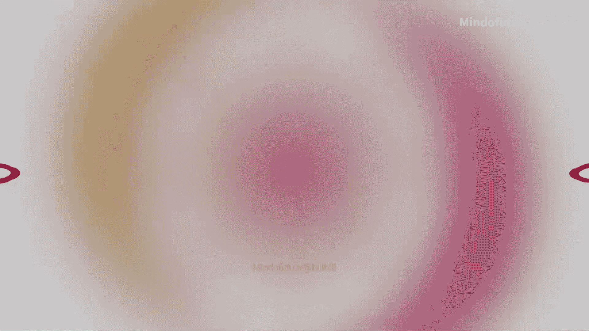
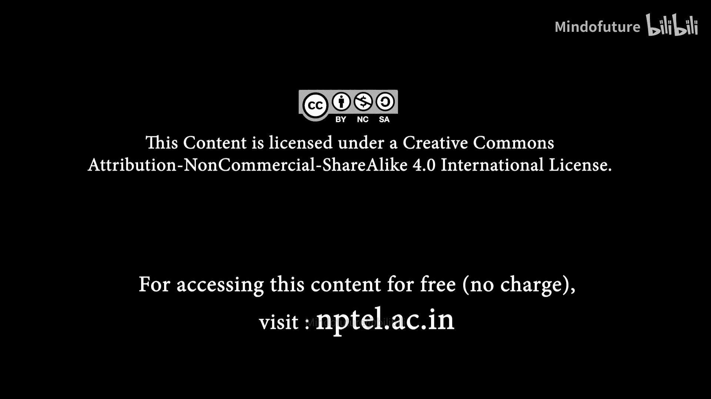
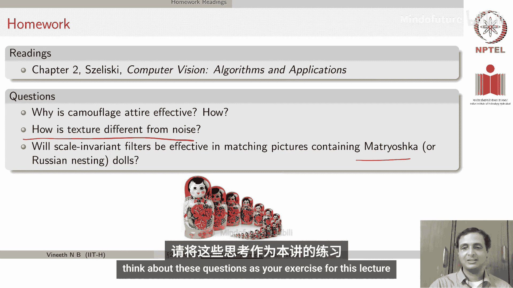

# 010：尺度空间、图像金字塔与滤波器组





## 概述
在本节课中，我们将学习如何使特征检测（如Harris角点检测）具备尺度不变性。我们将探讨尺度空间的概念，学习如何构建图像金字塔（高斯金字塔和拉普拉斯金字塔），并了解如何使用滤波器组来提取和表示图像纹理。

---

## 从Harris角点检测的局限性谈起
上一节我们介绍了Harris角点检测器。我们提到它的一个主要局限性是**不具备尺度不变性**。这意味着，在一张图像中被检测为角点的位置，在另一张放大或缩小的图像中，可能只会被识别为边缘。

让我们快速回顾一下这个问题。Harris角点检测通过计算**自相关矩阵**，并分析其特征值（λ1, λ2）来判断一个区域：
*   当 λ1 和 λ2 都很小时，区域是平坦的。
*   当其中一个特征值远大于另一个时，区域是边缘。
*   当两个特征值都很大时，区域是角点。

然而，由于检测时使用的**图像块（patch）大小是固定的**，当图像尺度（缩放程度）发生变化时，同一个物理角点在图像上的表现会不同，从而导致检测失败。

---

## 实现尺度不变性的思路
为了克服尺度问题，我们需要一种方法，能够**在不同尺度上分析图像**，并找到**在位置和尺度上都稳定的关键点**。

一个简单的想法是：构建图像的多尺度表示（即图像金字塔），然后在每一层尺度上独立运行Harris检测器。但这种方法要求我们在匹配时，必须知道两张图像在哪一个相同的尺度层上进行比较，这在实际中往往难以实现。

更理想的方法是：对于一个潜在的关键点，我们不仅找到它的位置 (x, y)，还要找到它**最显著的尺度 σ**。这个尺度σ就是使该点的“角点响应”达到最大的那个尺度。我们可以通过**改变用于计算自相关矩阵的图像块大小**来模拟尺度的变化，并绘制出角点响应随尺度变化的曲线，曲线的峰值对应的就是该点的特征尺度。

---

## 图像金字塔：高斯与拉普拉斯
上一节我们提到了改变图像块大小来模拟尺度变化。本节中，我们来看看一种更系统、更常用的多尺度表示方法：**图像金字塔**。其核心思想是固定检测器的窗口大小，而去改变图像本身的尺度。

**高斯金字塔**的构建过程如下：
1.  从原始图像（最底层）开始。
2.  使用高斯滤波器对图像进行平滑（模糊）。
3.  对平滑后的图像进行下采样（如尺寸减半），得到上一层的图像。
4.  重复步骤2和3，得到一系列分辨率逐渐降低的图像，构成一个金字塔。

以下是构建过程的简化表示：
```
G1 (原始图像) -> [高斯平滑 & 下采样] -> G2 -> [高斯平滑 & 下采样] -> G3 -> ...
```

**拉普拉斯金字塔**则源于高斯金字塔，它保存的是不同尺度间的**细节信息**。其构建方法是：
1.  对高斯金字塔中的某一层图像（如G2）进行上采样并平滑，得到一个与下一层（G1）尺寸相同的预测图像。
2.  用原始层（G1）减去这个预测图像，得到的差值图像就是拉普拉斯金字塔的一层（L1）。

这个过程可以表示为：
```
L1 = G1 - UpSample(Smooth(G2))
```
拉普拉斯金字塔之所以得名，是因为**一个拉普拉斯算子可以近似为两个不同方差的高斯函数的差（Difference of Gaussians, DoG）**。

### 图像金字塔的应用
以下是图像金字塔的几个主要应用场景：
*   **图像压缩**：传输低分辨率图像和拉普拉斯金字塔的细节层，以重建高分辨率图像。
*   **目标检测**：采用“由粗到精”的策略。先在低分辨率图像中快速定位目标大致区域，再逐步到高分辨率层中精确定位。
*   **稳定的兴趣点检测**：为特征点提供尺度信息，实现尺度不变性。
*   **图像配准**：同样采用“由粗到精”的策略，先在粗尺度上对齐图像，再在细尺度上优化。

---

## 纹理表示与滤波器组
在学习了边缘、角点和多尺度分析后，本节我们来看看如何表示更复杂的图像模式：**纹理**。纹理是由重复或随机的图案、沟槽、标记等形成的，它包含了关于材料、方向和尺度的重要信息。

仅靠全局统计（如直方图）无法区分纹理。我们需要捕捉局部模式的排列信息。一种有效的方法是：计算图像在不同**方向**和不同**尺度**上对一系列滤波器的响应，然后对这些响应进行统计（如计算均值和方差）或聚类，从而形成对纹理的描述。

这就需要用到**滤波器组**。滤波器组是一系列滤波器的集合，其中每个滤波器都可以看作一个**带通滤波器**，只允许图像中特定频带和方向的信息通过。

### Gabor滤波器组
Gabor滤波器是一种非常流行的、用于纹理分析的滤波器，它结合了**高斯函数**的平滑性和**正弦函数**的方向性。

一个二维Gabor滤波器的数学公式如下：
```
G(x,y;λ,θ,ψ,σ,γ) = exp( - (x'² + γ² y'²) / (2σ²) ) * exp( i(2πx'/λ + ψ) )
```
其中：
*   `x' = x cosθ + y sinθ`
*   `y' = -x sinθ + y cosθ`
*   `λ`：正弦函数的波长。
*   `θ`：滤波器的方向取向。
*   `ψ`：相位偏移。
*   `σ`：高斯包络的标准差，控制有效区域大小。
*   `γ`：空间纵横比，控制高斯区域的椭圆度。

通过设置不同的`θ`（如0°, 45°, 90°, 135°）和`λ`，我们可以得到一组Gabor滤波器。将图像与这组滤波器分别进行卷积，就能得到图像在各个方向和频率子带上的响应，这些响应的集合构成了对图像纹理的丰富描述。

### 可导向滤波器组
另一种方法是使用**可导向滤波器**。这类滤波器可以表示为一组**基滤波器**的线性组合。例如，一个任意方向的一阶高斯导数滤波器，可以表示为x方向和y方向导数滤波器的线性组合：
```
G₁_θ = cos(θ) * G_x + sin(θ) * G_y
```
通过改变`θ`，我们可以“引导”滤波器指向任何方向，而无需重新设计滤波器核。将多个不同方向和尺度的可导向滤波器组合起来，就构成了可导向滤波器组，同样可用于提取纹理特征。

---

## 总结
本节课我们一起学习了三个紧密相关的核心概念：
1.  **尺度空间**：为了解决特征点的尺度不变性问题，我们需要寻找特征点在**位置(x, y)**和**尺度(σ)**上的联合最大值。
2.  **图像金字塔**：一种系统生成图像多尺度表示的工具，主要包括**高斯金字塔**（存储不同尺度的图像）和**拉普拉斯金字塔**（存储不同尺度间的细节）。它们在图像压缩、目标检测和特征匹配中非常有用。
3.  **滤波器组**：用于提取和表示图像纹理。**Gabor滤波器组**和**可导向滤波器组**通过捕捉图像在不同方向和频带上的响应，能够有效地描述纹理的局部结构模式。

通过结合多尺度分析和滤波器响应，我们可以为图像构建更强大、更鲁棒的特征表示，为后续的图像匹配、分类和识别等高级任务奠定基础。



---
**思考题**：
1.  从本节课的讨论出发，为什么迷彩服（伪装色）是有效的？
2.  纹理与椒盐噪声有何区别？两者在图像中可能看起来相似。
3.  尺度不变滤波器能否有效匹配包含俄罗斯套娃（或印度嵌套娃娃）的图片？为什么？