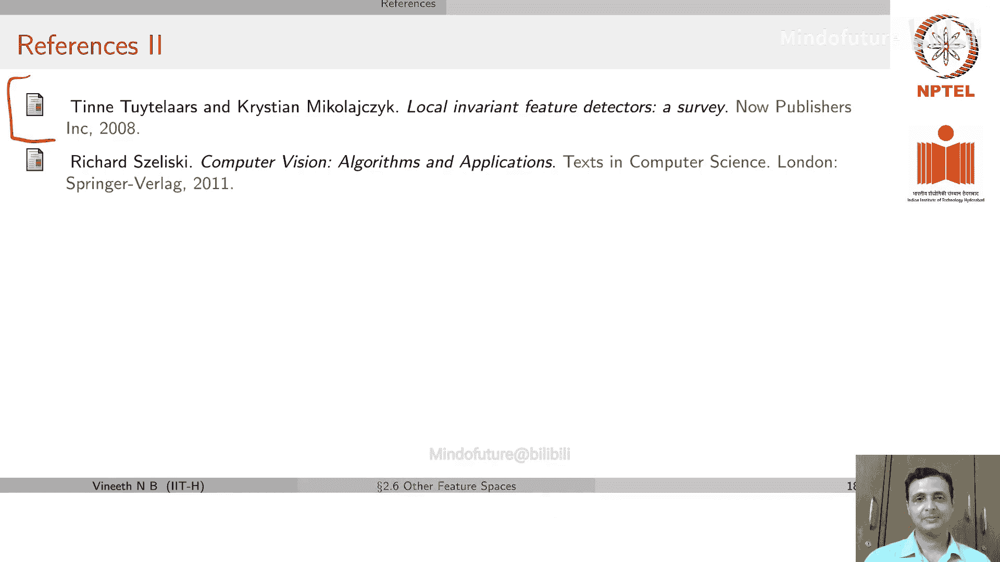

# 013：其他特征空间 🧩

在本节课中，我们将学习在深度学习兴起之前，计算机视觉领域发展出的几种其他重要的特征空间表示方法。我们将探讨形状上下文、最大稳定极值区域、方向梯度直方图以及局部二值模式等经典特征描述子，并了解它们的基本原理和应用场景。

## 形状上下文 (Shape Context) 🎯

上一节我们讨论了图像分割，本节中我们来看看形状上下文。这是一种用于描述和匹配图像中形状的特征表示方法。

形状上下文的核心思想是：对于一个给定的像素点，通过构建其周围邻域的**对数极坐标直方图**来描述该点的局部形状信息。具体来说，它以目标像素点为原点，将周围空间划分为若干个对数距离和角度区间（bin）。

以下是构建形状上下文描述子的步骤：
1.  以目标像素点为中心，建立对数极坐标系。
2.  将邻域空间划分为多个扇形区域（例如，5个距离区间和12个角度区间，共60个bin）。
3.  统计落入每个扇形区域内的其他像素点的数量，形成一个直方图。这个直方图就是该点的形状上下文描述子。

这种表示方法对**平移**和**缩放**具有一定的不变性，并且对邻近点赋予了更高的精度，类似于高斯核函数的思想。

为了衡量两个像素点（来自不同图像）的相似性，我们使用以下**匹配代价公式**：
`C(i, j) = 1/2 * Σ [ (h_i(k) - h_j(k))^2 / (h_i(k) + h_j(k)) ]`
其中，`h_i(k)` 和 `h_j(k)` 分别是点 `i` 和点 `j` 的形状上下文直方图中第 `k` 个bin的计数值。当两个直方图越相似时，`C(i, j)` 的值越小。

通过计算所有点对之间的匹配代价，并寻找代价最小的对应点，我们可以建立两个形状之间的点对应关系，从而实现形状匹配。

## 最大稳定极值区域 (MSER) 🌊

接下来，我们探讨一种基于区域的特征检测方法——最大稳定极值区域。它源于我们之前学过的分水岭分割思想。

MSER 的工作原理是：通过连续改变图像的灰度阈值，来检测那些在阈值变化过程中区域面积保持相对稳定的连通区域。

以下是 MSER 的检测过程：
1.  对灰度图像，从黑到白（或从白到黑）连续改变阈值 `g`。
2.  在每个阈值 `g` 下，对图像进行二值化，并提取所有的连通区域（白色部分）。
3.  随着阈值的变化，这些连通区域会像树状结构一样分裂或合并。
4.  对于一个在阈值 `g` 下的区域 `R(g)`，我们计算其在阈值微小扰动 `±Δ` 时的面积变化率 `ψ`：
    `ψ = ( |R(g-Δ)| - |R(g+Δ)| ) / |R(g)|`
    其中 `|R|` 表示区域 `R` 的面积（像素数）。
5.  如果 `ψ` 小于一个预设的阈值，则表明区域 `R(g)` 在阈值变化时非常稳定，我们将其标记为一个“最大稳定极值区域”。

这种方法能有效地检测出图像中灰度均匀且与周围对比明显的“斑点”或“区域”，常用于文本检测、场景识别等任务。

## 方向梯度直方图 (HOG) 🧍

现在，我们来看一种在目标检测，特别是行人检测中取得巨大成功的特征——方向梯度直方图。

HOG 特征描述的是图像局部区域内梯度方向的分布情况。其基本流程如下：

以下是提取 HOG 特征的步骤：
1.  **计算梯度**：对图像（或检测窗口）的每个像素计算水平和垂直方向的梯度，得到梯度幅值和方向。
2.  **划分细胞单元**：将图像划分为小的、不重叠的“细胞单元”（例如 8x8 像素）。
3.  **创建方向直方图**：在每个细胞单元内，根据像素的梯度方向（通常划分为9个方向区间或bin）进行投票，投票权重为该像素的梯度幅值。这样就为每个细胞单元生成一个9维的梯度方向直方图。
4.  **块内归一化**：为了对光照和阴影有更好的不变性，将相邻的若干个细胞单元（例如 2x2 个）组合成一个“块”，对块内所有细胞单元的直方图向量进行串联，然后对这个长向量进行归一化处理。
5.  **收集 HOG 特征**：将图像中所有块的归一化直方图向量串联起来，就形成了最终的 HOG 特征描述符。

为了进一步提升性能，还出现了金字塔 HOG。它在不同尺度的图像金字塔上分别计算 HOG 特征，然后进行串联，从而更好地捕获空间信息。

## 局部二值模式 (LBP) 😀

最后，我们介绍一种在纹理分类和人脸识别中广泛使用的特征——局部二值模式。LBP 是一种强大的纹理描述算子，它通过比较像素与其邻域的关系来编码局部纹理信息。

LBP 的基本操作非常简单：

以下是计算基本 LBP 的步骤：
1.  对于一个像素点，观察其周围 3x3 邻域内的 8 个邻居像素。
2.  以中心像素的灰度值为阈值，将邻域中每个像素的灰度值与其比较。
3.  如果邻居像素的灰度值大于或等于中心像素，则将该位置标记为 1，否则标记为 0。
4.  从左上角开始，按顺时针方向读取这 8 个二进制位，形成一个 8 位的二进制数（例如 `01111100`）。
5.  将这个二进制数转换为十进制数（例如 124），并用这个数替换原中心像素的值。

通过定义不同的邻域半径 `R` 和采样点数 `P`，可以产生多种 LBP 变体，以适应不同尺度的纹理。

在得到整幅图像的 LBP “编码图”后，通常将其划分为多个网格，然后计算每个网格内 LBP 值的直方图，最后将所有网格的直方图串联起来，作为整个图像或区域的纹理特征。

## 特征检测器总结与展望 📊

在本节课中，我们一起学习了多种经典的特征空间表示方法。为了系统地比较这些方法，我们可以从以下几个维度进行评估：

以下是评估特征检测器的关键指标：
*   **检测类型**：是角点、斑点还是区域检测器？
*   **不变性**：是否对旋转、尺度变化或仿射变换具有不变性？
*   **可重复性**：同一场景在不同视角下，检测到的特征点是否一致？
*   **定位精度**：检测到的特征位置是否准确？
*   **鲁棒性**：对噪声的敏感程度如何？
*   **效率**：计算速度如何？

例如，Harris 角点检测器对旋转不变，但尺度不变性较差；SIFT/SURF 是优秀的尺度和旋转不变的特征点/斑点检测器；而 MSER 则在区域检测方面表现出色，并具有良好的仿射不变性。

然而，我们必须认识到，随着深度学习的革命性进展，这些需要手工设计的特征在很大程度上已被深度神经网络自动学习到的特征所超越。深度学习模型能够从海量数据中直接学习到更强大、更适用于特定任务的特征表示，这已成为当前计算机视觉领域的主流。理解这些经典方法，有助于我们更好地把握计算机视觉发展的脉络，并 appreciate 深度学习带来的范式转变。

**本节课中，我们一起学习了形状上下文、最大稳定极值区域、方向梯度直方图和局部二值模式这四种经典的图像特征描述方法，了解了它们的基本原理、计算过程和应用场景，并对不同特征检测器的性能评估维度进行了总结。**