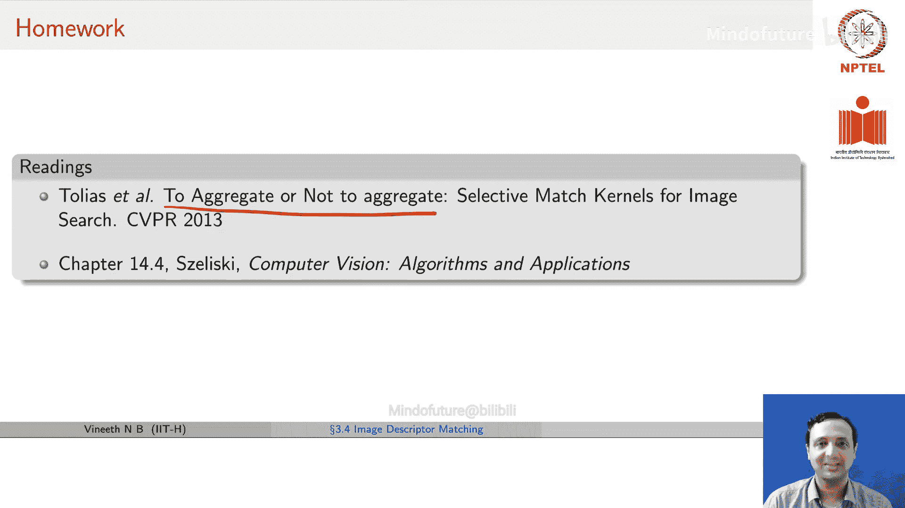

# 018：图像描述符匹配 🖼️🔍

在本节课中，我们将学习如何利用图像描述符进行图像间的匹配。我们将从回顾词袋模型开始，探讨其局限性，并介绍一种更通用的匹配框架——匹配核。通过理解匹配核，我们可以将多种描述符匹配方法统一起来，并学习如何改进匹配的准确性和效率。

## 回顾与扩展：词袋模型与层次化K均值

上一讲我们介绍了使用词袋方法或VLAD方法描述图像。现在，我们将在此基础上，展示如何利用这些描述符进行图像间的匹配。

在深入之前，需要再次说明，本讲幻灯片内容源自法国国家信息与自动化研究所的Avaus教授的精彩讲座。

我们上节课还遗留了一个问题：既然词袋模型本质上依赖于K均值聚类来定义其聚类中心，我们能否考虑K均值的扩展来改进词袋模型的性能？

一个具体的例子是**层次化K均值**。这是K均值聚类算法的一种扩展，其中聚类中心以层次化的方式组织，从根节点开始，一直到一组叶节点。

事实上，这种方法在2006年就已经通过一种名为“词汇树”的方法被探索用于词袋模型。该方法利用层次化K均值构建一个最终的划分树。现在，你的图像描述符从树的根节点开始，在每一层下降到其中一个叶子节点。

因此，你将所有图像中提取的所有视觉词汇的聚类中心集合在一起。回想一下，在词袋模型中，当你构建聚类中心时，你将数据集中的所有图像汇集起来，提取所有特征，使用某种方法对特征周围的描述符进行聚类，然后将这些聚类作为你的码本中心，每个关键点都会被分配到一个中心。

你的图像最终被表示为X，它是图像描述符中的一个元素。图像描述符由 **`Wi * Ni`** 给出，其中 **`Wi`** 是树中该特定节点的权重，**`Ni`** 是分配给该特定聚类中心的关键点数量。

这里一个明显的问题是，很难知道如何给 **`Wi`** 赋值。有人可能会认为，也许树中更深的层级应该具有更高的权重，因为它们匹配得更好。也有人可能持相反观点，这取决于特定应用场景，其中高层级的匹配可能比低层级的匹配更重要。这取决于应用和特定上下文中的重要性。因此，该方法的一个限制是没有定义 **`Wi`** 的原则性方法，尽管你可以在该方法之上提出一些启发式规则。

数据同样使用倒排文件索引进行搜索，就像我们在词袋模型中看到的那样。从根本上说，这里存在一个问题，即失真通常只在局部最小化，例如围绕某个特定的聚类中心。因此，你犯的任何错误或图像之间的任何差异都只是相对于该特定聚类中心的局部差异，失真并不是在全局意义上度量的。它都是相对于每个聚类中心，通过计算该聚类中心在两个待匹配图像中每次匹配的出现情况来度量的。

以上就是层次化K均值如何被扩展用于词袋模型。因此，我们也可以考虑K均值的其他扩展，并能够在这些方法中使用它们来描述图像。

## 评估现有匹配方法

现在，让我们讨论如何以更原则性的方式匹配来自两个不同图像的描述符。在此之前，我们先评估一下目前已知的方法。

我们目前探索过的最简单的方法之一是**最近邻匹配**。你有一幅图像，它是一组特征点；另一幅图像，它是另一组特征点。此时我们讨论的不是任何词袋聚合，而仅仅是一幅图像中的一组特征和另一幅图像中的一组特征。

我们使用第一组中的每个特征及其对应的描述符，独立地在第二组特征中进行索引。我们简单地基于每幅图像中特征的描述符进行最近邻匹配。

你能想到这种方法可能有什么局限性吗？

这种方法的一个固有局限性是，它可能忽略了有用的上下文信息。有可能在一幅图像中存在同一特征的多个实例，例如豹子身上的斑点或斑马身上的条纹等等。你可能将一幅图像中的单个特征映射到另一幅图像中的多个不同特征，因为它们看起来都很相似。例如，一幅图像中豹子的一个斑点可能被映射到另一幅图像中豹子的多个斑点。

理想情况下，你不希望这种情况发生。你希望豹子身上的每个斑点都映射到另一幅图像中豹子的一个独立斑点上，另一个斑点映射到另一个斑点，依此类推。幻灯片上看到的例子是一只大熊猫，它的结构中也有一些重复的特征，这些特征可能被映射到第二幅图像中的同一个实例上。

这就是你在这里看到的理想情况，每个特征都独立地映射到第二幅图像中的一个特征。而另一种情况是，同一特征的两个不同实例被映射到第二幅图像中的同一个特征上，这是不可取的。当你使用最近邻匹配方法时，这可能会导致一些问题。

到目前为止，我们也看到了词袋匹配方法。

你能看出这种方法有什么明显的局限性吗？

一个明显的局限性是，词袋方法仅限于**整图匹配**，而不是**部分匹配**。因为你要比较的是图像一中聚类中心出现次数的直方图与图像二中类似直方图的相似度。只有当完整的直方图彼此相当接近时，你才会说两幅图像匹配。

因此，如果只有第二幅图像的一部分与第一幅图像匹配，这些直方图将不匹配，你在此类设置中将无法获得良好的匹配。换句话说，词袋模型不是“一对一”的匹配。

但理想情况下，我们希望有一种“一对一”匹配的感觉，即图像的一部分与另一部分匹配，这样我们仍然可以匹配某些部分相似的图像。从理想的角度来看，最近邻匹配是一种“一对一”的匹配方法，但它有其自身的局限性。

## 引入匹配核框架

现在，让我们尝试推广如何使用你在机器学习中见过的一种方法来进行描述符匹配，那就是**核方法**。你可能在支持向量机中听说过核。我们将在这里使用类似的思想来推广描述符之间的匹配。

回想一下，即使在支持向量机或任何其他可以使用核的机器学习算法中，核都是两个数据点之间相似性的一种度量。这里使用的也是同样的原理。

为了实现这一点，让我们先定义一下目前的设置。假设你有一幅由n个描述符描述的图像，所以X是一幅图像，由 **`x1, x2, ..., xm`** 给出，其中每个 **`xi`** 是一个D维向量。记住，这些可以是聚类中心，也可以是单个特征。

以词袋模型为例，这些描述符通常使用K均值聚类或任何其他聚类方法进行**量化**。这意味着你并不取图像中的所有特征，而是尝试查看它们属于哪个聚类中心，并仅将该特定聚类中心的计数作为该特定特征或该特定聚类中心的表示。

这个量化函数由 **`Q`** 给出，它将我们从 **`R^D`** 映射到 **`R^D`** 的一个子集 **`C`**，其中 **`C`** 被称为**码本**，由 **`c1`** 到 **`ck`** 给出。所以有K个可能的聚类中心，正如我刚才提到的，你可以通过对所有图像的特征进行K均值聚类来获得。在一幅图像中，你尝试使用一个量化器函数，将每个特征映射到离它最近的一个聚类中心。这就是当前的设置，现在让我们尝试定义核。

现在，给定两幅图像X和Y，匹配核 **`K(x, y)`** 定义为：
**`K(x, y) = γ(x) * γ(y) * Σ_c M(x_c, y_c)`**

其中，正如我们稍后将看到的，**`γ(x)`** 和 **`γ(y)`** 是归一化函数，我们稍后会看到为什么需要它们。求和是对你拥有的所有聚类中心进行的。**`M`** 是**单元内匹配函数**，也就是我们所说的匹配核函数。它针对每个聚类中心在一幅图像中的出现次数以及该聚类中心在第二幅图像中的出现次数进行计算。

我们仍然需要定义 **`M`** 是什么，随着课程的进行，我们将看到几个例子。

这里的 **`γ(x)`** 和 **`γ(y)`** 是必需的，因为你不希望匹配结果受到图像中特征数量的影响而产生偏差。例如，你可能在一幅图像中检测到1000个特征，而在另一幅图像中只检测到200个。如果你只是简单求和，那么拥有大量特征的图像总是会占优势，因为计数会增加，而这可能并不是完美的匹配。因此，**`γ(x)`** 和 **`γ(y)`** 是归一化函数，你可以除以图像中的特征总数，这样匹配就不会仅仅因为图像中的特征数量而产生偏差。

## 匹配核的具体实例

现在，让我们尝试看几个例子，看看 **`M`** 在你目前见过的例子中会是什么样子。

如果你采用**词袋匹配**，词袋匹配在某种程度上是两幅图像中聚类中心之间的余弦相似度。你可以定义，到目前为止你在词袋相似度中看到的任何内容都可以由一个匹配核来定义，该核由下式给出：
**`M(x_c, y_c) = count(x_c) * count(y_c)`**

你取你的一个码本元素或聚类中心 **`c`**，计算它在图像X中出现的次数，以及在图像Y中出现的次数，然后简单地将它们相乘。例如，对于一个特定的码本条目 **`c3`**，如果图像X中有10个特征对应于 **`c3`**，图像Y中有3个特征对应于 **`c3`**，那么对应的匹配核就是 **`10 * 3 = 30`**。然后对所有码本条目进行双重求和。所以这本质上就是一个词袋模型。请记住，如前所述，归一化函数将负责对图像本身的总特征数进行归一化，但这就是 **`M`** 的定义方式。

你可以将此扩展到另一种称为**汉明嵌入匹配**的方法。如果你假设每个描述符都可以以某种方式进行二值化，例如，你可以取一个描述符，简单地说任何大于阈值的为1，小于阈值的为0，你可以对任何描述符进行二值化。然后，你计算匹配核为：
**`M(x_c, y_c) = 1 if Hamming_Distance(b(x), b(y)) < τ, else 0`**

这又类似于你的词袋核。现在唯一的区别是，你只计算汉明距离 **`Hamming_Distance(b(x), b(y))`** 小于阈值 **`τ`** 的实例数量。这就是你的汉明嵌入。其中 **`H`** 是两个二进制向量之间的汉明距离，**`τ`** 是你必须指定的阈值，以便在此特定设置中获得匹配核。

你也可以在相同的框架中定义**VLAD匹配**。再次记住，VLAD与词袋相似，唯一的区别是你不计算属于一个码本元素或聚类中心的特征数量，而是获取属于一个码本元素或聚类中心的所有特征，并计算残差向量。

再次回想，在VLAD中，你有一个聚类中心，例如，你可以有两个聚类中心。你有一组最接近这个特定聚类中心的特征，还有另一组最接近另一个特定聚类中心的特征。你取它们之间的差值，这将是一个残差向量，然后将属于这个特定聚类中心的所有残差向量相加，这就成为该聚类中心的表示，类似地，你也会对其他聚类中心进行此操作。

现在，如果这是表示方式，你如何计算匹配核？匹配核由下式给出：整个图像X的表示将是一个集合或整个向量，由 **`v(x_c1), v(x_c2), ..., v(x_cK)`** 表示。这将是每个码本元素对应的表示。

你的匹配核现在由 **`v(x_c)^T * v(y_c)`** 给出，这是图像X中第c个码本条目的表示与图像Y中第c个码本条目的表示之间的内积。但这很容易展开，因为 **`v(x_c)`** 是属于该特定码本条目的所有x及其对应残差的和。类似地，**`v(y_c)`** 也用其和展开。现在，你的新匹配核变成了对图像X中属于该码本条目的所有元素或所有特征的求和，以及对图像Y中属于同一码本条目的所有y的求和，内部是 **`r(x)^T * r(y)`**，即残差之间的内积。

如果你试图理解这里的直觉，你是在试图说明：如果你在图像X中有一个聚类中心 **`c3`**，在图像Y中有相同的聚类中心 **`c3`**。假设图像X中有三个特征属于这个聚类中心，图像Y中也有三个特征属于这个聚类中心。你将取其中一个残差，看看另一个残差如何与这个残差匹配。如果两个残差匹配，你将获得较高的匹配分数；换句话说，如果两个图像中围绕该聚类中心的特征配置方式相匹配，那就是更好的匹配。

## 聚合选择性匹配核

一种更通用的结合所有这些思想的方法被称为**聚合选择性匹配核**，它结合了你目前见过的几个想法：它结合了我们将在稍后看到的汉明嵌入中的非线性选择性函数，也结合了VLAD的思想。

这种方法的工作方式是：你取VLAD，正如你在参数内部看到的那样。然后你对VLAD向量进行归一化，这就是你定义为 **`v_hat`** 的。所以，如果你看到这张幻灯片的底部，**`v_hat`** 由 **`v(x_c) / ||v(x_c)||`** 给出。实际上，你试图将VLAD向量（即所有残差的和）转化为单位范数向量。

现在，你取了VLAD向量之间的内积，这与我们在上一张幻灯片上看到的非常相似。因为这是一个内积，其输出将是一个标量。现在，你使用一个非线性选择性函数 **`σ_α`** 作用于这个标量，以获得最终的匹配函数。这个 **`σ_α`** 是什么？对于任何输入 **`u`**，**`σ_α`** 定义为：
**`σ_α(u) = sign(u) * |u|^α if u > τ, else 0`**

请记住，内积是相似性的度量。值越高，对你越有利。因此，如果 **`u`** 大于阈值 **`τ`**，你可能希望给予更多的权重，这可以通过 **`α`** 来控制；如果 **`u`** 小于阈值，则为0。这与汉明距离非常相似，我们说过，如果汉明距离小于阈值，我们就更多地计数，否则就不计数。这是一个非常相似的想法，尽管我们使用VLAD向量来实现相同的目标。

你可以在这里看到，如果 **`α = 1`**，那么 **`sign(u) * |u|`** 就是 **`u`** 本身。

让我们看几个这个想法的图示，使其更清晰。这里有几个不同 **`α`** 和 **`τ`** 值选择的图示。在左上角，你可以看到 **`α = 1`**，正如我们刚才所说，就是 **`u`** 本身。在这种情况下，**`τ = 0`**，所以任何大于0的值，你都会认为 **`u`** 本身就是分数。你可以在这里看到，黄色对应零相似性，红色对应最大相似性。所以有一些特征完全不匹配，有一些特征匹配得很好，它们都显示在左上角的图像中。

如果你看右上角，你可以再次看到 **`α = 1`**，但 **`τ = 0.25`**。你现在可以看到很多黄色区域减少了。你现在说，分数 **`u`** 必须至少为0.25，我们才认为它是一个匹配。现在你可以看到，许多错误匹配消失了，因为任何低分数现在都被忽略了。

底行显示了一个 **`α = 3`** 的例子。请记住，因为你归一化了你的VLAD向量，**`u`** 将是一个介于0和1之间的值。因为你有归一化的向量，**`u`** 很可能是一个介于0和1之间的值。所以，如果作为 **`u`** 的指数的 **`α`** 很高，值会变得更小。这就是你在左边看到的，一些红色消失了，因为它们更接近0了。在右边，你看到了类似的情况，当 **`α = 3`** 且 **`τ = 0.25`** 时，你得到了一些更多的黄色，因为此时 **`u^α`**（这里 **`α`** 是3）可能降低了值，因为 **`u`** 介于0和1之间。

因此，你可以在这里看到，更大的选择性减少了错误的对应关系，这就是我们在右边两幅图像中 **`τ = 0.25`** 所看到的。这整个方法取代了我们在汉明嵌入中使用的硬阈值，并提供了一种实现类似目标的不同方式。

这是应用ASMK方法后的另一个结果图示。你可以看到，这些不同图像中的每种颜色对应相同的视觉词汇。例如，如果你取粉色或红色，你会看到粉色或红色的视觉词汇对应于每幅图像中的某个角落或尖角。

## 高效匹配核与总结

所有这些核都可以推广为**高效匹配核**，你可以将核定义为某个连续函数 **`κ(x, y)`**，并完全避免使用任何码本。因为计算码本、然后计算残差等在计算上可能很密集。你可以直接在图像一的单个特征和图像二的单个特征之间施加一个核函数。

再次强调，这与核函数在支持向量机或其他具有核组件的机器学习算法中的使用方式非常相似。

理想情况下，你希望这个 **`κ(x, y)`** 可以分解为 **`φ(x)^T * φ(y)`** 的内积，其中 **`φ`** 是每个特征在不同空间中的表示。那么，你的最终 **`κ`** 将是 **`x`** 的所有特征表示的某种归一化求和，与 **`y`** 的类似聚合表示的内积。这是我们目前所见方法的一个推广。

本节课到此结束。关于更多阅读资料，这篇题为《聚合还是不聚合》的论文很好地总结了这些核方法。请你在有空时务必阅读。此外，Celsky著作的第14.4章将是本讲的其他参考资料。

在本节课中，我们一起学习了图像描述符匹配的核心概念。我们从回顾词袋模型及其层次化扩展开始，分析了简单最近邻匹配和词袋匹配的局限性。接着，我们引入了强大的匹配核框架，它将多种匹配方法（如词袋、汉明嵌入、VLAD）统一在一个通用的数学形式下。我们重点探讨了聚合选择性匹配核，它通过引入非线性选择性函数和归一化，提高了匹配的准确性和鲁棒性。最后，我们简要提到了高效匹配核作为更一般的推广。理解这些匹配核的原理，对于在计算机视觉任务中实现高效、准确的图像比较至关重要。