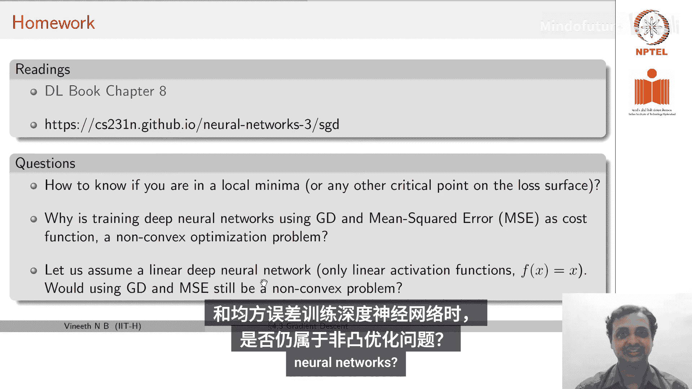

# 026：梯度下降及其变体 - 第二部分 🚀


在本节课中，我们将要学习梯度下降法的不同变体，特别是随机梯度下降及其改进版本。我们将分析批量梯度下降、随机梯度下降和小批量随机梯度下降的优缺点，并探讨如何通过自适应学习率算法（如AdaGrad、RMSProp和Adam）来优化训练过程。

## 批量梯度下降分析 📊

上一节我们介绍了梯度下降及其动量方法。本节中，我们来看看梯度下降法本身的优缺点。

对于每一次参数更新，梯度下降法需要遍历整个数据集。它计算每个数据点的梯度，进行累加，然后取平均值，这个过程被称为一个**epoch**。因此，梯度下降法也被称为**批量梯度下降**。

以下是批量梯度下降的优缺点：

**优点：**
*   从优化理论的角度看，其收敛条件有很好的理解。
*   许多加速技术（如共轭梯度法）在批量梯度下降的设定下效果很好。

**缺点：**
*   计算速度可能很慢，尤其是在训练数据集很大时（例如1万个或100万个数据点）。你需要等待遍历完所有数据点后才能进行一次更新。对于像ImageNet这样拥有约1400万样本的数据集，一次迭代会非常耗时。

## 随机梯度下降 🔄

这引出了另一种非常流行的方法：**随机梯度下降**。

随机梯度下降的步骤如下：首先随机打乱训练数据，然后针对**每一个**训练样本计算梯度并立即更新所有参数。这与批量梯度下降的关键区别在于：参数更新步骤被放到了遍历每个数据点的循环内部。

以下是随机梯度下降的优缺点：

**优点：**
*   **速度更快**：由于数据中存在大量冗余信息，无需等待所有数据即可获得梯度方向感，从而加快训练。
*   **可能找到更好的解**：其更新带有“噪声”，这种噪声有助于逃离糟糕的局部极小值或鞍点。
*   **易于适应变化**：当有新数据加入时，可以轻松地用小批量新数据更新模型，而无需对整个（旧+新）数据集重新计算梯度。

**缺点：**
*   **噪声可能导致不收敛**：由于误差曲面的复杂性，初始权重和噪声更新可能导致训练不收敛。实践中，如果前几次迭代误差波动过大，常见的做法是重新初始化权重并再次尝试。
*   **学习率选择困难**：噪声更新需要谨慎选择学习率，过高可能导致梯度爆炸，过低则收敛缓慢。

## 小批量随机梯度下降 ⚖️

在讨论更多优缺点前，我们先介绍一种介于两者之间的方法：**小批量随机梯度下降**。

顾名思义，小批量随机梯度下降每次从训练数据集中取一小批样本（例如20个），前向传播计算所有输出和误差，计算所有梯度，然后仅对这20个梯度取平均值来更新参数。

这种方法的需求在于：如果对每个样本都更新，梯度方向可能过于随机。对小批量样本取平均，能获得一个在更多数据点上相对一致的梯度方向感。

**算法上**，参数更新步骤再次被移到循环外，但这次你只针对一个大小为 `B` 的小批量数据聚合并平均梯度。

```python
# 伪代码示意
for each mini-batch B in training_data:
    gradients = compute_gradients(B)
    average_gradient = mean(gradients)
    parameters = parameters - learning_rate * average_gradient
```

小批量随机梯度下降是当今训练神经网络的默认选择。通常当人们提到使用SGD时，实际上指的就是小批量SGD（当批量大小为1时，即为标准SGD）。

## 学习率调度策略 ⏱️

我们之前提到，动量是人为向系统注入学习率的一种方式。但一般来说，如何选择学习率呢？

一种简单的方法是**固定学习率**，在整个训练过程中保持不变。

另一种是**基于退火的方法**，即随着时间推移逐渐降低学习率。其思想是：随着训练进行，你越来越接近最小值，此时需要更小的步长以避免越过最优点。

以下是几种常见的退火策略：

*   **步长衰减**：每经过N次迭代，或在满足特定条件（如当前误差大于前一次误差）时，降低学习率。
*   **指数衰减**：学习率按公式 `α = α0 * e^(-k*t)` 衰减，其中 `α0` 和 `k` 是超参数，`t` 是迭代次数。
*   **1/t衰减**：学习率按公式 `α = α0 / (1 + k*t)` 衰减。

这些方法都是启发式的。我们能否根据网络的实际行为更智能地调整学习率呢？答案是肯定的。

## 自适应学习率算法 🧠

### AdaGrad

AdaGrad的直觉是：稀疏但重要的特征（对应神经网络中某些权重）可能梯度较小，学习在这些方向上可能很慢。那么，为什么对所有权重使用相同的学习率呢？

在AdaGrad中，为网络中的**每个权重**维护一个累积平方梯度 `R_t`。参数更新公式为：

`θ_{t+1} = θ_t - α / (δ + √(R_t)) * Δθ_t`

其中 `Δθ_t` 是当前时间步的梯度向量，`δ` 是一个很小的数（如 `10^-7`）用于数值稳定性，防止除以零。

**核心思想**：对于某个权重，如果其历史梯度平方和 `R_t` 小，则 `α / √(R_t)` 会变大，相当于给该权重一个较大的学习率；反之，如果 `R_t` 大，则学习率变小。这实现了对每个权重的自适应学习率。

**问题**：`R_t` 是单调递增的累积和，随着迭代进行，分母会变得非常大，导致所有权重的学习率都变得极小，可能过早停止学习。

### RMSProp

RMSProp 改进了 AdaGrad 的问题。它不再使用简单的累加，而是使用**指数移动平均**来累积平方梯度：

`R_t = ρ * R_{t-1} + (1 - ρ) * (Δθ_t)^2`

这里 `ρ` 是衰减率（例如0.9），这是一个凸组合，确保 `R_t` 不会无限增长，从而避免了学习率过早衰减的问题。其参数更新公式与 AdaGrad 形式相同。

### Adam

Adam 是目前最流行的自适应学习率算法，它结合了 **RMSProp（自适应学习率）** 和 **动量（梯度方向平滑）** 的思想。

Adam 同时维护两个移动平均值：
1.  梯度的一阶矩估计（有偏） `s_t`（类似于动量）。
2.  梯度平方的二阶矩估计（有偏） `r_t`（类似于RMSProp）。

然后对这两个估计进行**偏差校正**，以解决初始迭代时估计值偏向零的问题。校正公式为：
`ŝ_t = s_t / (1 - ρ1^t)`
`r̂_t = r_t / (1 - ρ2^t)`

最终的参数更新公式为：
`θ_{t+1} = θ_t - α * ŝ_t / (δ + √(r̂_t))`

Adam 算法因其良好的实践效果而被广泛采用。

## 总结与挑战 🎯

本节课中我们一起学习了梯度下降的各种变体及其改进方法。

我们首先分析了批量梯度下降的优缺点，然后引入了更快的随机梯度下降及其更稳定的小批量版本。接着，我们探讨了学习率调度的重要性，并介绍了三种自适应学习率算法：AdaGrad、RMSProp 和 Adam，它们通过为不同权重调整学习率来优化训练过程。

然而，训练深度神经网络仍然面临诸多挑战：
*   误差曲面存在平坦区、局部极小值和鞍点。
*   随着网络加深，会出现梯度消失或爆炸问题，导致误差曲面出现“悬崖”。
*   权重矩阵或损失函数可能病态。
*   梯度计算可能存在数值误差。
*   误差曲面通常是非二次、非凸、高维的，存在许多极小值和平坦区域。
*   没有强理论保证网络一定能收敛到好的解，或者一定收敛。

尽管如此，基于随机梯度下降的深度神经网络训练在实践中被证明是行之有效的，并在全球众多应用中获得成功。



**课后思考**：
1.  如何判断自己处于损失曲面上的局部极小值还是其他临界点？
2.  为什么使用梯度下降和均方误差训练深度神经网络是一个非凸优化问题？（这是我们本节课开始时提出的问题）
3.  如果我们假设一个**深度线性神经网络**（没有激活函数），使用梯度下降和均方误差进行训练，这仍然是一个非凸优化问题吗？