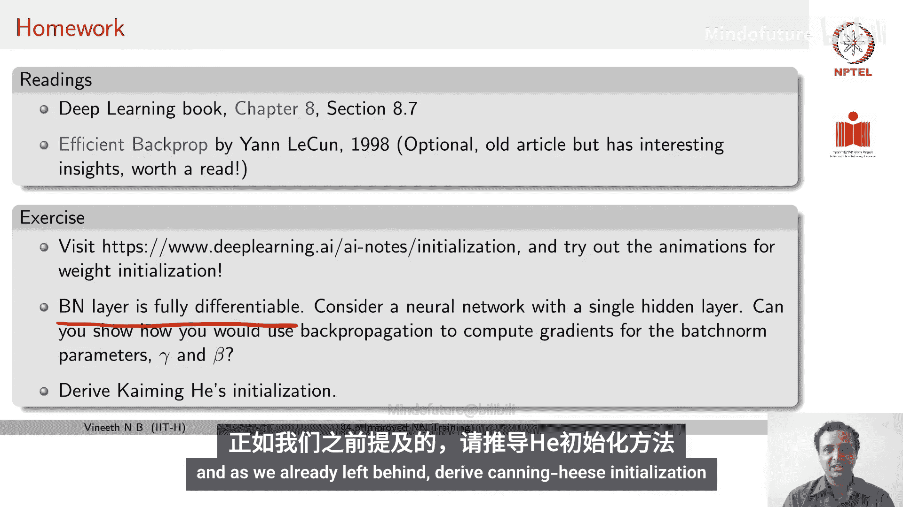

# 030：改进神经网络训练 - 第二部分


在本节课中，我们将要学习改进神经网络训练的三个核心组件：权重初始化、Xavier/Glorot初始化的推导，以及批归一化技术。这些方法对于稳定训练过程、加速收敛至关重要。

## 权重初始化的重要性

上一节我们讨论了优化器和学习率，本节中我们来看看另一个关键因素：权重初始化。

现在你已经知道，为了让神经网络学习，必须首先用特定值初始化权重，然后执行梯度下降。这真的很重要吗？能否将所有权重初始化为零然后开始训练？

这很重要，因为如果你回想神经网络的误差曲面，起点对于你将到达哪个局部最小值至关重要。误差曲面可能非常复杂，这意味着结果取决于你的起点。相应地，你可能会收敛到一个局部最小值。如果你想获得更好的局部最小值，可能需要在开始时处于一个更好的位置，才能得到那个解。

最近的研究试图从其他角度分析这个问题，但总的来说，权重初始化被认为是设计神经网络的一个非常重要的方面。事实上，在21世纪初深度学习开始流行时，这在某种程度上改变了游戏规则。

## 为什么不能初始化为零或常数？

首先问一个简单的问题：为什么不直接将神经网络权重初始化为零，让它学习应该学习的东西？这是一个好方法吗？不是。事实上，任何常数权重初始化方案都会表现得很差。

为什么会这样？让我们举个例子来理解这一点。考虑一个有两个隐藏单元的神经网络，假设使用ReLU激活函数。为了便于理解，我们将所有偏置设为零，并将所有权重初始化为某个常数α。它可以是零，也可以是非零的任何常数初始化。

如果我们这样做，并在网络中前向传播一个输入，下一层两个隐藏单元的输出都将是 `α*x1 + α*x2`，因为权重是相同的。现在，为什么这是个问题？这意味着两个隐藏单元将具有相同的输出，它们对成本或损失具有相同的影响，因此它们将具有相同的梯度。如果它们具有相同的梯度，它们将具有相同的更新，并且权重将始终保持相同。它们开始时相同，梯度相同，并且在训练过程中始终保持相同的值。这是不可取的。因此，我们希望做的不仅仅是简单地用相同的值初始化权重。

## 如何初始化权重？

那么如何初始化权重呢？权重通常被随机选择，例如，可以从高斯分布中采样权重，以使权重具有一些变化性。

当初始化时，需要记住非常重要的一点：过大的权重和过小的权重都可能导致激活函数（如sigmoid和tanh）饱和。

## 历史方法：贪婪逐层无监督预训练

让我们具体看看如何初始化。在2006年，权重初始化是扭转深度神经网络关注度的主要因素之一。Salakhutdinov和Hinton引入了一种称为“贪婪逐层无监督预训练”的方法，这被认为是深度神经网络训练和成功的重要催化剂。

从2006年起的几年里，普遍的理解是，这种方法对于使深度神经网络在实践中工作至关重要，并导致了深度神经网络在各种应用中的广泛采用。然而，今天人们理解到，你不需要这种方法，有简单的权重初始化方法可以使用，并且能得到同样好的结果。但让我们试着理解这种方法试图做什么。

顾名思义，“贪婪逐层无监督预训练”。建议是，当你有一个深度神经网络时，在开始训练神经网络之前（我们这里讨论的是权重初始化步骤），你取前两层，使用某种无监督技术训练它们，例如，你可以使用称为玻尔兹曼机或自编码器的方法（我们稍后会看到）。通过这种方式，你可以得到一组权重，然后你冻结这些权重。接着，你取下两层，以无监督的方式训练它们。因为第一层的权重被冻结了，你可以提供输入，乘以那些冻结的权重，它们将成为第二层的输入。所以你可以取第二层和第三层，以无监督的方式训练它们，你会得到一组特定的权重，然后你冻结这些权重。然后你取第三层权重，以无监督的方式训练它们，并不断重复这个过程，为你的神经网络获得权重初始化。

为什么这被称为“贪婪”？因为它独立地优化每个部分，而不是联合优化。“逐层”是因为你以逐层的方式进行初始化。“无监督”，正如我所说，是因为你只使用数据，没有标签来训练这些网络，因为这不是一个正式的训练过程，它只是为了初始化神经网络。它被称为“预训练”，因为这是在正式训练过程开始之前完成的，正如我提到的，它是为了权重初始化。

你现在可能有一个问题：如何在每对层之间进行无监督训练？你可能需要在本课程中等待这个答案。这是通过称为自编码器或受限玻尔兹曼机的网络实现的，甚至可以使用其他方法来实现这一点，但我们将在本课程稍后看到这些例子。

但正如我提到的，在过去的十年里，这种方法已经被更新的权重初始化方法所取代。

## 现代初始化方法的思路

让我们试着理解提出新的初始化方法背后的思考过程。

如果你有一个神经网络，比如你在这里看到的。假设你的所有输入都已经归一化，均值为零，方差为1。在将数据输入提供给任何机器学习算法之前，对数据输入进行归一化现在非常普遍。

现在也假设你的权重必须具有零均值和某个方差。我们不知道那个方差应该是什么，这正是我们想找到的。

让我们取其中一个神经元，称之为a1。为了简单起见，取这里的其中一个神经元，称之为a1。那将由 `a1 = Σ_{i=1}^{n} w_i * x_i` 给出，其中n是进入该神经元的权重数量。那么a1的方差将是 `Var(a1) = Σ_{i=1}^{n} Var(w_i * x_i)`。

现在假设w和x彼此不相关，你可以将 `Var(w_i * x_i)` 写成 `Var(w) * Var(x)`，联合协方差将变为零。并且假设我们也希望所有神经元具有相同的方差，那么求和就变成了 `n * Var(w) * Var(x)`。

现在让我们试着理解当我们在神经网络中深入时，方差会发生什么变化。方差会不断相乘，你会在后面的层得到预激活的方差为 `n^k * Var(w)^k * Var(x)`。这可能导致爆炸或变为零，取决于w的原始方差是多少。

请记住，我们理想上希望，我们已经知道x的方差是1。我们希望每个后续层的方差也是1，因为这将确保中间层也是归一化的。所以我们理想上希望a1的方差也为1。

实现这一点的方法是 `n * Var(w)` 必须等于1。我们知道 `Var(x)=1`，我们希望 `Var(a1)=1`，因为那样即使后面层的激活方差也会被归一化，那么 `n * Var(w)` 必须等于1。

这意味着，对于一个好的初始化，你可以从正态分布或高斯分布中抽取权重，并按 `1/√n` 缩放它们，其中n是扇入数。这里的fan_in指的是进入特定神经元的权重数量。

## 流行的初始化方法

基于此，已经开发了一些权重初始化方法，今天最流行的是Xavier初始化或Glorot初始化，由以下公式给出：

```
W ~ Uniform(-√6 / √(fan_in + fan_out), √6 / √(fan_in + fan_out))
```

或者He初始化，你在这个范围内均匀采样：

```
W ~ Uniform(-√(2 / fan_in), √(2 / fan_in))
```

这些来自2010年和2015年发表的这两篇论文。让我们至少详细理解其中一个，看看这个范围是如何得出的。

## 推导Xavier/Glorot初始化

我们刚才证明了，让 `Var(w)` 为 `1/√fan_in` 是好的。但我们也必须考虑反向传播期间的反向传递，这也可能影响权重和梯度。因此，当你必须决定梯度的权重时，反向传递也会有影响，因为梯度是根据特定层中的权重分布的，这些权重流经前面的层，依此类推。

所以，考虑 `Var(w)` 为 `1/√fan_out` 也可能是明智的。fan_out是从一个神经元到下一层的权重数量。

因此，我们采用 `Var(w)` 的平均值为 `2 / (√fan_in + √fan_out)`。

现在我们从均匀分布的统计中知道，给定一个范围 `[a, b]` 的均匀分布，方差由 `(b - a)^2 / 12` 给出。这意味着，如果我们现在从 `-a` 到 `a` 均匀采样权重，其方差将由 `(2a)^2 / 12 = a^2 / 3` 给出。

现在让我们把这些放在一起。我们说过 `fan_in * Var(w)` 必须等于1（上一张幻灯片中的n与此相同）。我们说过我们希望这样。我们知道来自区间均匀分布的 `Var(w)` 是 `a^2 / 3`。将这两者放在一起，我们希望 `fan_in * (a^2 / 3) = 1`，或者 `a = √3 / √fan_in`。

现在考虑反向传递和正向传递，你得到Xavier初始化将是：

```
W ~ Uniform(-√6 / √(fan_in + fan_out), √6 / √(fan_in + fan_out))
```

He初始化建立在此基础上，但这将作为你的家庭作业，让你计算出如何得到这个作为另一个可能的初始化。通过观察，你可以说思路必须相似，但有一些细微的变化。你也可以查看提出这一方法的论文（在上一张幻灯片的脚注中）来完成这个作业。

## 批归一化

让我们转到本讲座的最后一个组件，这是一个重要的发展，出现在2015年，称为批归一化。

协变量偏移是机器学习中的一个问题，指的是训练和测试场景之间输入分布的变化。这通常会导致问题，因为模型需要适应新的分布。即使在训练过程本身中，一个阶段的分布和另一个阶段的分布之间也可能发生这种情况。

在神经网络中，这个问题可能表现为内部协变量偏移，其中输入分布可能在各层之间发生变化。所以第一层，我们可以归一化数据，输入将遵循某个分布。根据第一层的权重，第二层将接收到不同的分布，第三层将根据这些权重接收到不同的分布，依此类推。神经网络必须学会处理这些不同的分布。

我们能做些什么来解决这个问题吗？我们知道，当网络的输入被白化或归一化（即线性变换为零均值和单位方差）时，网络训练得很好。我们现在能否做些什么，在每一层也产生类似的效果？我们能否让每一层也服从单位高斯分布？这并不完全由我们控制，因为它取决于权重，但我们如何实现这样的效果呢？

答案是我们可以通过考虑一个小批量来实现这一点。由于我们使用小批量SGD训练神经网络，我们可以尝试看看是否可以在一个小批量中计算任何层输出的均值和方差，然后通过减去均值并除以方差以某种方式对它们进行归一化。

为了实现这一点，这种称为批归一化的方法于2015年提出。它引入了两个额外的参数，γ 和 β。上标 `(l)` 表示你引入这些参数的特定层，因为你需要逐层进行此操作，其中 γ 由 `√Var(x)` 给出，β 是 `Mean(x)`。

## 批归一化如何工作？

让我们看看批归一化如何工作。批归一化通常本身作为一个层引入，它位于神经网络现有层之一之后。

考虑一下这个。我们假设，在某个层之后，你得到一些输出值。让你在一个特定的SGD迭代中传播的小批量中所有这些值的均值为 `μ_B`。同样，你可以计算你正在考虑的该层中那些值的跨小批量方差为 `σ_B^2`。

现在，如果我们归一化，你的 `x̂_i` 将是 `(x_i - μ_B) / √(σ_B^2 + ε)`。在这种情况下，你的输出将是 `x̂_i * σ + μ` 会返回 `x_i`。但我们不这样做，而是说这个批归一化层的输出是 `γ * x̂ + β`，其中 γ 和 β 是学习得到的。

这有什么帮助？一旦你学习了 γ 和 β，从某种意义上说，该层的输出被重新归一化了。新的所谓的均值将是 β，γ 将是这个新分布的标准差。通过学习 γ 和 β，你要求神经网络以你想要的方式归一化每一层。你不需要进行均值为零、方差为1的标准归一化，而是选择有助于你获得最佳性能的均值和方差，并让神经网络学习 γ 和 β。

批归一化层通常在你应用非线性之前插入。所以你有一个层从前一层接收输入，进行批归一化，然后应用你的非线性。这通常是它的实现方式，并且已经给出了良好的经验结果。

## 批归一化的好处

批归一化允许更高的学习率。为什么？保持低学习率的原因之一是为了避免神经网络中的权重爆炸或变得过低。但我们这里讨论的是更高的学习率。通过确保由于批归一化，你的激活受到控制，现在可以提高学习率，因为学习 γ 和 β 将满足神经网络的需要，防止其爆炸。

它减少了对初始化的强烈依赖，因为现在无论初始化如何，权重都可以在SGD的每次连续迭代中使用 γ 和 β 进行控制。它还可以作为一种正则化形式，因为无论从一层出来的权重或激活是什么，你都将乘以一个 γ 和 β，这有一种向这些激活添加噪声的感觉，从而成为正则化器。

## 测试时的注意事项

批归一化的一个重要区别和重要关注点是，在测试时，你的数据可能不会以批次形式前向传播。你可能只想对单个点进行预测。那么在测试时，你可能没有小批量的均值和方差。如何处理？你基于训练数据选择 `μ_B` 和 `σ_B^2`。也许是最后两个训练批次。然而，你在一组训练迭代中对 `μ_B` 和 `σ_B^2` 取运行平均值，并在测试时使用这些值。

## 总结与练习

本节课中我们一起学习了权重初始化的原理、Xavier初始化的推导过程，以及批归一化技术。这些方法共同作用，使得深度神经网络的训练更加稳定和高效。

以下是本讲的推荐阅读材料：
*   《深度学习》书籍第8章第8.7节。
*   一篇名为《Efficient Backprop》的非常棒的文章，作者是Yann LeCun。这是一篇很老的文章，其中一些内容与深度神经网络无关，但其中一些关于神经网络高效训练的见解非常棒，我推荐你阅读。

以下是练习：
1.  访问[此链接](https://playground.tensorflow.org)，该链接有一些关于神经网络在不同初始化下如何行为的精彩动画。很简单，点击并尝试练习。
2.  批归一化是完全可微的。你能试着找出如何计算批归一化层的梯度吗？通过观察，你可以看出它只是一个乘法因子和一个加法因子，应该是可微的。但如何得到 `∂L/∂γ` 和 `∂L/∂β`？请计算出来。
3.  正如我们已经留下的，推导He初始化。



