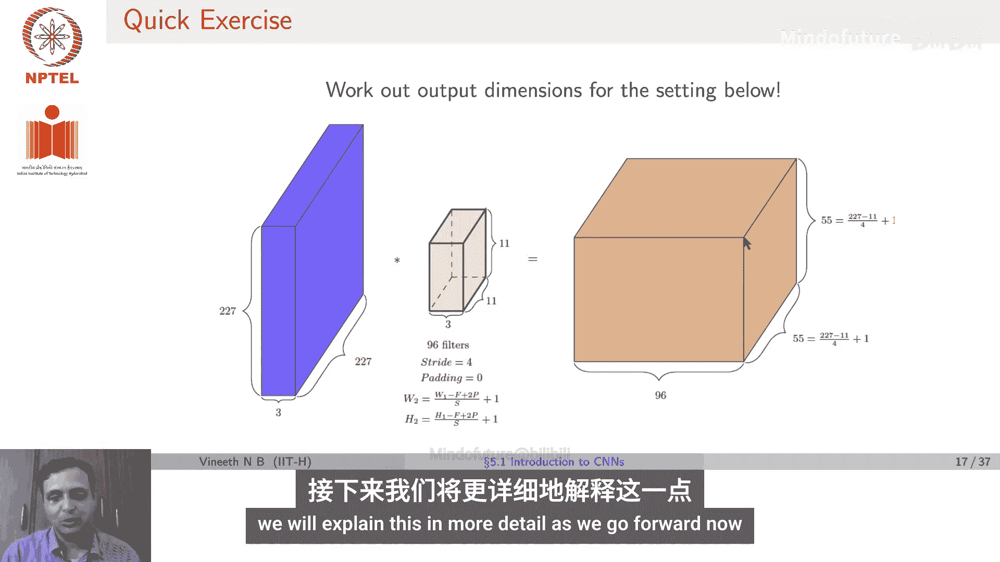

# 031：卷积神经网络介绍 - 第一部分

在本节课中，我们将从简单的前馈神经网络过渡到计算机视觉深度学习的核心构建模块——卷积神经网络。在开始讨论之前，我们先回顾一下上周课程中留下的作业练习。

## 批归一化层的反向传播

上一节我们介绍了批归一化算法，本节中我们来看看如何对其进行反向传播。下图展示了批归一化在计算图中的表示。

前向传播过程是：给定一个批次的数据 `x1` 和 `x2`，计算某一层激活输出的均值和方差，然后使用该均值和方差对数据进行归一化。归一化后，通过缩放参数 `gamma` 和平移参数 `beta` 进行重新调整，以适应具体问题。这是批归一化的核心思想。

反向传播的关键是应用链式法则计算梯度。以下是计算各项梯度的步骤：

**1. 计算损失 L 对 beta 的梯度**
回顾算法，最终输出 `Yi` 的公式为：`Yi = gamma * X_hat_i + beta`。因此，`beta` 可视为 `Y` 的一个输入。梯度计算如下：
`dL/dbeta = Σ_i (dL/dY_i * dY_i/dbeta)`
由于 `dY_i/dbeta = 1`，所以：
`dL/dbeta = Σ_i (dL/dY_i)`

**2. 计算损失 L 对 gamma 的梯度**
`gamma` 是乘以 `X_hat` 的常数。梯度计算如下：
`dL/dgamma = Σ_i (dL/dY_i * dY_i/dgamma)`
由于 `dY_i/dgamma = X_hat_i`，所以：
`dL/dgamma = Σ_i (dL/dY_i * X_hat_i)`

**3. 计算损失 L 对 X_hat 的梯度**
我们需要计算此项，以便将梯度传播到网络的前层参数。
`dL/dX_hat_i = dL/dY_i * dY_i/dX_hat_i`
由于 `dY_i/dX_hat_i = gamma`，所以：
`dL/dX_hat_i = dL/dY_i * gamma`

**4. 计算损失 L 对方差 sigma^2 的梯度**
梯度需要经过此项才能传播到更早的层。
`dL/d(sigma^2) = Σ_i (dL/dX_hat_i * dX_hat_i/d(sigma^2))`
其中 `dX_hat_i/d(sigma^2)` 可根据 `X_hat_i = (X_i - mu) / sqrt(sigma^2 + epsilon)` 的公式求导得到。

**5. 计算损失 L 对均值 mu 的梯度**
`dL/dmu = Σ_i (dL/dX_hat_i * dX_hat_i/dmu) + dL/d(sigma^2) * d(sigma^2)/dmu`
其中 `dX_hat_i/dmu` 和 `d(sigma^2)/dmu` 均可根据其定义公式求导得到。

**6. 计算损失 L 对原始输入 X 的梯度**
这是最终需要计算的梯度，以便反向传播到更早的层。
`dL/dX_i = dL/dX_hat_i * dX_hat_i/dX_i + dL/d(sigma^2) * d(sigma^2)/dX_i + dL/dmu * dmu/dX_i`
公式中各项均可根据前述定义计算。

**核心要点**：在神经网络中引入任何新参数时，只要所有组件都是可微的，通过仔细为每个项应用链式法则，就能计算出梯度并实现反向传播。

## 卷积神经网络基础

现在，让我们开始学习卷积神经网络。本节内容主要基于Mish Kara的优秀讲座。

首先，我们回顾卷积的概念。在第一周的课程中我们已经学过，卷积是一种将两个信号组合成第三个信号的数学方法。它是信号处理中极其重要的技术。图像是二维信号，但卷积也广泛应用于语音、加速度计数据、时间序列数据等其他信号。

对于二维数据（例如灰度图像），滤波器 `W`（维度为 `k x k`）与图像 `X`（维度为 `n1 x n2`）之间的卷积操作定义为：
`Y[i, j] = Σ_u Σ_v W[u, v] * X[i - u, j - v]`
其中，求和范围 `u`, `v` 从 `-k` 到 `k`。

更一般地，我们可以将卷积写成以像素为中心的形式：
`Y[i, j] = Σ_{u=-k1/2}^{k1/2} Σ_{v=-k2/2}^{k2/2} W[u, v] * X[i - u, j - v]`
这种写法强调了滤波器以当前像素为中心进行计算，本质上是相同的方程。

我们知道，在一维情况下，将一个一维滤波器滑过一维输入信号。在二维情况下，将一个二维滤波器（如Sobel边缘滤波器）滑过二维输入图像。

## 扩展到三维卷积

那么三维情况呢？为什么需要三维卷积？图像不是二维的吗？灰度图像是二维的，但对于彩色图像，我们有RGB三个通道，这构成了第三个维度。如果我们想一次性处理所有通道，就需要三维卷积。

我们来理解三维卷积的样子。假设输入是一个彩色图像，具有三个通道（R, G, B），这使得输入成为一个**体积**（Volume）。一个三维滤波器也是一个**体积**。

当我们将这个滤波器体积滑过输入体积并执行卷积操作时，会在输入体积的不同位置移动，并在输出图像中每个位置得到一个标量输出。这个输出图像在卷积神经网络中被称为**特征图**。

这里的一个重要假设是：**滤波器的深度与输入体积的深度相同**。这意味着我们是在三维输入上进行二维卷积。为什么这么说？因为我们沿着输入的高度和宽度滑动滤波器，但不沿着深度滑动（因为深度相同）。因此，此操作的输出也是一个二维图像。

*   一维滤波器对一维信号进行一维卷积，得到一维输出。
*   二维滤波器对二维输入（图像）进行二维卷积，得到二维输出。
*   现在，我们用三维滤波器对三维输入进行卷积，但输出不是三维而是二维。这是因为滤波器的深度与输入深度相同。

那么，能否得到三维输出呢？可以，通过定义多个滤波器。每个滤波器体积会产生一个二维特征图。使用多个滤波器，就会得到多个特征图，它们堆叠在一起就形成了一个输出体积。

## 卷积输出的维度计算

现在我们来理解维度计算。我们知道，在进行卷积时，图像边缘会存在无法计算卷积的问题，我们使用**填充**等技术来解决。让我们在彩色图像的背景下重新审视这些概念。

假设输入维度为 `W1 x H1 x D1`（宽 x 高 x 深度）。
每个滤波器的空间范围是 `F x F`，深度与输入深度 `D1` 相同。
输出维度为 `W2 x H2 x D2`。如果只使用一个滤波器，`D2` 为1。增加滤波器数量可以增加 `D2`。

我们来推导 `W2` 和 `H2` 的公式。我们还将讨论**步长**（决定连续卷积之间的重叠程度）和**滤波器数量**（决定输出特征图的大小）。

**1. 无填充且步长为1的情况**
如果将滤波器放在角落，由于缺少输入像素，无法计算卷积。这导致输出尺寸小于输入。滤波器越大，受影响的边界像素越多，输出越小。
通常，在这种情况下：
`W2 = W1 - F + 1`
`H2 = H1 - F + 1`
例如，输入为 `7x7`，滤波器为 `5x5`，则输出为 `3x3`。

**2. 使用填充的情况**
如果我们希望输出尺寸与输入相同，可以进行**填充**。最简单的方法是在图像外部添加零行和零列，以扩展原始图像尺寸，从而对边界像素进行卷积。
例如，`7x7` 的图像通过填充变成 `9x9`，使用 `3x3` 滤波器卷积后，输出恢复为 `7x7`。
此时公式变为：
`W2 = W1 - F + 2P + 1`
`H2 = H1 - F + 2P + 1`
其中 `P` 是填充量，`2P` 是因为需要在宽度和高度方向的两端都进行填充。

**3. 引入步长的情况**
**步长**定义了滤波器在输入上移动的间隔。步长为1是标准卷积，移动到相邻像素；步长为2则跳过1个像素。
步长会进一步减小输出尺寸。引入步长 `S` 后，公式修正为：
`W2 = (W1 - F + 2P) / S + 1`
`H2 = (H1 - F + 2P) / S + 1`
实践中，行和列的步长通常相同。

**4. 输出深度**
输出深度 `D2` 由使用的滤波器数量 `K` 决定。每个滤波器与输入体积完全卷积后，产生一个二维特征图。`K` 个滤波器产生 `K` 个特征图，它们堆叠形成深度为 `K` 的输出体积。因此：
`D2 = K`

## 维度计算示例

让我们通过一个练习来巩固理解。
假设：
*   输入尺寸：`227 x 227 x 3`
*   滤波器尺寸：`11 x 11 x 3`
*   滤波器数量：`96`
*   步长 `S = 4`
*   填充 `P = 0`

计算输出维度 `W2, H2, D2`：
1.  `D2` = 滤波器数量 = **96**
2.  `H2 = (H1 - F + 2P) / S + 1 = (227 - 11 + 0) / 4 + 1 = 216 / 4 + 1 = 54 + 1 = **55**
3.  `W2` 计算同理，`(227 - 11) / 4 + 1 = **55**`

因此，输出特征图的维度是 `55 x 55 x 96`。

**一个重要区别**：在前馈神经网络中，我们指定每个隐藏层的神经元数量，从而决定权重数量。在卷积神经网络中，情况相反：我们通过选择滤波器尺寸、数量、步长和填充来决定权重（滤波器参数），而输出特征图的大小则由这些选择和输入尺寸自动决定。

## 总结

本节课中我们一起学习了：
1.  批归一化层的反向传播原理，通过链式法则逐步计算损失对各个参数（`beta`, `gamma`, `X_hat`, 方差, 均值, 原始输入 `X`）的梯度。
2.  卷积操作从二维扩展到三维（用于处理多通道输入如彩色图像）的概念，并理解了滤波器深度需与输入深度相同。
3.  卷积神经网络中输出特征图维度的详细计算方法，关键变量包括输入尺寸 `(W1, H1, D1)`、滤波器尺寸 `F`、填充 `P`、步长 `S` 和滤波器数量 `K`，最终输出维度为：
    *   `W2 = (W1 - F + 2P) / S + 1`
    *   `H2 = (H1 - F + 2P) / S + 1`
    *   `D2 = K`
4.  通过一个具体示例演示了如何应用公式计算卷积层的输出尺寸。