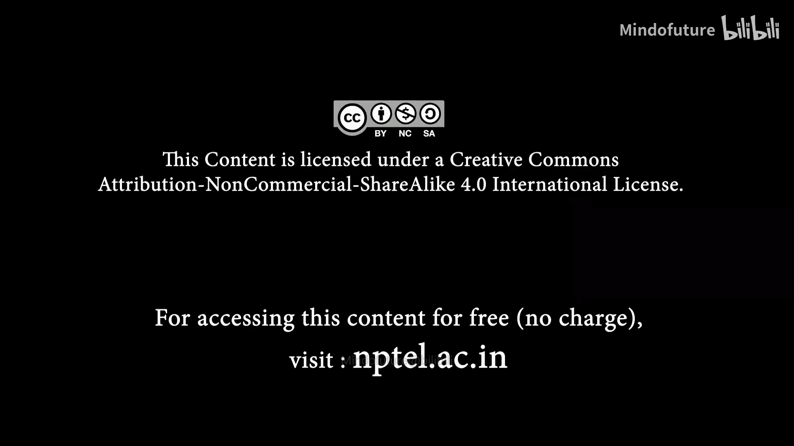
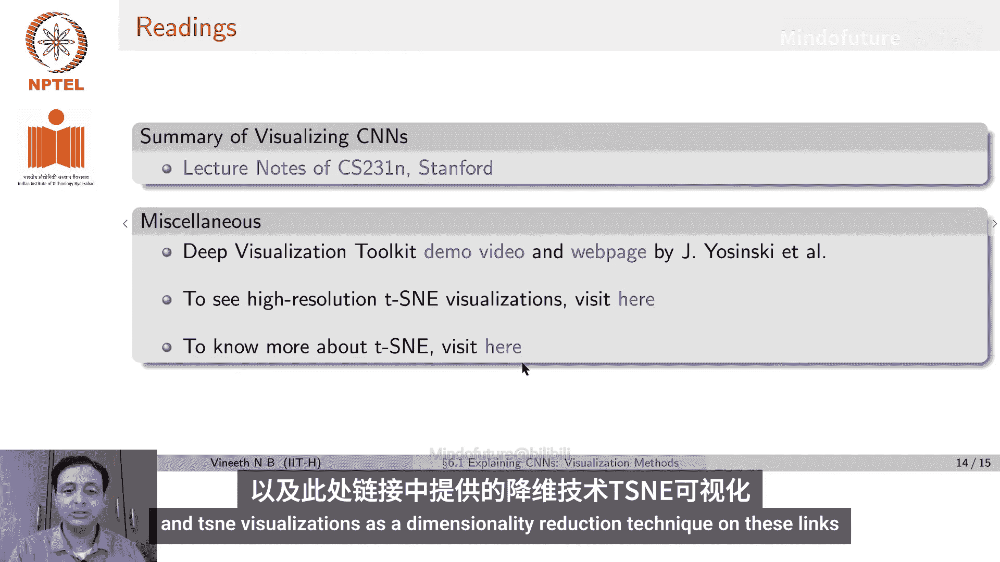

# 038：解释CNN - 可视化方法

在本节课中，我们将学习如何理解、可视化和解释卷积神经网络（CNN）或其他神经网络的模型预测。我们将从可视化方法开始，探讨CNN中不同卷积核或滤波器、特定层的激活值以及其他相关技术。本讲内容主要基于斯坦福大学CS 231N课程的第13讲，并参考了IIT Madras的Mitesh Khapra教授的精彩讲座。

## 可视化卷积核

上一节我们介绍了课程概述，本节中我们来看看最简单的可视化形式——可视化CNN中的滤波器或卷积核本身。

在CNN的每个卷积层中，都有一定数量的滤波器。例如，在AlexNet的第一个卷积层中，有64个大小为11x11的滤波器，每个滤波器包含三个颜色通道（R、G、B）。我们可以将这些滤波器本身当作图像来可视化。

以下是可视化第一层卷积核的步骤：
1.  将每个滤波器矩阵（例如11x11x3）视为一个小图像。
2.  将每个通道的值归一化到合适的显示范围（如0-255）。
3.  将所有滤波器排列在一个网格中进行显示。

当这样操作时，我们会发现第一层的滤波器通常呈现出类似**Gabor滤波器**的模式，它们能捕捉不同方向的边缘、颜色块、棋盘格图案和条纹等低层图像特征。这种现象在多种CNN模型（如AlexNet、ResNet、DenseNet、VGG）的第一层中普遍存在，因此被称为“类Gabor滤波器疲劳”。

## 可视化表示空间

了解了单个滤波器的可视化后，我们来看看CNN学习到的整体表示空间。

我们可以提取CNN倒数第二层（通常是最后一个全连接层，如AlexNet中的`fc7`层）的输出向量。对于一批测试图像，我们前向传播得到这些高维特征向量（例如4096维），然后使用降维技术将其映射到二维空间以便可视化。

以下是进行表示空间可视化的方法：
1.  使用主成分分析（PCA）或t-SNE等降维方法。
2.  将降维后的二维点根据其真实类别用不同颜色标注。
3.  观察不同类别的点是否在二维空间中形成分离的簇。

例如，在MNIST手写数字数据集上，经过t-SNE降维后，不同数字的样本会清晰地聚集在不同的区域。这表明CNN学习到的表示具有良好的语义区分能力，相似语义的物体在表示空间中距离更近。

## 可视化激活与神经元

除了静态的权重，我们还可以动态地观察CNN在处理输入时的内部状态。

我们可以选择CNN中间层的某个特定神经元，然后观察哪些输入图像或图像中的哪些区域会最大程度地激活该神经元。通过分析这些“激发”该神经元的图像块，我们可以推断该神经元所响应的视觉模式。

以下是分析特定神经元的步骤：
1.  准备一个大型图像数据集。
2.  将每张图像输入训练好的CNN。
3.  记录目标神经元在每张图像上的激活值。
4.  找出激活值最高的那些图像，并定位导致高激活的图像区域（通过计算感受野）。

在实践中，我们可能发现某些神经元专门对人脸、文本、动物眼睛或特定纹理（如红色斑点、镜面反射）产生响应。这有助于我们理解CNN各层是如何逐步构建对复杂特征的表示的。

## 遮挡实验

最后，我们来探讨一种旨在理解CNN决策依据的方法——遮挡实验。

为了验证CNN是否真正关注目标物体本身（例如，因为图像中有猫而预测为“猫”，而不是因为背景中的草地），我们可以系统地遮挡图像的不同部分，并观察模型预测概率的变化。

以下是进行遮挡实验的步骤：
1.  选择一张输入图像及其真实标签。
2.  使用一个灰色方块（或其他遮挡物）依次遮挡图像中的每个区域。
3.  每次将遮挡后的图像输入CNN，并记录模型对真实标签的预测概率。
4.  为每个被遮挡的位置生成一个概率值，从而形成一个热力图。

在这个热力图中，概率显著下降的区域（通常显示为蓝色）就是模型做出决策所依赖的关键区域。例如，在一张狗的图像中，当狗的脸部被遮挡时，模型预测为“博美犬”的概率会大幅下降，这证明模型确实是通过识别狗的脸部特征来做出判断的。

## 总结

本节课中我们一起学习了多种理解和可视化CNN的“不干扰模型”方法。我们首先介绍了如何可视化卷积核，特别是第一层中普遍存在的类Gabor滤波器。接着，我们探讨了如何通过降维技术（如t-SNE）来可视化CNN学习到的高维表示空间。然后，我们学习了如何通过分析最大化激活特定神经元的图像块来理解神经元的功能。最后，我们介绍了遮挡实验，该方法通过扰动输入并观察输出变化，来揭示模型决策所依赖的图像区域。

这些方法帮助我们窥探CNN的“黑箱”，增强我们对模型为何以及如何做出特定预测的理解，是模型可解释性研究的重要基础。

**推荐阅读与资源：**
*   CS 231N课程讲义。
*   Jason Yosinski的深度可视化工具包演示网页和视频。
*   关于t-SNE降维技术的详细介绍和可视化示例。