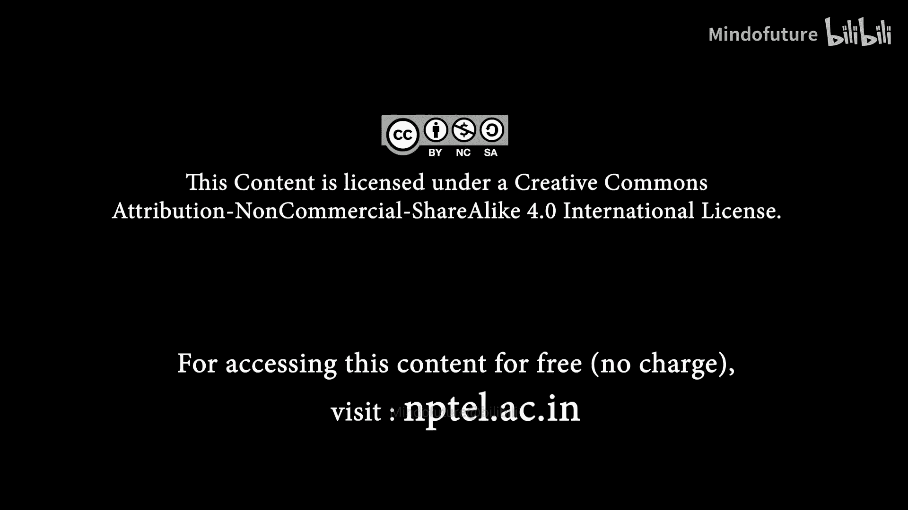
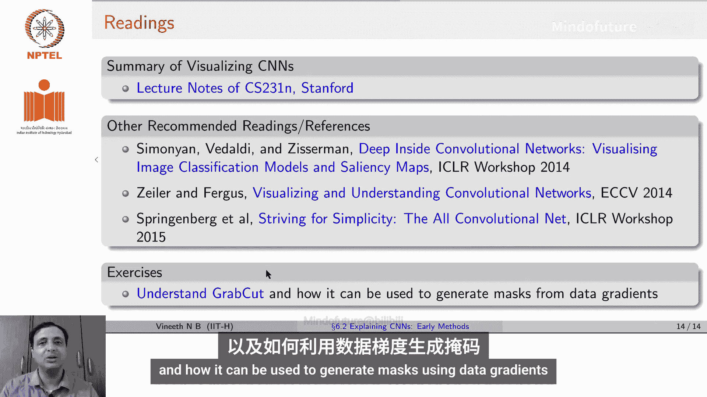

# 039：解释CNN - 早期方法

在本节课中，我们将继续探讨几种帮助我们理解卷积神经网络及其预测的方法。我们将学习如何通过优化输入图像来最大化特定类别的得分，如何可视化数据梯度，以及如何使用引导反向传播技术来获得更清晰的激活可视化。这些方法为我们打开了理解CNN内部工作机制的窗口。

## 最大化类别得分的图像生成 🖼️

上一节我们讨论了如何通过可视化来理解CNN。本节中，我们来看看一个不同的问题：我们能否找到一张能最大化某个类别得分的图像？

例如，一个在ImageNet上训练好的AlexNet模型见过很多猫的图像。那么，它是否知道一只“平均”的猫长什么样？如果我们要求它重建一张猫的图像，它能做到吗？这就是我们试图回答的问题。

以下是实现这一目标的核心步骤：

1.  **初始化输入**：首先，我们取一个训练好的CNN模型（如AlexNet）。我们提供一个初始图像作为输入，这个图像可以是全黑或全灰的零图像。
2.  **定义目标**：我们希望网络的最终输出是一个独热向量，其中我们感兴趣的类别（如“猫”）位置为1，其余位置为0。
3.  **计算梯度**：由于输入零图像不会得到目标输出，我们计算损失。关键的一步是，我们不更新网络权重，而是计算损失相对于**输入图像**的梯度，即 `dL/dx`。
4.  **梯度上升更新**：我们使用**梯度上升**来最大化目标类别的得分。这意味着我们沿着梯度的正方向更新输入图像，使其越来越能激活目标类别。更新公式可以表示为：
    `I_new = I_old + η * (dL/dI)`
    其中 `η` 是学习率，`dL/dI` 是损失相对于输入图像的梯度。
5.  **迭代优化**：重复步骤3和4，不断更新输入图像，直到收敛。最终得到的图像就是模型认为最能代表目标类别的“平均”图像。

通过这种方法生成的图像可能看起来不像我们日常认知中的物体，但它们揭示了模型内部学到的特征模式。例如，最大化“洗衣机”类别的图像可能包含重复的圆形和矩形纹理。

## 可视化数据梯度 📊

除了生成图像，我们还可以直接可视化损失相对于输入图像的梯度（`dL/dI`）。这个梯度图可以粗略地显示图像中哪些像素对提高特定输出神经元的得分贡献最大。

由于输入图像有RGB三个通道，梯度在每个通道上都有一个值。一种常见的可视化方法是取每个像素点上三个通道梯度绝对值的最大值。

以下是几个可视化数据梯度的例子。可以看到，对于“帆船”图像，高梯度区域集中在帆和船体的轮廓上；对于“狗”的图像，高梯度区域则突出了狗的头部和身体。这表明梯度图能够定位与类别判断相关的图像区域。

## 结合图割生成对象掩码 ✂️

仅仅有梯度图还不够直观。我们可以将数据梯度与一种称为**图割**的图像分割算法结合，来生成更精确的对象掩码。

具体流程如下：
1.  给定一张输入图像，我们首先计算其对于某个预测类别（如“鸟”）的数据梯度。
2.  将这个梯度图作为输入，应用图割算法。图割算法能够根据像素间的相似性（由梯度等特征定义）和差异性，将图像分割成前景（对象）和背景。
3.  算法输出一个二值掩码，清晰地标出了模型认为导致该类别预测的图像区域。

这种方法能有效地从背景中分离出对象，为进一步的分析（如目标定位）提供了可能。

## 从特征编码重建图像 🔄

另一个有趣的问题是：给定CNN中间层（如AlexNet的FC7层）的特征编码，我们能否重建出原始图像？这相当于一个“解码”或“反演”过程。

我们可以通过解决一个优化问题来实现：
1.  **目标函数**：我们希望找到一张图像 `x`，使其FC7层的特征 `φ(x)` 尽可能接近我们给定的目标编码 `φ_target`。同时，我们希望重建的图像看起来自然，因此需要加入图像先验正则化项（如惩罚图像的高频噪声）。
2.  **优化过程**：目标函数可以形式化为：
    `x* = argmin_x ||φ(x) - φ_target||² + λ * R(x)`
    其中 `R(x)` 是正则化项，`λ` 是平衡两项的系数。我们通过梯度下降法迭代更新图像 `x` 来最小化这个目标函数。
3.  **结果**：从不同的初始图像开始优化，可能会得到不同的局部最优解，但它们都与原始图像在语义上具有整体相似性。这证明了CNN的高层特征确实捕获了图像的核心语义信息。

## 引导反向传播 🧭

在反向传播计算梯度以可视化时，标准的ReLU激活函数在反向过程中，会将前向传播时输入为负的神经元的梯度置零。然而，梯度本身可能仍包含正值和负值。

**引导反向传播** 在2015年被提出，它对标准过程做了一个关键修改：在反向传播时，不仅屏蔽掉前向传播中被ReLU抑制（输入为负）的神经元的梯度，还额外屏蔽掉所有**负的梯度值**。也就是说，只允许**正的梯度**传递回前面的层。

这样做的直观理解是：我们只关心那些对激活目标神经元有**正面贡献**的像素。屏蔽掉负梯度（即那些会降低激活值的像素）后，得到的可视化图像噪声更少，对象轮廓更加清晰。例如，在可视化“猫”的激活时，引导反向传播能产生比标准方法更干净、更易辨认的猫的轮廓。

这种方法已成为许多现代CNN解释方法的基础组件。

## 总结与练习 📝

本节课我们一起学习了几种理解CNN的早期重要方法：
1.  **图像生成**：通过梯度上升优化输入，生成能最大化特定类别或神经元激活的图像。
2.  **梯度可视化**：直接绘制损失相对于输入的梯度，以识别重要像素区域。
3.  **图割分割**：结合数据梯度和图割算法，生成目标对象的二值掩码。
4.  **特征反演**：从网络中间层的特征编码出发，通过优化重建语义相似的图像。
5.  **引导反向传播**：通过仅反向传播正梯度，获得更清晰、噪声更少的激活可视化图像。

这些方法为我们提供了工具，去窥探CNN这个“黑箱”内部的运作机制，理解模型究竟根据图像的哪些部分做出了决策。

**推荐阅读与练习**：
*   课程CS231N中关于可视化CNN的讲义。
*   论文《Deep Inside Convolutional Networks》、《Visualizing and Understanding Convolutional Networks》、《Striving for Simplicity: The All Convolutional Net》。
*   **练习**：请通过[此链接](提供的资料)学习图割算法，并尝试理解如何将其与数据梯度结合生成对象掩码。

