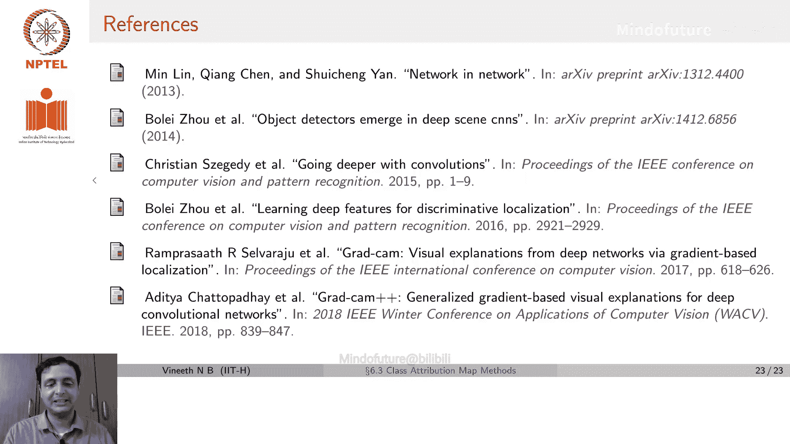

# 040：类别归因图方法 🧠

在本节课中，我们将学习几种用于解释卷积神经网络预测的类别归因图方法。我们将从基础的类别激活映射开始，逐步探讨其改进版本，理解它们如何通过可视化网络关注的图像区域来解释模型的决策过程。

## 概述

我们已经了解了多种利用CNN模型不同方面（如不同层的激活值、梯度、输出概率等）来解释其预测的方法。现在，我们将关注一类被称为**类别判别性显著图**或**类别归因图**的方法。

所谓“显著图”，指的是对于给定预测而言，图像中那些显著的区域。而“类别判别性显著图”，则特指那些有助于区分不同类别的显著图。例如，在一张同时包含猫和狗的图片中，我们想知道是图像的哪部分导致模型将其预测为猫，又是哪部分导致其被预测为狗。

接下来的内容将对此进行更详细的探讨。

## 类别激活映射

我们持续追问的问题是：能否知道网络在预测某个类别时，正在“看”图像的哪部分？但接下来要介绍的方法，与我们之前所见有所不同。

这方面最早的方法之一是**类别激活映射**，发表于2015-2016年。该方法利用卷积神经网络，并引入**全局平均池化**的概念来实现目标。

### 工作原理

让我们详细了解一下。假设你的网络架构中有五到六个卷积层。你取**最后一个卷积层**的输出。对于该卷积层中的每个特征图（假设有100个滤波器，你就有100个特征图），你对其进行**全局平均池化**。

**全局平均池化**具体做什么呢？它取一个特定的特征图（例如图中绿色的那个），将该图中所有强度值平均为一个单一的标量（即图中的绿色圆圈）。同样地，对红色特征图进行平均得到红色标量，对蓝色特征图进行平均得到蓝色标量。

现在，我们如何处理这些全局平均值呢？每个标量代表一个特征图。接着，我们学习一个简单的回归模型（或线性模型），将这些标量映射到最后一层的每个类别标签上。

具体来说，对于最后一层的每个类别标签，我们学习一组权重：`w1 * 第一个特征图的平均值 + w2 * 第二个特征图的平均值 + ... + wn * 第n个特征图的平均值`，其中n是最后一个卷积层中特征图的数量。

### 如何生成显著图

对于一张给定的图像（例如这里看到的图像），如果你将其前向传播通过一个训练好的AlexNet，直到最后一个卷积层，你会得到一组n个激活图。假设这些就是图中所示的激活图。

现在，我们使用在GAP层和分类层之间学到的权重，对每个激活图进行加权。当你对所有激活图进行加权求和时，就得到了这些激活图对某个特定类别标签的贡献。

在这个例子中，假设我们想预测这张图像属于“澳大利亚梗犬”类。那么，你学习对应于“澳大利亚梗犬”类的每个激活图的权重，并以相同的方式对每个激活图进行加权。这个卷积层激活图的加权组合，就对应了“澳大利亚梗犬”类。

如果你想预测图像中的“人”类，那么你会得到一组不同的权重（对应“人”类）。因此，同一组激活图的不同加权组合，会告诉你图像的哪部分对应于“人”类。

这种方法为我们提供了一种获取类别判别性显著图的途径。

### 视觉示例与优势

以下是该方法的一些视觉示例。在前三张图片中，是“比熊犬”类的例子；后三张是“杠铃”类的例子。你可以看到，在每种情况下，CNN模型都关注特定区域（比如比熊犬的脸部、杠铃的配重片）来做出决策。

你可能会问：如果我改变类别会怎样？这里也有一个例子。一张图像及其基于该图像预测的前五个类别的显著图（类别激活图）。前五个预测类别是：圆顶、教堂、祭坛、修道院。可以看到，当模型预测“圆顶”时，它只关注圆顶部分；预测“教堂”时，关注靠近圆顶的立面；预测“祭坛”和“修道院”时，则关注可能使其认为是该类别的特定部分。

这为我们提供了类别特定的激活图，在实践中非常有用。

### 方法背后的直觉

在大多数CNN中，我们通常有几个卷积层，后面跟着一些全连接层。卷积层在一定程度上保持了物体定位的能力。然而，全连接层（例如Fc7表示）会丢失这种空间信息。这正是开发卷积层本身的原因之一。

通过基于CAM的方法，我们实际上可以检索第五层的激活图，并利用它们来解释分类层的决策。

### 不同模型比较与优缺点

这里比较了不同模型上的CAM图。可以看到，在GoogleNet、VGG、AlexNet、网络中的网络等架构上应用CAM或使用GAP。并与AlexNet和GoogleNet上的反向传播（即数据梯度）进行了比较。显然，CAM提供了比数据梯度更强、更有用的显著图。

**CAM的优点**：
*   具有类别判别性。
*   无需任何位置监督即可定位物体。
*   不需要像引导反向传播或反向传播到图像那样，通过整个模型进行反向传递。

**CAM的缺点**：
*   关键缺点在于，为了获得GAP后的那些权重，实际上需要重新训练模型。在训练完AlexNet后，你仍然需要进行全局平均池化，并在最后一层学习那些线性模型，以理解激活图与每个类别标签之间的关系。这在你训练好的CNN模型之上，为解释增加了额外的计算负担。
*   我们通过强制引入全局平均池化层来对架构施加了约束，这可能在你希望将此类方法推广到许多视觉任务时造成问题。
*   模型可能会为了可解释性而牺牲准确性。为了获得更好的可解释性，如果直接使用GAP模型及其相应权重进行分类，最终可能会达到较低的准确率。

## 梯度加权类别激活映射

现在，让我们看看如何解决这些缺点。这在一个后续方法中得以实现，该方法发表于2017年ICCV（顶级计算机视觉会议）。

**梯度加权类别激活映射**是一个非常巧妙的方法，它重新利用了CNN中已有的量来实现CAM的功能。

### 整体思路与架构

以下是整体思路和架构，我们将在接下来的幻灯片中描述每个组件。
1.  输入图像通过CNN。
2.  得到卷积特征图。这些特征图后面可以接任何特定任务的网络（例如我们目前看到的分类，也可以是图像描述或视觉问答等后续课程会讲的任务）。
3.  无论任务如何，我们都假设有一个最后一层、一个损失函数和一个梯度（任何神经网络中都可以假设存在）。
4.  一旦你有了关于任何任务的损失梯度，你就有了关于所有特征图或激活图的梯度。
5.  将这些梯度组合起来，它们会自动成为每个特征图的权重。
6.  在Grad-CAM中，为了确保最终显著图中只显示正相关性，我们在激活图的加权组合上应用一个ReLU函数，这就得到了我们最终的Grad-CAM显著图。
7.  该方法还讨论了加入引导反向传播来创建一个变体，称为引导Grad-CAM。

### 数学推导：从CAM到Grad-CAM

从数学上讲，CAM中我们有类别得分 `Yc`，由对所有K个特征图的求和给出：`Yc = Σk Wck * Fk`，其中 `Fk` 是第k个特征图的全局平均池化结果。

如果我们现在计算 `Yc` 对 `Fk` 的梯度，`∂Yc/∂Fk` 正是 `Wck`。进一步推导可以发现，`Wck` 实际上等于 `Yc` 对特征图 `Ak` 中每个像素的梯度之和的平均（乘以一个归一化因子Z）。

这告诉我们一个重要信息：CAM模型中我们实际学习的权重 `Wck`，实际上就是每个类别得分相对于特征图中每个像素的梯度之和。因此，我们实际上不需要像CAM那样进行重新训练。你不需要全局平均池化，也不需要重新训练那些权重；你只需要计算最后一层得分相对于任何你想计算显著图的特征图的梯度，就可以得到这些权重。

### 最终公式

因此，我们现在可以将 `Wck` 写为：`Wck = (1/Z) * Σi Σj (∂Yc/∂Aijk)`，其中Z是归一化因子（特征图像素总数）。我们最终的显著图或定位图 `Lc` 由下式给出：`Lc = ReLU( Σk Wck * Ak )`。应用ReLU是为了只保留对类别有正面贡献的特征。

### 示例与引导Grad-CAM

现在看一些例子。对于原始图像，这里是“猫”的Grad-CAM，它聚焦在猫身上。同样，在一个ResNet模型上，它定位了猫的位置；对于“狗”，它关注狗的区域来做出判断。

但这里有一个仔细的观察：网络实际上预测这是“虎斑猫”而不仅仅是“猫”。我们能进一步阐述这一点，看看为什么它是虎斑猫吗？这就是该方法提出**引导Grad-CAM**变体的地方。

引导Grad-CAM将我们在之前课程中看到的**引导反向传播**和Grad-CAM结合在一起，通过进行**逐像素乘积**将它们叠加起来。现在我们可以看到，取Grad-CAM指出的特定区域，并将其与引导反向传播的输出（即图像中哪些像素是显著的）相结合，我们得到了一个更清晰的估计，知道模型在判断为“狗”时关注的是什么。引导反向传播本身不一定具有类别判别性，所以如果单独使用它，你也会看到其他类型的活跃像素。但通过与Grad-CAM结合，我们得到了一个更局部化的理解。

现在你明白为什么模型称它为“虎斑猫”了：将Grad-CAM显著图与引导反向传播的输出再次结合，你实际上得到了这种输出，它显示了猫身体上的条纹，这解释了为什么它是虎斑猫。

### 反事实解释

Grad-CAM还展示了该方法如何用于**反事实解释**。即，能否找出图像中哪个区域最大程度地影响了模型将图像判断为属于“狗”类？或者，哪些其他像素可能抑制了模型输出“狗”的概率？

这可以通过使用完全相同的Grad-CAM程序来完成，唯一的区别是使用**负梯度**而不是正梯度。这将告诉我们哪些特征图的组合（或加权组合）对提高某个类别概率产生了负面影响，从而为我们提供了反事实解释。最终，你可以通过某种方式移除或抑制这些特征来提高模型的置信度（如果你希望以这种方式使用它）。

## Grad-CAM的局限性与Grad-CAM++

然而，Grad-CAM存在一些局限性，特别是在图像中存在多个物体实例或遮挡时。

例如，在一张有多只狗的图片中，Grad-CAM给出的输出似乎没有捕捉到图像中所有的狗。当物体数量较少时，它可能做得还不错，但这里仍然有三只狗，Grad-CAM捕捉到了两只，但错过了中间的那只——这是Grad-CAM的局限性之一。另一个例子是在存在遮挡的情况下：一只鸟的腿隐藏在水下，并且它有一个喙；这里还有一只刺猬，它也有一个类似喙的结构。在这两种情况下，Grad-CAM似乎没有捕捉到那些实际上是该物体类别判别性显著方面的特征。

我们能否对此做些改进？Grad-CAM本身的公式是否存在可以改进的局限性？这在一项名为**Grad-CAM++**的工作中得以实现。

### 主要动机

Grad-CAM++的主要动机在于观察到：Grad-CAM计算了类别得分 `Yc` 相对于激活图中每个像素的梯度，然后取所有这些梯度的**平均值**来得到其最终权重 `Wkc`。从某种意义上说，它在获取最终权重时，通过取平均值来平等地加权每个像素。

Grad-CAM++的想法指出：也许对类别贡献更大的像素应该获得比平等分配更多的权重。这尤其可以抑制那些空间足迹较小的激活图（正如上一张幻灯片中的例子：当有三只狗时，较小的那只狗获得的梯度较少，因为它的像素更少，因此对输出的贡献也较小）。当可视化中存在这种偏差时，一些较小的物体可能根本不会被显著图捕捉到。

### 方法改进

Grad-CAM++建议保留Grad-CAM的基本公式，但这次在计算最终权重 `Wkc` 时，我们将为每个激活图中的每个像素分配一定的权重（称为 `α_ijk^c`），以决定它们应如何贡献于该显著图。Grad-CAM++还在此权重的计算中添加了一个ReLU，以确保只考虑正梯度。

但核心问题是：在Grad-CAM中，平均所有梯度得到 `Wkc` 相对简单。现在，如何计算这些像素级的 `α_ijk` 呢？

### 直观理解

让我们再次直观地理解Grad-CAM++。这里注意到，如果一张图像中有三个不同的物体（比如狗），分别占据大、中、小的空间足迹。假设不同的特征图捕捉不同的狗（也可以是其他物体）。在Grad-CAM中计算梯度时，占据最大面积的区域最终获得了大部分梯度，而其余像素的梯度较小，因为它们像素较少，因此对输出的贡献较小。Grad-CAM++试图通过进行像素级加权来克服这个问题。可以看到，在使用这种方法时，梯度处于相同的范围内，最终显著图也处于相同的范围内。

### 如何计算像素级权重

我们不会在这里推导这个公式，这可能比较冗长，并将作为你的作业一部分。但通过重组梯度表达式并利用一些算术，Grad-CAM++表明，`α_ijk^c` 实际上可以作为一个闭式表达式获得，该表达式由你已经拥有的几个梯度项组成。一旦完成这个推导，其余部分与Grad-CAM非常相似：在Grad-CAM++中，你仍然在最后对 `Σk Wck * Ak` 应用ReLU，其中 `Wck` 由 `Σi Σj α_ijk^c * ReLU(∂Yc/∂Aijk)` 给出。

### 效果展示

这带来了什么帮助呢？现在可以看到，给定同一张多只狗的图片，虽然Grad-CAM没有有效地定位所有狗，但Grad-CAM++似乎得到了一个更好的、围绕狗的显著图。即使有三只狗，它也能工作得更好，并且还能捕捉到存在遮挡（如喙或腿）结构的情况。

Grad-CAM++还表明，与Grad-CAM相比，从Grad-CAM++获得的显著图提供了更好的定位效果（与图像提供的边界框相比）。你可以在这里看到几个结果：左侧块的第一列是原始图像，然后是对应类别的Grad-CAM可视化（头发、美洲龙虾、灰鲸、项链），以及似乎更好的Grad-CAM++定位（尤其是对于灰鲸等物体）。在另一组图像（灰鲸、风筝、山羊、鳗鱼）中，Grad-CAM++通过考虑像素级权重策略，其定位效果优于Grad-CAM。

这里还有更多Grad-CAM++针对物体多次出现情况的例子，再次显示了相对于Grad-CAM的改进性能。

## 总结与作业

在本节课中，我们一起学习了三种重要的类别归因图方法：**类别激活映射**、**梯度加权类别激活映射**及其改进版**Grad-CAM++**。我们了解了它们如何利用网络内部的激活图和梯度信息，生成能够解释CNN决策过程的视觉显著图。从需要修改网络结构的CAM，到利用现有梯度的Grad-CAM，再到进一步优化权重分配的Grad-CAM++，这些方法在保持或提升解释能力的同时，不断增强其适用性和准确性。

**作业**：
有三篇论文：CAM、Grad-CAM和Grad-CAM++。你的任务是阅读它们。
另一个练习是推导出Grad-CAM++中 `α` 权重的闭式表达式。