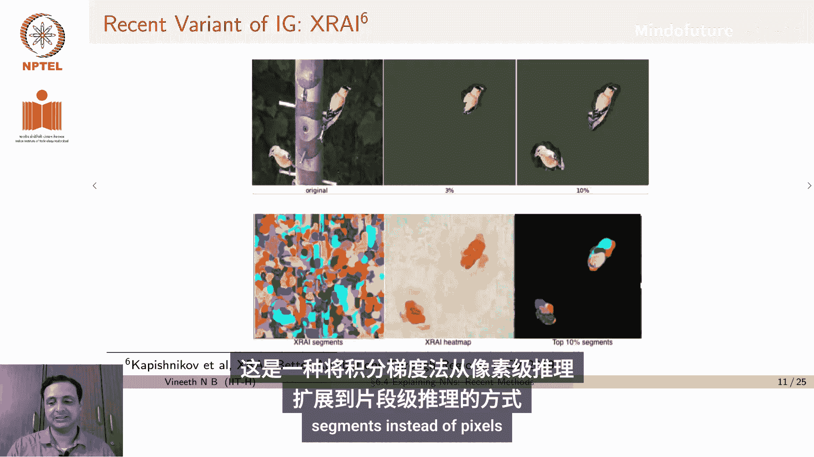

# 041：解释CNN - 最新方法 - 第一部分


## 概述 📖

在本节课中，我们将学习近年来用于解释卷积神经网络（CNN）乃至更广泛的神经网络行为的最新方法。我们将探讨传统梯度可视化方法的局限性，并介绍几种旨在解决这些问题的先进技术，包括DeepLIFT、积分梯度及其变体。

## 从梯度可视化到其局限性 🔍

上一节我们介绍了通过计算输出对输入的梯度（`dy/dx`）并可视化来生成归因图的方法。归因图显示了每个输入像素对最终输出分数的贡献程度。

然而，这种方法并不总是足够有效。让我们来看一个反例，说明仅使用梯度的方法可能会失败。

### 梯度方法的饱和问题

考虑一个简单的神经网络场景，有两个输入 `i1` 和 `i2`。它们经过一个使用ReLU激活函数的层，输出 `h`，最终输出 `y` 定义如下：
```
h = max(0, 1 - i1 - i2)
y = 1 - h
```
当 `i1 + i2 > 1` 时，`h` 恒为0，因此 `h` 对 `i1` 和 `i2` 的梯度也为0。同时，`y` 对 `h` 的梯度为负值。在引导反向传播等方法中，负梯度会被置零。综合来看，这导致最终计算出的梯度处处为零，无法提供有效的解释。这就是所谓的**饱和问题**。

## 解决饱和问题：DeepLIFT方法 🧠

DeepLIFT方法在2017年被提出，旨在解决上述饱和问题。其核心思想是不再使用传统的（无穷小）梯度，而是使用一种基于参考点的“梯度变体”。

### DeepLIFT的核心概念

DeepLIFT不再考察输入发生无穷小扰动时输出的变化，而是考察：当输入从某个**参考输入**（或基线输入）变化到当前输入时，输出相对于**参考输出**的变化量。它为每个输入属性（如图像像素）分配一个贡献分数。

对于输入属性 `i`，其贡献分数 `C_Δx_i Δt` 满足：
```
Σ_i (C_Δx_i Δt) = Δt
```
其中 `Δt` 是输出相对于参考输出的总变化量。这样，每个输入对输出变化的贡献就被量化了。

通过始终与一个固定的参考点（例如全零图像）进行比较，即使函数进入饱和区，输入的变化仍能导致输出的可测量变化，从而避免了梯度为零的问题。

### DeepLIFT的“重缩放规则”

DeepLIFT提出了几条规则，其中“重缩放规则”概括了其核心思想。该规则通过层间反向传播“相关性”来实现。

定义：
*   `z_ji^(l+1) = w_ji^(l+1) * a_i^(l)`：当前输入下，第 `l` 层神经元 `i` 对第 `l+1` 层神经元 `j` 的贡献。
*   `z_ji‘^(l+1) = w_ji^(l+1) * a_i‘^(l)`：参考输入下，相应的贡献。
*   `R_i^(l)`：第 `l` 层神经元 `i` 的相关性分数。

计算过程：
1.  **输出层**：最终层的相关性是当前输出与参考输出之差。`R^(L) = F(x) - F(x‘)`。
2.  **中间层**：对于第 `l` 层的神经元 `i`，其相关性由它连接到第 `l+1` 层的所有神经元 `j` 的相关性反向传播而来：
    ```
    R_i^(l) = Σ_j [ (z_ji - z_ji‘) / Σ_i (z_ji - z_ji‘) ] * R_j^(l+1)
    ```
3.  将此过程从输出层反向传播至输入层，即可得到每个输入像素的归因分数。

这个过程与梯度反向传播类似，但传播的是基于参考点的贡献差异，而非瞬时梯度。

## 积分梯度：沿路径累积 📈

积分梯度是另一种广泛使用的方法，它同样受解决梯度饱和问题的动机驱动。

### 动机与直观理解

下图展示了对一张“消防船”图像使用普通梯度方法得到的归因图。归因信号分散，未能清晰突出关键特征（如船体和水流），这正是饱和问题导致的。

积分梯度通过累积输入图像从基线（如黑色图像）到当前图像路径上多个点的梯度来解决这个问题。具体做法是，创建一系列图像，这些图像是基线图像和原始图像在不同比例（α）下的线性插值：
```
x_interpolated = x‘ + α * (x - x‘), 其中 α 从 0 渐变到 1。
```
对每一个插值图像计算梯度，然后将所有这些梯度进行积分（或求和平均）。

### 数学定义与实现

输入 `x` 在第 `i` 维上的积分梯度 `IG_i` 定义为：
```
IG_i(x) = (x_i - x_i‘) * ∫_{α=0}^{1} [ ∂F(x‘ + α*(x - x‘)) / ∂x_i ] dα
```
其中 `F` 是神经网络函数，`x‘` 是基线输入。

在实际操作中，我们无法进行连续积分，因此采用离散近似。将区间 [0, 1] 分成 `M` 步，计算公式变为：
```
IG_i(x) ≈ (x_i - x_i‘) * (1/M) * Σ_{k=1}^{M} [ ∂F(x‘ + (k/M)*(x - x‘)) / ∂x_i ]
```
通过这种方式得到的积分梯度归因图，能够更清晰、更集中地突出对预测类别至关重要的特征，例如消防船的船身和喷出的水流。

## 平滑梯度：通过添加噪声来平滑归因图 🌫️

平滑梯度采用了一种与积分梯度思想相似但更启发式、更简单的方法。它不进行路径积分，而是通过对输入图像添加多次像素级的高斯噪声，然后平均这些噪声版本图像的梯度。

**核心操作**：
1.  创建原始图像的多个副本。
2.  对每个副本添加不同的高斯噪声。
3.  分别计算每个噪声图像通过模型后的数据梯度。
4.  将所有梯度进行平均，得到最终的平滑梯度归因图。

一个有趣的观察是：这种方法通过**向输入添加噪声**，反而能在归因图上**减少噪声**（即得到更平滑、更集中的显著性区域）。这种方法在实践中效果良好，并且催生了许多“平滑”变体，例如平滑积分梯度。

## 扩展到图像区域：XRAI方法 🧩

XR AI是积分梯度的一个近期变体，发表于2019年。其核心思想是将归因分析从像素级别提升到图像区域（分割块）级别，这通常更符合人类的认知习惯，也更具实用性。

### XRAI的工作流程

以下是XRAI方法的主要步骤：
1.  **计算初始归因图**：首先使用积分梯度等方法，得到像素级的归因热图。
2.  **过分割图像**：使用图像分割算法将输入图像分割成许多小区域（超像素）。
3.  **迭代构建掩码**：
    *   从一个空的区域掩码开始。
    *   在所有的分割区域中，选择**区域内像素归因值总和最高**的那个区域。
    *   将该区域添加到掩码中。
    *   重复此过程，可以依次添加归因值总和次高的区域，以此类推。
4.  **生成区域级归因**：通过上述过程，我们可以得到一系列按重要性排序的图像区域。例如，可以可视化“对预测贡献最大的前10%的区域”。

### 效果展示

通过XRAI，归因结果不再是散乱的像素点，而是连贯的、有意义的图像区域。例如，对于“热气球”图像，XRAI能够清晰地标出气球本身所在的区域；对于“鸟”的图像，它能依次找出鸟喙、头部、身体等关键部位。这使得模型的决策过程对人类来说更加直观和可理解。

## 总结 🎯

本节课我们一起学习了多种用于解释神经网络决策的最新方法。
*   我们首先指出了传统梯度可视化方法存在的**饱和问题**。
*   接着，我们探讨了**DeepLIFT**如何通过引入参考输入和输出，使用贡献差异而非瞬时梯度来规避饱和问题。
*   然后，我们介绍了**积分梯度**，它通过沿从基线到输入的路径积分梯度，获得了更鲁棒、更集中的归因图。
*   之后，我们了解了**平滑梯度**这种更简单的启发式方法，它通过向输入添加噪声并平均梯度来平滑归因结果。
*   最后，我们看到了**XRAI**如何将像素级归因提升到区域级，通过图像分割和区域选择，提供了更符合人类直觉的解释。



这些方法都是在模型训练完成后，用于分析和理解其内部决策机制的工具，对于构建可信、可靠的AI系统至关重要。