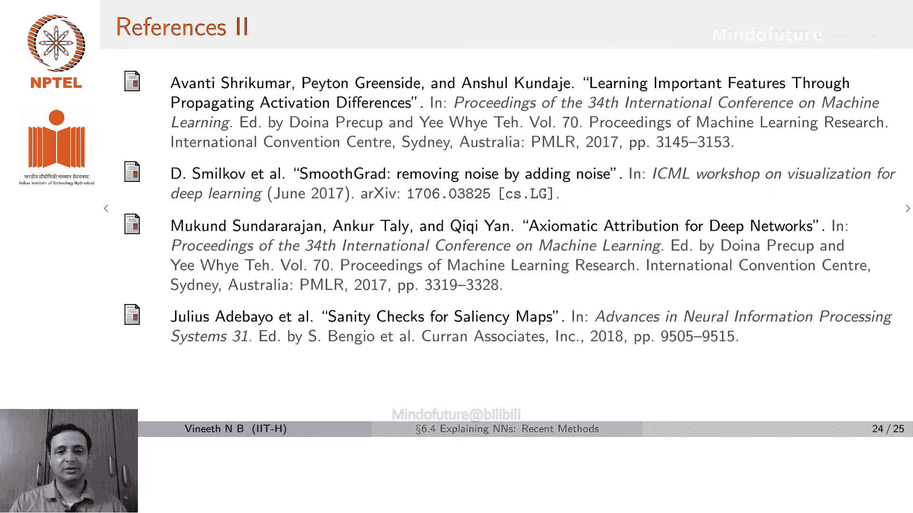

# 042：解释CNN - 最新方法 - 第二部分

## 概述
在本节课中，我们将继续学习解释卷积神经网络（CNN）决策的最新方法。我们将重点介绍三种核心方法：LIME、SHAP以及评估解释质量的量化指标。这些方法旨在帮助我们理解模型为何做出特定预测，这对于建立对AI系统的信任至关重要。

---

## LIME：局部可解释模型无关解释

上一节我们介绍了基于梯度和类激活映射的解释方法。本节中，我们来看看一种模型无关的解释方法——LIME。

LIME代表“局部可解释模型无关解释”。该方法的核心思想是：对于一个给定的复杂模型（如CNN）和特定的输入实例，LIME通过在该实例附近构建一个简单的、可解释的模型（如线性模型）来近似原始模型的局部行为。

以下是LIME方法的工作原理：

1.  **选择待解释的实例**：例如，一张被模型分类为“猫”的图片。
2.  **生成扰动样本**：通过遮盖、删除或修改原图片的部分区域（如超像素），生成一系列略微不同的新图片。
3.  **获取原始模型预测**：将这些扰动后的图片输入到待解释的原始CNN模型中，记录其预测结果（例如，是“猫”还是“狗”）。
4.  **拟合局部解释模型**：根据这些扰动样本及其对应的原始模型预测结果，训练一个简单的、可解释的模型（如线性回归模型）。这个简单模型只在该特定输入实例的“局部”有效。
5.  **解释权重**：简单模型的权重（系数）大小，指示了原图中哪些区域对模型的最终预测贡献最大。权重高的区域被认为是重要的。

其目标函数公式如下：
`解释模型G = argmin [ Σ (π_x(z) * (F(z) - G(z))^2 ) + Ω(G) ]`
其中，`F`是原始复杂模型，`G`是待学习的简单解释模型，`π_x(z)`衡量扰动样本`z`与原始样本`x`的接近程度，`Ω(G)`是解释模型`G`的复杂度（如非零权重数量），用于鼓励模型简洁。

---

## 保真度与可解释性的权衡

在应用LIME时，我们需要在**保真度**和**可解释性**之间进行权衡。

*   **保真度**：指局部解释模型`G`在多大程度上准确反映了原始模型`F`在局部区域的行为。我们希望`G`尽可能接近`F`。
*   **可解释性**：指解释模型`G`本身对人类而言是否容易理解。线性模型因其直观性（权重代表重要性）而被广泛使用。

目标函数中的两项正对应了这种权衡：
*   第一项 `Σ (π_x(z) * (F(z) - G(z))^2 )` 追求高保真度。
*   第二项 `Ω(G)` 追求高可解释性（低复杂度）。

通常，提高保真度可能需要更复杂的`G`，但这会降低可解释性。LIME通过选择线性模型并施加稀疏性约束（如L1正则化），在实践中取得了较好的平衡。

---

## SHAP：基于博弈论的解释方法

接下来，我们介绍另一种强大的解释方法——SHAP，它源于博弈论中的沙普利值概念。

想象一个足球队，你想量化梅西对巴塞罗那队价值的贡献。SHAP的思想是：计算某个“玩家”（在机器学习中即某个特征）加入所有可能的“联盟”（特征子集）时所带来的**边际贡献**的平均值。

形式上，对于特征`i`的SHAP值（即其重要性得分）计算公式为：
`φ_i(v) = Σ [ |S|! (|N|-|S|-1)! / |N|! ] * [ v(S ∪ {i}) - v(S) ]`
其中：
*   `N`是所有特征的集合。
*   `S`是`N`中不包含特征`i`的任意一个子集（即一个“联盟”）。
*   `v(S)`是衡量特征子集`S`价值的函数。
*   `[ v(S ∪ {i}) - v(S) ]`就是特征`i`加入联盟`S`带来的边际贡献。
*   求和项遍历所有可能的子集`S`，前面的系数用于对所有可能的排列顺序进行平均。

在神经网络中，关键是如何定义价值函数`v(S)`。一种常见定义是：`v(S) = E[ F(x) | 已知特征子集S的值 ]`，即，在已知特征子集`S`取值的情况下，模型输出`F(x)`的期望值。这需要通过采样未知特征`S'`（`S`的补集）的值来计算。

SHAP的一个扩展是**DeepSHAP**，它结合了SHAP和DeepLIFT的思想，通过考虑一组基线输入并计算平均归因来定义价值函数`v(S)`。

---

## 如何评估解释方法？

我们已经学习了多种生成解释的方法，一个自然的问题是：如何客观地评估这些解释的好坏？我们不能仅靠肉眼观察定性结果。

以下是几种常用的量化评估指标：

### 1. 交并比
如果数据集中包含真实的目标边界框（例如，图片中猫的精确位置），我们可以将解释方法生成的显著图进行阈值化，得到一个区域，然后计算该区域与真实边界框的**交并比**。IoU越高，说明解释方法定位关键区域越准确。
`IoU = (Area of Overlap) / (Area of Union)`

### 2. 忠实性
该指标衡量**归因分数**与**输出变化**之间的相关性。具体做法是：对输入进行扰动（如修改像素），观察模型输出的变化。如果某个特征（像素）的归因分数高，那么扰动它应该引起较大的输出变化。两者相关性越高，说明解释越忠实于模型。
`Faithfulness = Corr( R_i, Δ_i )`
其中`R_i`是像素`i`的归因分数，`Δ_i`是扰动像素`i`后的输出差异。

### 3. 删除与插入指标
*   **删除指标**：按照解释方法给出的重要性顺序，从最重要到最不重要，依次删除（如置黑）图像中的像素。同时监控模型对该类别的预测概率。性能（如AUC）下降得越快，说明解释方法找出的区域越关键。
*   **插入指标**：与删除指标相反，从最不重要到最重要，依次向空白图像中插入像素。性能上升得越快，说明解释方法越有效。

### 4. 移除与重训练
这是一种更严格的评估方式：使用解释方法为训练集中的每张图片生成显著图，然后根据显著图扰动（如移除）最重要的像素，并用这个被修改过的训练集重新训练模型。如果解释方法有效，那么新模型在测试集上的准确率应该有显著下降。

此外，研究社区还提出了**解释方法的公理**（如完整性、敏感性、实现不变性等）和**显著性图的健全性检查**，作为评估解释方法理论合理性的基础。建议读者将这些作为延伸阅读材料。

---

## 总结

本节课我们一起学习了多种解释CNN决策的高级方法与评估标准：

1.  **LIME**是一种**模型无关**的局部解释方法，它通过拟合一个局部线性模型来近似复杂模型的行为。其优点是通用性强，可用于图像、文本等多种数据，但需要为每个输入实例单独训练解释模型，速度较慢。
2.  **SHAP**基于坚实的**博弈论**基础，通过计算特征在所有可能子集中的平均边际贡献来分配重要性。它提供了统一的理论框架，但实际计算可能需要近似。
3.  **评估解释**需要客观的量化指标，如**交并比**、**忠实性**、**删除/插入指标**和**移除与重训练**等，这些指标帮助我们超越定性观察，科学地比较不同解释方法的优劣。

不同的解释方法各有侧重和适用场景。在实践中，选择哪种方法取决于具体需求：是追求速度、理论完备性，还是需要模型无关的灵活性。理解这些方法的原理和评估方式，是构建可信、可解释AI系统的重要一步。

---
**课后作业建议**：
1.  阅读关于“归因公理”和“显著性图健全性检查”的论文，理解可靠解释方法应满足的理论性质。
2.  使用Captum（PyTorch）或类似的可解释性工具库，对你之前构建的CNN模型进行解释，并可视化显著图。
3.  探索OpenAI Microscope等模型可视化工具，从不同层次理解神经网络的行为。

**扩展资源**：
*   Christoph Molnar所著《Interpretable Machine Learning》在线电子书。
*   Captum库官方教程与文档。