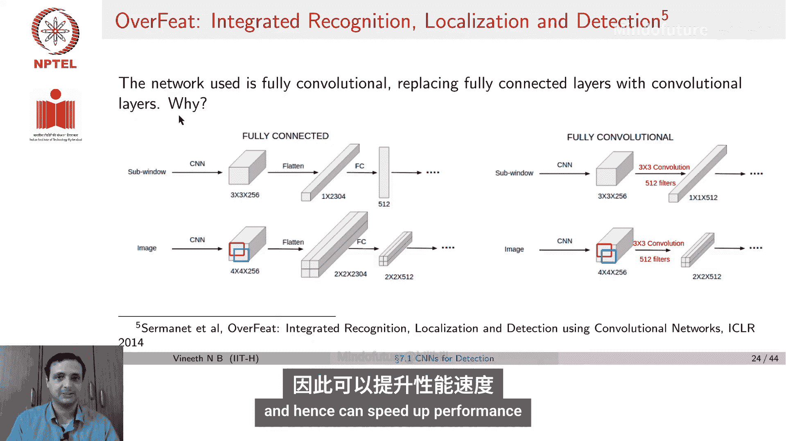

# 044：用于目标检测的CNN I - 第一部分

在本节课中，我们将要学习目标检测任务，这是计算机视觉中最常用和重要的任务之一。我们将从深度学习时代之前的方法开始，了解其基本原理，然后探讨如何将卷积神经网络（CNN）应用于目标检测，并介绍一些早期的成功案例。

## 概述：从分类到检测

到目前为止，我们已经学习了神经网络的最简单形式，即前馈神经网络。我们学习了反向传播，了解了如何使用不同变体的梯度下降法。我们还学习了一些训练神经网络时的实用技巧。

随后，我们转向了卷积神经网络（CNN），这是计算机视觉的基石。我们看到了如何使用反向传播训练CNN，了解了CNN中的各种架构，并且在上周学习了如何可视化和理解CNN所学的内容，以及如何解释它们的预测。

然而，在迄今为止的所有讲座中，我们主要关注的任务是分类。给定一张图像，我们的目标是分类图像中包含什么物体。我们可以通过将交叉熵损失改为均方误差，将其扩展到回归任务，预测实数值。

但是，计算机视觉中还有许多其他类型的任务。从本周开始，我们将转向这些任务。我们将从当今最常用的任务之一——目标检测开始。

## 分类、定位与检测的区别

分类、定位和检测之间的区别如下：

*   **分类**：给定一张包含猫的图像，目标是判断图像中存在一只猫。
*   **定位**：除了判断存在一只猫，还需要用一个边界框框出猫在图像中的位置。
*   **目标检测**：更进一步，需要检测出给定图像中属于你设定类别的所有可能出现的物体，并对它们进行定位。

在定位任务中，通常只定位一个物体。而在目标检测中，可能存在多个物体，甚至是同一物体的多个实例。例如，图像中可能有一只猫和一只狗，或者两只狗和一只猫。目标检测的目标是识别出每一个物体，并使用边界框对它们进行定位。

最后是**分割**任务，其工作是为每个像素分配一个标签，标记其属于C个类别中的哪一个（取决于我们拥有的类别数量）。

我们将从检测开始本讲座，然后在本周晚些时候讨论分割以及其他任务。

## 深度学习前的目标检测方法

在深度学习兴起之前，人们使用其他方法在各种设备上部署计算机视觉进行目标检测。例如，即使在15年前深度学习尚未成熟时，目标检测和人脸检测功能就已经出现在傻瓜相机中。

这些方法大多使用了**Viola-Jones算法**的变体。该算法由Viola和Jones开发，因此得名，并于2001年在CVPR上发表。这是一个用于实时目标检测的框架，最初主要用于检测正面人脸，后来也被调整用于检测其他类型的物体或物体的部分（如人脸中的眼睛检测）。

该工作的主要贡献包括：
1.  使用**Haar-like特征**进行弱分类。
2.  引入了**积分图像**这一强大概念，可以显著加快Haar-like特征的计算速度。
3.  使用**AdaBoost**作为分类器，但其使用方式与传统机器学习中的AdaBoost略有不同。
4.  使用了**级联分类器**。

### Haar-like特征

Haar特征是基于Haar小波的矩形特征。它们看起来像这样：通常包含一个黑色区域和一个白色区域，但可以有不同组合。你可以有水平或垂直排列的黑白两区域，也可以有被白色区域夹在中间的黑色区域（水平或垂直），或者棋盘格图案等等。

Haar滤波器的核心思想是：特征值等于**黑色矩形区域内像素值的总和**减去**白色矩形区域内像素值的总和**。记住这是卷积操作，滤波器会翻转，因此与Haar滤波器卷积的输出实际上是黑色矩形区域像素和减去白色矩形区域像素和。

为了适应不同尺度的图像，这些特征可以通过高度、宽度进行缩放，或者采用不同的模式。

### 积分图像

积分图像是一个基本概念，并非专门用于人脸检测，而是一种加速计算的方法，尤其是在使用Haar-like特征时。它由Viola和Jones在这项工作中引入。

积分图像的定义是：对于积分图像中的任意像素点 `(x, y)`，其值等于从图像左上角原点 `(0, 0)` 到该点 `(x, y)` 所围成的矩形区域内所有原始图像像素值的总和。

用数学公式表示为：
`II(x, y) = Σ_{x'≤x, y'≤y} I(x', y')`
其中，`II` 是积分图像，`I` 是原始图像。

积分图像可以通过递推关系高效计算：
`s(x, y) = s(x, y-1) + I(x, y)`
`II(x, y) = II(x-1, y) + s(x, y)`
其中 `s(x, y)` 是行累加和。为了使递推成立，需要定义 `s(x, -1) = 0` 和 `II(-1, y) = 0`。

积分图像的强大之处在于，**计算任意矩形区域的像素和只需要四次查表运算**。假设矩形的左上角坐标为 `(x1, y1)`，右下角坐标为 `(x2, y2)`，则该矩形区域的像素和 `Sum` 为：
`Sum = II(x2, y2) + II(x1-1, y1-1) - II(x2, y1-1) - II(x1-1, y2)`

对于Haar特征计算，例如一个两矩形特征（一个黑矩形紧邻一个白矩形），计算其卷积输出（黑区和减白区和）只需要**六次**积分图像查表（因为需要确定三个矩形的六个角点）。作为练习，可以思考一下，对于一个三矩形特征（例如中间黑，两边白）和一个四矩形特征（例如棋盘格），分别需要多少次查表？

### 使用AdaBoost进行特征选择

一旦有了这些Haar滤波器的输出，Viola-Jones算法建议每个特征都可以被视为一个**弱分类器**。给定一个特征 `f_j`，一个阈值 `θ_j` 和一个指示符号的奇偶性 `p_j`，弱分类器 `h_j(x)` 定义为：
`h_j(x) = 1, if p_j * f_j(x) < p_j * θ_j`
否则为0。

这样，每个Haar特征都对应一个弱分类器。我们知道，弱分类器的组合可以形成强分类器。但这里存在一个问题：即使在一个简单的24x24滑动窗口内，可能的Haar特征数量也超过16万个。在每个滑动窗口内计算16万个弱分类器是不现实的。

这时就需要**AdaBoost**。Viola-Jones算法中使用AdaBoost的方式如下（简述自论文）：
1.  初始化所有训练样本的权重为均匀分布。
2.  对于每一个可能的Haar特征 `j`，训练一个仅使用该特征的弱分类器 `h_j`。
3.  计算该弱分类器的加权误差 `ε_j`。
4.  **从所有特征对应的弱分类器中，选择误差 `ε_t` 最小的那个**，记为 `h_t`。
5.  根据 `h_t` 的误差更新所有样本的权重（增加错分样本的权重，降低正确分类样本的权重）。
6.  重复步骤2-5，共进行 `T` 轮迭代。
7.  最终的强分类器是这 `T` 个弱分类器的加权组合。

通过这种方式，AdaBoost从海量特征中自动选择了最具判别力的 `T` 个特征，大大提升了效率。

### 分类器级联

Viola-Jones算法的第三个组成部分是**分类器级联**。其动机是：图像中只有极少数子窗口真正包含目标（如人脸）。如果对每个可能的窗口都进行完整的强分类器评估，计算量巨大，且假阳性率可能很高。

级联分类器的思想是：**尽早排除负样本窗口**，从而减少在它们身上花费的计算时间。具体来说：
1.  所有可能的子窗口首先进入第一级分类器（由少量特征构成，计算快）。
2.  只有被第一级分类器判定为“可能包含目标”的窗口，才会进入第二级分类器（可能使用更多特征，更精确）。
3.  以此类推，经过多级筛选。
4.  在任何一级被拒绝的窗口将不再参与后续处理。

为什么级联很重要？对于目标检测，假阳性率（False Positive Rate, FPR）至关重要。假设一张100万像素（1兆像素）的图像，至少有百万量级的候选窗口。理想的FPR需要低于 `10^-6` 量级。

如果只使用少数几个Haar特征，可能达到100%的检测率，但FPR高达50%。使用200个特征，可能达到95%检测率，FPR约为 `1/14000`，仍然不够。

级联分类器解决了这个问题。**最终的总检测率是各级检测率的乘积，总FPR是各级FPR的乘积**。例如，一个10级级联，如果每一级的检测率为0.99，FPR为0.3，那么总FPR就是 `0.3^10 ≈ 6e-6`，达到了我们的要求。而每一级使用少量特征（如200个）就可以实现0.99的检测率和0.3的FPR。通过级联，我们以可接受的计算成本获得了极低的总体FPR。

### 非极大值抑制

在检测中，一个物体周围可能有多个窗口都被分类为包含该物体。我们需要选择其中最合适的一个。这通常通过**非极大值抑制**（Non-Maximum Suppression, NMS）来完成，其核心是**交并比**（Intersection over Union, IoU）。

IoU定义为两个边界框 `B1` 和 `B2` 的交集面积除以它们的并集面积：
`IoU(B1, B2) = Area(B1 ∩ B2) / Area(B1 ∪ B2)`
IoU越接近1，表示两个框重叠度越高。

NMS的基本步骤是：
1.  获取所有预测框及其置信度分数。
2.  选择置信度最高的框。
3.  计算该框与剩余所有框的IoU。
4.  移除所有IoU超过某个阈值（如0.5）的框（因为它们很可能是对同一物体的重复检测）。
5.  在剩余的框中重复步骤2-4，直到没有框剩下。

我们稍后会看到更完善的NMS方法，它不仅考虑IoU，还会结合框的置信度。

## 方向梯度直方图

另一个在深度学习之前流行的检测方法是**方向梯度直方图**（Histogram of Oriented Gradients, HOG），我们之前在讨论手工特征提取时提到过它。这里我们主要看它如何用于行人检测任务。

HOG检测流程如下：
1.  给定一张图像，一个检测窗口在图像上滑动。
2.  在每个窗口内，计算图像的梯度（例如使用Sobel滤波器）。
3.  将窗口划分为小的**单元格**（cells）。
4.  在每个单元格内，计算梯度方向的直方图（将360度或180度划分为若干个区间）。
5.  将相邻的单元格组合成**块**（blocks，例如2x2个单元格），对块内所有单元格的直方图进行归一化，以增强对光照和阴影的鲁棒性。
6.  将所有块的归一化直方图连接起来，形成最终的HOG描述符。

得到HOG描述符后，可以训练一个**支持向量机**（SVM）分类器，来判断一个窗口是否包含行人。该方法由Dalal和Triggs于2005年提出。

HOG也可以在多分辨率下进行，即构建图像金字塔，在每一层金字塔图像上执行上述HOG+SVM检测，然后通过某种方式（如加权、投票）整合各层的检测结果。

以上是深度学习兴起之前用于检测的主要方法。

## 使用CNN进行目标检测的最简单方法

现在，让我们看看如何以最简单的方式使用CNN进行目标检测。

假设在训练时，我们有汽车的图像。我们会训练一个CNN（使用标准的交叉熵损失）来学习一个汽车分类器。

在测试时，当得到一张汽车可能位于图像中任何位置的图片时，我们需要：
1.  在图像上以**多个尺度**提取**滑动窗口**（可能产生数十万个窗口）。
2.  将每个窗口调整到CNN输入所需的大小。
3.  将每个窗口依次输入训练好的CNN。
4.  CNN对每个窗口进行分类，判断其是否包含汽车。
5.  根据分类结果，在原始图像上标记出检测到的汽车位置。

同样，可以结合**非极大值抑制**来提升性能。具体来说，在获得所有可能包含汽车的边界框列表后：
1.  选择**置信度最高**的边界框（例如，图中红色框，置信度0.93）。
2.  计算该框与列表中所有其他框的IoU。
3.  移除所有与该框IoU超过阈值（如0.5）的其他框，因为它们很可能检测的是同一物体。
4.  在剩余的框中重复此过程。

这种方法存在几个明显问题：
1.  边界框可能不够紧密地贴合物体。
2.  需要将成千上万个滑动窗口逐个输入CNN进行评估，**计算成本极高**。

我们将在后续讨论克服这些问题的更先进方法。

## 目标定位

在深入讨论检测之前，我们先看看**目标定位**，正如之前所说，它是检测的前置任务。在定位中，我们假设图像中只有一个物体。

实现定位的一种方法是修改CNN结构：
1.  CNN的骨干网络部分（卷积层）保持不变，用于提取特征。
2.  在最后的全连接层之后，网络**分成两个分支（头）**：
    *   **分类头**：输出物体的类别概率，使用交叉熵损失训练。
    *   **回归头**：输出边界框的坐标，通常是四个值 `(x, y, w, h)`，分别表示边界框的中心点（或左上角点）坐标、宽度和高度。使用L2损失（均方误差）训练。
3.  网络的总损失是分类损失和回归损失的加权和。

通过这种方式，网络被训练为同时进行分类和定位。

### OverFeat：一个成功的定位器

**OverFeat**是早期成功将CNN用于定位的典范，它是2013年ImageNet定位挑战赛的冠军。

OverFeat实现定位的关键思想是：**将整个网络设计成全卷积的**，避免使用全连接层。这样做的好处是：
*   可以对任意大小的输入图像直接进行前向传播。
*   通过一次前向传播，就能在特征图上得到对应于输入图像不同位置的预测，**避免了在多个滑动窗口上重复计算**，极大提升了效率。

具体来说，OverFeat用全局平均池化或1x1卷积层替代了全连接层。例如，一个14x14的输入，经过一系列卷积和池化操作后，特征图尺寸逐渐减小，最后通过1x1卷积直接输出每个空间位置对应的类别和边界框偏移量。

这种“全卷积”的思想后来被许多先进的检测和分割模型所采用，我们将在后续课程中看到。

## 总结

本节课中，我们一起学习了目标检测的基础知识。我们首先回顾了深度学习时代之前的经典方法，包括Viola-Jones算法（使用Haar-like特征、积分图像、AdaBoost和级联分类器）和HOG描述符结合SVM的方法。然后，我们探讨了如何将CNN应用于目标检测的最朴素方式——滑动窗口法，并指出了其计算效率低下的问题。接着，我们介绍了目标定位任务，以及如何通过修改CNN结构（添加回归头）来实现单物体定位。最后，我们了解了OverFeat模型，它通过全卷积网络结构显著提升了定位的效率，为后续更先进的检测模型奠定了基础。下一节，我们将深入探讨基于CNN的现代目标检测算法。