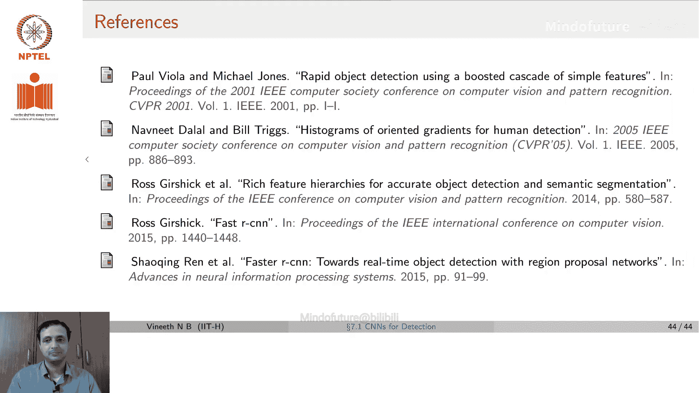

# 045：用于目标检测的CNN I - 第二部分


在本节课中，我们将要学习基于深度学习的现代目标检测方法。我们将首先了解目标检测方法的两种主要分类，然后深入探讨基于区域提议的方法，特别是R-CNN系列模型的发展历程、工作原理及其优缺点。

上一节我们介绍了深度学习时代之前的目标检测方法以及如何将基础CNN用于目标检测。本节中，我们来看看当今基于CNN的现代目标检测方法。

现有的方法主要可以分为两大类：**基于区域提议的方法**和**基于密集采样的方法**。我们将在本讲中介绍基于区域提议的方法，并在下一讲中讨论基于密集采样的方法。

## 🧩 基于区域提议的方法概述

在基于区域提议的方法中，检测框架通常由两个阶段组成。

*   第一阶段：一个网络或模块负责提出可能包含物体的不同候选区域。
*   第二阶段：一个分类器（在我们的案例中是CNN）对这些候选区域进行分类，判断其属于某个物体类别还是背景。

这种两阶段方法性能更稳健，但由于其分步处理的特性，速度较慢。另一方面，基于密集采样的方法是单阶段方法，它通过密集采样程序一次性完成区域提议和区域分类/检测。这种方法更简单、更快，但有时在精度上可能不及基于区域提议的方法。

## 🚀 R-CNN：区域卷积神经网络

现在我们来讨论基于区域提议的方法。最早的方法是R-CNN（基于区域的卷积神经网络），由Ross Girshick等人在2014年CVPR会议上提出。

以下是R-CNN的工作流程：

1.  **区域提议**：使用一种名为“选择性搜索”的图像处理方法（不使用神经网络）来生成多个可能包含物体的候选区域。
2.  **区域处理**：将每个候选区域缩放（扭曲）到相同尺寸，以适应CNN的固定输入要求。
3.  **特征提取与分类**：将每个区域输入CNN（如AlexNet或VGG）提取特征。特征图通过全连接网络后，分为三个部分：
    *   **Softmax分类器**：将区域分类为已知的物体类别之一。
    *   **SVM分类器**：实际上用于最终分类决策（稍后解释）。
    *   **边界框回归模块**：预测当前候选区域与真实边界框之间的偏移量（如左上角坐标的Δx, Δy，以及高度和宽度的Δh, Δw）。

### R-CNN的训练流程

R-CNN的训练是一个多阶段的流程：

1.  **微调CNN**：使用经过扭曲的区域图像，通过Softmax和交叉熵损失（也称为对数损失）来微调CNN及其后的全连接网络权重。交叉熵损失公式为：
    `L_cls = -log(p_gt)`
    其中 `p_gt` 是模型预测的真实类别的概率。
2.  **训练SVM**：将全连接网络的输出作为每个区域的表征，针对检测问题中的每个类别（例如20个类别）训练一个独立的SVM分类器。
3.  **训练边界框回归器**：训练一个全连接层用于边界框回归，使用L2损失（均方误差损失）。

### R-CNN的局限性

尽管R-CNN是开创性的工作，但它存在几个主要缺点：

*   **多阶段训练流程复杂**：需要依次训练CNN、多个SVM和边界框回归器。
*   **速度慢，存储需求大**：每个候选区域都需要独立通过CNN进行前向传播。例如，在Pascal VOC数据集（约5000张图像）上训练需要约2.5个GPU天和数百GB的存储空间。
*   **检测速度慢**：测试时，对每张图像进行目标检测大约需要47秒，无法达到实时性。

## ⚡ Fast R-CNN：快速区域卷积神经网络

为了解决R-CNN的瓶颈，同一批作者在2015年ICCV上提出了Fast R-CNN。

Fast R-CNN引入了几个关键创新：

*   **共享特征计算**：不再将每个候选区域单独输入CNN。而是将**整张图像**输入CNN一次，得到特征图。然后，将选择性搜索得到的候选区域坐标**映射**到这些共享的特征图上。这避免了2000次（候选区域数量）重复的CNN前向传播，极大地提升了效率。
*   **统一的多任务网络**：移除了独立的SVM分类器。网络末端有两个并行的“头”：
    *   **分类头**：使用Softmax和交叉熵损失直接输出类别概率。
    *   **边界框回归头**：输出边界框偏移量。
*   **ROI池化层**：由于映射到特征图上的候选区域尺寸不一，Fast R-CNN引入了**ROI（感兴趣区域）池化层**，将任意尺寸的区域特征图转换为固定尺寸（如7x7），以供后续的全连接层处理。

### ROI池化工作原理

ROI池化将尺寸为 `h x w` 的输入区域，划分为 `H x W` 个网格（例如目标尺寸为2x2）。对每个网格子窗口执行最大池化操作，最终输出固定尺寸 `H x W` 的特征图。

### Fast R-CNN的损失函数

Fast R-CNN使用一个多任务损失函数，结合了分类损失和定位损失：
`L = L_cls + λ * L_loc`

*   `L_cls` 是分类损失，即交叉熵损失（对数损失）。
*   `L_loc` 是定位损失，仅对正样本（真实类别）计算。Fast R-CNN建议使用**平滑L1损失**代替L2损失。

平滑L1损失公式如下：
```
smooth_L1(x) = {
    0.5 * x^2,  if |x| < 1
    |x| - 0.5,  otherwise
}
```
平滑L1损失对异常值的敏感度低于L2损失（原因将在课后思考题中探讨）。

### Fast R-CNN的性能提升

得益于这些改进，Fast R-CNN在训练和测试速度上显著超越R-CNN：
*   训练时间从84小时减少到8.75小时（约10倍提升）。
*   测试时间从47秒减少到2.3秒（若不计入区域提议时间，则为0.3秒）。

然而，区域提议步骤（选择性搜索）仍然占据了大部分时间（约2秒），这成为了新的瓶颈。

## 🚀 Faster R-CNN：更快的区域卷积神经网络

为了彻底解决区域提议的速度问题，作者们在2015年NIPS上提出了Faster R-CNN。

Faster R-CNN的核心思想是：**用神经网络（区域提议网络，RPN）替代耗时的选择性搜索算法**，将区域提议也集成到端到端的深度学习框架中。

### Faster R-CNN架构

1.  **共享卷积层**：输入图像通过一个基础CNN（如VGG）得到特征图。
2.  **区域提议网络（RPN）**：RPN在特征图的每个位置上预设一组不同尺度和长宽比的**锚框**。RPN的任务是判断每个锚框内是否包含物体（二分类：物体/背景），并初步预测边界框的偏移量以微调锚框位置。
3.  **ROI池化与检测网络**：RPN提出的候选区域（经过微调后的锚框）被映射到共享特征图上，然后通过ROI池化层和后续的全连接网络，最终由分类头和边界框回归头输出检测结果。

### RPN的工作原理

RPN是一个全卷积网络。在特征图的每个滑动窗口中心，它会评估 `k` 个预定义的锚框。对于每个锚框，RPN输出两个预测：
*   **物体性得分**：该锚框包含物体的概率。
*   **边界框偏移量**：4个值，用于调整锚框的位置和尺寸。

### Faster R-CNN的训练流程

Faster R-CNN采用四步交替训练法：
1.  训练RPN（使用ImageNet预训练的CNN权重固定）。
2.  使用RPN生成的提议训练Fast R-CNN检测网络（此时CNN权重固定）。
3.  固定检测网络，用其权重初始化RPN的共享卷积层，并微调RPN独有的层。
4.  固定共享卷积层，微调检测网络独有的全连接层。

### Faster R-CNN的性能

通过将区域提议步骤融入网络并实现参数共享，Faster R-CNN实现了接近实时的检测速度：
*   测试时间从Fast R-CNN的2.3秒大幅降低到**0.2秒每图像**。

## 📚 总结与课后任务

本节课中我们一起学习了基于区域提议的现代目标检测CNN方法。我们从两阶段检测框架讲起，详细分析了R-CNN、Fast R-CNN和Faster R-CNN的演进过程。每一次改进都致力于解决前一代模型的瓶颈：R-CNN解决了如何用CNN进行检测的问题；Fast R-CNN通过共享卷积计算和统一网络提升了效率；Faster R-CNN则通过引入区域提议网络（RPN）实现了近乎端到端的训练，大幅提升了速度。

**课后思考题**：在Fast R-CNN中，为什么平滑L1损失（Smooth L1 Loss）比L2损失对异常值更不敏感？请尝试分析原因，我们将在下一讲开始前进行讨论。

**延伸阅读与练习**：
*   回顾经典的Viola-Jones目标检测框架。
*   阅读博客“Object Detection for Dummies”以加深理解。
*   观看关于目标检测模型演进的视频系列。

下一讲，我们将探讨目标检测的另一大类方法：基于密集采样的方法（如YOLO, SSD等）。



