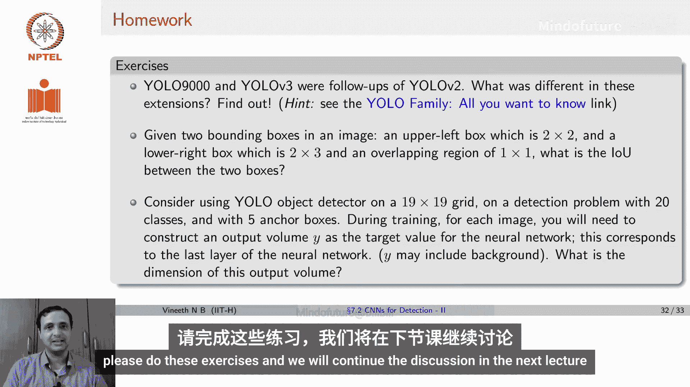

# 046：用于目标检测的CNN II

## 概述
在本节课中，我们将继续学习目标检测中的密集采样方法。我们将详细介绍几种主流的单阶段检测框架，包括YOLO、SSD、特征金字塔网络以及RetinaNet，并解释它们的工作原理、损失函数和优缺点。

---

## 平滑L1损失与L2损失

上一节我们介绍了目标检测的基本概念。在深入新内容之前，我们先回顾一下上节课留下的思考题：为什么平滑L1损失比L2损失对异常值更不敏感？

当预测输出与真实值之间的偏差很大时（即存在异常值），平方损失或L2损失会夸大这种偏差。这也会导致梯度被夸大，可能引发梯度爆炸问题。L1损失缓解了这个问题。因为L1损失在零点不可微，所以我们使用其平滑版本，即平滑L1损失，以减轻异常值引起的问题。

---

## 密集采样方法简介

我们之前提到，现代目标检测方法大致可分为区域提议方法和密集采样方法。现在，我们将进入密集采样方法的学习，这些都属于单阶段检测框架。

### YOLO (You Only Look Once) 🎯

目前仍被广泛使用的最流行的单阶段检测器是YOLO。YOLO的第一个版本于2016年提出。它是一个单阶段检测器。可以说，所有这些单阶段检测器都大致基于OverFeat的思想，它们都只使用卷积层，没有全连接层，其主要目标是速度和良好的性能。

**高层次流程**是：调整图像大小，运行卷积网络，得到一组输出，然后进行非极大值抑制以确定最终的边界框。

让我们更详细地了解它。以下是整体流程。给定输入图像，首先将图像划分为S×S的网格。每个网格单元负责其中心重合的物体。例如，如果取这里的特定网格单元，它将负责这里的狗这个物体，并需要预测该边界框的偏移量。

因此，每个网格单元预测B个边界框（B是另一个超参数）以及每个框的置信度分数。所以，每个网格单元可以预测多个边界框和每个框的置信度。同时，每个网格单元为每个类别预测一个概率，总共C个类别意味着C个总概率。可以认为这是在计算一个条件概率：给定存在物体时，属于类别I的概率。

最终的预测可以编码为：你有一个S×S的网格。在每个网格位置，为每个边界框预测5个值。这五个值是什么？是表示物体中心的坐标、宽度和高度，以及每个边界框的置信度。这总共是5个值。然后，每个网格单元有C个类别概率。这样，在应用非极大值抑制之前，输出层的总输出数量为 **`S × S × (5B + C)`**。

每个边界框给出四个坐标：x, y, w, h。x, y是表示物体中心相对于网格单元的坐标，w, h是物体相对于整个图像的宽度和高度。每个边界框给出的置信度分数反映了模型对该边界框包含物体的置信程度，以及框的准确性。可以将置信度视为存在物体的概率（此时还不知道属于哪个类别）乘以预测框与真实框的交并比。因此，置信度同时考虑了这两个量。

每个网格单元有每个类别的条件类别概率，无论每个网格单元预测的边界框数量B是多少。YOLO每个网格单元只预测C个类别概率。因此，可以假设这些C个类别概率就是这里的条件概率：给定存在物体时，属于类别I的概率。

所以，如果你将这个置信度与这些类别条件概率相乘，你会得到：给定存在物体时属于类别I的概率（即条件类别概率）乘以置信度（即存在物体的概率乘以真实框与预测框的IOU），这等于类别I的概率乘以真实框与预测框的IOU。因此，对于每个单元格，你是在说这个类别出现在这个网格单元的概率是多少，以及预测框与真实框的IOU是多少。

**用于训练YOLO的损失函数是什么？** 损失函数有效地结合了多个组成部分，以确保预测的每个量都接近真实值。这里有多项。首先解释这些指示符：`1_{ij}^{obj}` 表示单元格i中的第j个边界框预测器是否负责该预测。记住，每个单元格预测B个边界框。所以这里的`I_{ij}`对应于第i个单元格预测的第j个边界框。`1_{i}^{obj}` 表示物体是否出现在单元格i中。

现在看看每一项的作用。如果你看一个特定单元格预测的特定边界框，首先试图确保网络预测的x_i, y_i接近期望的x_i_hat, y_i_hat。然后确保网络预测的宽度和高度接近原始的宽度和高度，这里取了平方根，因为宽度和高度是二维的。C和C_hat是置信度值，所以也试图确保当置信度较低时（相对于应有的置信度，如果有物体，应为1），这个差异也被最小化。所有这些求和是针对所有网格单元和每个网格单元预测的所有边界框进行的。

即使物体不存在，你也会做同样的事情，希望置信度匹配期望的置信度，此时应为0。所以这两项本质上是针对正类和负类的互补项。最后，最后一项表示条件类别概率匹配期望的条件类别概率。这些就是用于训练网络的损失函数中的不同项。

**这种方法有哪些局限性？** YOLO V1有一些局限性。首先，它只能检测少量物体。由于方法本身的空间限制以及可以呈现的重叠物体的数量，它会漏检小物体或彼此靠近的物体。这导致了较高的定位误差和相对较低的召回率。

为了克服这些问题，作为YOLO v1扩展提出的YOLO v2将锚框的概念引入了YOLO框架。这些锚框类似于你在Faster R-CNN中看到的。让我们看看这些锚框如何工作。

每个锚框预测五个坐标：t_x, t_y, t_w, t_h 和 p_o。让我们看看每一个。如果单元格距离图像左上角的偏移为(c_x, c_y)，并且锚框具有先验宽度和高度p_w和p_h，那么对应于锚框的预测由以下公式给出：
*   **`b_x = σ(t_x) + c_x`**
*   **`b_y = σ(t_y) + c_y`**
*   **`b_w = p_w * e^{t_w}`**
*   **`b_h = p_h * e^{t_h}`**
*   物体概率乘以IOU，即我们在YOLO v1中看到的量，是 **`σ(t_o)`**

这些是网络预测的不同量，它们与网格位置试图指向的实际边界框相关。记住，每个锚框只预测这五个值。b_x, b_y, b_w, b_h是由锚框给出的这些值对应的实际边界框。

---

### SSD (Single Shot MultiBox Detector) 📦

继续前进，有另一种单阶段检测方法，称为单次多框检测器（SSD）。SSD再次使用了类似OverFeat的方法。你可以看到，给定输入图像，网络的初始部分是一个类似VGG的网络。然后，卷积层不断减小尺寸，你可以看到有一些跳跃连接将你从卷积层直接带到分类器。

让我们更详细地看看它们。你拥有用于检测的多尺度特征图，因为你将这些卷积层的特征图直接发送到输出，这些直接到输出，这些直接到输出。所以输出层接收来自不同尺度卷积层的特征图，这就是多尺度特征图。

我们还看到，对于每个卷积层，都有一组不同的卷积滤波器将其连接到输出层。例如，这里的初始层经过一个 **`3×3×(4+类别数)`** 的卷积滤波器，这是它拥有的输出数量，也就是卷积滤波器的大小，从而在输出层给出相应的输出，依此类推，对于每个中间卷积层都是如此。

如果你取这些特征图中的任何一个，例如一个大小为m×n、具有C个通道的特征图层，那么它将给出m×n个位置。因此，这些特征图中每个像素位置都可能是物体的中心。所以，每个位置都像一个网格单元，你可以将其与YOLO进行比较。边界框偏移值相对于该网格单元位置。

记住，每个卷积图预测 **`(类别数 + 4)`** 个值，这是它们将预测的值的数量，即每个类别的类别概率加上对应于这些卷积特征图中每个像素位置的边界框偏移的四个值。

因此，当通过网络的后面的部分时，特征图变得越来越小。你可以在这里看到，如果这是原始图像中的真实框，你可以看到一个8×8的特征图，接着是一个4×4的特征图。在8×8的特征图中，如果你查看每个网格单元位置的锚框，每个锚框将预测一组值，我们在上一张幻灯片中讨论过。如果你有K个具有不同宽高比的锚框，SSD将预测C个类别特定分数加上4个锚框偏移，这就是我们在前面幻灯片中看到的C+4，即每个卷积层连接到输出层时的通道数。

因此，对于一个m×n的特征图，你总共有 **`(C+4) × K × m × n`** 个输出，因为你现在假设每个像素都可能是物体的中心，并且每个像素周围有K个锚框，每个锚框预测C个类别概率和4个边界框偏移。这就是为什么在SSD框架中，每个m×n特征图会有这么多输出。

**这里使用的损失函数是什么？** 与我们目前看到的损失函数非常相似，SSD实现了一个定位损失函数和一个置信度损失函数。置信度损失函数比较预测的类别概率和真实值。真实值的写法是：x_{ij}^p 根据是否存在物体而给定为1或0，如果第i个默认框（或锚框，这里默认框和锚框是同义词）与类别p的第j个真实框匹配。

L和G是预测的和真实的框参数。让我们更详细地看看每个损失函数。

SSD的定位损失再次由平滑L1损失给出。它开头也有一个因子x_{ijk}来表示是否涉及某个类别，因为你只想在涉及类别时评估这个量（此时它会变为1）。这些L是预测的偏移量，G_hat是真实的偏移量。这些真实偏移量由以下公式给出：
*   **`ĝ_{cx} = (g_{jx} - d_{ix}) / d_{iw}`**
*   **`ĝ_{cy} = (g_{jy} - d_{iy}) / d_{ih}`**
*   **`ĝ_w = log(g_{jw} / d_{iw})`**
*   **`ĝ_h = log(g_{jh} / d_{ih})`**

这里ĝ_{cx}是真实框中心x坐标减去当前锚框中心x坐标，然后除以锚框宽度，确保你计算的是相对于当前锚框的正确偏移，并对x和y维度用宽度和高度进行归一化。这里的ĝ_w, ĝ_h是指数因子，我们用来缩放宽度和高度，而不是加性因子。我们说YOLO对宽度和高度使用乘法因子，因为那里有一个指数项，所以这里使用对数来反转操作，这将是你的网络应该预测的真实缩放因子。当你对其取指数时，对数项会消失，你会得到正确的期望宽度和高度。

SSD的另一个损失，即置信度损失，是类别置信度概率的softmax损失。它由正边界框的第一项（即标准交叉熵损失）和负边界框的第二项给出，其中有一个对应于背景类别的类标签，你希望最大化它。这里的c_0对应于一个称为背景的类标签，它被视为你想要读取的类别之一。c_hat是你的标准softmax激活函数。

在实际实现中，YOLO和SSD都有这个问题：与Faster R-CNN相比，大多数锚框很可能是负样本。为了应对这个问题，你选择具有最高置信度损失的负样本，使得负样本与正样本的比例保持在约3:1。因为否则，请记住，即使在一张图像中只有100个物体，如果你采用SSD，每个像素你将有K个不同的锚框，就负样本且其中没有物体的框的数量而言，这可能是一个巨大的数字。然后学习会受到影响，这就是你这样做的原因。**困难负样本挖掘**：在训练时，你只选择那些具有非常高置信度损失的框，并且只在我们讨论的损失函数中使用它们。记住，损失函数也考虑了那些负框。

SSD还使用了数据增强策略。给定原始图像，原始图像也被使用。它还从图像中随机采样 patches，试图确保与实际物体的最小IOU在预定义的一组范围内，以确保网络暴露于图像中不同种类的 patches 以及不同种类的物体及其重叠。

通过这种方法，SSD的性能可以超越YOLO和Faster R-CNN。

---

### 评估指标：mAP

所有检测方法都使用一个称为mAP（平均精度均值）的评估指标进行测量。精度指的是机器学习方法中使用的标准精度指标。平均精度指的是在所有类别上获得的平均精度，而均值是针对所有边界框的。

因此，通常在一个特定的IOU下测量mAP。那么，你如何确认是否预测了一个边界框？你预先指定一个特定的IOU，例如0.5，并说只要我的预测框与我的真实框至少有0.5的IOU，我就认为我的预测是正确的。这就是定义正确性的方式，以获得你的精度，然后你在预测的类别和框上取平均值。

你可以看到，SSD在mAP上匹配了Faster R-CNN，但以显著更高的FPS（每秒帧数）速率，这是使单阶段方法在实践中更快的主要目标。你还可以看到，输出框的数量明显更高，显然对于SSD来说是这样，因为你为每个像素都做，并且他们还表明这在不同的输入分辨率下也相当有效。

---

### 特征金字塔网络 (FPN) 🗼

第三种单阶段检测器方法称为特征金字塔网络（FPN）。FPN使用的思想是，来自初始层的特征图中的特征层可能并不真正适合检测。当你通过卷积网络时，初始层是高分辨率的，然后随着你深入，分辨率变得越来越低。但是，尽管初始层是高分辨率的，我们从CNN的可视化中看到，它们可能并没有真正捕捉到那些初始特征图中的物体语义。然而，它们是分辨率较高的。而较低分辨率的特征图具有更丰富的特征用于检测。我们如何弥合这个差距，正是特征金字塔网络试图做的。

以下是特征金字塔网络如何尝试弥合这一差距的可视化。如果你要使用图像金字塔来进行检测，你可以做的一件事是对图像进行下采样，并为每个图像分辨率构建一个特征图，并为每个特征图进行预测。或者，你可以获取输入图像，构建越来越低分辨率的特征图，最后在最低分辨率进行预测。或者，给定输入图像，在构建许多卷积层时在不同分辨率构建特征图，并在每个分辨率进行预测。

特征金字塔网络建议的是，当你通过卷积网络时，你确实在不同分辨率构建特征图，但现在你进行上采样并获取更高分辨率的特征图，然后进行预测。这样，你试图在最低分辨率获取语义，但上采样回来将语义传递到更高分辨率。

让我们看看这在架构中是如何完成的。这是整体架构。你有一张图像。你有一个步长为2的卷积层，然后0.5x表示一个下采样最大池化层（2×2池化）。然后你有一个步长为4的卷积层，一个最大池化，一个步长为8的卷积层，一个最大池化，一个步长为16的卷积层，一个最大池化，以及一个步长为32的卷积层。你可以认为这就像一个在FPN中使用的ResNet。所有卷积特征图C1到C5都经过一个1×1卷积处理（你在这些箭头上看到，有256个通道）。然后，M5被上采样2倍以获得下一个M4，但在获得M4之前，你从C4获取信号（在应用1×1卷积之后），并将C4的输出与1×1卷积和M5结合以获得M4。你类似地继续这样做以获得M3和M2。一旦完成，在M4、M3和M2上应用3×3卷积，这样做是为了减少M中的混叠效应。记住，当我们从M5到M4、M4到M3、M3到M2时，我们正在进行上采样，而回想一下，上采样可能导致混叠。因此，为了平滑这些混叠因素，我们使用一个3×3卷积，将我们从M4带到P4，从M3到P3，从M2到P2，依此类推。最后，你得到所有这些P，它们被提供给单独的目标检测器以获得最终预测。

---

### RetinaNet 与 Focal Loss ⚖️

一种更近期的目标检测方法侧重于用于训练这些检测器的损失函数。这就是RetinaNet。提出的损失函数称为Focal Loss，于2017年ICCV提出。它基于这样的直觉：两阶段检测器被认为比一阶段检测器更准确。一阶段检测器显然更快。据推测，两阶段检测器更准确，是因为背景或负类与包含物体的正提议之间的类别不平衡较少。记住，当你进行选择性搜索时，我们将区域提议限制在只有2000个。而在一阶段检测器中，你可能要处理100,000个区域，因为在SSD中，你在特征图的每个像素上都有多个锚框。即使在YOLO中，你可能为每个S×S网格单元预测B个边界框，这可能是一个非常大的数量。那么，我们如何解决负类或背景类与实际正类之间的这种不平衡？

每当存在这样的问题，即有许多负样本（它们对模型没有真正帮助）而只有少数正样本时，可能会发生某些情况：
1.  训练可能变得低效，因为简单的负样本并没有给出任何有用的信号。
2.  损失可能被负样本淹没，而不是正样本，这可能会使训练过程退化，导致模型在一定程度上退化。我们在SSD中讨论的困难负样本挖掘，我们试图确保最终损失只使用那些具有显著置信度损失的样本，并确保负样本与正样本的比例为3:1，这确实缓解了这些问题，但问题仍然存在。

因此，这篇论文提出，用于检测分类分支的交叉熵损失可能本质上是不好的。让我们试着看看为什么。记住，交叉熵损失在多类设置中定义为 -log(p)，正如我们提到的，它就是负对数损失。根据他们的实证研究，他们观察到了这个图表。如果你注意到，当γ等于0时，他们引入的称为Focal Loss的损失将变成，这个系数在γ=0时将变为1，损失将变成你的标准对数损失或交叉熵损失。所以当γ=0时，蓝色是你的标准交叉熵损失，你可以看到，即使网络对真实类别预测了高概率，损失值也相当不小，即使模型对正确类别预测了高概率，你也会得到相当高的损失。这可能会违背学习的目的。

那么，使用Focal Loss的RetinaNet提出了什么？一种方法是你可以做一个平衡交叉熵，其中负对数损失由某个量α加权，α可以给定为某个逆类别频率，这是一种方法。但RetinaNet方法也提出了Focal Loss，它考虑预测概率本身来微调损失。所以你用 **(1 - p_t)^γ** 来加权你的对数损失，其中γ是一个可调的聚焦参数。因此，γ是训练网络时必须提供的一个超参数。最终的Focal Loss给出这个量。假设γ是某个值，比如5。那么当p高时，这个量会变低，你降低了整体损失，因为当p高时你希望损失低。当p低时，比如0.1，因为γ是5，这个量仍然是一个合理的量，并且当你的预测概率p_t对于真实类别较低时，对数损失将保持在高水平。这就是Focal Loss的主要思想。

RetinaNet架构在其他方面使用FPN（我们讨论过的特征金字塔网络）以及Focal Loss，你可以看到这里的第一部分是特征金字塔网络本身，然后对于每个尺度，你有一个分类子网络和一个边界框回归子网络，分类子网络使用Focal Loss进行学习。

---

## 实现与总结

所有这些现代检测方法（包括密集采样方法和基于区域提议的方法）都在一个名为Detectron的流行库中实现。Detectron由Facebook AI Research提供，特别是为了促进目标检测算法的使用。因此，如果你有兴趣为任何项目实现这些目标检测算法中的任何一个，可以查看Detectron或Detectron2以获取更多细节。

你的阅读材料是《目标检测入门》的延续，这次是第4部分，关于密集采样方法。这里有一个关于整个YOLO系列方法的教程，以及理解SSD、FPN和RetinaNet的教程。

## 课后练习

我们在这节课中只涵盖了YOLO v1和YOLO v2。YOLO还有一个YOLO9000，讨论了将YOLO扩展到9000个类别，以及一个YOLO v3，其思想非常接近YOLO9000。然而，这些与YOLO v2的不同之处将是你的作业，请务必阅读上一张幻灯片阅读部分中给出的链接以理解YOLO。

还有几个更简单的问题：
1.  给定图像中的两个边界框，一个左上框为2×2，一个右下框为2×3，重叠区域为1×1。两个框之间的IOU是多少？
2.  考虑在19×19的网格上使用YOLO，处理一个具有20个类别和5个锚框的检测问题。在训练期间，你必须构建一个输出体积y作为神经网络的目标值。这个输出体积的维度是多少？记住，在YOLO中，我们设定为 **`S × S × (5B + C)`**。尝试在这里使用该公式找出这个特定YOLO目标检测器的输出体积应该是多少。

请完成这些练习，我们将在下一讲继续讨论。

---

## 总结

本节课中，我们一起学习了目标检测中的几种核心密集采样方法。我们从YOLO的基本原理和损失函数开始，了解了其网格预测机制。接着，探讨了SSD如何利用多尺度特征图进行高效检测，并引入了困难负样本挖掘。然后，我们学习了FPN如何通过自上而下的路径和横向连接来融合不同分辨率的语义信息，以提升对小物体的检测能力。最后，我们分析了类别不平衡问题，并介绍了RetinaNet提出的Focal Loss如何通过调整损失权重来聚焦于困难样本，从而提升单阶段检测器的精度。这些方法共同推动了实时、高精度目标检测技术的发展。