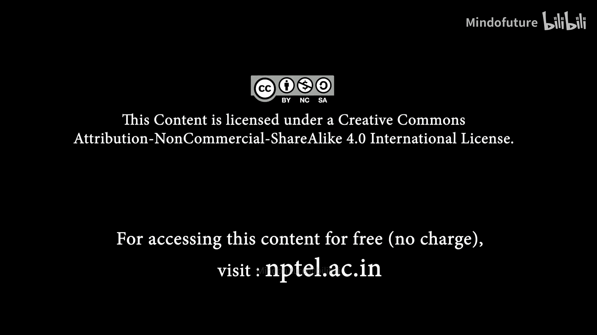
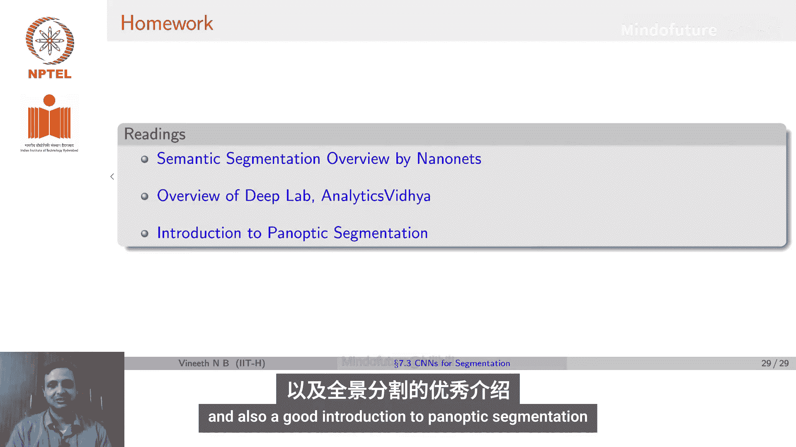

# 047：用于分割的CNN 🖼️

在本节课中，我们将学习如何使用卷积神经网络进行图像分割。我们将从回顾检测任务开始，然后深入探讨用于语义分割、实例分割和全景分割的各种CNN架构。课程将涵盖FCN、SegNet、U-Net、PSPNet、DeepLab和Mask R-CNN等核心模型，并解释它们的设计原理、关键技术和应用场景。

## 回顾与引言

上一节我们介绍了目标检测。现在，我们将继续学习使用CNN架构进行图像分割。

首先快速回顾上一讲的练习。给定图像中的两个边界框：一个左上角框，大小为2x2；一个右下角框，大小为2x3；重叠区域为1x1。那么交并比是多少？这应该很简单。

你有一个左上角2x2的框，一个右下角2x3的框。重叠区域是一个1x1的框。这里总共有9个框，其中交集是1个框。因此，总的IOU是1/9。

第二个问题：考虑在19x19的网格上使用YOLO，有20个类别和5个锚框，输出体积是多少？记住，我们说过它是 `S x S x (5 * (B + C))`，其中B是边界框信息（通常是4个坐标），C是类别数。这就是你得到的最终答案。这里我们假设类别数C也包括背景。如果你想将背景作为一个单独的类别，那么C需要是21。

## 图像分割基础

首先，让我们回顾一下图像分割。在课程早期，我们讨论过不同的图像分割方法，如分水岭、图割、归一化割、均值漂移等。在某种程度上，这些方法启发了用于检测和分割任务的早期CNN架构。事实上，R-CNN使用选择性搜索来获取区域提议，就使用了一种称为约束参数最小割的分割方法来生成区域提议。

但现在，我们将转向用于分割的深度神经网络。因此，我们首先要处理的任务是**语义分割**，我们希望为图像中的每个像素分配一个类别标签。

如何用神经网络，特别是卷积神经网络来解决这个问题？我们将把它视为一个**像素级分类问题**。

到目前为止，我们讨论的是图像级分类，即我们只在图像级别有一个标签。然后我们学习了检测，在边界框级别有标签，我们不仅给出类别标签，还给出边界框的偏移量来进行最终预测。但在语义分割中，我们将在每个像素的级别进行分类。因此，对于每张图像，每个像素都必须用一个语义类别进行标记。可以想象，为语义分割创建数据集需要非常密集的标注工作。

近年来出现了各种架构，如FCN、SegNet、U-Net、PSPNet、DeepLab等，我们将在本讲座中逐一介绍。

## 全卷积网络

我们从用于语义分割的**全卷积网络**开始，它于2015-16年提出。它们将各种分类网络（如VGGNet、GoogleNet等）改编为全卷积网络。

通过将全连接层转换为1x1卷积层，我们在单次检测方法中看到了相同的思路。这里也是如此，因为对于语义分割，你仍然需要在像素级别进行分类，所以你不想脱离卷积机制。

为了获得每个像素的分类，我们可以在任何CNN的末端添加一个1x1卷积层，并在最终的输出体积中拥有C+1个通道，其中C是类别数，加1是用于背景类。

但这种方法有什么问题吗？使用卷积层时存在一个问题：所有标准的CNN随着层数加深都会进行下采样，无论是通过卷积还是池化。这意味着你的输出特征图尺寸不会与输入相同。但我们最终希望以输入图像的分辨率给出像素级标签。

那么我们该怎么做？我们已经知道答案：我们可以在某个阶段后进行**上采样**。

那么如何上采样呢？我们之前讨论过的方法之一是**转置卷积**。

让我们快速回顾一下转置卷积。这是我们讨论卷积神经网络时谈到的一维例子，其中输出可以大于输入。这是我们为转置卷积提供的图示，当你在输入图像上应用滤波器时，卷积中存在膨胀。因为有膨胀，转置卷积也被称为**膨胀卷积**，有时也被称为**空洞卷积**，我们稍后会看到。因为在进行卷积时它会膨胀。

现在，在FCN中，这就是在某个层级之后用于上采样的思路。

让我们看一个带有VGG骨干网络的FCN架构。如果你有一个VGG16骨干网络，FCN中做的第一件事是移除所有全连接层，所以你现在只有VGG16的卷积层。你可以看到所有标准的VGG16特征图。三个FC层被替换为1x1卷积层，最后一个1x1卷积层有C+1个滤波器。你可以看到这里最后一个有21维滤波器，这是应用于一个有20个类别的数据集，所以是21维。

然而，你注意到这里：虽然有21个通道，但输出尺寸仍然比输入分辨率小。因此，最后你有一个上采样层，使用转置卷积来恢复到原始尺寸。这就是在全卷积网络中所做的。

但是，转置卷积是获得上采样的唯一方法吗？不一定。我们可以做几件事，包括我们稍后会看到的跳跃连接。但在那之前，我们将讨论另一个与FCN大约同时期出现的方法，称为**SegNet**。

## SegNet 架构

SegNet就是你在图像中看到的：有一个输入图像，一个输出。该架构是一个全卷积的编码器-解码器架构。

这与FCN有何不同？与FCN非常相似，编码器是没有FC层的VGG16。解码器将低分辨率的编码器特征图映射到输入分辨率。这里与FCN有一个区别：FCN只在最后有一个上采样层，而SegNet有一系列解码器层，它们镜像了编码器的架构。因此，编码器和解码器架构是彼此镜像的。

SegNet的一个重要贡献是避免在上采样中使用转置卷积。那么，SegNet在这种情况下如何进行上采样呢？它实际上使用在编码器层中获得的**池化索引**来进行上采样。

让我们看看这是如何完成的。如果你有一个来自特定解码器阶段的输出图，我们使用原始编码器的最大池化索引。假设最大池化索引是00、10、10、01，那么A会去到00位置（左上角），B会去到10位置（左下角），C会去到10位置（左下角），D会去到01位置（右上角）。现在，这成为解码器中前一层输出图的上采样版本。可以继续这样做以获得最终的上采样图像。

编码器中的最大池化索引是什么意思？每当你有池化层时，无论是2x2还是3x3的池化，你都会跟踪该补丁中哪些条目的索引是最大的，并将这些获胜索引存储在一个单独的内存缓冲区中。我们将使用这些最大池化索引上采样回更高的分辨率。

为什么这很好？存储最大池化索引比存储编码器的完整特征图更高效。在解码器的每个阶段，使用相应编码器的最大池化索引来生成上采样的特征图。如果你看完整的图像，这个编码器特征图的池化索引会进入这个解码器，这个编码器的特征图会进入这个解码器，依此类推。

## 损失函数

现在我们已经看到了几种架构，FCN和SegNet。训练这样的网络应该使用什么损失函数？

很简单，就是**像素级交叉熵损失的总和**。记住，在FCN和SegNet中，你的输出将是一个体积，其尺寸与输入分辨率相同，但通道数将是类别数加一（背景）。因此，实际上你可以为每个像素在输出体积中有一个概率向量。现在，你可以计算每个像素的像素级交叉熵，将它们全部加起来，这就成为你的损失函数。因为它是交叉熵的总和，所以仍然是可微的。

## U-Net 架构

第三种架构，也出现在2015-16年，被称为**U-Net**。U-Net也是一个全卷积的编码器-解码器架构，但它以一种不同于SegNet的方式引入了跳跃连接的概念。

在收缩路径（编码器路径）中，是一个移除了全连接层的现有分类网络，类似于SegNet和FCN。但在扩展路径中，除了特征图的上采样外，网络还接收收缩路径的相应特征图，以及进一步的卷积层。最后，在末端，有一个1x1卷积层，具有C+1个通道，其中C是类别数。

U-Net中的上采样是使用步长为2、填充为0的转置卷积来执行的。在每个上采样步骤中，特征通道数减半，这意味着总的输入尺寸将加倍。现在，通过2x2的转置卷积和通道数减半，此时输入图的尺寸将加倍。

所以原始的U-Net架构执行的是无填充卷积，这意味着输出分割图比输入小一个恒定的边框宽度。

让我们看一下图示，这就是U-Net。它的形状告诉你为什么它被称为U-Net架构。你可以再次看到收缩路径类似于任何其他没有FC层的架构。在扩展路径中，除了在每个步骤进行转置卷积外，你还接收收缩路径的相应特征图，这些特征图被添加到你的扩展路径中。这样，除了上采样之外，你还能从编码器的相应层获得定位信息。因此，你从编码器的相应层获得额外信息，而不是像SegNet或FCN那样仅仅依赖上采样。

U-Net最初是为生物医学图像分割提出的。事实上，它发表在一个医学会议MICCAI上。你认为这会如何影响U-Net模型的学习？

生物医学图像分割有一些独特的挑战。首先，通常你没有像一百万甚至几万那样数量级的训练数据集。可能只有很少的训练图像可用。因此，这项特定工作通过对可用的训练图像应用**弹性形变**来进行**过度的数据增强**，这是其贡献之一。医学领域的另一个挑战是，同一类别的许多物体可能彼此接触。因为可能有彼此相似的物体相邻放置。因此，U-Net还提出了一种损失函数，对靠近边缘的像素的惩罚比对远离边缘的像素的惩罚更重。边缘对于医学图像分割至关重要。

多年来，出现了U-Net的几种变体，主要是通过用密集块替换卷积块、增加U-Net的深度等来改变架构。

## PSPNet 架构

另一个用于分割的网络被称为**PSPNet**。PSPNet首先提出了一个问题：如果在复杂场景上应用FCN，可能会面临哪些挑战？

如果你深入思考，你会注意到FCN没有学习到上下文模式。例如，我们知道汽车在路上，而船在河流附近。FCN也可能将物体的部分预测为不同的类别。例如，它可能看着一座摩天大楼，认为像素属于不同的建筑物，因为该物体的规模巨大。第三，根据架构和所使用的感受野，FCN可能无法检测到大物体或小物体。

那么我们如何解决这些限制呢？PSPNet假设应该使用**全局上下文信息**来提高分割性能。

那么如何获取全局上下文信息呢？在多个尺度上进行分割。当你在较低分辨率下分割时，你实际上是在尝试将更多的全局信息带入分割结果中。

因此，PSPNet引入了**金字塔池化模块**。给定一张图像，通过CNN进行前向传播。然后有一个池化层，在多个尺度上进行池化。有哪些不同的尺度？有一个粗糙的尺度，就是简单的全局平均池化，所以这将是1x1xC，其中C是通道数。每个连续的池化级别提供增加的信息定位信息。因此，你的池化输出将是1x1xC（全局平均池化）、2x2xC、3x3xC和6x6xC，这是PSP采用的四个尺度。记住，当你进行池化时，通常通道数不会减少，你是按通道操作的。

一旦完成了这四个尺度的池化，PSPNet现在对每个来自池化操作的映射应用一个1x1卷积，以减少输出中的通道数。每个1x1卷积将通道大小减少了多少？减少了四分之一。这样做是有原因的。原因是，一旦执行了这些1x1卷积，所有这些映射都会被上采样并连接起来。因此，每个池化后的映射使用简单的双线性插值进行上采样，然后它们被连接起来，这个连接后的体积将具有与原始特征图相同数量的通道。完成后，将其送入卷积层以获得最终的分割预测。

## DeepLab 架构

另一种方法是**DeepLab**，这是一种流行的语义分割方法，与PSPNet类似。在这种情况下，图像经过几个卷积块，然后，不是有一个将图像分成四个不同尺度的池化层，而是执行**空洞空间金字塔池化**，因此这个模块被称为ASPP模块。记住，空洞卷积与膨胀卷积或转置卷积相同，有时甚至被称为分数步长卷积，所以当你的步长小于1时，你会得到与在多个尺度上进行池化相同的效果。因此，可以说空间金字塔池化是实现PSPNet中金字塔池化模块的不同方式。

因此，一旦你进行了空洞空间金字塔池化，你再次上采样、连接，并最终在连接后的体积上得到结果。

DeepLab多年来经历了一些不同的版本，其中一个较新的版本称为DeepLab V3。它在基本的DeepLab架构中添加了一些模块。在这个DeepLab V3模块中，图像级特征也被传递到ASPP模块。使用了批归一化以方便训练，还有一个完整的解码器架构用于细化分割结果。你可以看到这里有ASPP模块，使用它执行1x1卷积、3x3卷积等，你得到一组特征图，这些图被连接起来。进行1x1卷积以减少这些通道的深度，然后上采样4倍，并与ASPP模块的输出一起传递给解码器。然后将这些连接起来，最后再进行一次卷积，然后上采样并在最后进行预测。记住，当我们说预测时，它将再次是一个输出体积，其分辨率与输入图像相同，通道数将是C+1，其中C是类别数，加1是背景。

## 实例分割

从语义分割继续，**实例分割**是一个比语义分割更具挑战性的任务。在语义实例分割，或通常所说的实例分割中，我们的目标不仅是为每个像素提供一个类别标签，还要为每个对象分配一个对象ID。

因此，如果有多个行人、多把椅子或多只狗，你还需要区分这些行人、狗的实例，而基本的语义分割任务没有考虑这一点。在语义分割中，狗就是狗像素，无论有两只狗、三只狗还是四只狗，它们都只会被分类为狗。但在实例分割中，我们想要狗1、狗2、狗3和狗4。这里的挑战是你可能不知道狗的数量，这与检测问题类似。这就是为什么最流行的实例分割方法之一，称为**Mask R-CNN**，实际上试图改进Faster R-CNN来实现实例分割。

因此，Mask R-CNN于2017年在ICCV上提出，它使用类似Faster R-CNN的架构，但增加了一个分支来掩码化并获得实例级分割。所以你可以把Mask R-CNN看作是在感兴趣区域上带有FCN的Faster R-CNN。它添加了一个并行的头部，除了你的RPN对象分类器（或简单的分类模块）和边界框偏移回归器之外，你现在添加了第三个头部——掩码预测器。

Mask R-CNN中能够准确实现掩码的一个重要贡献是一个称为**RoI Align**的模块。由于Mask R-CNN在Faster R-CNN的框架内运行，这个模块解决的主要限制是：当你将对象提议映射到特征空间时，回想一下在Fast R-CNN和Faster R-CNN中，你有一些对象提议，并将它们映射到某个特征空间。而特征空间的分辨率可能与你获得对象提议的分辨率不同。在Fast R-CNN和Faster R-CNN中，我们只是将其变形到所需的大小，然后将你的对象提议带到那个维度。然而，当你这样做时，你可能会遇到由于量化而导致的误差。

为什么这很重要？这很重要，因为特征空间中的一个像素可能相当于图像上的许多像素，因为与初始输入相比，后面卷积层的特征空间更小。当你试图获得一个掩码时，这几个像素可能会在最终性能中带来显著的误差。

那么我们如何克服这个问题呢？RoI Align执行**双线性插值**，以获取对象提议与给定特征图匹配的确切坐标。这保留了掩码的**平移等变性**。我们是什么意思？我们的意思是，给定一张图像，其中一个物体可能位于这个黄色框或红色框中，两者都可能是有效的检测，但每个边界框中的掩码位置是不同的。因此，通过平移等变性，我们的意思是，如果物体在边界框内移动了一定的量，掩码也必须移动相同的量。这可以通过RoI Align层来实现。

因此，RoI Align的做法是：当你将对象提议转换为特征图上的位置时，如果该位置落在特征图上的几个像素之间，那么你对特征图周围的像素执行双线性插值。然后你在对象提议指向的特定点获得特定的像素值，这就是然后被池化以获得固定维度表示的内容，该表示将进入Faster R-CNN架构的后续层。

因此，除了具有分类损失和边界框损失的标准Faster R-CNN架构外，我们还有带有Mask R-CNN的掩码头。Mask R-CNN所做的是使用一个类似FCN的分支，这意味着它是全卷积的。对于每个RoI，掩码大小为28x28，正如你在这里看到的。在推理过程中，它最终被缩放到边界框大小，然后叠加在图像上。因此，正如你在这里看到的，这个掩码是为每个RoI获得的，然后在推理时最终叠加回输入图像上。

## 全景分割

最后一种更近期的流行分割形式被称为**全景分割**。全景分割结合了语义分割和实例分割。因此，正如你所看到的，语义分割是你分割所有对象的像素，但所有实例保持不变。实例分割是你只关心你类别中对象的实例，但你分别标记每个实例。而全景分割是两者的结合，你标记每个像素属于不同的对象，并且你还确保每个对象的实例获得完全不同的标签。

那么，如何进行全景分割呢？这项工作于2019年在CVPR上首次提出，大约一年前。人们可以使用几种架构来实现全景分割。你可以使用Mask R-CNN来获得实例分割结果，可以使用膨胀FCN来获得语义分割结果，然后将两者合并以获得全景分割，这是一种方法。因此，这项特定工作实际上实现了几种方法，然后研究了如何以不同的方式对其进行评估。

另一种方法是，你可以使用特征金字塔网络，而不是我们在这里看到的膨胀FCN或Mask R-CNN，你可以使用FPN，然后将这些检测结果通过Mask R-CNN头部以获得实例级分割，你也可以将这些不同的特征图通过像素级识别头部进行语义分割。因此，在这两种方法中，都有一个实例分割路径和一个语义分割路径，它们结合起来给出你的全景分割。

这里的损失函数是什么？推荐的损失函数是语义分割和实例分割损失函数的组合。记住，实例分割，正如我们在Mask R-CNN中看到的，有三个损失：分类损失、边界框损失和掩码损失。而对于语义分割，你有标准的像素级交叉熵损失。

全景分割的挑战之一是，它不能使用用于语义分割或实例分割的指标进行评估。为什么会这样？在语义分割中，我们使用IoU和每像素精度。因此，你可以尝试看看，如果你画出了一组属于特定对象的像素，你可以尝试获得该对象与真实标注的交并比。你也可以获得每像素精度，因为你将在每个像素级别为你拥有的所有类别预测概率，你也可以将该精度作为一个指标。

另一方面，对于实例分割，它类似于检测，你会有不同IoU阈值下的平均精度。

为什么我们不能将这些用于全景分割？因为这可能导致对有或没有实例级标注的类别产生不对称性。记住，在全景分割中，你可能有一些类别有多个实例，例如行人或狗。也可能有一些类别，如天空、道路，可能没有很多实例。因此，在不考虑这些不对称性的情况下合并这些指标可能不明智。

因此，这项特定工作推荐了一个称为**PQ指标**的新指标。PQ指标如何工作？你可以看这里的例子，让我们假设这是你正确的真实标注。所以有天空，有草地，有三个人（这是其实例分割部分），然后有一只狗。

现在让我们假设，无论我们提出什么模型，都这样预测它。天空，它预测对了。草地，它预测对了。狗被预测成了人。并且不是三个人，它只预测了两个人，它把其中两个人合并了。

那么你现在如何衡量这种系统的误差呢？因此，这种方法推荐的方式是：你首先写出所有的真正例，这将是你的真实标注和预测之间的两个真正例的人。有一个假阴性，即你错过的那个人。还有一个假阳性，即你添加的而不是狗的那个人。

因此，对于一个真实标注段G和一个预测段P，PQ指标计算为：对所有属于真正例的PGs的IoU求和，除以真正例的数量加上二分之一假阳性的数量加上二分之一假阴性的数量。

如果你分析这个，它可以写成：分子保持不变，让我们乘以并除以真正例的数量。那么你会得到第一项是这样，第二项是真正例的数量除以真正例的数量加上二分之一假阳性加上二分之一假阴性。

因此，这里的第一项给出了**分割质量**：在所有真正例中，你的所有分割的IoU是多少。第二部分给出了**识别质量**：在所有可能的分割中，我们有多少得到了真正例。因此，你有一部分检查分割质量，有一部分检查识别质量，这就是为什么这个指标对全景分割有用。

## 总结

在本节课中，我们一起学习了用于图像分割的各种卷积神经网络架构。我们从基础的语义分割任务开始，介绍了全卷积网络、SegNet和U-Net等编码器-解码器结构，它们通过上采样和跳跃连接来恢复空间分辨率并融合多尺度信息。接着，我们探讨了PSPNet和DeepLab，它们通过金字塔池化或空洞卷积来捕获全局上下文，以提升复杂场景下的分割性能。然后，我们深入到更精细的实例分割任务，了解了Mask R-CNN如何扩展Faster R-CNN，并引入RoI Align来精确预测每个实例的掩码。最后，我们介绍了全景分割这一前沿任务，它旨在统一语义分割和实例分割，并讨论了其特有的评估指标PQ。

这些架构的发展体现了深度学习在像素级理解图像方面的不断进步，从粗略的类别划分到精确的实例区分，再到全面的场景解析。掌握这些模型是进入计算机视觉高级应用领域的重要一步。