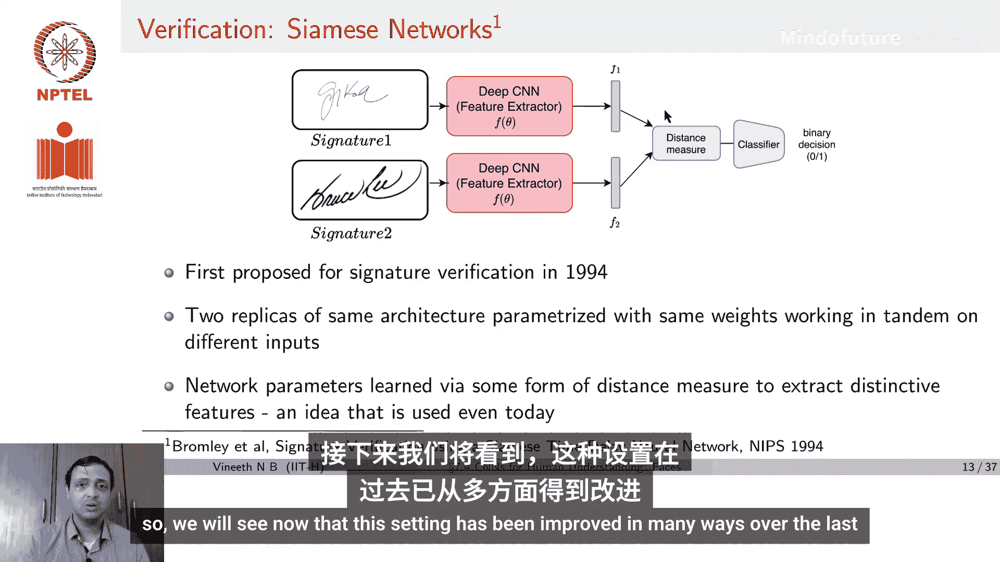

# 048：用于人类理解的CNN - 面部识别 - 第一部分

在本节课中，我们将要学习卷积神经网络在计算机视觉中的一个重要应用领域：面部识别。我们将探讨面部识别的基本概念、发展历程、标准处理流程以及两种核心任务：身份验证与身份识别。

---

## 发展历程与重要性

面部识别作为生物识别技术的一部分，在安全、金融、医疗保健等多个社会领域有着重要应用，其研究已持续数十年。无约束条件下的面部识别（即在自然场景中识别人脸）是一个极具挑战性的问题，因为它需要处理光照、遮挡、姿态、表情等多种变化。

从算法发展来看，面部识别的研究始于20世纪60年代。随后在70年代、90年代（以特征脸算法为代表）以及21世纪初，出现了基于局部特征分析、弹性束图匹配、局部二值模式等手工设计特征的方法。自2014年起，基于深度神经网络的方法成为主流，这也是本节课的重点。

从硬件发展来看，摄像头技术从1915年的相机发展到90年代的数码相机，再到后来的监控摄像头、智能手机、Kinect等设备，为面部识别的广泛应用奠定了基础。

---

## 标准面部识别流程

一个标准的、采用深度学习的面部识别流程如下图所示。流程始于输入图像，首先需要进行**面部检测**以从图像中定位并裁剪出人脸区域。

检测完成后，在将裁剪后的人脸送入识别系统前，通常需要进行一些**预处理**步骤。第一步是**面部对齐**，即将人脸对齐到预定义的几何标准。第二步是**活体检测**（可选），用于判断输入是真实人脸还是伪造的图片（如照片）。如果检测为伪造，流程终止；否则，进入下一阶段。

下一阶段是**面部处理**，主要分为“一对多”增强和“多对一”归一化两种方式，具体取决于应用需求。我们稍后会详细讨论。

经过上述处理步骤得到训练数据后，将其输入**卷积神经网络**进行特征提取。最后，使用欧几里得距离、角距离等不同的损失函数来训练CNN。

在测试时，测试图像会经过类似的预处理流程。处理完成后提取其特征，并通过与阈值比较、最近邻匹配、度量学习或稀疏表示等方法，将最终的人脸嵌入向量进行匹配，以完成识别。

---

## 核心处理步骤详解

上一节我们介绍了标准流程，本节中我们来看看其中的关键处理步骤。

### 面部处理：增强与归一化

面部处理旨在提升后续识别的鲁棒性和准确性，主要有两种策略：

**1. 一对多增强**
这是标准的数据增强技术。通过对单张人脸图像进行各种变换（如旋转以模拟不同姿态），生成多个训练样本。这有助于使面部识别系统对姿态变化等更具鲁棒性。

**2. 多对一归一化**
此方法旨在将同一个人在不同条件下（如不同光照、姿态、时间点或视频帧）捕获的多张图像，归一化到一个标准的、通常是正面的规范视图。这种方法有助于在保留身份信息的同时，消除光照、表情和背景变化的影响。该领域也有大量研究利用3D模型进行面部归一化。

---

## 网络架构演进

在深度学习的时代，用于面部识别的网络架构也随着CNN主流架构的发展而演进。

以下是近年来一些代表性工作及其使用的骨干网络：
*   **2014年 DeepFace**: 使用了 **AlexNet**。
*   **2015年 FaceNet**: 使用了 **GoogleNet**。
*   **2015年 VGG Face**: 使用了 **VGGNet**。
*   **2017年 SphereFace**: 使用了 **ResNet**。
*   **2017年 VGG Face 2**: 使用了 **SENet**。

总体而言，面部识别架构的骨干网络主要采用了同期在通用视觉任务上表现优异的网络，如AlexNet、VGG、ResNet等，研究人员有时会对其进行微调以适应特定任务。

---

## 核心任务：验证与识别

从应用角度看，整个面部识别领域可大致分为两种核心任务：**验证**和**识别**。在这两种情况下，通常只有架构的最后阶段有所不同。流程都是：输入图像 -> 检测与对齐 -> 深度CNN特征提取 -> 验证或识别系统。

### 面部识别

面部识别的任务是为给定的输入图像，从数据库中的多个身份里分配一个对应的人名或身份ID。这是一个**一对多匹配**问题。

这非常类似于我们之前讨论的图像分类任务（如ImageNet）。给定一张图像，将其与数据库中的多个类别（身份）进行匹配，找出最匹配的类别。这通常被表述为一个 **K+1 多类分类问题**（额外的“+1”类用于处理数据库中不存在的人脸）。

**损失函数**：在此场景下，通常使用标准的 **Softmax** 激活函数和**交叉熵损失**。

设 `x` 为倒数第二层的特征表示，`W` 为最后一层线性层的权重，则未经过Softmax的最终输出（即逻辑值 `logits`）为 `W^T * x`。随后应用Softmax函数得到概率分布，并计算交叉熵损失。

该损失函数的目标是增大**类间方差**，即将不同身份的特征在嵌入空间里分离开。

### 面部验证

面部验证的任务是确认两张图像是否属于同一个身份。这是一个**一对一匹配**问题。

例如，在出入境检查时，官员需要核实护照上的照片与持证人当前的面部是否匹配。系统不需要将当前图像与整个数据库比对，只需验证其与声称的身份是否一致。

因此，这是一个**二分类问题**，输出为“匹配”或“不匹配”。

**流程**：输入图像通过CNN得到特征表示，同时从数据库中提取声称身份对应的特征表示。然后，使用一个**相似性度量**（如距离计算）来比较这两个特征，最终通过一个阈值或分类器做出二元决策。

---

## 验证与识别的关系

一个有趣的观点是，可以将**识别任务转化为一系列验证任务**。

具体做法是：对于测试图像，提取其特征表示，然后将其与数据库中的**每一个**身份进行逐一验证（匹配/不匹配判断）。

**这样做的好处**是，当数据库中加入新身份时，**无需重新训练整个CNN模型**。因为模型只需要学习如何提取好的特征表示，而新身份的匹配可以通过外部的相似性度量来完成，这使得系统更具可扩展性。

**潜在的缺点**是，识别需要进行多次验证，如果验证系统本身存在误差，这些误差可能会在多次比较中被放大。因此，构建一个高精度、高效率的验证系统至关重要，这样才能有效地将其用于识别任务。

---

## 早期验证架构：孪生网络

最早的验证架构之一是1994年提出的**孪生网络**，最初用于签名验证任务。

其架构如其名（源于“连体双胞胎”），包含两个结构相同、权重共享的CNN分支。一个分支处理当前输入的签名（或人脸），另一个分支处理数据库中存档的签名（或人脸），分别得到特征表示 `F1` 和 `F2`。

然后，通过一个**距离度量**（如欧氏距离）来计算这两个特征的相似度，最后送入一个二分类器判断是否匹配。

这种方法的一个重要启示是：**网络学习到的特征表示必须与后续用于比较的距离度量方式相兼容**。这个思想在后续的研究中得到了诸多改进和发展。

---

本节课中我们一起学习了面部识别的基本概念、标准流程、关键预处理技术、网络架构的演进，并深入探讨了验证与识别这两大核心任务及其相互关系。我们还了解了将识别转化为验证任务的思路，以及孪生网络这一早期验证架构的基本原理。在接下来的课程中，我们将继续探讨更先进的损失函数和训练方法。