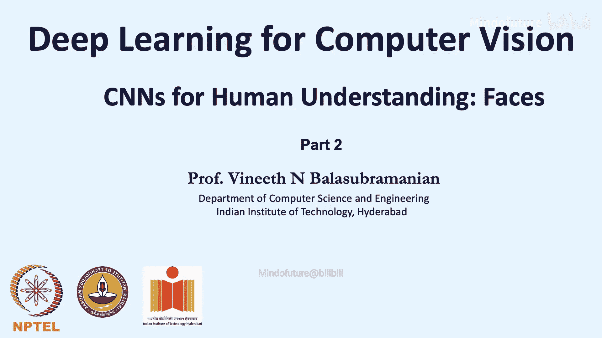
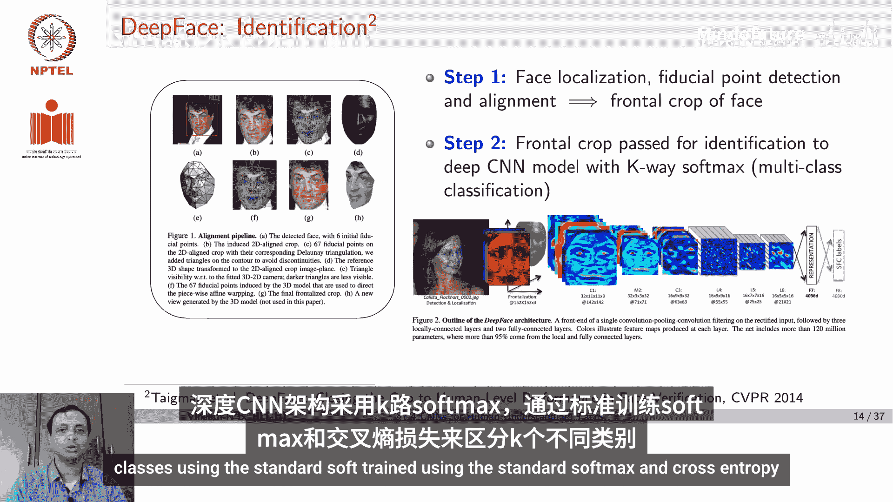
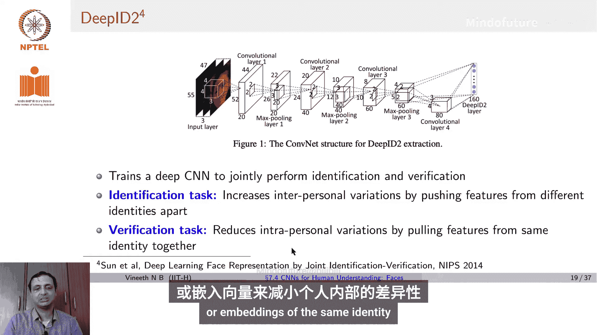
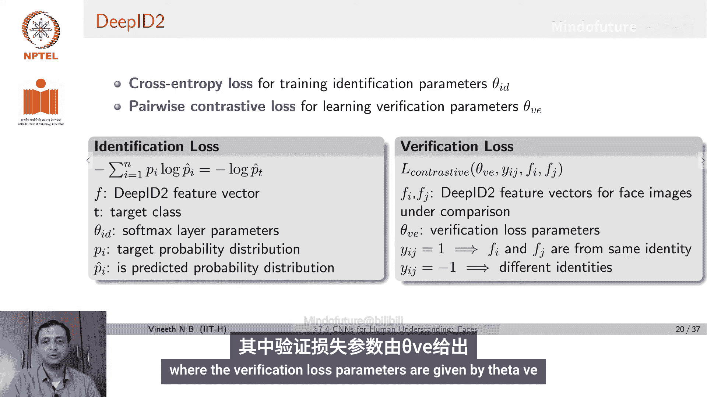
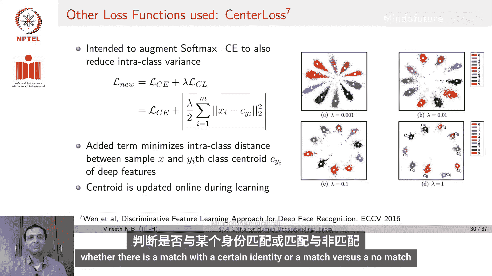
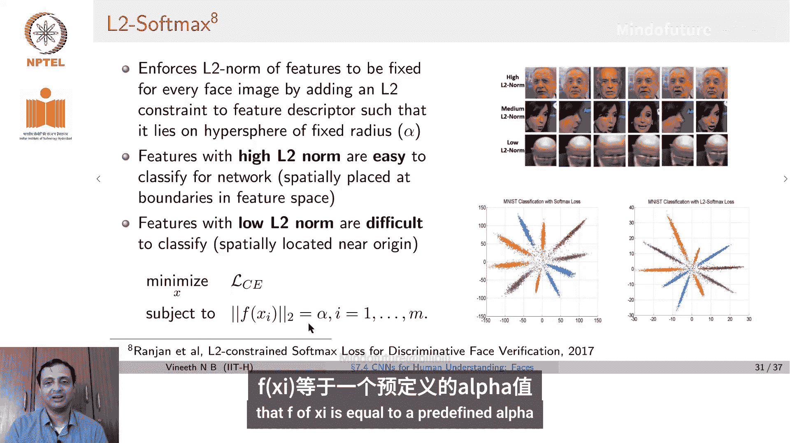
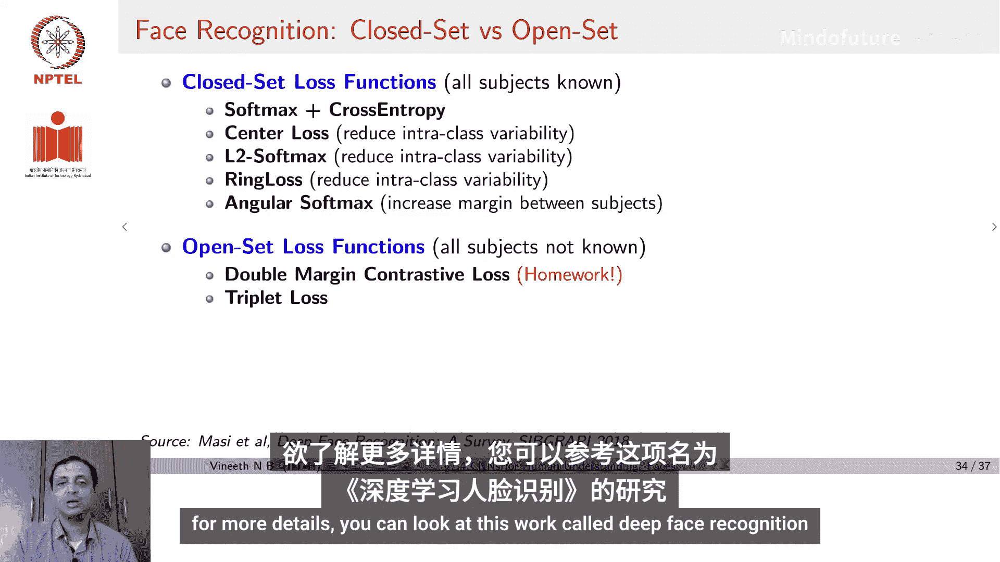
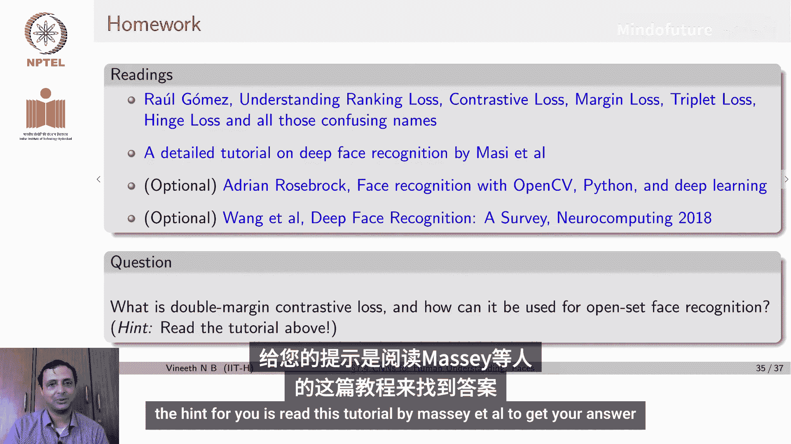

# 049：用于人类理解的CNN - 面部识别（第二部分）👤



## 概述
在本节课中，我们将学习卷积神经网络在人脸识别与验证任务中的近期应用。我们将从DeepFace模型开始，逐步探讨对比损失、三元组损失等核心概念，并了解如何通过改进损失函数来提升模型性能，最终区分闭集与开集人脸识别场景。

---

## 近期基于CNN的人脸识别与验证工作



上一节我们介绍了CNN在人脸理解中的基础应用。本节中，我们来看看自AlexNet成功以来，一些利用CNN进行人脸识别与验证的早期重要工作。

其中一项开创性工作是**DeepFace**，发表于2014年的CVPR会议。该工作首先执行了一个预处理步骤，包括人脸定位、关键点检测和对齐，以获得人脸的正面裁剪图。


左侧图像展示了获得正面裁剪图的步骤：
1.  给定输入图像，第一步是检测人脸并从图像中裁剪出人脸区域。
2.  然后在2D裁剪图上检测约67个面部关键点（如鼻尖、眼角、嘴角等），并进行三角剖分。
3.  接着，将这些关键点投影到一个3D模型上，该模型对应这张特定的人脸图像。
4.  然后对这个3D模型进行归一化，生成一个带有对应关键点的2D人脸图像，即正面裁剪图。
5.  最后，由于我们现在有了同一个人脸的3D模型，我们还可以生成该人物的其他姿态图像。

因此，我们在步骤1中讨论的正面裁剪图就是图像G，与图像B相比，可以看到它被很好地归一化了。

这个正面裁剪图被送入一个深度CNN模型。该模型使用标准的Softmax层和交叉熵损失，通过一个K路Softmax来区分K个不同的类别。

## 验证任务与孪生网络

对于验证部分，DeepFace采用了一种类似**孪生网络**的方法。从识别任务中学到的表示被冻结用于验证，即这些架构参数被固定。

给定一张人脸图像I1和其声称身份对应的记录图像I2，我们得到两个表示F1和F2，即G(I1)和G(I2)。网络的其余部分通过取F1和F2的绝对差值，后接一个全连接层，最后使用Sigmoid激活函数进行二元决策来训练。

因此，在这种特定场景中诱导的距离是 **|F1 - F2| * α**，其中α是在该特定层中学到的权重。最终输出是匹配或不匹配（相同或不同）。

DeepFace提出的这种方法，源于90年代的孪生网络思想，此后在多个方面得到了扩展。其中一个主要思想是使用所谓的**对比损失**。

## 对比损失与度量学习

对比损失是一种基于机器学习中度量学习范式来训练神经网络的损失函数。机器学习中的度量学习方法试图学习一个距离度量，而不是使用欧几里得距离度量或余弦距离度量。

同样的思想现在被用来为特定任务学习具有区分性的特征表示。在人脸验证场景中，我们的目标是将输入映射到一个**嵌入空间**，其中点之间的距离对应于语义相似性。

欧几里得距离可以做到这一点，但如果我们能学习一个更有效地实现此目标的距离，那将更有用，这也是大多数方法试图做到的。已有多种公式化方法，如成对对比损失、排序损失、三元组损失等。我们将在本讲座的剩余部分看到其中一些。

成对对比损失源于Hadsell等人2006年的工作，其中引入了一种学习对复杂变换不变的映射的方法。正如我们刚才所说，其思想是让相似的点在嵌入流形上彼此靠近。因此，从CNN输出得到的这种表示也称为**嵌入**。

如果我们现在假设这些是低维嵌入（通常这些嵌入的维度低于图像本身，图像可能是200x200，而嵌入可能只是一个1000维或4000维的向量），我们理想地希望这些位于（例如）1000维或4000维流形上的嵌入，对于相似实体彼此接近，对于不相似实体彼此远离。



我们的目标是学习神经网络权重W，使得给定输入x1和x2时，距离 **Dw = Gw(x1) - Gw(x2)** 能够近似输入之间的语义相似性。让我们看看这是如何实现的。



以下是该算法的总体思想：
1.  给定一个训练数据集，首先识别彼此相似的样本，并将它们放入一个集合中，例如给定输入Xi，我们识别与Xi相似的样本Xj。在人脸验证上下文中，这可能是同一个人的其他照片。我们设定如果这些点相似，则Yij = 0。
2.  同样地，识别不相似的点，这可能是两个不同人的图像，此时设定标签Yij = 1。
3.  训练时，对于训练集中的每一对(Xi, Xj)：如果Yij = 0（相似图像），则更新W以减小距离Dw；如果Yij = 1（不相似图像），则更新W以增大距离Dw。

现在，让我们看看如何使用单个损失函数来实现这一点。

给定x1和x2为一对高维输入向量。令y为一个二元标签，如果x1和x2相似则为0，否则为1。那么，成对对比损失 **L_contrastive** 定义如下：

```
L_contrastive = (1 - y)/2 * Dw² + y/2 * max(0, m - Dw)²
```

第一项仅在y=0时激活，第二项仅在y=1时激活。
*   当y=0（图像相似）时，我们最小化Dw²，这正是我们想要的。
*   当y=1（输入图像不相似）时，我们最小化max(0, m - Dw)²。这里m是用户定义的边界，我们希望不相似的图像至少被此边界值隔开。
    *   如果Dw² > m，则第二项max(0, m - Dw)²变为0，意味着无需操作，因为不相似图像之间的距离已经大于边界m。
    *   如果Dw² < m，则我们最小化(m - Dw)²，这等价于最大化Dw²，即增大这些不相似图像之间的距离。

## DeepID2：联合识别与验证

这个思想被用于后续的网络**DeepID2**，该网络于2014年提出。与DeepFace类似，DeepID2训练一个深度CNN来联合执行识别和验证任务。可以认为，识别任务增加了**人际差异**（试图将不同身份的图像或嵌入分开），而验证任务通过拉近同一身份的特征或嵌入来减少**个人内部差异**。


这是如何实现的？在DeepID2中，交叉熵损失用于识别参数，成对对比损失用于学习验证参数。因此，我们有对应识别模块权重的θ_ID，和对应验证模块权重的θ_verification。

识别损失由交叉熵给出，其中θ_ID是Softmax层的参数（用于识别的最后一层参数）。类似地，验证损失由成对对比损失给出，其中验证损失参数由θ_verification表示。


但DeepID2使用了一种略有不同的方式来学习整个流程。让我们看看这个算法：
1.  从训练数据中采样两个训练样本Xi和Xj。
2.  令F和Fj分别为Xi和Xj经过参数为θ_C的主干CNN（基础CNN）卷积层后的输出。
3.  识别参数的梯度由两部分组成：对F的识别损失（交叉熵损失）关于θ_ID的梯度，加上对Fj的识别损失关于θ_ID的梯度。
4.  验证参数的梯度由系数λ（用于加权）乘以验证损失关于θ_verification的梯度给出，其中验证损失由成对对比损失定义（在此特定情况下，如果身份相同则Yij设为1，如果身份不同则Yij设为-1）。
5.  类似地，F和Fj的梯度（即关于嵌入F和Fj的梯度，它们是CNN的输出）由对F的识别梯度加上对F的验证梯度给出，对Fj同理。
6.  整个CNN参数的最终梯度由以下公式给出：`dF_i * d(CNN(Xi))/dθ_c + dF_j * d(CNN(Xj))/dθ_c`。这确保了CNN的权重更新首先使用Xi和Xj输出的梯度进行更新，然后相同的权重被共享给应用于Xi和Xj的两个CNN架构。

总结来说，θ_ID和θ_verification通过各自的目标分别更新，而θ_C（在分支到验证和识别之前的主干CNN的权重）则通过识别和验证目标的加权贡献进行训练。这使得主干网络能够同时学习良好的人际特征和个人内部特征。

## FaceNet：直接学习嵌入表示

随后出现了**FaceNet**，于2015年的CVPR会议上提出。它的前提是，现有的人脸识别架构（包括DeepFace和DeepID2）通常学习整个神经网络，然后使用其中一个倒数第二层（称为瓶颈层）的嵌入来进行最终的匹配决策。

这种方法存在问题吗？FaceNet声称存在，即存在**间接性**。因为我们不知道来自中间层、倒数第二层或瓶颈层的那些嵌入在后续任务中能用于什么。并且，因为它没有针对后续任务（那些嵌入被用于的任务）进行明确训练，所以可能效率低下。

因此，FaceNet试图确保其目标是输出一个良好的表示，而不再有基于学习到的表示进行单独考虑的分类目标。事实上，FaceNet使用一种称为**三元组损失函数**的新损失函数来学习一个128维的嵌入，该损失函数如今在深度学习的多个场景中被广泛使用。

## 三元组损失

三元组损失的思想是：它是**对比损失的扩展**。对比损失使用相似和不相似的样本对，而三元组损失使用一个三元组。

三元组由什么构成？一个**锚点**、一个**正样本点**和一个**负样本点**。给定任何输入（作为锚点），我们有一个与锚点身份相同的正样本点，和一个与锚点身份不同的负样本点。

我们的目标是在学习过程中使用所有这三个点，通过一个损失函数来确保锚点与负样本之间的距离至少比锚点与正样本之间的距离大一个特定的边界值。

如何用损失函数实现这一点？我们有一个三元组约束，规定：
`||f(x_a) - f(x_p)||² + α ≤ ||f(x_a) - f(x_n)||²`
这意味着锚点到负样本的距离必须至少比锚点到正样本x_p的距离大一个正值α。

你可以将其可视化：有一个作为输入给CNN模型的锚点图像，数据集中有该锚点图像的正例和负例。在获得表示（作为CNN架构的输出）后，首先确保这些表示被归一化，使得每个表示的`||f(x)|| = 1`。这相当于这些点位于你所考虑的128维空间中的单位超球面或单位球体上。

现在的目标是根据所有这些三元组来调整神经网络权重θ，以确保 `||f(x_a) - f(x_p)||² + α ≤ ||f(x_a) - f(x_n)||²`。

这是通过使用**三元组损失**来实现的，其定义为：
`L_triplet = max(0, ||f(x_a) - f(x_p)||² - ||f(x_a) - f(x_n)||² + α)`
很容易看出，这将试图确保在锚点到负样本的距离与锚点到正样本的距离之间至少有一个边界α。

一个关键问题是：给定一个锚点图像，如何选择这些三元组？可能有所谓的**简单三元组**，其中正样本和负样本非常明确。然而，简单三元组可能无法真正促进学习，它们可能无法让网络学习到有区分性的特征。因此，选择最初违反三元组约束的三元组可能很重要，这样网络才能学习，并可能随着时间的推移最终改变三元组的性质。

因此，你可以首先选择所谓的**困难三元组**。给定一个用于训练神经网络的三元组样本小批量，你可以只选择困难正样本和困难负样本。
*   **困难正样本**是那些使`||f(x_a) - f(x_p)||`最大化的样本（即与正样本距离最远的样本）。
*   **困难负样本**是那些使`||f(x_a) - f(x_n)||`最小化的样本（即与负样本距离最近的样本）。

因此，我们在给定的小批量中选择这类样本作为困难三元组来训练网络。FaceNet实际上使用**在线三元组采样**，从每个小批量中采样困难正样本和负样本。

但这里有一个问题：如果早期选择非常困难的负样本，可能会导致糟糕的局部极小值，训练可能崩溃。因此，想法是在初始阶段选择**半困难负样本**，然后在训练后期转向更困难的负样本。

如何选择半困难负样本？理想情况下，我们希望选择位于边界α内的负样本。因此，我们想从这类样本开始选择，它不一定是最小距离的样本，但我们希望选择一个在边界内的负样本。如何选择这样的半困难样本？你可以选择满足 `||f(x_a) - f(x_p)||² < ||f(x_a) - f(x_n)||²` 的样本（忽略我们之前提到的α），这样你最终可能会选择在初始训练时位于边界内的样本。

## 角Softmax损失及其他改进

进一步关于三元组损失，2017年出现了一种称为**角Softmax损失**的方法，旨在提高人脸识别和验证的性能，也可用于其他领域。论文中的这些图表阐明了整体思想。

如果你有一个原始的Softmax损失，并考虑在应用Softmax损失之前神经网络的嵌入（即在应用Softmax激活函数和之后的交叉熵损失之前的倒数第二层的嵌入），你可能得到类似这样的嵌入：所有黄色点属于一个类别，所有粉色或紫色点属于另一个类别。可以看到，如果现在归一化这些向量并获得单位范数，使用两者之间的余弦距离来区分身份可能有点困难，因为有些地方黄色和紫色点几乎重叠。

这可以通过使用改进的Softmax损失来改善，即在获得这些嵌入之前先归一化权重向量。这项特定工作提出了**角Softmax**，它增强了正类嵌入和负类嵌入之间的区分度，从而可以使用余弦距离度量来有效区分身份或获得身份之间的相似性。

为什么这在上下文中很重要？请记住，对于大多数这些识别或验证方法，最后一步是使用距离度量进行匹配，而可用于匹配的一个距离度量是余弦相似性或这些表示之间的角度。

现在我们看看这些改进的Softmax损失的不同定义。
*   **原始Softmax损失**可以写为：`L_softmax = -log(e^{W_{y_i}x_i + b_{y_i}} / Σ_j e^{W_j x_i + b_j})`，其中`W_{y_i}x_i + b_{y_i}`是神经网络对应真实类别y_i的逻辑值。点积`Wx`可以写成 `||W|| * ||x|| * cos(θ_{y_i}) + b_{y_i}`。
*   **改进的Softmax损失**：在神经网络的倒数第二层之后，应用Softmax之前，对获得的权重进行归一化。在这种情况下，连接到最后层的每个神经元的权重（W1, W2等）的范数被归一化为1，同时偏置b也被设为0。因此，新的改进损失看起来像这样，其中||W||变为1，偏置变为0。
*   **角Softmax损失**扩展了这一点，使对应正类的角度缩放m倍，而对应所有其他类的角度不按相同的m值缩放（m是一个正常数）。这确保了正类和其他类之间的角度被进一步分离。请记住，检查一个特征是否属于一个类别而非另一个类别的最终匹配将由 `cos(θ_i) > cos(θ_j)` 给出，此时我们会说该点属于第i个标签而非第j个标签。通过进行角Softmax，我们确保现在有 `cos(m * θ_i)`，它可能大于 `cos(θ_j)`。我们试图确保对于正类，余弦值可以进一步远离与其他类角度的余弦值。

以下是来自同一论文的另一可视化：
*   Softmax决策边界由 `(W1 - W2)x + (b1 - b2) = 0` 给出。
*   在改进的Softmax边界中，你归一化权重，因此所有点都位于一个单位球体上。你现在试图确保得到这样的分离：属于正类的点位于球体的一侧，属于负类的点位于球体的另一侧。
*   角Softmax试图通过让W1在球体一侧的弧上更远，W2在球体另一侧的弧上更远，来确保这种分离被进一步最大化。这种进一步的分离有助于在最后一步实现更好的分类。

## 其他损失函数改进

过去几年，还有其他改进这些损失函数的想法，其中许多已用于人脸分析领域。

*   **中心损失**是2016年提出的另一种方法。它是在交叉熵损失之外添加的一个损失，除了标准的交叉熵损失外，我们还获得每个类标签的一个**质心**。对于一个属于特定类的点，我们还最小化该表示到该特定类质心的距离。这些质心在学习过程中在线更新。右侧图表显示，随着调整加权到质心距离的系数λ，当λ值较小时，嵌入与质心有某种分离；当λ权重越来越大时，特定类的所有嵌入最终都接近该类质心（由这些类中的白点表示）。当你想最终决定是否与某个身份匹配时，这允许类之间有良好的分离。



*   **L2 Softmax** 是另一项改进。它试图确保在Softmax之前的特征的L2范数位于一个固定半径α的超球面上。这种方法不是将特征归一化以确保它们具有单位范数，而是试图确保它们具有特定的范数α。这种方法的直觉来自他们的观察：具有高L2范数的特征易于分类，而具有低L2范数的特征（因为它们可能接近原点）可能更难以分类（当点更接近原点时，它们可能看起来更接近；当点具有高L2范数时，它们离原点更远，因此可能更容易分离）。在这种情况下，优化结果是：最小化交叉熵损失，使得在应用Softmax之前获得的表示满足 `||f(x_i)|| = α`，α是预定义的。




*   **环损失**于2018年提出，进一步改进了这一点。这是一个与L2 Softmax非常相似的想法，然而，即使在这种情况下，你也是最小化交叉熵损失使得 `||f(x_i)|| = R`，但与L2 Softmax的区别在于，在此特定情况下，你还**将R作为训练过程的一部分来学习**。因此，神经网络除了学习神经网络的权重外，还决定L2范数值应该是多少。这被称为环损失，因为你试图将Softmax层之前的特征表示投影到一个环上，该环的半径也由神经网络决定。


基于这些方法，出现了一系列努力：
*   **CosFace**（2018年提出）提出了一种基于大间隔的余弦损失用于人脸识别。
*   **UniformFace**（2019年提出）提出了一种均匀损失来学习等分布表示，从而利用整个特征空间，而不是专注于原点周围的一个球体。
*   **RegularFace**（2019年再次提出）提出了一种显式正则化来显式增大不同实体之间的角度距离。
*   **GroupFace**（2020年最近提出）使用多个组感知表示来提高嵌入质量。
*   **CurricularFace**（同样是2020年的近期工作）提出了自适应课程学习，以调整不同训练阶段简单和困难样本的相对重要性。**课程学习**是训练深度神经网络的一个方面，即最初让模型接触简单的训练样本，然后逐渐增加训练样本的难度，以帮助神经网络更好地学习。我们在三元组挖掘中看到了这一点，我们说在转向困难负样本之前，先从半困难负样本开始。这种称为CurricularFace的方法进一步提出了自适应课程学习损失。

## 闭集与开集人脸识别

总结本讲座，人脸识别还有所谓的**闭集**和**开集**设置。
*   在**闭集设置**中，你有一组预先给定的身份，必须将输入图像与之匹配。可以使用Softmax加交叉熵损失、中心损失、L2损失、环损失、角Softmax损失等来实现闭集人脸识别。
*   另一方面，在**开集人脸识别**中，可能会遇到不在你数据库中的人（即系统未知的人）的图像，神经网络必须至少能够说此人不属于数据库且对当前系统是未知的。你使用什么样的损失函数来训练这样的网络？有一种称为**双边界对比损失**的方法可以被重新用于实现这一点，甚至三元组损失也可用于实现开集人脸识别。更多细节，可以参考名为《Deep Face Recognition: A Survey》的论文。



## 总结

本节课中，我们一起学习了CNN在人脸识别与验证中的演进。我们从DeepFace的预处理和孪生网络架构开始，深入探讨了用于学习判别性嵌入的核心思想——对比损失。接着，我们分析了DeepID2如何联合优化识别与验证任务，以及FaceNet如何通过三元组损失直接学习高质量的嵌入表示。然后，我们了解了包括角Softmax、中心损失、L2 Softmax和环损失在内的多种改进损失函数，它们通过不同的几何约束（如角度间隔、特征范数）来提升特征空间的分离度。最后，我们区分了闭集与开集人脸识别场景，并指出了适应开集任务的潜在损失函数方向。

---

## 课后阅读与作业


本讲的课后阅读将是一篇关于理解排序损失、对比损失、边界损失、三元组损失等的非常好的博客（如果它们都让你感到困惑的话）。还有一篇由Masi等人撰写的关于深度人脸识别的详细教程。如果你有兴趣，可以查看使用OpenCV进行人脸识别的Python代码库，以及关于深度人脸识别综述的整篇论文。

我们留下的问题是：什么是双边界对比损失？以及它如何用于开集人脸识别？给你的提示是阅读Masi等人的这篇教程以找到答案。



