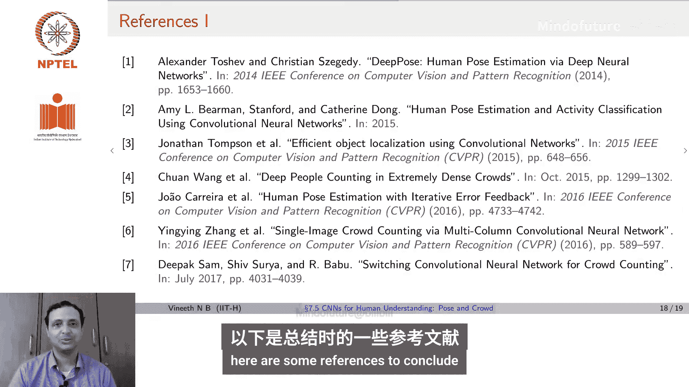

# 050：用于人体理解的CNN - 人体姿态估计与人群计数


## 概述
在本节课中，我们将学习卷积神经网络在人体理解任务中的两个重要应用：人体姿态估计和人群计数。我们将了解这些任务的定义、面临的挑战、评估指标以及基于深度学习的核心方法。

---

## 超越人脸理解
上一节我们介绍了人脸理解任务。实际上，卷积神经网络已被用于许多其他人体理解任务，例如手势识别、情绪识别和步态识别等。

为了展示任务的多样性，我们现在将探讨另外两个任务：使用深度学习和CNN进行人体姿态估计和人群计数。

---

## 人体姿态估计任务
人体姿态估计的任务是在图像和视频中定位人体关节（如肘部、手腕等）的问题。

这种任务可用于体育分析，或用于微软Xbox等设备，通过检测你的姿态来控制屏幕上的虚拟角色进行特定的网球击球或高尔夫挥杆动作。

---

## 现有方法分类
现有的人体姿态估计方法，特别是基于深度学习的方法，大致分为两类：
*   **单人姿态估计流程**：旨在获取图像帧中单个人的姿态。
*   **多人姿态估计流程**：图像帧中可能存在多个人，需要获取每个人的姿态。

下图展示了姿态估计模型的工作原理示意图。理想情况下，我们寻找的是图像中每个关节的位置。


---

## 任务挑战
这个任务与我们目前看到的任务（如图像级分类、检测、分割或人脸验证）不同。我们将在本讲座中了解如何使用CNN来完成此任务。

此外，当出现遮挡（尤其是自遮挡，即身体的一部分遮挡了另一部分）时，这个任务会变得非常具有挑战性。

---

## 评估指标
在讨论具体方法之前，我们首先需要知道如何评估人体姿态估计模型的性能。目前有一些公认的评估指标。

以下是几个关键指标：

*   **PCP（正确部位百分比）**：如果一个检测到的关节与真实关节之间的距离小于该肢体长度的一半，则认为该肢体被正确检测。根据所建模的身体部位不同，肢体有长有短。如果预测关节位置与正确关节位置之间的距离小于该肢体长度的一半，则认为这是一个相当正确的预测。这被称为PCP@0.5。如果考虑四分之一肢体长度，则称为PCP@0.25。

*   **PDJ（检测关节百分比）**：如果预测关节与检测关节之间的距离在躯干直径的某个分数范围内，则认为检测到的关节是正确的。可以将躯干直径作为所建模人物的中心尺度。例如，PDJ@0.2意味着要求预测关节与真实关节之间的距离小于所考虑人物躯干直径的0.2倍。

*   **基于OKS的mAP（目标关键点相似度平均精度）**：这可以看作是人体姿态估计中IOU的等效指标。其公式如下：

    ```
    OKS = Σ_i [exp(-d_i² / (2 * s² * k_i²)) * δ(v_i > 0)] / Σ_i [δ(v_i > 0)]
    ```

    让我们解释一下公式中的各个量：
    *   `d_i` 是检测到的关键点与对应真实关节之间的欧几里得距离。
    *   `v_i` 是真实关节的可见性标志。某些关节可能被其他关节遮挡，尝试获取该关节的正确估计可能是一项不可能完成的任务。通过为每个关节设置可见性标志，可以知道如果某个关节不可见，则该关节上的任何误差都可以被赋予较低的权重。
    *   `s` 是目标尺度。检测点与真实点之间的距离必须通过该特定目标的尺度进行归一化。如果图像中该目标非常大，这个距离可能相对较大；而对于同一图像中尺度较小的人物，这个距离则较小。
    *   `k_i` 是每个关键点的用户定义常数，可以视为控制衰减的超参数。

    可以看到，这个指标是距离的负指数函数，意味着它给出了预测好坏的程度，但同时考虑了关节的尺度和可见性来评估最终性能。

---

## 深度姿态估计方法
在明确了这些评估指标后，我们现在来讨论使用深度神经网络模型进行人体姿态估计的方法。

所有此类模型的先驱是2014年提出的 **DeepPose**。这可能是第一个启动基于深度学习的人体姿态估计的工作。

在该方法中，图像被输入模型，当时的架构自然是受AlexNet启发的，因为在2014年这是实践中最常见的模型之一。

与原始AlexNet架构的唯一区别在于输出空间。现在，不是预测整个图像的类别标签，而是预测一组关节的2D位置坐标 `(x_i, y_i)`。因此，输出 `y` 是一组 `y_i`，每个 `y_i` 包含对应关节的x、y坐标。

这里使用的损失函数是什么？损失函数将是每个关节位置相对于其真实位置的均方误差或L2范数。

---

## 级联回归器
该方法并未止步于此。为了进一步提高性能，它还使用了**级联回归器**来提高每个关节位置的精度。

这意味着什么？一旦在初始阶段识别出关节位置，就在关节位置周围裁剪出一个区域。该区域被缩放到整个CNN的输入大小，并再次预测该区域内关节位置的细化值，这有助于在多个阶段微调关节位置。

因此，这些裁剪后的图像在后续阶段被输入网络，这确保了在更精细的图像尺度上，可以获得精确的关键点位置作为输出。

---

## 迭代误差反馈方法
另一种在2016年提出的方法采用了不同的方向，也是一种基于迭代误差反馈的方法。

整个预测从一个**平均姿态骨架**开始，然后在多个步骤中进行迭代更新。给定一张输入图像和一个平均人体姿态骨架，神经网络的任务仅是预测与平均姿态骨架的偏差。

更详细地看这个过程：
1.  在第一阶段，`x_t` 是图像 `I` 本身。
2.  该图像被输入神经网络，神经网络为每个关节预测一个偏差 `ε_t`。
3.  这个 `ε_t` 被加到前一步的姿态 `y_t` 上，得到一个新的姿态 `y_{t+1}`。
4.  现在，将这个 `y_{t+1}` 覆盖在图像上，并围绕它裁剪出一个区域，再次用于细化误差和偏差，得到一个新的 `ε_t`。
5.  这个过程反复迭代，以获得姿态的最终估计。

视觉上，这里有几个示例。可以看到，在图像上覆盖了平均姿态（通常是直立的人），在每一步中，平均姿态都被调整以接近特定人物的姿态。经过四步后，预测的姿态变得接近最后一列显示的真实姿态。

这里还有更多具有挑战性的示例。同样，从站立姿态开始，经过几步，得到了人物蹲在特定位置的姿态。

---

## 基于检测的方法
我们之前看到的基于回归的方法试图预测关节位置。人体姿态估计的另一类方法是**基于检测的方法**，即一次性尝试获取每个关节区域的热图。

使用这种方法的工作之一在2015年提出，它还采用了从粗到细的多尺度策略来帮助细化这些热图，以获得更好的关节定位。

让我们看看这种方法。在该方法中：
1.  输入图像被输入一个**粗热图模型**，该模型给出关节位置的热图。这可能是一个经过微小修改的标准CNN骨干网络。
2.  对于预测的每个关节（可能位于特定热图的中心），在其周围裁剪出一个区域，然后使用一个**精细热图模型**来改进该特定位置的关节定位。

让我们更详细地看看这个精细热图模型。对于粗热图中的每个关节位置（可能是热图特定区域的中心），有一个多尺度金字塔。如果原始图像是64x64，则有128x128和256x256版本。相应地，裁剪出9x9、18x18和36x36的区域。

现在，这三个区域分别通过不同的卷积流程。9x9区域通过一个流程，18x18区域通过两个具有不同卷积滤波器的流程，36x36区域通过另一个不同的卷积+ReLU层流程。然后，所有这些特征图都被上采样到36x36（显然，最上面的不需要上采样），所有特征图被连接起来以进行最终预测，该预测对于该特定关节更加精确。这个细化过程有助于提高最终性能。

---

## 多人姿态估计
正如我们提到的，另一类方法是当图像中有多个人，需要估计每个人的姿态时。

这里主要有两种不同的流程，方法与我们之前看到的非常相似：

*   **自上而下流程**：在这种情况下，我们希望检测给定图像中所有人的姿态。因此，我们首先检测给定图像中的所有人物。然后，对于检测到的每个人的边界框，运行我们在前几张幻灯片中看到的单人姿态估计方法。如果需要，可以使用一些全局上下文信息来帮助细化姿态估计。

    这是一个示例：使用人体检测器检测到两个人，然后裁剪出这两个人，并使用基于回归或检测的方法运行单人姿态估计器，得到骨架。同样处理另一个人，然后将这两个骨架覆盖在输入图像上。

*   **自下而上流程**：这个过程相反，首先检测图像中的所有关键点，而不考虑它们属于谁。因此，可以使用基于检测的方法获得整个图像的热图，这些热图区域的中心可能是不同的关键点，但不知道哪个关键点属于哪个人。一旦检测到这些关键点，然后使用不同的方法将这些关键点关联到不同的人物实例。

    有关这些方法的更多细节，可以参考名为“基于深度学习的2D人体姿态估计”的综述。显然，在这种方法中，推理可能更快，因为同时处理所有人的信息，而不是通过不同的流程处理每个人的边界框。

---

## 人群计数任务
我们将探讨的另一个任务是人群计数。人群计数对于城市规划、公共安全、安保、治理等是极其重要的任务。然而，这在实践中可能是一项非常具有挑战性的任务。

你可能面临几个挑战，例如：
*   **遮挡**：如图所示，在这张图像的单个区域中，有许多不同的面孔（用绿点表示），彼此之间严重遮挡。
*   **复杂背景**
*   **尺度变化**：取决于相机拍摄的角度。
*   **图像中人物分布不均匀**
*   **透视畸变**
*   **旋转问题**
*   **光照变化**：例如在阴影中计数人数。
*   **天气变化**

所有这些都使得人群计数问题变得极其困难。

---

## 人群计数方法分类
使用CNN进行人群计数的现有方法可分为三种：

1.  **基础CNN方法**：使用基本的CNN架构来实现目的。输入图像通过一个简单的CNN，输出一个密度图。密度图热图中的峰值可以估计给定图片中的人数。
2.  **多列方法**：该方法的假设是，为了能够计数不同尺度的人脸（大人脸、小人脸等），需要使用多列方法，其中每一列关注不同尺度的人脸。可以看到，给定输入后，将其转换为多尺度金字塔形式，在每个单独的流程中尝试检测特定尺度的人脸。
3.  **单列方法**：这种方法再次采用单列，但试图观察多列方法的性能，并在一定程度上简化它们，以确保网络架构不会太复杂。

---

## 基础CNN方法
基础CNN方法将人群计数问题视为回归问题，给定图像，必须预测一个数字作为输出。

以下是一些训练数据点：给定一组人群正例图像及其计数，以及其他场景（人群计数为0）的负例图像。每个训练样本都通过CNN架构进行拟合，输出是该图像中的人数，可以直接通过回归（如L2损失或平滑L1损失）来解决。

这里可以扩展负样本集，因为获取没有人的图像（其真实计数为零）可能更容易，这有助于减少干扰并提高在正样本上的性能。

然而，可以看出这是一种粗略的方法，可能对人群密度分布、人物尺度等敏感。

---

## 多列CNN方法
这引出了基于多列的方法，这些方法试图解决人脸的尺度在图像中可能不同的问题。

在这种多列CNN中，每个单独的流程以不同尺度查看输入图像。可以看到这里有9x9、7x7和5x5的卷积滤波器，它们查看输入中的多个尺度。这有助于在最后获得更好的性能：在每个流程的最后几层之后，特征图被合并，然后通过一个1x1卷积层获得与输入相同分辨率的密度图。

这里有一些示例：给定测试图像和相应的真实密度图，可以看到估计的热图。如果需要计数，可以考虑使用这些热图的峰值来估计数量；在某些应用中，密度图本身可能就足够了。

---

## 带切换分类器的多列CNN
2017年的一项工作在多列CNN的基础上进行了扩展，引入了**切换分类器**的概念。

输入图像的每个区域被输入一个切换层，该层决定哪个分辨率是该区域的最佳尺度。因此，切换分类器（可以在最右侧看到）获取图像区域，然后输出一个结果，指示在CNN的三个尺度列中，哪个尺度适合在该区域检测人脸。现在，该区域被输入相应的CNN，并使用该尺度的密度图来获得最终结果。

为什么这有道理？这是因为在图像的局部区域内，人脸的尺度很可能保持在相同范围内，而在图像的另一个区域，尺度可能非常不同。因此，这种方法利用人群尺度的局部性，为每个区域切换相应的CNN流程，从而最终获得良好的性能。最后，它使用加权平均来融合可以在全局使用的特征。

---

## 单列CNN方法
单列CNN是从多列CNN衍生而来的，基于对其性能的一些观察。

2018年的首次努力观察到，在多列CNN中，单列在某些数据集上保留了约70%的准确率。那么，为什么要使架构复杂化呢？

因此，这里的单列CNN最初使用一组标准的卷积层，然后将来自较早层的特征图传递到经过反卷积后获得的较深层。可以看到，在卷积层6之后，连接了前一层的特征图，然后进行反卷积（相当于这里的上采样）以获得更高分辨率的图像。然后，将来自较早层的特征图添加到这个上采样图像中，得到新的特征图，这些特征图通过一组特定的卷积层，最后通过一个1x1卷积层获得最终的密度图。

在这个特定案例中，使用了反卷积而不是上采样或逐元素求和。此外，这项工作使用了基于密度图的损失和基于计数的损失来训练神经网络。因此，所有这些方法都假设真实密度图和总人数是已知的，因此可以使用与这两者相对应的损失进行反向传播并训练神经网络的其他部分。对于密度图，可以使用L2损失；对于计数，可以直接使用计数的L1损失（即预测计数与正确计数之差的绝对值）。

---

## 更近期的单列CNN
2019年提出的另一个更近期的单列CNN观察到，在多列CNN中，低级特征在人群计数上下文中具有非常相似的功能和特征。

因此，他们建议保留CNN初始层的相同流程，当进入较深层时，使用一个多尺度金字塔（称为**尺度金字塔模块**），该模块结合不同尺度的特征以获得密度图的最终输出。

在这个特定案例中，尺度金字塔模块是使用不同尺度的扩张卷积实现的，以便能够分析不同尺度的人脸，并将其放置在VGG16架构的conv4_3和conv5_1层之间。

这里有几个示例：给定图像、估计计数和正确计数。可以看到，在大多数情况下，估计计数在一定的误差容忍范围内与真实估计相当接近。

---

## 本课作业与思考
本课的作业是关于人体姿态估计的一篇很好的博客文章（来自Nanonets），以及2020年最新发布的关于密度估计和人群计数的综述。

如果你有兴趣，也可以阅读这篇关于2D人体姿态估计的综述。

本课的练习或思考实验是：CNN，特别是用于人体理解时，可能会受到数据集中偏见的影响。因此，根据特定数据集中占主导地位的种族（用于人体姿态估计或人脸识别），决策可能会受到这些统计数据的偏见影响。

在讨论如何解决这些偏见之前，你首先如何发现为基于人体的任务训练的模型是否存在偏见？请思考一下。

---



## 总结
在本节课中，我们一起学习了卷积神经网络在人体理解中的两个高级应用：人体姿态估计和人群计数。我们了解了它们的任务定义、核心挑战、评估指标（如PCP、PDJ、OKS），并深入探讨了多种深度学习方法，包括DeepPose、迭代误差反馈、基于检测的热图方法、多人姿态估计的流程（自上而下与自下而上），以及人群计数的基础CNN、多列CNN和单列CNN方法。最后，我们提出了关于模型偏见的思考，这是实际应用中需要关注的重要问题。